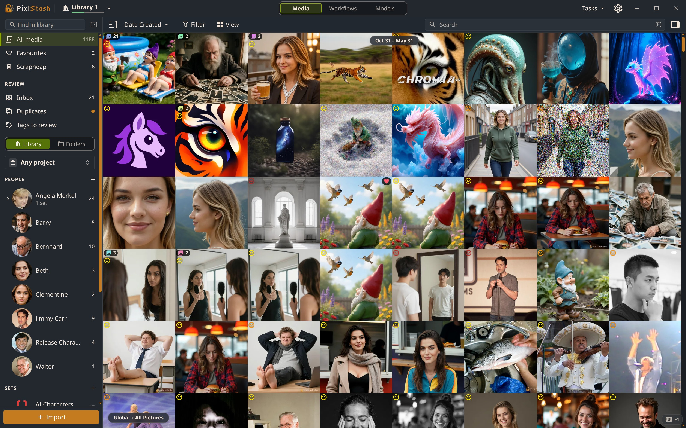
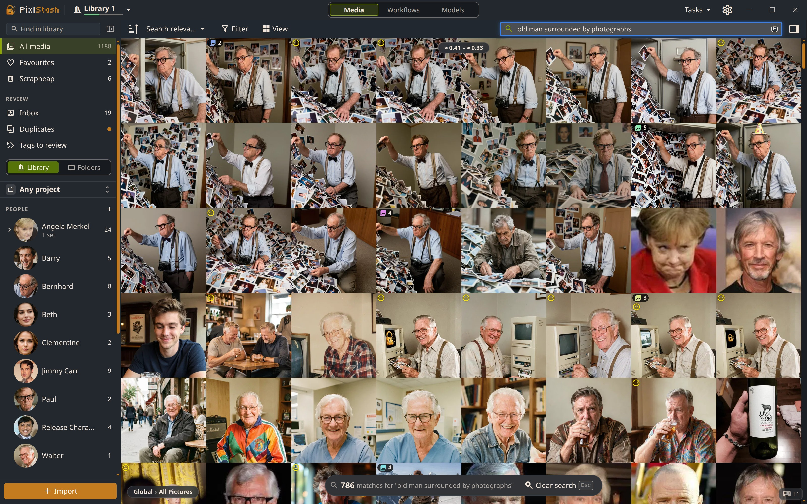
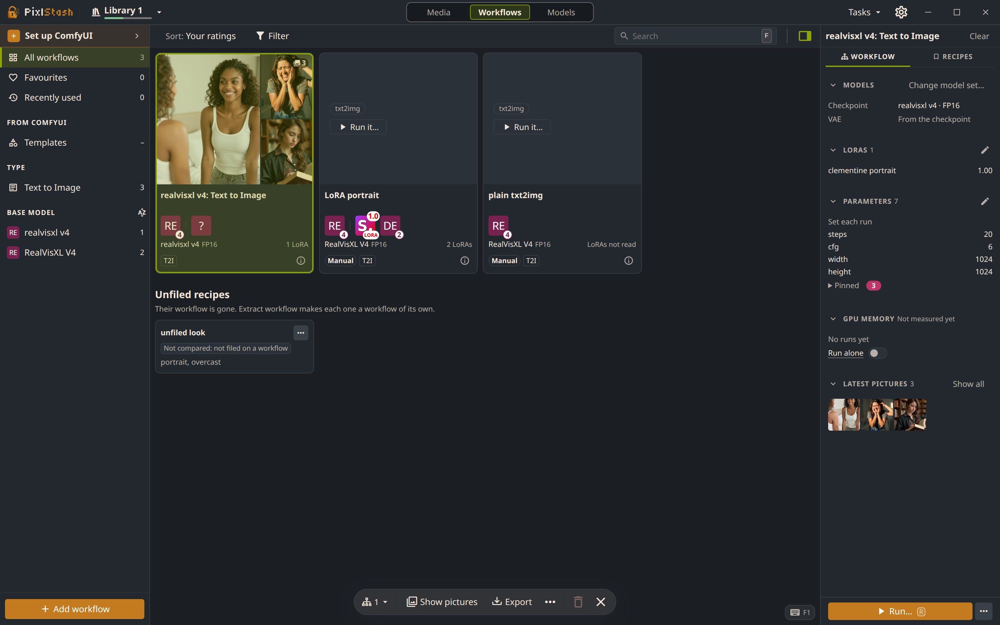
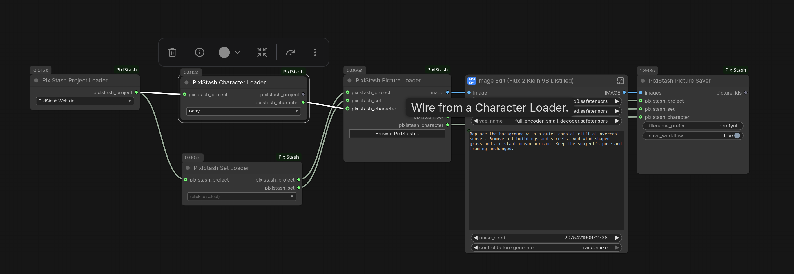
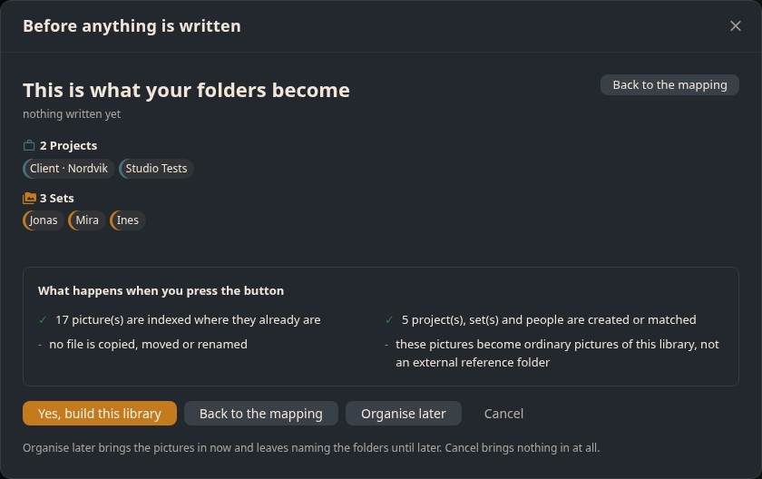
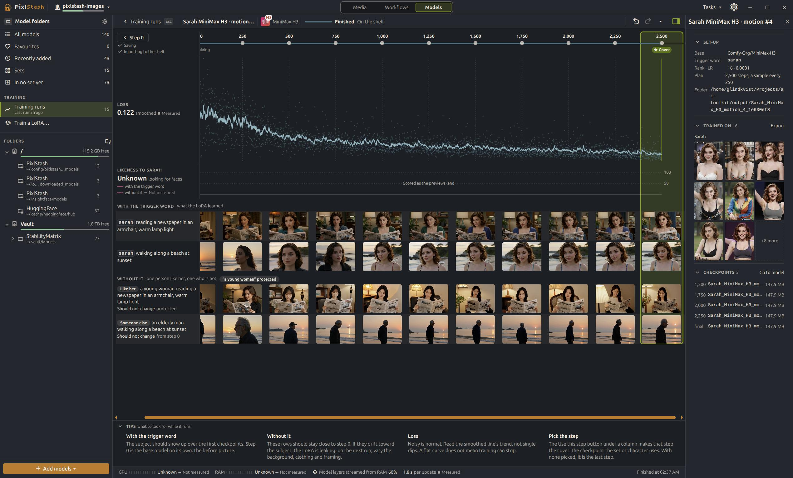

# PixlStash
<p align="center">
  
</p>

<p align="center">
  <a href="https://pixlstash.dev/install.html">
    
  </a>
  &nbsp;
  <a href="https://demo.pixlstash.dev?token=o75qQ-w0fy_FraPb2sdxcGOVTBoKFmmZwStycljomSs">
    
  </a>
</p>

PixlStash is an image library for photographers and creators. It searches,
tags, scores and organises large picture collections. Connect ComfyUI to
generate and edit pictures, and AI-toolkit to train LoRAs. Every model runs on
your own machine.

PixlStash is first of all a desktop app. The headless server, with the full
interface in a browser, is maintained alongside it.

## The 2.0 layout

The title bar switches between three workspaces:

- **Media**: the picture grid, with people, sets and projects in the sidebar
  and the selected pictures in the Inspector on the right.
- **Workflows**: your ComfyUI workflows as cards, their recipes, and the
  templates your ComfyUI serves.
- **Models**: the model shelf, your model folders and drives, and training
  runs.

The title bar also holds the library picker, which shows how full the
library's drive is, and a Tasks button for running work. It is the
same in the desktop app and in a browser.

## Features

### AI

- Semantic search with CLIP (OpenCLIP ViT-B-32) across the whole library,
  tagged or not. Text in documents, receipts and screenshots is read too, and
  the same search matches it.
- Face detection and recognition (InsightFace SCRFD-10G, buffalo_l or
  AuraFace), grouped into people you name. Search by one face, sort the grid
  by likeness to a person. *Reverse image search* in the right-click menu
  finds visually similar pictures.
- Tags and descriptions from the PixlStash Tagger, WD14, Florence-2 or
  JoyCaption, chosen per request. Re-tag or redescribe any selection from the
  right-click menu.
- A tag review queue that asks about the tags the models most likely got wrong
  or missed, and a health board per tag showing where to look next.
- Smart score sorting, character-likeness scoring, and calibrated anomaly
  detection for malformed anatomy and render defects (a DINOv3 ViT-B/16
  model).
- Object detection and segmentation with labelled boxes, exportable as COCO or
  Ideogram JSON.
- Every model runs on your own hardware: the CPU, an NVIDIA GPU (CUDA), the
  GPU of an Apple Silicon Mac, or an AMD GPU with ROCm (experimental). No
  cloud API.

<p align="center">
  
</p>

### Workflows and recipes

These use a ComfyUI, on this machine or another one. Settings › ComfyUI finds
a local one, installs the PixlStash nodes into it and links the two apps.

- **Two-way ComfyUI integration.** Run ComfyUI workflows from PixlStash, or
  use the PixlStash nodes inside your own workflows. Results come back tagged,
  with their people, sets and projects attached.
- **Workflow cards.** Every workflow your pictures were made with, plus the
  files you add, as a card covered with the pictures it made. Drop a workflow
  `.json` on the screen to add it. A Templates tab lists the templates your
  ComfyUI serves.
- **Editing in place.** Swap models, LoRAs and stages, expose or pin
  parameters, and save over the workflow with earlier versions kept, or save
  it as new. *Open in ComfyUI* loads models off your shelf, and Ctrl+S in
  ComfyUI saves a new version back to PixlStash.
- **A Recipe tab on every picture** made in ComfyUI, A1111 or Forge, videos
  included: prompt, models, LoRA strengths, seed and settings. Save a recipe,
  name it and run it again.
- **One Run popup** for rerunning a recipe, *Make more like these…*, running a
  workflow on a selection, and *Create with LoRA…* on a person or set. Video
  workflows run too, and two people can share one picture.
- **Runs that do not stop on a missing file.** A missing checkpoint, VAE or
  text encoder can be swapped for one on your shelf, a missing LoRA or seed
  node is worked around, and missing models can be downloaded from inside
  PixlStash.
- **Several ComfyUI connections**, such as this PC and a render box, picked
  from the Workflows sidebar's Run on menu.
- **GPU scheduling.** A run that does not fit in free GPU memory waits for
  room instead of running out of it. Tasks shows a memory bar per GPU and a
  ComfyUI row that can clear ComfyUI's memory, and Settings › GPU & compute picks
  which GPU PixlStash uses.

<p align="center">
  
</p>

<p align="center">
  
</p>

### Inpaint, crop and compare

- Paint a selection in the picture view's Edit tab (rectangle, ellipse, lasso,
  brush, eraser, colour wand), describe what goes there, and an inpaint
  workflow redraws only that part. Several inpaint workflows ship with
  PixlStash, and *Convert to Inpainting workflow* makes one from your own
  image-edit workflow.
- Crop and rotate without ComfyUI.
- Upscale with any workflow, including pictures you already have.
- A before/after slider for an edit and its original, or for any two pictures
  selected in the grid.
- Edit several selected pictures at once. By default each edit is a new
  picture in the original's stack.
- *Open with* sends a picture to another app; save over it there and the edit
  comes back stacked on the original.

### Your folders

- **Watched folders.** The library folder itself and any reference folders are
  watched: rename or move a picture in your file manager and it keeps its tags,
  score, people and sets. Import folders are watched for new files.
- **Add a library from a folder you already have.** PixlStash reads it where
  it sits and proposes which folder levels are projects, people, sets or tags.
  Nothing is written until you confirm, and no file is copied, moved or
  renamed.
- **Import folders** (Settings › Libraries & imports) bring new files in as
  they appear, such as ComfyUI's output folder. The **Inbox** under Review
  holds whatever you added lately that has no person or set yet.
- **Caption files** beside your pictures (`photo.txt`, `photo.caption`…) are
  read on import and can be kept in sync both ways.
- **Folder layouts** file new pictures into project, person or set folders.
- **Exports** to a zip or straight into a folder, with captions and sidecars.
  Generation data (the ComfyUI workflow, prompt and A1111 parameters) is
  stripped from exported PNG, JPEG and WebP pictures unless you choose to keep
  it.
- In the desktop app, Ctrl+C or a Ctrl-drag copies the selected pictures out
  as the original files.

<p align="center">
  
</p>

### Libraries, models and training

- **Multiple libraries** in one installation, one open at a time and switched
  from the title bar. Pictures, tags, scores, snapshots, API tokens and share
  links stay with their library; your account, preferences and model shelf
  are shared. Pictures can be moved from one library to another.
- **The model shelf** catalogues the folders holding your checkpoints, LoRAs,
  VAEs, text encoders, GGUF models, upscalers and ControlNets: kind, base
  model, precision, size and every folder a copy sits in. The folders keep
  themselves up to date, and new models in your Downloads folder are picked
  up.
- **Workflow sets**: a card per checkpoint listing the VAEs, text encoders and
  LoRAs that have run beside it, used to swap a workflow's models in one go.
- Look up a missing base model on Civitai by file hash (nothing is uploaded),
  and keep one copy of a duplicated model file.
- A **Folders tree** of your drives and model folders with free space per
  drive. Create, rename, move and remove folders, and drag or cut and paste
  models between them, across drives too.
- **LoRA training** from a person or a set with AI-toolkit, on your own GPU.
  The Train dialog fits the run to your GPU, measures your machine on the first
  run and gives a time estimate. *Create a training set…* on a person picks
  the pictures for you.
- **Training runs** have their own page: a loss curve with each checkpoint's
  previews under it, and the time left. For a person, every
  preview is rated for likeness. The finished LoRA goes on the shelf, attached
  to the person or set, and a run can be trained longer or retried. Runs
  trained in AI-toolkit outside PixlStash can be imported.
- **Plugins** add tagger and captioning engines to the engine picker, and image
  filters you apply to a selection from the grid.
- **`pixlstash-cli`** manages libraries, writes and restores backups, and
  installs plugins.

<p align="center">
  
</p>

### Browse and organise

- A fast grid, justified or square. Thumbnails appear at once and the details
  fill in after.
- People, picture sets and projects. Sets can sit inside a person or another
  set, and one person or set can belong to several projects.
- **Favourites**: press H to mark a picture. On a model, workflow set or
  workflow, it puts that item first in every list you pick from.
- **Tag groups.** Every library starts with default groups that file common
  tagger tags, tags that name a colour show their chip in that colour, and a
  Danbooru tag database (.xlsx or .csv) can be imported to file tags by its
  categories.
- Copy tags from one picture and paste them onto another or onto a selection.
- A search field that finds tags, faces, checkpoints, LoRAs and workflows as
  you type, metadata filters, and Union, Overlap, Difference and XOR on people
  and sets.
- Review queues for likely duplicates and for stacks whose pictures no longer
  match.
- Undo, redo and history, plus automatic snapshots with full or selective
  restore. Deleted pictures wait in the Scrapheap.
- Lock a finished set to freeze its tags, descriptions and scores. Sets can
  have their own icon and colour.
- Security notifications in the title bar when a fix is available.
- Keyboard shortcuts for navigation, selection, scoring and tagging.
- Read-only share links for pictures, sets, people and projects. Links can be
  revoked and can carry your watermark.
- View URLs you can bookmark or reload and land where you left off.
- A REST API, and `pixlstash-mcp` for AI agents ([below](#connecting-an-ai-agent-mcp)).

## How is this different from Immich?

Immich is a very good home photo server. If that's what you need, use it! PixlStash does a different job.

**PixlStash does the AI features Immich is known for.** CLIP semantic search,
InsightFace face recognition and reading the text in pictures are in here too,
along with duplicate detection. Immich does these well for the job it is built
for: finding a photo you already took. Immich also has mobile apps with
background sync, which PixlStash does not.

What PixlStash adds is everything that happens *after* you have found the
pictures. It is a tool for working with images rather than just storing them,
though it works as a home server too:

- Automatic tagging and captioning, with the engine selectable per request
- A tag review queue and a tag health board, so auto-tags are verified rather than trusted
- Quality, anomaly and character-likeness scoring, so a large set sorts by what is worth looking at
- Segmentation, reverse face search and reverse likeness search
- Two-way ComfyUI integration: control ComfyUI from PixlStash, or call its nodes from your own workflows. Generated images return tagged, with People, Picture Set, and Project associations attached
- A workflow library with recipes, inpainting and before/after comparison
- LoRA training from a person or a set, import of AI-toolkit runs, and dataset export
- A tagger plugin API, so a model we have never heard of shows up in the engine picker

Full breakdown, including a capability-by-capability comparison table:
[pixlstash.dev/ai.html](https://pixlstash.dev/ai.html).

## Install or try PixlStash

<p align="center">
  <a href="https://pixlstash.dev/install.html">
    
  </a>
  &nbsp;
  <a href="https://demo.pixlstash.dev?token=o75qQ-w0fy_FraPb2sdxcGOVTBoKFmmZwStycljomSs">
    
  </a>
</p>

PixlStash is available as a **native desktop app for Windows, macOS (Apple
Silicon), and Linux** (no Python or browser tab required), as a Docker image, or
as a pip package that runs anywhere Python does (including Intel Macs). The
desktop app ships a ready-to-run CPU runtime,
so it works offline out of the box, and auto-detects your hardware to offer
optional GPU acceleration (NVIDIA CUDA, or experimental AMD ROCm), which it
installs on demand straight from PyPI / PyTorch.

Detailed installation instructions on <a href="http://pixlstash.dev/install.html">pixlstash.dev</a>.


## First run and data location

On first run, PixlStash creates a user config directory and stores:

- Server config
- Database
- Imported media files

The **desktop app** uses this same platform user data directory, so a desktop
install shares its library with a pip or Docker install on the same machine. If
you add GPU acceleration, the desktop app stores the downloaded GPU wheels under
the app's own user-data directory.

> **Model downloads:** On first startup, PixlStash automatically downloads the AI models required for tagging, captioning, and quality scoring. This includes several hundred MB of model weights. Downloads are stored in the platform user data directory:
>
> | OS | Path |
> |----|------|
> | **Linux** | `~/.local/share/pixlstash/downloaded_models/` |
> | **macOS** | `~/Library/Application Support/pixlstash/downloaded_models/` |
> | **Windows** | `%LOCALAPPDATA%\pixlstash\downloaded_models\` |
>
> An internet connection is required the first time the server starts. Subsequent starts use the cached models.
>
> **Moving them somewhere else:** open **Model folders** on the model shelf and use **Move** on PixlStash's own folder. Every file in it is copied, verified and removed from the old location, and the new location is remembered — so nothing is downloaded again. Set `PIXLSTASH_BUILTIN_MODEL_DIR` instead if you want the folder somewhere else without moving what is already in it (a mounted model volume, typically).

If you need to use a custom config path:

```bash
python -m pixlstash.app --server-config "C:\path\to\server-config.json"
```

## Multiple libraries

PixlStash can register several independent image libraries and keep one open at
a time. Pictures, tags, scores, snapshots, guest sessions, and guest scores stay
with their library; your owner account and preferences stay with the
installation. API tokens and share links are pinned to the library where they
were created: they become inactive while a different library is open and work
again when you switch back. An API token for a script or an AI agent can be set
to work in every library instead (the **Every library** switch in the token
list, or **Use in every library** in **Connect AI agent**); it then acts on
whichever library is open. Only the owner, signed in from the local network,
can change that (a token cannot change it, its own included). A share link and
the ComfyUI link key always stay with their library.

**Settings → Libraries & imports** does all of it: add a library, rename one, switch
between them, and stop using one. **Add a library…** takes a single folder and
works out what it is — a library you already made is added as it is, with its
tags, scores and people; a folder of pictures is brought in as it stands; an
empty folder starts a fresh library. Nothing in that folder is moved, renamed
or copied.

**Stop using this** removes no file. PixlStash forgets the library, everything
inside the folder stays where it is, and adding the folder again brings back its
tags and its share links. The library you have open cannot be forgotten — switch
away from it first.

Managing libraries is available on the machine running PixlStash, or over your
local network or Tailscale, because it points the server at folders on that
machine. A session from further away can **see** the list — the names, and which
one is open — and nothing more: switching is on that same footing as adding and
removing, because it reloads every connected client and takes the outgoing
library's share links offline. It also sees no folder paths. Set
`allow_remote_host_ops` in server settings to lift all of it at once.

### The library command line

The same things can be done from a terminal, which is what a script or a cron
job wants. **Settings → Libraries & imports** shows the exact command for your
installation, with a copy button.

Run these on the machine hosting PixlStash, as the OS user that owns `hub.db`,
**with the same environment active that the server runs in** (activate the venv,
or use the same interpreter). That is the one assumption the short form makes;
if the commands are not found, see [Which form to type](#which-form-to-type)
below.

```bash
pixlstash-cli libraries list
pixlstash-cli libraries create /path/to/new-library --name "New library"
pixlstash-cli libraries attach /path/to/existing-library --name "Existing library"
pixlstash-cli libraries rename "Existing library" "Better name"
pixlstash-cli libraries relocate "Existing library" /new/path
pixlstash-cli libraries detach "Existing library"
pixlstash-cli libraries backup "Existing library" /path/to/backups/
pixlstash-cli libraries backup "Existing library" /path/to/backups/monday.tar.zst
pixlstash-cli libraries restore /path/to/backups/monday.tar.zst /path/to/new-library
```

| Command | What it does |
| --- | --- |
| `list` | Shows every registered library and marks the active one. |
| `create` | Creates the folder, starts an empty library in it, and registers it. |
| `attach` | Registers a library folder that already exists on disk. |
| `rename` | Changes the display name. Nothing on disk moves. |
| `relocate` | Points an existing registration at a new path, keeping its identity and share links. |
| `detach` | Forgets a library. **No files are removed and nothing inside the folder changes.** |
| `backup` | Writes the library and the hub to a single archive. |
| `restore` | Unpacks an archive into a **new** folder and makes it the library that opens. |

Notes worth knowing before you need them:

- `detach` refuses the **active** library. Switch to another one first.
- Reattaching the same folder revives its original registration, including its
  share links, because a library carries a fingerprint of its own identity.
- A backup is a **zstd-compressed tar**, named `.tar.zst` — not `.tar.gz`.
  `--no-compress` writes a plain `.tar` instead. Given a folder, `backup`
  invents a dated name with the right ending; given a filename, it adds the
  right ending if you left it off. `restore` recognises an archive by its
  contents, so a renamed file still works.
- A backup contains `hub.db`, and therefore your login and token secrets.
  PixlStash writes it owner-readable and refuses to overwrite an existing file.
- A backup covers the library folder. Pictures kept in **reference folders** live
  outside it and are *not* included, so back those up separately.
- Backing up finishes any outstanding one-time snapshot cleanup first, so the
  archive never carries credentials from before your upgrade.
- `restore` needs PixlStash stopped, and names a folder that is empty or does
  not exist yet — it never writes over a library. Because the archive holds the hub,
  restoring also brings back the password and API tokens that library was
  using, so your current ones are replaced.
- **`restore` does not delete your current setup.** It *moves*
  `server-config.json` and `hub.db` into a dated `pre-restore-*` folder beside
  themselves and prints the launch command for each, so
  `pixlstash-server --server-config <pre-restore-*>/server-config.json` reopens
  what you had. Your old library folder is never touched.

#### Which form to type

The commands above assume `pixlstash-cli` is on your `PATH`, which is true once
the environment PixlStash is installed into is active.

- **Source checkout**, or an environment you have not activated:
  `python -m pixlstash.cli libraries list`
- **Docker Compose**, for a running service (paths are inside the container):
  `docker compose exec pixlstash pixlstash-cli libraries list`
- **Desktop app** (AppImage, deb, .dmg, installer): the app is its own CLI, so
  `/path/to/PixlStash.AppImage cli libraries list` works whether or not the app
  is running. On Windows that route is the bundled interpreter instead, because
  the app's own launcher is a GUI binary no shell waits for. Turn on Settings ›
  Backend › Desktop › **Shell command** to get a `pixlstash` command
  (`~/.local/bin` on Linux and macOS, `%LOCALAPPDATA%\PixlStash\bin` — added to
  your user `PATH` — on Windows) and type `pixlstash libraries list` instead;
  open a new terminal afterwards. Either form targets the desktop app's own hub;
  there is no need to pass `--hub`. Settings › Libraries & imports always shows the exact
  command for your install.
- **A different hub** than the default: put global options *before* `libraries`,
  e.g. `pixlstash-cli --hub /path/to/hub.db libraries list`. Without `--hub` the
  CLI uses the standard config location, which is what you want almost always.

### Required one-shot preparation when upgrading

If an older installation already has its owner and tokens inside `vault.db`,
normal startup deliberately will not guess from the config file or from
finding an existing vault; it needs that exact legacy vault authorized once.

- **Desktop app:** setup performs this step only after you explicitly approve
  importing the detected legacy owner and tokens.
- **`pixlstash-server` / `python -m pixlstash.app`, in an interactive
  terminal:** startup detects the unprepared legacy vault itself and asks,
  with a plain explanation and a `[y/N]` prompt — defaulting to **no**, since
  this is irreversible — before doing anything. Saying yes does the same thing
  the CLI command below does, in the same startup, so no separate step or
  restart is needed. After this runs, the vault is no longer readable as an
  owner/token store by versions of PixlStash older than the hub — the prompt
  says so before you answer.
- **Non-interactive launches** (a service, a container, redirected stdin) log
  that the legacy vault needs preparing instead of asking, and the CLI command
  below remains the
  way to authorize the migration ahead of time.

Pip installation:

```bash
pixlstash-cli --hub /path/to/config-dir/hub.db libraries prepare-legacy-identity /path/to/library
```

Source checkout:

```bash
python -m pixlstash.cli --hub /path/to/config-dir/hub.db libraries prepare-legacy-identity /path/to/library
```

Docker Compose, before bringing the upgraded service up (adjust the two
container paths if you configured custom mounts):

```bash
docker compose run --rm --entrypoint pixlstash-cli pixlstash \
  --hub /home/pixlstash/.config/pixlstash/hub.db \
  libraries prepare-legacy-identity \
  /home/pixlstash/.config/pixlstash/images
```

After the command succeeds, start PixlStash normally. Startup verifies the
approved path and identity digest, copies the owner/tokens into the hub, stamps
the library, and only then removes portable owner, token, and guest-session data
from the live vault and its historical snapshots. New snapshots and every
restore scratch database receive the same sanitation, so identity remains
hub-only. If verification fails, the hub does not mark the migration complete;
correct the reported problem and retry.

## Server configuration

On first run, PixlStash generates a `server-config.json` file in the user config directory:

- **Linux / macOS:** `~/.config/pixlstash/server-config.json`
- **Windows:** `%LOCALAPPDATA%\pixlstash\server-config.json`

You can also supply a custom path with `--server-config <path>`.

On first run in an interactive terminal, PixlStash now launches a short setup wizard for:

- `image_root` (storage path)
- `port`
- `require_ssl` (HTTP/HTTPS)

Before the server starts, bootstrap also offers to set (or replace) the
initial username/password.

You can rerun the wizard at any time with:

```bash
python -m pixlstash.app --bootstrap
```

When rerunning the wizard, pressing Enter keeps existing values as defaults.

Edit the file and restart the server to apply changes.

### Network and port

| Key            | Default       | Description                                                                                                                                               |
| -------------- | ------------- | --------------------------------------------------------------------------------------------------------------------------------------------------------- |
| `host`         | `"localhost"` | Address the server binds to. Change to `"0.0.0.0"` to expose the server on the local network or internet.                                                 |
| `port`         | `9537`        | TCP port the server listens on.                                                                                                                           |
| `cors_origins` | `[]`          | Extra origins allowed to make credentialed cross-origin requests. `localhost`, `127.0.0.1`, and the server's own LAN IP are always permitted on any port. |
| `require_local_for_write` | `true` | When `true`, full login (username/password and ALL-scope tokens) is only permitted from local network addresses (RFC 1918 / loopback). READ-only share tokens are always accepted from any IP. Set to `false` to allow full login from any IP. |
| `trusted_proxies` | `[]` | List of proxy IP addresses whose `X-Forwarded-For` header should be trusted for real-client-IP detection. See [Sharing and remote access](#sharing-and-remote-access) below. |

At startup the server detects its own LAN IP and automatically allows it on any port. This means the Vite dev server works over LAN (`http://<lan-ip>:5173` → `http://<lan-ip>:9537`) without any extra configuration, as long as network access is enabled via `host`.

Use `cors_origins` only if you need to allow origins on a different machine entirely.

### Sharing and remote access

PixlStash supports read-only share tokens that let you give guests access to
a specific picture, picture set, character, or project without exposing your full
account. To safely share over the internet while keeping your login protected:

1. **Expose the server** — set `"host": "0.0.0.0"` and open/forward the port.
2. **Enable HTTPS** — set `"require_ssl": true` (strongly recommended whenever
   the server is internet-facing; see [SSL / HTTPS](#ssl--https) below).
3. **Keep `require_local_for_write: true`** (the default) — this ensures that
   full login is only possible from your local network or VPN. Share tokens
   (READ-only) continue to work from any IP.
4. **Create a share token** — in the PixlStash settings UI, create a READ-only
   token scoped to the resource you want to share. Copy the generated URL and
   send it to your guests.

#### If you run a reverse proxy (nginx, Caddy, Cloudflare Tunnel…)

When a proxy sits in front of PixlStash, `require_local_for_write` sees the
proxy's IP instead of the real client IP. You must tell PixlStash which proxy
addresses to trust so it reads the real IP from the `X-Forwarded-For` header:

| Scenario | `trusted_proxies` value |
|---|---|
| nginx/Caddy on the same machine | `["127.0.0.1"]` |
| Cloudflare Tunnel (cloudflared on same machine) | `["127.0.0.1"]` |
| Proxy on a different LAN machine | `["192.168.1.x"]` (the proxy's LAN IP) |

Example:
```json
{
  "host": "0.0.0.0",
  "require_ssl": true,
  "require_local_for_write": true,
  "trusted_proxies": ["127.0.0.1"]
}
```

> **Warning:** Only add addresses you control to `trusted_proxies`. Trusting an
> untrusted address allows that host to spoof any client IP, bypassing the local
> network restriction entirely.

### SSL / HTTPS

| Key               | Default                     | Description                                                                   |
| ----------------- | --------------------------- | ----------------------------------------------------------------------------- |
| `require_ssl`     | `false`                     | Enable HTTPS. When `true`, the server will use the key and certificate below. |
| `ssl_keyfile`     | `<config_dir>/ssl/key.pem`  | Path to the SSL private key file.                                             |
| `ssl_certfile`    | `<config_dir>/ssl/cert.pem` | Path to the SSL certificate file.                                             |
| `cookie_samesite` | `"Lax"`                     | `SameSite` attribute for session cookies (`"Lax"`, `"Strict"`, or `"None"`).  |
| `cookie_secure`   | `false`                     | Set the `Secure` flag on session cookies. Enable when serving over HTTPS.     |

When `require_ssl` is enabled and no certificate files exist at the configured
paths, PixlStash generates a **self-signed certificate** automatically. Browsers
will show a security warning for self-signed certs. To get a trusted certificate
without warnings, choose one of the options below.

#### Option A — Replace the auto-generated certificate with a real one

If you already have a certificate (e.g. from certbot or your DNS provider), drop
the files into the config directory and restart:

| OS | Default cert directory |
|----|------------------------|
| Linux / macOS | `~/.config/pixlstash/ssl/` |
| Windows | `%LOCALAPPDATA%\pixlstash\ssl\` |

Place your private key as `key.pem` and the full certificate chain as `cert.pem`,
or point `ssl_keyfile` / `ssl_certfile` at any paths you prefer.

To obtain a cert with **certbot** (requires port 80 reachable and a real domain):

```bash
certbot certonly --standalone -d pixlstash.example.com --email you@example.com
```

Then in `server-config.json`:

```json
{
  "require_ssl": true,
  "cookie_secure": true,
  "ssl_keyfile": "/etc/letsencrypt/live/pixlstash.example.com/privkey.pem",
  "ssl_certfile": "/etc/letsencrypt/live/pixlstash.example.com/fullchain.pem"
}
```

Certbot installs a systemd timer / cron job that renews automatically. The
`--standalone` renewal briefly needs port 80; use a
[pre/post hook](https://eff-certbot.readthedocs.io/en/latest/using.html#pre-and-post-validation-hooks)
to stop and restart PixlStash around the renewal if it is bound to port 80.

#### Option B — Caddy as a reverse proxy (automatic Let's Encrypt)

[Caddy](https://caddyserver.com/) provisions and renews a trusted TLS certificate
automatically whenever it proxies a request for a real domain. No manual cert
management required.

1. Install Caddy: `sudo apt install caddy` (or see [caddyserver.com](https://caddyserver.com/docs/install))
2. Create `/etc/caddy/Caddyfile`:
   ```
   pixlstash.example.com {
       reverse_proxy localhost:9537
   }
   ```
3. `sudo systemctl reload caddy`

PixlStash itself can stay on plain HTTP (`require_ssl: false`); Caddy terminates
TLS externally. Set `"trusted_proxies": ["127.0.0.1"]` in `server-config.json`
so that `require_local_for_write` correctly identifies the real client IP (see
[Sharing and remote access](#sharing-and-remote-access)).

#### Option C — Cloudflare Tunnel (no open port, no domain purchase required)

[Cloudflare Tunnel](https://developers.cloudflare.com/cloudflare-one/connections/connect-networks/)
routes traffic to PixlStash through Cloudflare's edge without opening any inbound
firewall ports. Cloudflare provides a free `*.trycloudflare.com` subdomain with a
valid TLS certificate, or you can use your own domain.

```bash
# Install cloudflared, then:
cloudflared tunnel --url http://localhost:9537
```

Cloudflare terminates TLS; PixlStash runs plain HTTP internally. As with Caddy,
set `"trusted_proxies": ["127.0.0.1"]` so local-write restrictions work correctly.

### Storage

| Key             | Default               | Description                                                                                                                  |
| --------------- | --------------------- | ---------------------------------------------------------------------------------------------------------------------------- |
| `image_root`    | `<config_dir>/images` | Directory where imported media files are stored.                                                                             |

Automatic import folders are stored in the database and managed via the
Import Folders UI/API, not in `server-config.json`.

### Processing

| Key                              | Default        | Description                                                                                                  |
| -------------------------------- | -------------- | ---------------------------------------------------------------------------------------------------------- |
| `default_device`                 | `"cpu"`        | Device used for AI processing (`"cpu"` or `"cuda"`).                                                        |
| `insightface_model_pack`         | `"buffalo_l"`  | InsightFace model pack used by the face detection / recognition pipeline. One of `"buffalo_l"` or `"auraface"`. |
| `generate_thumbnails_on_startup` | `true`         | Generate missing thumbnails when the server starts.                                                         |

#### Face model pack and licensing

`insightface_model_pack` selects which InsightFace model pack powers face
detection and face recognition. The licensing decision is yours;
PixlStash simply makes the choice available.

- **`buffalo_l`** (default): the standard InsightFace pack. Its recognition
  weights are trained on the WebFace600K dataset, which is licensed for
  **non-commercial research use only**. This is the right choice for personal
  and research use, and it downloads automatically on first use.
- **`auraface`**: the [`fal/AuraFace-v1`](https://huggingface.co/fal/AuraFace-v1)
  pack, whose weights are **Apache-2.0 licensed** and therefore suitable if you
  need to use face features in a **commercial** setting. It uses the same
  SCRFD-10G face detector as `buffalo_l`, so switching only changes the
  recognition embedding. When selected, PixlStash downloads the pack from a
  pinned HuggingFace revision into `~/.insightface/models/auraface/` on first
  use. If the automatic download fails (for example, no network access), you can
  place the pack's `.onnx` files in that directory manually and restart.

Changing this setting on an existing library does **not** delete your faces or
your manual character assignments. PixlStash detects faces whose embeddings came
from a different pack and refreshes those embeddings in place, in the background,
keeping each face's identity intact. New imports are always processed first, so a
refresh sweep never starves brand-new pictures.

To remove stale database records for missing source files at startup, run:

```bash
python -m pixlstash.app --cleanup-missing-pictures
```

### Logging

| Key         | Default                   | Description                                                  |
| ----------- | ------------------------- | ------------------------------------------------------------ |
| `log_level` | `"info"`                  | Log verbosity (`"debug"`, `"info"`, `"warning"`, `"error"`). |
| `log_file`  | `<config_dir>/server.log` | Path to the log file.                                        |

### Example config

```json
{
  "host": "localhost",
  "port": 9537,
  "log_level": "info",
  "require_ssl": false,
  "image_root": "/home/user/.config/pixlstash/images",
  "default_device": "cpu",
  "insightface_model_pack": "buffalo_l",
  "generate_thumbnails_on_startup": true
}
```

## Upgrade PixlStash

<p align="center">
  <a href="https://pixlstash.dev/upgrade.html">
    
  </a>
</p>

Detailed installation instructions on <a href="http://pixlstash.dev/upgrade.html">pixlstash.dev</a>.

## Installing plugins

PixlStash supports built-in plugins and user-created plugins.

### With the CLI (recommended)

```bash
pixlstash-cli plugins available                     # what is published
pixlstash-cli plugins available caption             # ...matching a word
pixlstash-cli plugins install hello_world_stamp     # from the plugins repository
pixlstash-cli plugins install ./my_captioner.zip    # a zip of a plugin folder
pixlstash-cli plugins install ./my_captioner/       # an extracted folder
pixlstash-cli plugins install ./my_filter.py        # a single module
pixlstash-cli plugins test ./my_captioner.py       # does it load and render?
pixlstash-cli plugins list
pixlstash-cli plugins remove my_captioner
pixlstash-cli plugins create                          # start writing one
pixlstash-cli plugins submit                          # ...and open its PR
```

`plugins available` lists what
[PixlStash-plugins](https://github.com/Pikselkroken/PixlStash-plugins) publishes,
with each plugin's name, title, one-line summary and (where declared) author and
licence; `*` marks one you already have. Add a word to search, and it matches
any of those fields, so anything you can see in the listing you can search for.
It downloads the same archive `install` does and reads it without importing
anything, so it needs no token and runs no published code.

The destination differs by kind (captioning plugin or image filter) and by
shape, so `install` works it out from the source instead of asking you to type
it: it reads the source without importing it, decides which base class it
derives from, and names the installed file after the plugin's own `name`. It
refuses a source that is not a plugin, one whose name collides with a built-in,
and a zip whose entries would be unpacked outside the folder it is unpacked
into.

`--dry-run` prints the plan and stops, `--yes` skips the confirmation, `--force`
replaces an existing plugin of the same name, and `--strict` turns the warnings
into refusals. `--ref` picks a branch, tag or commit in the plugins repository
and is ignored for local sources; it cannot point the download at a different
repository. A plugin's `requirements.txt` is never installed unless you pass
`--with-deps`. **Plugin code runs unsandboxed, in the server process, with your
permissions** — install what you would run yourself.

Captioning plugins load at server start, so restart PixlStash after installing
one; image filters are re-scanned every time the Filters menu is listed.

`plugins test` is for the person *writing* a captioning plugin, and it is the
one verb that imports the plugin instead of reading it: it loads the file the
way the server does, registers what it defines, and checks that the parameter
schema is one the settings screen can render — so a typo costs a command rather
than a restart, and it ends by listing the connections, programs and file
writes it saw the plugin make while it ran. `--image PATH` runs it over one
picture as well, and stops
instead of running when the plugin reports its model is not present — though a
plugin that downloads inside `init()` still will, since by then it is the
plugin's code deciding.

**It is a development aid, not a security scanner.** It does not tell you
whether a plugin is safe to install — it *runs* the plugin, unsandboxed, with
your permissions, which is exactly what the server would do. Only test a plugin
you would have installed anyway.

### User plugin directory

If you prefer to copy files by hand, they go in the platform-specific user data
directory. PixlStash logs the exact path on startup, and
`pixlstash-cli plugins list` prints it.

| OS | Image filters | Captioning plugins |
|----|---------------|--------------------|
| **Linux** | `~/.local/share/pixlstash/image-plugins/user/` | `~/.local/share/pixlstash/tagger-plugins/user/` |
| **macOS** | `~/Library/Application Support/pixlstash/image-plugins/user/` | `~/Library/Application Support/pixlstash/tagger-plugins/user/` |
| **Windows** | `%LOCALAPPDATA%\pixlstash\pixlstash\image-plugins\user\` | `%LOCALAPPDATA%\pixlstash\pixlstash\tagger-plugins\user\` |

The doubled `pixlstash\pixlstash` on Windows is not a typo: `platformdirs` puts
the app under a vendor folder, and PixlStash passes no separate vendor name.
This table used to show it singly, which is why copying a plugin there by hand
appeared to do nothing.

An image filter is always a single `.py` file. A captioning plugin may be a
single `.py` file or a folder containing `__init__.py`.

### Writing a plugin

```bash
pixlstash-cli plugins create
```

Run with no arguments it is a wizard. It works out first whether it can fork
[PixlStash-plugins](https://github.com/Pikselkroken/PixlStash-plugins) for you,
and names the repository it would create:

```
This will create https://github.com/you/PixlStash-plugins, a public fork of
Pikselkroken/PixlStash-plugins on your account, and clone it.
```

If you already have that fork it says so, and that it will be reused rather
than created. If it cannot fork at all it says why: `gh` missing, or `gh` not
signed in.

Then it asks what kind of plugin you are writing, and that question carries the
way out:

```
What kind of plugin is it?
  1  image       turns a picture into another picture (the Filters menu)
  2  captioning  turns an image into tags or a description
  3  abort       stop here, creating nothing
Choose [1]:
```

Answer with the number or the name. `3` stops with nothing forked, cloned or
created, and the question is asked before any of those happen for exactly that
reason. After it, you are asked what the plugin should do and what to call it.

Everyone contributes from a fork, maintainers included. A plugin reaches the
repository as a pull request or not at all, and a shortcut for the few people
with write access would be a second path that only those people ever exercise.

From those answers it clones, branches, copies one of the repository's example
plugins into `plugins/<kind>/<name>/`, renames its folder, module and class,
puts your git identity and your licence in the header, writes what you said it
should do into the plugin's README and docstring, and prints the commands that
open the pull request. Nothing is committed or pushed: the plugin at that point
is still the example.

Last, it offers a command that hands the job to a coding agent:

```bash
cd /home/you/PixlStash-plugins && claude 'Read plugins/image/edge_glow/BRIEF.md and do what it says.'
```

One line, because the command is the part that gets pasted. The brief itself is
written to disk as `BRIEF.md` inside the new plugin's folder, where it can be
read, edited and re-run without retyping anything. It says what you asked the
plugin to do, that the folder holds a renamed copy of an example whose
behaviour must be replaced rather than described, what "done" looks like, and
that it should delete itself when finished. `BRIEF.md` is gitignored, so
forgetting cannot put it in the pull request.

The command carries its own `cd`, because the brief is named relative to the
checkout and the agent reads that checkout's instructions: pasted anywhere else
it would find neither.

For everything general, the brief points at the plugins repository's own
[`AGENTS.md`](https://github.com/Pikselkroken/PixlStash-plugins/blob/main/AGENTS.md)
(and a byte-identical `CLAUDE.md`) that both agents read on their own, covering
the contract to follow, the header rules, what a plugin README needs and the
commands to finish with. Restating any of that in the prompt would be a second
copy of instructions that repository maintains and its tests keep honest. All
the command adds is which README holds the brief.

It is printed rather than run: starting an agent on your checkout is your call,
and you should read what it writes before committing it.

### Submitting it

```bash
cd PixlStash-plugins
pixlstash-cli plugins submit
```

`submit` is the other half of `create`, and there is nothing to type because
the branch already names the plugin. It runs the plugins repository's own
checks with that checkout's `.venv` if it has one (its ruff is pinned, and a
different version formats differently), stages the one plugin folder, commits
it, pushes the branch and opens the pull request.

A failing check stops it, which is the point: the same failure found in CI
costs a red pull request and a force-push. `--dry-run` runs the checks and
stops; `--skip-checks` runs none of them.

It asks one thing first: what you tested the plugin against, which model, which
PixlStash version, on what hardware. That goes in the pull request body,
verbatim and with nothing else read off your machine. CI checks the shape of a
model-backed plugin and never runs the model, so that sentence is what makes it
reviewable at all. Pushing and opening the PR are confirmed before they happen
(`--yes` skips the question).

Everything the wizard asks can be given as an option instead, and giving a name
and `--kind` skips the questions entirely:

```bash
pixlstash-cli plugins create edge_glow --kind image \
  --purpose "Adds a soft glow around every edge." --agent claude
```

It copies the example the plugins repository's own CI keeps green, rather than a
template kept here, so a scaffold cannot be out of date with the contract tests
it has to pass. `--from` starts from a different published plugin,
`--display-name`, `--description`, `--author` and `--license` fill in the
header, `--dir` says where the checkout goes, and `--no-fork` skips the fork.

To write one by hand instead, start from
`pixlstash/image_plugins/built-in/plugin_template.py` in this repository:

1. Create a new `.py` file in your user plugin directory.
2. Subclass `ImagePlugin`, set a unique `name` and `plugin_id`, and implement `run()`.
3. Restart PixlStash Server — plugins are loaded at startup.

`plugin_template.py` is ignored by plugin discovery and will not be loaded as a plugin.

### Plugin licensing

PixlStash backend core is GPL-3.0, but the plugin authoring API files
`pixlstash/image_plugins/base.py` and
`pixlstash/image_plugins/built-in/plugin_template.py` are MIT-licensed.

This means user plugins that only rely on that plugin API/template may use any
license chosen by the plugin author.

If a plugin copies substantial GPL backend code or depends directly on other
GPL-only backend internals, different obligations may apply.


## Connecting an AI agent (MCP)

`pixlstash-mcp` is an [MCP](https://modelcontextprotocol.io) server: an agent
can search the library and read pictures, tags and ComfyUI recipes. By default
it has no tools that change anything; `--allow-write` adds workflow editing
(see [Read and write workflows](#read-and-write-workflows)). It talks to a
running PixlStash server with an API token and sees exactly what that token
sees.

The quickest way in is **API Tokens → Connect AI agent** in your account
settings: it mints a read-only token (unless you choose **Read and write
workflows**) and hands back the finished configuration to paste, either a one-line `claude mcp add …` or the `mcpServers` block below.
That token covers the whole library. To narrow it to one set, character or
project, mint a **Read-only share** token with **New token** instead and put it
in the configuration yourself.

A token works only in the library that was open when you made it, so the agent
is refused once you switch. If you keep several libraries, turn on **Use in every
library** before creating it (or turn on **Every library** for it in the token
list afterwards): the agent then sees whichever library is open.

For read-only use, do not give it a full-access token: any agent that can read
its own config file then has full owner control of PixlStash - not just read
access to your pictures - because that token authorises writes, deletes and the
local-only filesystem endpoints, and nothing here limits what else the agent
does with it. Write mode needs exactly that token, and that is its cost.

`get_recipe` also asks your ComfyUI whether a recipe's nodes and models are
installed.

```json
{
  "mcpServers": {
    "pixlstash": {
      "command": "pixlstash-mcp",
      "env": { "PIXLSTASH_TOKEN": "<your read-only token>" }
    }
  }
}
```

That goes in your MCP client's own configuration file. In Claude Desktop that
is **Settings → Developer → Edit Config**; other clients document their own
location. If the file already lists servers, add the `"pixlstash"` entry inside
the existing `"mcpServers"` block rather than replacing the file, or you will
drop the servers already there.

No address is needed: `pixlstash-mcp` reads the port, the scheme and the
certificate out of your `server-config.json`, the same file the server reads,
so it keeps working if you change any of them. If you have **Require SSL** on,
it connects over https and trusts PixlStash's own self-signed certificate.
The desktop app keeps a separate `server-config.json`, and its shim passes that
path with `--server-config`; point a hand-written config at it the same way. Pass `--url` (or set `PIXLSTASH_URL`) only to point it at
a different machine. **Do not copy the address out of the desktop app's
window** - that is an ephemeral port the desktop shell picks afresh on every
launch, so it stops resolving the next time PixlStash starts.

**Desktop app:** you do not need to install anything. Turn on **Shell command**
in Settings and the app puts both `pixlstash` and `pixlstash-mcp` on your PATH,
forwarding to the interpreter it already ships. Nothing is installed into any
Python environment of your own.

Running from a checkout instead, `pip install -e .` provides `pixlstash-mcp`
in that virtualenv. If your MCP client then reports
`Executable not found in $PATH: "pixlstash-mcp"`, it is not inheriting that
environment; give it the absolute path, which `which pixlstash-mcp` prints in a
shell where PixlStash runs.

Tools: `search_pictures`, `list_pictures`, `count_pictures`, `get_picture`,
`view_picture`, `list_tags`, `list_sets`, `list_characters`, `list_projects`,
`list_picture_workflows`, `get_recipe`.
`list_picture_workflows` lists the workflows the pictures the token can see were
made with, how many pictures each, and the LoRAs each one loads.
`list_pictures` and `search_pictures` also narrow by `set_id`, `character_id`,
`project_id` and `tags`; `list_pictures` and `count_pictures` also by the
`workflow_id` a recipe names. `get_recipe` says whether the model forks into
several sampler passes and which LoRAs feed each, and gives the path that opens
the picture's workflow in PixlStash.

The MCP server reads `PIXLSTASH_TOKEN` once, when it starts. After you replace
or revoke the token, restart or reconnect it in your MCP client.

### Read and write workflows

Choose **Read and write workflows** in **Connect AI agent** and the agent can
also edit and store workflow graphs and start runs. The dialog mints a
full-access token and adds `--allow-write` to the configuration:

```json
{
  "mcpServers": {
    "pixlstash": {
      "command": "pixlstash-mcp",
      "args": ["--allow-write"],
      "env": { "PIXLSTASH_TOKEN": "<your full-access token>" }
    }
  }
}
```

Every workflow route is owner-only, so a read-only or shared token cannot use
these tools, and `pixlstash-mcp` says so at start-up. The flag decides which
tools are offered; it does not limit the token, which can do anything you can.

Extra tools: `list_workflows`, `get_workflow`, `export_workflow_graph`,
`import_workflow_graph`, `preflight_workflow`, `run_workflow`,
`get_workflow_run`.

`import_workflow_graph` with a `workflow_id` saves the edited graph over that
workflow as its next version: the workflow keeps its name, pictures and
recipes, and the graph it replaces is kept, so you can go back to it. Without a
`workflow_id` it makes a new workflow card. A graph that swaps a checkpoint
you have installed is stored as a new workflow either way, and a LoRA attached
to a person is left out of the stored graph. A different prompt, seed or LoRA
is not a graph edit; pass it to the run instead.

#### With a ComfyUI MCP server

PixlStash does not edit graphs itself. Connect ComfyUI's own MCP server
([comfy-mcp](https://docs.comfy.org/agent-tools/mcp)) to the same agent and
the two work on one file; they never talk to each other, the agent goes
between them:

1. `export_workflow_graph` (PixlStash) writes a workflow's graph to a JSON file,
   in PixlStash's cache folder unless you name a path, and returns the path.
2. The agent edits that file. ComfyUI's server tells it what inputs a node
   takes on your install and which models are on disk, and can set widget
   values for it.
3. ComfyUI's server validates the edited file. Do not store one that fails.
4. `import_workflow_graph` (PixlStash) saves it over the workflow it was
   exported from (pass that `workflow_id`), or stores it as a new workflow
   card.
5. `preflight_workflow` checks it would run; `run_workflow` runs it and
   says how each run ended: a failed one names the node that failed and why.

Run through PixlStash, not through ComfyUI's server: a run there goes straight
to ComfyUI, and its pictures never reach your library.

If the agent answers questions about your library from the shell instead of
from these tools, it is almost always one of two things:

- **The server is registered for one directory only.** `claude mcp add`
  defaults to `--scope local`, which registers it just for the directory you
  ran it in; everywhere else the agent has no PixlStash tools at all. Use
  `-s user`, as the **Connect AI agent** command does. `claude mcp list` run
  from an unrelated folder tells you which you have.
- **Nothing is listening.** `pixlstash-mcp` writes a line to stderr at
  start-up in that case, which most clients show in their MCP server log.

## Troubleshooting

- If the page does not load, confirm the server process is running.
- If port `9537` is in use, set a different port in your server config file.
- If frontend assets are missing, rebuild frontend with `npm run build` and restart the server.
- **Mobile browsers:** the UI is designed for desktop. Mobile may work for basic browsing but is not a supported layout in 1.0.0.

## Docker Images

PixlStash maintains separate Dockerfiles:

- `Dockerfile`: CPU image
- `Dockerfile.gpu`: GPU image (NVIDIA CUDA)

Build locally:

```bash
# CPU
docker build -f Dockerfile -t pixlstash:cpu .

# GPU
docker build -f Dockerfile.gpu -t pixlstash:gpu .
```

Run locally:

```bash
# CPU
docker run --rm -p 9537:9537 -v pixlstash_data:/home/pixlstash pixlstash:cpu

# GPU
docker run --rm --gpus all -p 9537:9537 -v pixlstash_data:/home/pixlstash pixlstash:gpu
```

### First-run setup in Docker

Claiming the owner account (choosing the first username/password) is normally
restricted to loopback connections, and a Docker container never sees your
traffic as loopback — so the in-browser first-run setup is blocked with a 403.
Provision the owner account via environment variables on the **first** run
instead:

```bash
docker run --rm -p 9537:9537 \
  -e PIXLSTASH_INITIAL_USERNAME=owner \
  -e PIXLSTASH_INITIAL_PASSWORD=change-me-now \
  -v pixlstash_data:/home/pixlstash pixlstash:cpu
```

The account is claimed at startup and you can log in with those credentials
right away. Afterwards, restart the container **without** the two variables:
they are only used to claim a still-unclaimed account (a restart with stale
values never changes an existing password — it just logs that they were
ignored), but credentials should not linger in the container environment.
`docker-compose.yml` ships the same two variables commented out.

Alternative: log in over loopback from inside the container, e.g.
`docker exec -it <container> curl -X POST http://127.0.0.1:9537/api/v1/login -H 'Content-Type: application/json' -d '{"username":"owner","password":"change-me-now"}'`.

GitHub Actions uses the same split in `.github/workflows/docker-publish.yml`:

- CPU publish job builds from `Dockerfile`
- GPU publish job builds from `Dockerfile.gpu`

### GPU startup fails (`CUDAExecutionProvider` unavailable)

If startup reports that ONNX `CUDAExecutionProvider` is unavailable, you likely have CPU-only ONNX Runtime installed.

Fix your environment:

```bash
pip uninstall -y onnxruntime
pip install onnxruntime-gpu
```
It some cases you may have to uninstall onnxruntime-gpu and reinstall it.

Verify providers:

```bash
python -c "import onnxruntime as ort; print(ort.get_available_providers())"
```

Expected output should include `CUDAExecutionProvider`.

If you prefer CPU mode, set `"default_device": "cpu"` in `server-config.json`.

### Face extraction and WD14 on an AMD GPU (ROCm, experimental)

The bundled ONNX Runtime is the CPU build, so on ROCm face extraction and the
WD14 tagger run on the CPU while everything else uses the GPU. If MIGraphX is
part of your ROCm install, the AMD build of ONNX Runtime moves them to the GPU:

```bash
pip uninstall -y onnxruntime
pip install onnxruntime-migraphx
```

The startup log then names `MIGraphXExecutionProvider`.

### Import Folders and Reference Folders in Docker

Because Docker containers have an isolated filesystem, folders on your host machine must be explicitly bind-mounted into the container before PixlStash can read them.

**Key restrictions:**

- **Type container paths.** Add a library has no folder browser in Docker, and every folder path you enter is the path inside the container.
- **Mount the folder first.** Docker cannot add a mount to a running container, so stop and recreate the container with the new `-v` flag before adding the folder in PixlStash.

**Workflow:**

1. Recreate the container with a `-v <host path>:<container path>` mount for the folder (example below).
2. For an import folder, open **Settings › Libraries & imports** and choose **Add import folder…**. Enter the container path as **Folder** and the path on your machine as **Folder on the host**.
3. To read a folder of pictures in place, choose **Add a library…** in the title bar's library picker and enter the container path. Reference folders added before 2.0 keep working as they are.

**Example**: mounting a folder into an existing GPU container:

```bash
docker rm -f pixlstash-gpu 2>/dev/null || true
docker run -d \
  --gpus all \
  -e HOME=/home/pixlstash \
  -e PIXLSTASH_HOST=0.0.0.0 \
  -p 9537:9537 \
  -v ~/Pictures/pixlstash:/home/pixlstash \
  -v '/home/you/Photos:/data/ref/pictures-001' \
  --name pixlstash-gpu \
  ghcr.io/pikselkroken/pixlstash:latest-gpu
```

Replace `/home/you/Photos` with your actual host path and adjust the container path index if you have multiple folders.
