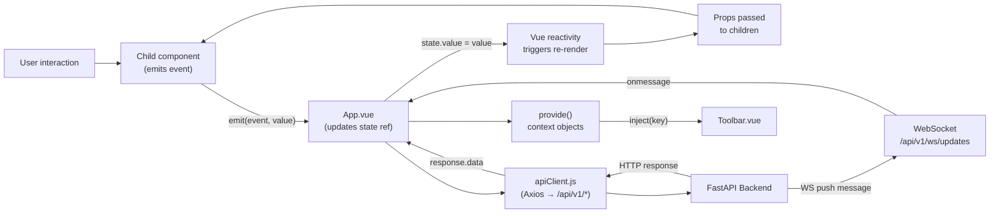
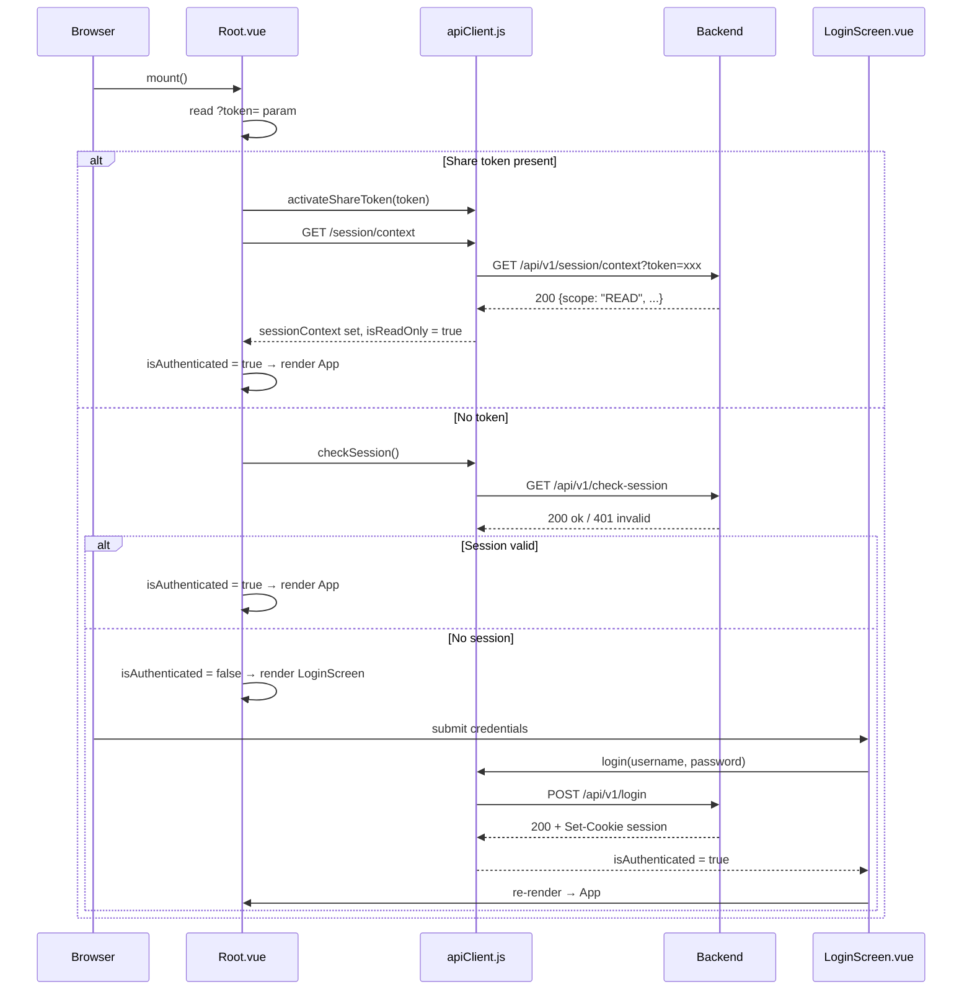
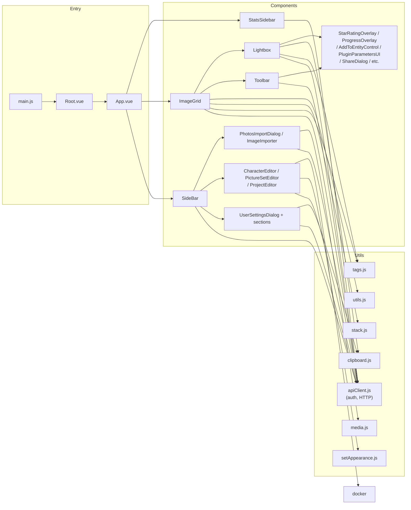
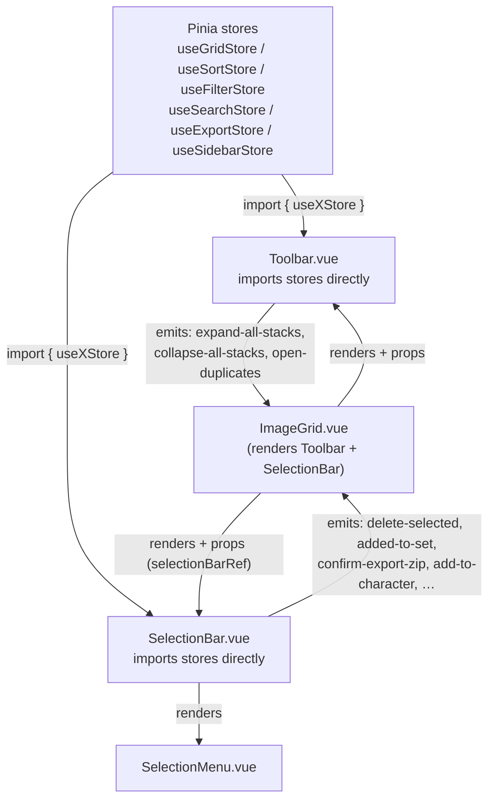

# PixlStash Frontend Architecture

> **Document purpose:** Synthetic reference database of the Vue 3 frontend for Copilot and developers. Describes every component, utility, data-flow pattern, and design decision. Keep this document updated when making structural changes.

---

## Table of Contents

1. [Project Source Tree](#1-project-source-tree)
2. [Architecture Overview](#2-architecture-overview)
3. [Entry Points](#3-entry-points)
4. [State Management — Pinia](#4-state-management--pinia)
5. [Component Catalogue](#5-component-catalogue)
6. [Utility Modules](#6-utility-modules)
7. [Theming and Styling](#7-theming-and-styling)
8. [API Client and Authentication](#8-api-client-and-authentication)
9. [Real-time Updates (WebSocket)](#9-real-time-updates-websocket) — incl. [9.1 Lightbox-open deferral contract](#91-lightbox-open-deferral-contract)
10. [Naming and Coding Conventions](#10-naming-and-coding-conventions)
11. [Build Configuration](#11-build-configuration)
12. [Mermaid Diagrams](#12-mermaid-diagrams)
13. [Destinations (whole screens)](#13-destinations-whole-screens) — [13.1 The model shelf](#131-the-model-shelf), [13.2 The workflow library](#132-the-workflow-library), [13.3 Duplicates](#133-duplicates), [13.4 About your library](#134-about-your-library), [13.5 Moves](#135-moves), [13.6 The Inbox](#136-the-inbox)

---

## 1. Project Source Tree

```
frontend/src/
├── main.js                      # App bootstrap: Vuetify + Pinia setup, theme registration, mount
├── Root.vue                     # Auth gate: LoginScreen or App
├── App.vue                      # Root application shell: layout + WebSocket + sidebar/stats state
├── App.css                      # App-scoped CSS overrides
├── style.css                    # Global CSS reset and base rules
│
├── assets/
│   ├── fonts/                   # Self-hosted fonts (if any)
│   ├── Google_Photos_icon_(2020-2025).svg
│   └── unknown-person.png       # Fallback avatar for unrecognised faces
│
├── styles/
│   ├── context-menu.css         # The one menu: surface (.ctx-menu) and row (.ctx-item)
│   └── design-tokens.css        # Design-system tokens: spacing, radius, type ramp, elevation, motion, colour
│
├── stores/                      # Pinia stores (cross-component shared state)
│   ├── useViewStore.js          # route → view resolution: the app's ONE route watcher (see §4.5)
│   ├── useSelectionStore.js
│   ├── useFilterStore.js
│   ├── useSortStore.js
│   ├── useGridStore.js
│   ├── useExportStore.js
│   ├── useWsStore.js
│   ├── useUserPrefsStore.js
│   ├── useProjectStore.js
│   ├── useSidebarStore.js
│   ├── useSearchStore.js
│   ├── useSnapshotsStore.js
│   ├── useGenStackPrefsStore.js # remembered "stack generated/filtered output with source" prefs
│   ├── useFavouritesStore.js    # the owner's favourite models, workflows and sets (#1578)
│   ├── useUpscaleStore.js       # the one remembered upscale factor and model, and the Upscale… dialog (#1868)
│   ├── useNewBatchStore.js      # the last run's pictures, marked New on the grid (#1868)
│   ├── useLockedSetsStore.js    # which pictures are frozen by a locked picture set
│   ├── useReviewSessionsStore.js # tag-review sessions, health board, and sticker gamification
│   ├── useEntityNamesStore.js   # id→name maps for the ImageGrid breadcrumb
│   ├── useEntityListsStore.js   # the shared character/set/project LISTS (stale-while-revalidate)
│   ├── useOperationStore.js     # the undo/redo stack + the action receipt (backend §21)
│   ├── useDedupStore.js         # the duplicate triage queue, its live counts and the tier gate
│   └── useTasksStore.js         # active background work (workers + ComfyUI runs); app-wide activity light
│
├── composables/                 # Extracted logic composables (Phase 8.1 — complete)
│   ├── useVirtualScroll.js      # Virtualised scroll window calculation for ImageGrid (uniform 'square' grid + packed 'justified' rows)
│   ├── useJustifiedLayout.js    # Pure justified-row (Google-Photos-style) packing arithmetic used by useVirtualScroll (+ *.test.js)
│   ├── useMultiSelect.js        # Image multi-selection (shift-click, range, touch mode); the ids live in useSelectionStore
│   ├── useSectionCollapse.js    # An inspector section's collapsed flag, per inspector, kept across selections and sessions (#2161)
│   ├── useSelectionTags.js      # A selection's tags (one picture or several): coverage, one picture's confidence, rejected predictions, the fan-out gestures (RailTags)
│   ├── useRailPicture.js        # The one selected picture's details and faces for the rail, and the head's name for it (#2161)
│   ├── useGridDragDrop.js       # Drag-and-drop reordering and import in ImageGrid
│   ├── useStackOrdering.js      # Stack expand/collapse, reorder, visual mapping in ImageGrid
│   ├── useGridFetch.js          # Grid image fetch state + all fetch/query-param functions
│   ├── useGridKeyboardNav.js    # Keyboard navigation and keyboard-driven actions for ImageGrid
│   ├── useGridRealtimeSync.js   # WebSocket picture-event decision table for ImageGrid (see §9)
│   ├── useBreadcrumb.js         # Current-view breadcrumb trail from route + id→name maps; drawn by the in-grid nav
│   ├── useReviewRoute.js        # URL ⇄ Tags to review view (`?review=…`); mirrors ImageGrid's `?overlay=` mechanics (+ *.test.js)
│   ├── useActionReceipt.js      # The receipt contract (wording, keycaps, drain, pause, focus) shared by the grid pill and the lightbox's own narration
│   ├── useVersionCheck.js       # "New version available" check (pixlstash.dev poll); single owner gated by `enabled`
│   ├── useDedupQueueKeyboard.js # The duplicate queue's key model, as a dependency-injected factory (+ *.test.js)
│   ├── useDedupRowExpansion.js  # The queue row's one stack-expansion band: the "one open, on the focused row" invariant + the lazy member read (+ *.test.js)
│   ├── useMixedStackQueue.js    # The Mixed stacks queue's view state: focus, selection, stranger marks and the member cursor (+ *.test.js)
│   ├── useOneTimeNotice.js      # A notice shown once per browser and then never again; localStorage-backed (+ *.test.js)
│   └── useSubmitGuard.js        # One in-flight submit at a time + the `pending` flag its button wears — see §10.1 (+ *.test.js)
│
├── api/                         # Backend resource modules: the only place URL strings live (see §8)
│   ├── config.js                # Per-user config blob: GET/PATCH /users/me/config
│   ├── serverConfig.js          # Server-wide config topics under /server-config/
│   ├── users.js                 # /users/me/* — account, tokens/share links, watermark
│   ├── session.js               # /session/context — the current credential's scope
│   ├── workers.js               # /workers/progress — background-worker poll
│   ├── snapshots.js             # /snapshots + restore/preview sub-resources
│   ├── reviews.js               # /reviews — tag-review session bookkeeping
│   ├── tagSuggestions.js        # /tag_suggestions — per-card review decisions
│   ├── tagHealth.js             # /tag_health — board rows + cache rebuild
│   ├── comfyui.js               # /comfyui/* — workflows, run, recipe read/replay, abort
│   ├── taggers.js               # /taggers, /taggers/plugin-diagnostics, /tagger/label-thresholds
│   ├── folders.js               # /reference-folders, /import-folders, /filesystem/*
│   ├── characters.js            # /characters + faces + reference pictures
│   ├── projects.js              # /projects + membership
│   ├── pictureSets.js           # /picture_sets + membership + locked members
│   ├── tags.js                  # /tags, /pictures/{id}/tags, tag predictions
│   ├── pictureImport.js         # streaming-staging import session (was useImportService)
│   ├── operations.js            # /operations — the undo/redo log, undo-state, undo/redo
│   ├── stacks.js                # /stacks — create, order, members
│   └── pictures.js              # /pictures — reads, count, stream, searches, stats
│                                # every module has a co-located *.test.js
│
├── utils/
│   ├── apiClient.js             # Axios instance, auth state, session/token helpers
│   ├── characterCreateFlow.js   # Pure helpers for the context-menu create-person flow: default naming + face-vs-picture assignment choice (+ *.test.js)
│   ├── clipboard.js             # Cross-browser clipboard write helper
│   ├── descriptions.js          # Pure helpers for picture-description formatting/normalisation
│   ├── keepCoverOnly.js         # Keep-cover-only: the copy + the two selection computations, pure (+ *.test.js)
│   ├── media.js                 # File extension lists, file-type predicates, drop-target helpers
│   ├── rotate.js                # In-place rotate: the format/reference-folder gates, the menu label and the skip note, pure (+ *.test.js)
│   ├── setAppearance.js         # Picture-set icon/colour palette constants (kept in sync with backend)
│   ├── sidebarCounts.js         # Which count field the sidebar reads per view mode, pure (+ *.test.js)
│   ├── snapshots.js             # Snapshot kind→chip-colour and relative-date helpers (shared by snapshot UIs)
│   ├── stack.js                 # Pure stack-ordering and leader-selection utilities
│   ├── tags.js                  # Tag normalisation, deduplication, penalty scoring
│   └── utils.js                 # Date formatting, score toggle, stack colours, ComfyUI error parsing
│
├── router/
│   └── index.js                 # Vue Router config: app routes + history mode
│
└── components/
    ├── TitleBar.vue             # The title bar, both shells: library picker, workspace switch, tasks pill, Settings, update alert, window controls
    ├── WordmarkLogo.vue         # "PixlStash" brand wordmark in the Tiny5 pixel font (two-tone via --wordmark-accent)
    ├── views/       # Full-page / full-screen UI surfaces: ImageGrid, Lightbox + extracted LightboxDescriptionPanel/LightboxRecipePanel/LightboxEditPanel/LightboxFilmstrip (Info itself is the rail's `panels/RailPicture`) and the Edit tab's Paint tools (PaintToolbox/PaintOptionsBar/PaintLayer), ReviewSessionsOverlay, DuplicateQueue, ModelShelf, LibraryInsights, MovesReview, TrainingRuns, WorkflowsView, LoginScreen
    ├── panels/      # Large structural panels that form the app shell: SideBar, Toolbar + extracted TbExportPanel/FilterMenu/FilterStrip/WorkflowFilterMenu/UndoControl, SelectionBar, SelectionMenu, StatsSidebar, TasksPanel, ProjectFiles, …
    ├── reviews/     # Tag-review surfaces (see below)
    │   ├── ReviewSessionView.vue      # One open review session: header, rail, and card queue
    │   ├── ReviewRail.vue             # Board footer: open reviews (scope, Abort), archived, stickers
    │   ├── ReviewBinaryCard.vue       # Single-tag accept/dismiss decision card
    │   ├── ReviewPairCard.vue         # Twin/near-duplicate pair decision card
    │   ├── ReviewDecisionBar.vue      # Accept/dismiss/fix/undo action bar
    │   ├── ReviewCelebration.vue      # Session-complete celebration
    │   ├── ReviewArchivedReceipt.vue  # Archived-session summary receipt
    │   ├── ReviewSticker.vue          # Die-cut sticker award (vocabulary from setAppearance.js)
    │   ├── NewReviewDialog.vue        # "Start a review" tag + scope picker
    │   ├── TagHealthBoard.vue         # Landing tag-health board
    │   └── tagHealthBoardLogic.js     # Pure board estimate/threshold helpers (+ *.test.js)
    ├── editors/     # Entity create / edit / delete dialogs
    ├── settings/    # UserSettingsDialog, its section sub-components (Appearance, Behaviour, SmartScore, Workflows, Account, Snapshots, Compute, Libraries, Layout), and the Settings* layout primitives (SettingsRow, SettingsSection, SettingsChip/ChipGrid, SettingsFieldBlock, SettingsSliderRow, SettingsTwoCol, SettingsInfoCard, SettingsAddTagRow)
    ├── io/          # Import / export / external-service connection, RunDialog, SaveRecipeDialog, ExportRecipeDialog
    └── widgets/     # Reusable primitives, including the App* design-system layer (AppButton/AppDialog/AppInput/AppSelect/AppStepper/AppTextarea + FieldLabel, and the two pick-one shapes `Segmented` and `OptionRows`), the two undo receipts (ActionReceipt over the grid, LightboxActionReceipt inside the lightbox), the Dedup* family (the duplicate queue's row, the picture strip both queue rows are built on, compare dialog, auto-stack dialog, tier menu, the shared threshold control, scan banner, scope pill, why-pills and confidence pill), `MixedQueueRow` (one row of the Duplicates destination's third page, which is a queue of its own), `KeepCoverOnlyDialog` (the one consent for collapsing stacks to their covers; see §5 "Confirming a destructive action"), the Stack* family (badge, edge ticks, expansion strip), `AdapterTray` (the adapters one person or set uses, read-only, inside the two editors), `BaseModelInput` (the completing base-model field, shared by the shelf's bulk dialog and its inline row editor), `PicturePicker` (one faceted, single-select library picker: the shelf's thumbnail verb today, the workflow Fixed and run-time modes next), and `AiToolkitIcon` (the one non-mdi glyph in the app: ai-toolkit's mark, traced as a `currentColor` path because they publish it only as raster), and `LoraLossChart` (a training run's loss curve against step, with a table alternative; the shelf draws it inside an expanded run through `views/ShelfRunLoss.vue`)
```

---

## 2. Architecture Overview

| Concern | Choice |
|---------|--------|
| Framework | Vue 3 (Composition API, `<script setup>`) |
| UI component library | Vuetify 3 |
| State management | **Pinia** — 21 domain stores in `src/stores/`; `App.vue` owns only UI-shell state |
| HTTP client | Axios (singleton `apiClient`) |
| Routing | **Vue Router 4** (`createWebHistory`). `Root.vue` gates on `isAuthenticated`; all authenticated views (`/`, `/character/:id`, `/set/:id`, `/project/:id`, `/scrapheap`, `/duplicates`, `/models`, `/models/runs`) render `App.vue` via `<RouterView>`. `useViewStore` owns the app's single route watcher and syncs params to Pinia stores (§4.5); `App.vue`'s nav handlers call `router.push()` to update the URL. `/duplicates` is deliberately NOT a grid view: `parseRouteView` returns `null` for it, so the selection stores keep whatever the user was looking at. **The route is the single source of truth for what the grid shows** — only explicit entry clicks push routes; sidebar tab/category switches never do (see Key Design Principles). |
| Build tool | Vite 5 |
| Unit tests | Vitest (jsdom environment) — test files co-located as `*.test.js` in `utils/` |
| End-to-end tests | Playwright (`frontend/e2e/`) — drives the real SPA against a backend booted on a throwaway copy of the `test-data/` fixture. See `frontend/e2e/README.md`. |
| Icons | Material Design Icons (`@mdi/font`) |

### Key Design Principles

- **Pinia for cross-component state.** All state shared across more than one component lives in a Pinia store in `src/stores/`. `App.vue` owns only layout-shell state (sidebar/stats visibility, pending import counts) that is not consumed anywhere else.
- **The route is the single source of truth for the grid view; the sidebar navigates only on a deliberate choice.** An entry click (a place, a project row, a person, a set, a folder) navigates, via `router.push()`. Anything that only changes what the sidebar *shows* (the Library / Folders switch, a branch's chevron, Find, the docked rail's flyouts) must **not** push a route, emit a `select-*` event or write the filter / selection / sort / grid stores (#2448). See [§5 → SideBar.vue](#sidebarvue).
- **Composables for reusable logic.** Complex logic extracted from mega-components lives in `src/composables/` as `useX()` functions. Composables accept dependencies as parameters and are independently unit-testable.
- **Flat component structure.** All components sit directly in `src/components/` with sub-directories by domain (`views/`, `panels/`, `editors/`, `settings/`, `io/`, `widgets/`). Shared presentational sub-components (e.g. `StarRatingOverlay`, `ProgressOverlay`) live in `widgets/`.
- **Utilities are pure functions.** Every file in `src/utils/` exports only plain functions and constants; none hold reactive state themselves (except `apiClient.js`, which holds `isAuthenticated`, `sessionContext`, and `isReadOnly`).
- **`<script setup>` everywhere.** All components use the Composition API with `<script setup>` syntax. Options API is not used anywhere.

---

## 3. Entry Points

### `main.js`

Bootstraps the app:
1. Imports global CSS (`vuetify/styles`, MDI icons, `style.css`, `context-menu.css`).
2. Creates a Vuetify instance with two custom themes: `pixlStashLight` and `pixlStashDark` (full custom colour tokens — sidebar, toolbar, accent, primary, input-background, etc.).
3. Creates the Vue Router instance (imported from `src/router/index.js`).
4. Mounts `Root` as the top-level component.

### `Root.vue`

Authentication gate rendered before `App`. On mount:
1. Reads `?token=` query parameter — if present, calls `activateShareToken()` and validates via `GET /session/context`. Valid → sets `isAuthenticated = true` and `sessionContext`.
2. Otherwise calls `checkSession()` (a `GET /check-session` request).
3. Shows `LoginScreen` when `isAuthenticated` is false; shows `<RouterView>` (which renders `App.vue`) when true.
4. Renders a blank `root-loading` div during the async check.

### `App.vue`

The application shell. Responsibilities:
- Owns **layout-shell state** only: sidebar/stats visibility. All domain state has moved to Pinia stores; the pill ids live in `useWsStore`.
- Owns **route pushing** (`pushAppRoute` / `pushRouteForCurrentSelection`) and calls `useViewStore().startRouteSync(route, { watch })` once. Reading the route back into stores is `useViewStore`'s job, not App.vue's (see §4.5).
- Renders the three-panel layout: `SideBar` | `ImageGrid` (+ `Toolbar`) | `StatsSidebar`.
- Manages the `PhotosImportDialog`.
- Owns the **WebSocket lifecycle only** (connect / reconnect / close / `set_filters`); the picture-event decision table is delegated to `useGridRealtimeSync` (see §9).
- Handles global keyboard shortcuts, window drag/drop, paste events. Undo/redo (`Ctrl+Z` / `Ctrl+Y` / `Ctrl+Shift+Z`, Meta accepted everywhere) lives in `handleGlobalKeydown` and declines in four cases, each for its own reason: while typing (a text field keeps its native undo stack), in a read-only session, on key auto-repeat (a held `Ctrl+Z` must not walk the stack), and while a modal **dialog** owns the screen — the receipt sits on `--z-floating`, under every dialog scrim, so an undo fired from there would mutate the library with no visible narration. See "Undo has three keyboard owners" below for the two surfaces that own the chord themselves.
- Fetches user config on startup (`GET /users/me/config`) and applies persisted preferences via the relevant stores.
- Persists sidebar/stats open state to `localStorage`.

---

## 4. State Management — Pinia

PixlStash uses **Pinia** for cross-component state. State is managed at three tiers:

### Tier 1: Pinia stores — cross-component shared state

All state consumed by more than one component lives in a Pinia store. The stores defined in `frontend/src/stores/` are:

| Store | File | Key State |
|-------|------|-----------|
| `useViewStore` | `useViewStore.js` | The route's parsed reflection: `view` (the resolved view descriptor) and `activeFolderKey`. Owns the app's **single route watcher** and is the only writer of route-derived selection/project state. Never pushes a route. See §4.5. |
| `useSelectionStore` | `useSelectionStore.js` | `selectedCharacter`, `selectedCharacterIds`, `selectedSet`, `selectedSetIds`, `selectedFolderFilter`, and `selectedImageIds`: **the grid's picture selection itself** (#2161). `useMultiSelect` takes it from here rather than holding its own, so the stats rail beside the grid reads the same list; `ImageGrid` clears it as it unmounts, because a selection that outlived its grid would come back selected. |
| `useFilterStore` | `useFilterStore.js` | `mediaTypeFilter`, `minScoreFilter`, `maxScoreFilter`, `unscoredOnlyFilter`, `tagFilter`, `tagRejectedFilter`, `faceBboxFilter`, `sharedOnlyFilter`, `noCharacterFilter` and `noSetFilter` (the Problems menu's "No character" and "In no set": either alone sends `character_id=UNASSIGNED&unassigned_by=character|set`, both send `character_id=UNASSIGNED` alone), `comfyuiConfigured` and `comfyuiUrl` (the configured ComfyUI address, set by `useAppConfig` and the ComfyUI settings section; both cleared on session change, since a share token cannot re-read the owner's config to overwrite them, `sessionReset.test.js`), etc. `minScoreFilter`/`maxScoreFilter`/`unscoredOnlyFilter` are writable computeds, not bare refs: "unscored" (`unscored=1`, i.e. `score IS NULL OR score = 0`) combines with a score range as "range OR unrated" (the filter menu's Score sets it whenever a range starts at 0 stars), so the setters no longer clear each other; a surface that means one or the other, like the stats sidebar's score bars, clears the other kind itself. |
| `useSortStore` | `useSortStore.js` | `selectedSort`, `selectedDescending`, `sortOptions`, `similarityCharacterOptions`, `selectedSimilarityCharacter` |
| `useGridStore` | `useGridStore.js` | `columns`, `thumbnailSize`, `sidebarThumbnailSize`, `gridVersion`, `wsUpdateKey`, `showStars`, `showFaceBboxes`, `showProblemIcon`, `showStacks`, `stackThreshold`, `expandedStackCount`, `totalStackCount`, `compactMode`, `visibleRangeLabel` |
| `useExportStore` | `useExportStore.js` | `exportType`, `exportCaptionMode`, `exportResolution`, `exportTagFormat`, `exportIncludeCharacterName`, `exportUseOriginalFileNames`, etc. |
| `useWsStore` | `useWsStore.js` | `wsTagUpdate`, `wsPluginProgress`, `updatesSocket`; the per-tab `clientId` (`crypto.randomUUID()`, persisted under `pixlstash:clientId` in `sessionStorage`, in-memory fallback; mirrored into `apiClient` via `setRequestClientId`); the two pills' ids — `pendingExternalImportIds`/`sortChangedExternalIds` with computed `*Count` and `add*`/`clear*` setters |
| `useUserPrefsStore` | `useUserPrefsStore.js` | `checkForUpdates`, `hiddenTags`, `applyTagFilter`, `penalisedTagWeights`, `dateFormat`, `themeMode`, `sidebarWidth` (drag-resizable through `useSidebarWidth`, clamped 140–300), `showKeyboardHint`, `gridOpenGesture` (`"double"`/`"single"`), `viewerWheelAction` (`"zoom"`/`"browse"`) |
| `useTagClipboardStore` | `useTagClipboardStore.js` | Tag copy and paste (#2139). `clipboardTags` (filled by Copy on the chips selected in `RailTags`, in the grid rail and the lightbox's Info alike, where Rejected chips select and copy too but Delete passes them over, or a search token; also written to the system clipboard as comma-separated text; **client memory only**, gone when the app closes) and `chipSize` (written to the `--tag-chip-font` root variable; stored in `/users/me/config` as `tag_chip_size`). `pasteClipboard(ids)` adds only the tags each picture is missing, one batch id, so one undo step; it never rejects. Ctrl+V reaches it from the lightbox (anywhere but a text field) and the grid selection; the rail's Tags header (`RailTags`) has a Paste button too. Hydrated by `useAppConfig`. |
| `useProjectStore` | `useProjectStore.js` | `projectViewMode` *(sidebar-display only — see below)*, `selectedProjectId`, `characterProjectIds`, `setProjectIds` |
| `useSidebarStore` | `useSidebarStore.js` | `sidebarDocked` (width pref), `sidebarPinned` (visibility pref), `statsOpen` (the Library's stats rail, default closed), `lightboxRailOpen` (the lightbox inspector's own flag, default **open**, key `pixlstash:lightboxRailOpen`; `toggleLightboxRail()` persists), `workflowInspectorOpen` (the Workflows inspector's own flag, default **open**, key `pixlstash:workflowInspectorOpen`; `toggleWorkflowInspector()` persists, `openWorkflowInspector()` is for deep links and does not), `showCardInInspector(rail)` + `cardTabRequest` (a card's double-click: opens a shut `workflows` or `models` rail, persisted, and bumps the counter so the rail on screen selects its card tab, Workflow or Models; an open rail is left on its tab), `inspectorNudge` (a counter a selection-describing inspector's screen bumps on each new selection, and the Models shelf also when a card's tray opens, see "Closed inspector" under Shared shell pieces), `sidebarForcedHidden`, `statsForcedHidden`, `characterMultiMode`, `setMultiMode`, `setDifferenceBaseId`; computeds `effectivePinned`, `effectiveDocked`, `sidebarVisible`, `sidebarOverlay` model the pin / dock / auto-hide behaviour (mobile `*ForcedHidden` overrides win). All localStorage access is try/caught. |
| `useSearchStore` | `useSearchStore.js` | `searchQuery`, `searchInput`, `searchHistory`, `isSearchActive`, `searchOverlayVisible` |
| `useSnapshotsStore` | `useSnapshotsStore.js` | `snapshots`, `loading`, `activeJob`, `error`, `dailySnapshotsEnabled`; drives the shared `RestoreConfirmDialog` hoisted in `App.vue` (`restoreDialogOpen`, `restoreDialogSnapshotId`, `restoreDialogResources`). Owns snapshot list load / create / restore and the snapshot WebSocket event handlers (called from `App.vue`). |
| `useMovesStore` | `useMovesStore.js` | v1.11 Phase 5, the reconciliation queue for moves made outside PixlStash. `unambiguous` / `ambiguous` / `offLayout`, `loading`, `error`, `loaded`; `hasPending`/`pendingCount` deliberately **exclude `offLayout`** — that bucket carries no decision (backend_architecture.md §24.5), so a sidebar badge counting it would nag about nothing. `fetchPending` never invents or corrects a verdict; it re-fetches `GET /moves/pending`, which the backend reclassifies live on every call. `applyAllUnambiguous`/`applyReview`/`dismissReviews`/`dismissAll` all re-fetch afterward rather than mutating the local lists — see §13.5. |
| `useImportFoldersStore` | `useImportFoldersStore.js` | Import folders (`GET /import-folders`): `folders`, `loaded`, `hasFolders`; `refresh`, and a debounced `refreshSoon` the WebSocket calls on picture events. |
| `useInboxStore` | `useInboxStore.js` | The Inbox's `period` (remembered in `localStorage`) and `counts` per period (`/pictures/count?inbox=`), `count` for the sidebar row; `setPeriod`, `refreshCount`, `refreshAllCounts`, and the pure `inboxEmptyState`. See §13.6. |
| `useReviewSessionsStore` | `useReviewSessionsStore.js` | Tag-review state: the tag-health board, the rail of open review sessions (each = one tag + frozen scope + one scan's results), and the per-session binary/pair card queues. Per-item decisions write through `/tag_suggestions`; session bookkeeping talks to `/reviews`, the board to `/tag_health`. Also owns the opt-in gamification — variable-ratio sticker awards with monotonic XP / level / streak counters; the sticker vocabulary is imported from `setAppearance.js` so sets and stickers never drift. |
| `useUpscaleStore` | `useUpscaleStore.js` | The one upscale (#1868): `factor` and the model last used (`localStorage`, the owner's own preference), the shelf's upscalers (`loadModels`, `GET /adapters?file_kind=upscaler`), `model` (the remembered one while the shelf has it, else the first, else none: the Lanczos resize), `body()` for a request, and `pictureIds`, the Upscale… dialog's pictures (`openFor`, `close`). `UpscaleChoice.vue` draws the factor and model the same in the Run popup's added-upscale row and in `UpscaleDialog.vue`, mounted once in `App.vue` and opened from the selection pill and the lightbox toolbar; its runs are followed as a Run popup's (`useGridComfyuiRuns`). The dialog shows the pictures' thumbnails (five, or four and a "+n"), puts the size they go to ("→ W × H") in its subtitle when every picture is one size (the Run popup's row keeps `UpscaleChoice`'s inline target), and, while the shelf holds no RealESRGAN, offers `RealESRGAN_x4plus.safetensors` through `downloadModels`; each `downloadsLanded` bump re-reads the shelf, and the model the link fetched is picked once it lands. Session reset drops the shelf's rows and closes the dialog. |
| `useNewBatchStore` | `useNewBatchStore.js` | The last run's pictures (#1868), read off `useTasksStore.finishedRuns`: the newest completed batch of a workflow's runs that ended after the page opened replaces `ids`, which the grid marks with a New chip. Session reset drops `ids`. |
| `useFavouritesStore` | `useFavouritesStore.js` | The owner's favourites (#1578), one mechanism on three surfaces: `keys` per kind (`model` by sha256, a run by its cover's; `workflow` by card key; `set` by the grid's set key), read once by `ensureLoaded()` from `GET /favourites` and written by `setFavourite` / `toggle` through `PUT /favourites` (drawn at once, replaced by the server's answer, put back with an error notice on a refusal). `toggle` favourites a mixed selection and unfavourites one that is all favourites. **The ranking rule lives here once**: `favouritesFirst(items, isFav)` is a stable partition a caller applies *per group, after its own sort*, so a favourite leads inside its group and never crosses into another (a picker's labelled groups and the owner's hand-made sets keep their place); with no favourites every list is unchanged. Owner-only hub rows, so session reset drops them. The mark is `FavouriteHeart.vue`, a heart in ink (a star already means a rating): filled for on, an outline only while its `fav-host` row or card is hovered or focused; `H` toggles the focused item or the selection on the shelf, the set grid and the Workflows view. **Pictures are the fourth surface and do not use this store**: the grid is paged by the server, so a picture's heart is `picture.favourite` in the vault, written by `setFavourite` / `toggleFavourite` in `useGridScoring` (drawn at once, put back with a notice on a refusal) and filtered by `useFilterStore.favouriteOnlyFilter` (`favourite=1`, the Filters menu's leading *Favourites only* box and a *Show* chip). The mark there is the heart that ends `StarRatingOverlay`'s strip (`favouritable`), red (`dark-surface-favourite`) only while on; a favourite tile keeps the strip collapsed to its heart at rest and the stars slide out on hover (`ImageGrid.css`), so the stack count moved to the top-left badge column. `H` toggles the hovered, cursor or selected pictures in the grid and the open one in the lightbox; the selection pill leads with the Favourite / Unfavourite verb. |
| `useLockedSetsStore` | `useLockedSetsStore.js` | Which pictures are frozen by a locked picture set. Fed by `GET /picture_sets/locked-members`; refreshed on app start and on the same sidebar-refresh / `pictures_changed` ws triggers the sidebar uses. Single source of the lock-tooltip copy reused by the grid badge, overlay chip, and context-menu gating. |
| `useModelShelfStore` | `useModelShelfStore.js` | The model shelf's rows and its `Show` selection. `rows` are the raw `/adapters` + `/checkpoints` payload, **every block fetched so far rather than the shown set**: a fetch replaces the blocks it asked for and leaves the rest standing, because the option vocabularies (`adapterKindOptions`, `capabilityOptions`, `baseModelOptions`) are derived from `rows`, so an overwriting narrowed fetch deleted the kind checkboxes that unticking Adapters is documented to *grey*, and dropped base models that stayed selected and persisted with no box left to untick them. `visibleRows` layers the resolved name, the reduced location state and `copies` (how many of the row's registered copies are `present`) on top and applies the kind, capability and base-model narrowing **client-side**, so a multi-select base-model filter is not one request per option. The capability filter matches **has this capability**, not *is this kind*: a model serving two features survives a tick of either, and like the kind boxes it narrows only the block it hangs under (engines), never the whole shelf. `groups` sorts `visibleRows` client-side on the five ruled `SortKey` values plus the client's own `type` (the Type cell's words, `shelfTypeLabel`) and `sets` (how many sets hold the model, from `setMembership`), one key per column so every heading sorts, and cuts them into one level of groups on `groupAxis` (`none` / `type` / `base_model` / `feature`; always `none` in a folder, which its headings sort instead, while `view.groupBy` keeps the grouping for leaving it), always returning at least one group so the flat and grouped lists are one piece of markup; `workflow_set` is deliberately NOT in that list and is the shelf's DEFAULT (#1438) — its groups overlap, so it swaps the row list for `ModelSetGrid.vue` and is served instead by `workflowSets` / `visibleCombinations` / `setStacks` / `setFoldCounts`, read once from `GET /models/workflow-sets` by `loadWorkflowSets()` and refetched only after a scan (`fetchRows({markNew: true})`), never on a filter tick, because it is a window over every kept picture in the vault and every stored ComfyUI run; `hiddenSets` rides on that same payload and is changed through `PUT /models/workflow-sets/hidden` (**#1869**, the hide is per LIBRARY and server-side, not the per-browser `localStorage` flag it used to be), whose answer is the whole new list so a hide needs no re-read; `worksWithModel(id)` answers off the WHOLE payload rather than the narrowed one, since hiding a companion because its kind is unticked would turn a view setting into a claim about the evidence; sorting never refetches, because every field the keys read is already on the payload and three server-sorted blocks would be destroyed by the merge above. **One axis fans a row out across several groups** — `feature` (a multi-capability model is listed under each feature it serves, which is the design rule) — so `rowKey` carries the group on every grouped axis, not just the ones that need it: one key across several draws put `tabindex="0"` on all of them at once. A row that cannot answer the key sorts last in BOTH directions, and the unset group sorts last whatever the direction; an adapter declares no capability and groups under **its algorithm** (`LoRA`, `LoKr`, …) rather than under one "No feature recorded" bucket that held most of the shelf. One vocabulary spells it and one fold keys it, both in `utils/modelShelf.js`: `adapterKindKey` trims and lower-cases the free-text column, `adapterKindLabel` names the folded value, and the group key, the group header, the row's Kind cell, the nested `Show` checkboxes AND the `adapterKinds` filter behind them all read those two rather than `row.kind`. **The fold has to reach the filter, not just the label.** `LoRA` is reachable from the edit dialog, which trims but does not case-fold, so faceting on the raw column offered two checkboxes drawn with the same label that each ticked half the rows — while the axis folded them into one visible group. **And the fold has to reach the remembered selection too**, which `storedFilters` does on read: a shipped build persisted the raw column, so a blob holding `LoRA` would match nothing and appear in no checkbox — an empty shelf with the Adapters box reading fully on and nothing on screen naming the filter doing it. Folded rather than discarded by a `FILTERS_SCHEMA_VERSION` bump, which throws the whole blob away when the selection is still exactly what the user chose. The key is the folded value and never the label, because the key is what `modelShelfView.collapsed.feature` remembers a collapse by; it is prefixed `kind:` to keep an algorithm out of the capability keyspace. Group headers are uppercased by `.shelf-group-label` like every other header on the axis, so the header reads `LORA` where the cell reads `LoRA`: one vocabulary stops a *second spelling* existing, it does not exempt the axis from the shelf-wide case rule. Everything that is not an adapter with an algorithm still falls through to "No feature recorded", which is the whole of the rest: a checkpoint, an unclassified file, an engine declaring no capability and any `file_kind` this build does not know have no algorithm at all; an adapter whose `kind` folds to the empty string has none either (the hub CHECK makes it NOT NULL, not non-empty, so a whitespace-only one is reachable over the raw API); and an adapter whose `kind` is the literal `unknown` has the classifier's refusal rather than an algorithm (`KIND_UNKNOWN`, `utils/adapter_header.py`) — heading that `UNKNOWN` would stand a second shrug beside the real one and call it a feature. The `Show` facet still offers `Unknown` as a box, because "which of these could we not identify" is a real selection even where it is not a real feature. `view` (`groupBy`, `sortKey`, `sortDirection`) and the per-axis collapsed sets persist under `pixlstash:modelShelfView`, a SECOND key so `resetFilters` cannot take the sort order with it. `filters` (`adapters`, `adapterKinds`, `checkpoints`, `unclassified`, `engines`, `capabilities`, `baseModels`, `duplicatesOnly`) persists to `localStorage` under `pixlstash:modelShelfFilters` — not to `/users/me/config`, which is a fixed `User` model and would need a backend column. **`duplicatesOnly` is the one field `storedFilters` deliberately does not read back**: "only the files written twice" is a question somebody asks once while reclaiming disk, and remembered across a restart it is a shelf that opens showing four rows of an eighteen-hundred-row library with nothing on screen saying why. An empty `adapterKinds` / `capabilities` / `baseModels` array means **unconstrained**, the standard multi-select convention and the only reading under which a fresh install shows anything. `activeCount` counts filter SECTIONS that deviate from their default, not ticked boxes, or a mild narrowing would read as `9`. Only the four top-level type toggles refetch, and they narrow client-side too; the rest only narrow what is already loaded. Each fetch takes the next `epoch` and only the newest may write `rows` or clear `loading`, so a slower earlier flight cannot land last and show adapters only while Checkpoints is ticked; `resetForSession` bumps the same counter, so a read on the wire when the credential changed is discarded. `ModelShelf.vue` watches `loaded` and refetches when a session reset clears it, which the store cannot do itself because session-reset handlers run *before* the new credential is installed. **Session reset drops `rows` but keeps `filters`:** the models are hub-side facts about this machine, but every row carries the characters and sets in the ACTIVE LIBRARY that use it, while the selection and the view axes are the user's own preferences and hold no ids. `offlineMounts` and the `New` badge's `newIds` are both derived here and both documented under §13.1, "The three kinds of absence": `offlineMounts` reads `rows` rather than `visibleRows` on purpose, and `newIds` is a per-fetch id diff that only `fetchRows({ markNew: true })` fills and every other fetch clears. |
| `useWorkflowsStore` | `useWorkflowsStore.js` | The Workflows grid's cards (v1.12 F1a) — `GET /workflows`, one card per workflow keyed by `id` (#1623); B9 (#1410) moved the grid onto that route when it deleted the shelf's topology list. `sortKey` is one of `rating` / `used` / `pictures` / `name` (the one ascending key, A to Z); *Your ratings* orders by **`rank`**, the Bayesian cover rank, not by the `rating` the card displays, or a 5.0 from one picture would lead a 4.8 from ninety. `selectedKeys` holds workflow ids: `select(id, {additive})` replaces the selection or toggles one id, `selectRange(ids)` takes a drawn run, and `runnableCard` is the one selected card or null. `refetch()` bumps the epoch, clears `loading` and re-reads the grid, so a write's re-read is never refused behind an older read still on the wire, and that older read cannot land over it. `invalidate()` is the one door in from outside the view — a ghost purge in Settings › Recovery — and re-reads the grid **only if it had been read**, so a purge made by somebody who never opened Workflows fires no request. `duplicateCard` re-reads the grid after writing rather than patching it, and returns the server's answer (whose `workflow_id` is the new manual workflow, which the caller selects) or `null` with the reason in `error`. `deleteSelected` deletes manual workflows only (the bar's gate), clears the selection when none was refused and bumps `recipesEpoch`, since their saved recipes become unfiled. `useSetKey` / `requestUseSet(id)` is how the selection menu's *Change model set…* row asks `WorkflowTab` to open its own set menu on that workflow (#1850): the `pictureToOpen` shape, a one-shot the tab clears when it takes it. **Every write the Workflow tab makes to a workflow's waiting changes ends in `refetch()`**, because the updates socket does not echo a write to the window that made it and the card's *Unsaved* badge is drawn off the grid. Session reset drops all of it: every count on a card is read across the active library's pictures. **`filters` (F7) is split across the wire on purpose**: the One-offs and Hidden flags are sent as `include_one_offs` / `include_hidden` and re-read the grid, because they widen the set the server answers with; Ghosts, Type, Checkpoint, Source and Rating only ever remove a card, so `filteredCards` applies them here. `filterChips` is the one answer to "which filters are on" — the panel's *Clear all*, the strip and the toolbar badge all count it — and its WORDS come from `workflowFilterChips` in `utils/filterChips.js`, the module that exists so one filter cannot be spelled two ways; the store owns the state and the refetch decision and nothing else. A filter that removes a card also **prunes `selectedKeys`**, because the selection bar and the rail's bulk verbs act on the selection and would otherwise offer Hide or Delete on cards nobody can see, and `filterOptions` counts each pick-one option over `cards` rather than `filteredCards`, so a count cannot go to zero on the row being read. |
| `useModelFoldersStore` | `useModelFoldersStore.js` | The registered model folders and the scans running against them. Fetched by the shelf and by the Models sidebar (its slot and Folders tree), and re-read when Settings › Model folders opens. It also caches the tree's one-level subfolder listings (`loadDirs`, `dirListings`, #2203). **Nobody starts a scan** (backend §25.13): the server scans a folder when it is added, when a model file in it changes and every ten minutes, and announces what it found as `models_arrived`, which refreshes the shelf (and this store's counts, from `useUpdatesSocket`). `scanningIds` is therefore read off each row's `scan_status` (`pending` / `running`), and the store polls `GET /model-folders` every 3s only while one is. It is a **store rather than dialog state** because the first scan of a folder added here outlives the panel: that one scan, and no other, gets a notice when it lands (`Scanned loras. 91 files listed.`, or the `scan_error` when it failed). `forget` captures the row's fields BEFORE the request, which is what makes the notice's `Add it back` possible and therefore what lets removal skip a confirmation prompt. **Session reset drops it whole:** absolute host paths are owner-only, and a session that lost its credential has no standing to keep polling. |
| `useGenStackPrefsStore` | `useGenStackPrefsStore.js` | Remembered client pref for whether newly filtered images stack with their source: `stackFilterOutputs` (plugin "Filters" runs), default ON and persisted to `localStorage`. Its `stackI2IOutputs` half went in v1.12 F5 with the two surfaces that read it, since `POST /workflows/run` does not stack. |
| `useEntityListsStore` | `useEntityListsStore.js` | The character / picture-set / project **lists** themselves (`characters`, `pictureSets`, `projects`) plus `fetchedAt` and `pending` per kind. One cache for the three surfaces that need them — the `SideBar` tree, the image context menu's Person/Set/Project flyouts, and the tag-review scope pickers. **Stale-while-revalidate:** a caller renders the cached list immediately and calls `refresh(kind)` *without awaiting it*, so opening a flyout never waits on the network; concurrent callers share one in-flight request (`inFlight`, modelled on `useDedupStore.scopeCounts`). `invalidate(kinds)` is **refetch-only** — a `characters_changed` ws event or a local assignment says "ask again", it never writes the store from a payload; **a caller re-reading after a change must use it, not `refresh`**, because `refresh` joins a request already in flight that may have started before the change, while `invalidate` queues one trailing read behind it (`SideBar`'s `fetchCharacters` / `fetchPictureSets` / `fetchProjects` call it: with `refresh`, a set deleted while a read was in flight came back on screen, #2323) (`origin_client_id` is echo-matching, not authority; see §9 and integration_architecture.md §8.1). **These are `SCOPED_LIST` routes, so their content is an authorization decision:** the cache is in-memory only (never `localStorage`/`sessionStorage`), `reset()` drops it on every auth-context transition via the single `onSessionReset` chokepoint in `apiClient` (logout / login / share-token entry / vault switch), and an epoch guard discards any response that was in flight across that transition. Revalidate-on-open is mandatory rather than an optimisation: a share/scoped session receives no ws events (the stream is owner-only), so it is that session's only invalidation path. **The sidebar's row counts ride along on these lists (`include_counts=true`, issue #651):** every character row carries `image_count` and `project_image_count` (scoped to the character's OWN `project_id`, or to "in no project" when it has none) and every project row carries `image_count`, which is what replaced `SideBar.fetchSidebarData`'s one-`/{id}/summary`-per-row fan-out. They live on the shared list rather than in a second counts-bearing cache on purpose (two shapes for one entity would mean two caches, two invalidation paths and two epochs), and the flyout / scope-picker consumers simply ignore the extra fields. Because both scopes are on every row and neither depends on the sidebar's current project selection, one cached response serves both sidebar view modes. Distinct from `useEntityNamesStore`, which holds id→name maps only. |
| `useEntityNamesStore` | `useEntityNamesStore.js` | `characterNames`, `setNames`, `projectNames`, `refFolderLabels` (id→name maps). One-directional id→name only (names aren't unique). `SideBar` publishes via `merge*` setters after each fetch; `ImageGrid`'s breadcrumb consumes them to label the route's IDs. |
| `useOperationStore` | `useOperationStore.js` | The undo/redo stack, mirrored from the backend's append-only operation log (`backend_architecture.md` §21): `operations` (newest 50, newest first), `canUndo`/`canRedo`/`nextUndo`/`nextRedo` from `GET /operations/undo-state`, and the single live `receipt` that narrates what just happened. Computeds `past` (applied steps), `future` (undone, redoable), `historyCount`, `nextUndoIsExternal`. Owns the receipt's dwell timer (5s, 8s destructive, paused on hover/focus/hidden tab) and the multi-step `undoTo` walk. Refreshed on a debounced WS picture/tag/character/description event; the receipt narrates THIS client's operations only (origin read from the event `data`), so another tab's work updates the stack silently. |
| `useLibrariesStore` / `useLibrarySwitchStore` | `useLibrariesStore.js` | Owner-only app-level library identity and the switch state machine. `App.vue` fetches the registry on owner startup; Settings refreshes the same store whenever its Libraries pane opens. `activeLibrary` therefore drives the Active row, the title bar's library picker, and the document title from one response. `confirmAndBegin` is the one switch confirmation (reload warning, share links left behind) that Settings › Libraries and the picker both call. Share/read-only sessions never make this request and receive no library name in chrome. A confirmed switch moves the second store to `switching`, lets Vue render the persistent alert dialog and apply `inert` to the entire `VApp`, then posts the UUID. Since Vuetify dialogs teleport beside the app root, `inertSiblingOverlays` also inerts every already-open overlay except the switch modal. Success reloads the document; failure keeps the old library, names both target and retained library, and the sole Stay action restores focus to the invoking row. |
| `useDedupStore` | `useDedupStore.js` | The duplicate triage queue. `openCount` (the sidebar badge), `byTier` (the per-tier split, including tiers that are switched off), `scopeCounts` (the per-object counts the context menus read, cached and de-duplicated while in flight), `scan` (normalised from the server's picture and bucket counters; the percentage is derived here because the server publishes none), `groups` + `windowStart` + `total` + `hasMore` (a contiguous WINDOW of the confidence-descending queue, absolute indices, never loaded whole), `focusIndex` (+ `focusStart`/`focusEnd`/`loadPrevious`/`cancelEndChase`/`endChaseActive`, the one-press random-access End jump onto the tail page and its upward backfill — see §13.3), the per-group `coverChoices` / `exclusions` keyed on signature, and the tier gate (`nearEnabled`, `embeddingEnabled`, `threshold`) whose bounds all come from `GET /dedup/policy`. Owns the verdicts and the auto-advance: resolving a group removes its row and the focus lands on the next open group. Every verdict is recorded server-side (`dedup.stack`; `dedup.keep_separate` since the owner's 2026-07-30 override of #644), so receipts and `Ctrl+Z` come from `useOperationStore` — triggered from the verdict response, gated on its always-populated `batch_id` (see §13.3); against an older backend whose keep-separate returns no `batch_id`, the narration degrades to the transient notice pointing at the **Decided page** (owner call, 2026-07-29 — this replaced the sticky Reopen notice). `showingDecided` / `toggleDecided` flip the queue to `GET /dedup/groups?decided=true`: resolved groups with their live verdict, each row swapping its verdict buttons for a verdict label and a **Clear decision** action (`POST /dedup/verdicts/reopen` — never touches pictures; a reopened stacked group stays stacked until unstacked from the Stacks view). Verdicts and multi-select are inert on the decided page, and its empty state carries its own way back since the header toggle unmounts with the list. **Multi-select (owner request, 2026-07-29):** Ctrl/Cmd+click toggles a group in and out of a selection, Shift+click ranges from the anchor, plain click clears — the grid's own conventions. A verdict on any selected group applies to the whole selection (`verdictTargets`); a bulk stack shares ONE `cli-` batch id so a single Ctrl+Z reverses the gesture, and a bulk keep-separate narrates once for the whole gesture. The bulk scope is stated twice — a header chip ("N groups selected — Stack and Keep separate apply to all") and the verdict buttons themselves rename ("Stack N groups" / "Keep N separate") — because a bulk action must never look like a single one. Escape clears the selection without costing the focus; a reload (scope, tier, rescan) clears it too, since it would silently point at different rows. **`openQueue` is the scan trigger**: the group cache only fills when a scan runs, so opening the queue queues one (`POST /dedup/scan`) and the queue opens over whatever exists while the banner streams — without this the queue reads an empty cache forever, whatever the tier gate says. Loosening the policy (enabling a tier, lowering the threshold) rescans too; narrowing only re-queries. While a scan is `pending`/`running` the store polls counts every 2s and reloads the group list **only while it is empty**, so the first finds surface on their own and a triage in progress is never yanked to the top. |
| `useTasksStore` | `useTasksStore.js` | `workerSnapshots`, `series` (per-worker throughput history), `systemUsage` (CPU/RAM/VRAM), `comfyuiRuns` (the ComfyUI runs in flight, as the poll's `runs` last listed them); computeds `activeEntries` (backend workers + ComfyUI runs + the import, merged), `hasActiveTasks`, `activeCount`. The **single poller** of `GET /workers/progress` (adaptive cadence — see §4.4) and the single source of truth for the app-wide "is the app working" indicators. |

Components import stores directly (`import { useFilterStore } from '../../stores/useFilterStore'`) — no prop drilling required.

### Tier 2: Component-local state

Sub-components that manage independent data (e.g. `AccountSection`, `SmartScoreSection`, `StatsSidebar`) own their own refs and fetch their own data. They receive an `open: Boolean` prop (or equivalent) and trigger data loads via `watch(() => props.open, ...)`.

### Tier 3: Template-ref imperative API

`App.vue` holds refs to `SideBar` (via `sidebarRef`) and `ImageGrid` (via `gridContainer`) and calls `defineExpose`'d methods on them:

**`SideBar` exposes:** `refreshSidebar()`, `openSettingsDialog()`, `startLocalImport()`, `currentProjectId`, `openCurrentSelectionEditor()`

**`ImageGrid` exposes:** `gridEl`, `onGlobalKeyPress()`, `updateVisibleThumbnails()`, `expandAllStacks()`, `collapseAllStacks()`, `exportCurrentViewToZip()`, `getExportCount()`, `removeImagesById()`, `clearFaceSelection()`, `runComfyuiOnGridImages()`, `hasCursorFocus`

**These refs are not guaranteed to be set in `App.vue`'s `onMounted`.** Vuetify's `<v-app>` renders its slot inside a `<Suspense>`, so while any `defineAsyncComponent` in the first render is still loading its chunk (the workflows, models, duplicates, insights and moves views, or the review overlay on any route), every template ref and mounted hook *inside* `<v-app>` is held back, and `App.vue`'s own mounted hook, which sits outside the boundary, runs first. A page loaded that way therefore sees `sidebarRef.value === null` at start-up. `useSidebarRefresh` covers the sidebar: a `refreshSidebar()` that finds no sidebar is remembered and delivered when the ref arrives, because nothing else is certain to ask again. The main area's `ResizeObserver` is created from a `watch` on its ref for the same reason. Any other start-up work that needs one of these refs must wait for the ref (`watch`), not assume it.

### 4.4 Task activity and the app-wide activity indicators

`useTasksStore` is the one place that knows "what is the app working on right now," and the only component that polls `GET /workers/progress`. What merges into its `activeEntries` list:

- **Backend workers** (quality scoring, tagging, embeddings, faces, likeness, folder scans…) — fetched from `/workers/progress`. The store accumulates per-worker throughput `series` and applies the same grace-period active-state logic the Tasks tab used to own.
- **ComfyUI runs** — reported by the backend in the same poll (`runs`: `run_id`, `prompt_id`, `label`, `workflow_id`, `status` `waiting`, `queued` or `running`, `percent`), like any other background work (#1862). A run belongs to the app and to no view: its row is there after any view switch, after a reload, in a second tab, and for a run MCP started. **One row per run** (the GPU design's Direction A): its figure is the VRAM its lease holds. A run PixlStash is holding for the GPU (`waiting`, `prompt_id` null) is not a ComfyUI row: it is a row of the *Waiting for the GPU* group below, joined to its lease by `run_id`.
- **Model downloads** — reported in the same poll (`downloads`, backend §25.12), one row each while running: the file's name, a bar of its bytes and a cancel (`cancelDownload` → `POST /model-downloads/{id}/cancel`). **They are started by `widgets/ModelDownloadButton.vue`**, the icon-only download beside a missing model's name wherever the pre-flight marks it `downloadable`: the Workflow tab's model rows (and its checkpoint line where no row exists), its LoRA rows (a `bypassed_loras` entry the pre-flight marks `downloadable`, matched by basename; a LoRA the run leaves out is flagged on its row as well) and the Run popup's `RunReasonNotice` file list, which draws refusals and the bypassed-LoRA notice alike. It sends the name alone, records the download (`downloadStarted`) and says so in a passing info notice whose *Show* is `showTasksTab()`; while that file downloads it is busy rather than pressable again. **How one ended is told once, by the tab that saw it running** (`noteDownloads` compares each poll's status with the last): `done` is a success notice and bumps `downloadsLanded`, which the Workflow tab and the Run popup both watch to pre-flight again; `failed` is an error notice with the server's sentence; an ending already over at the first poll is old news and not told.
- **The GPU** — the poll's `resources` (owner only, integration §11.3), kept as `tasksStore.resources`. From it the store derives `vramBars` (one bar per device: PixlStash, ComfyUI, AI Toolkit, other apps and the spare margin as segments; `utils/gpuMemory.js#deviceVramBar`), `pixlstashEntry` (every active backend worker, every granted PixlStash lease and every `preempted` entry folded into one *PixlStash processing* row, one child per worker: a lease or stopped task naming a worker lands on that worker's child, so a worker between batches, holding no lease, stays in the fold; no backend worker is listed outside it, `activeCount` counts each child, `taggingActive` is unaffected) and `waitingEntries` (waiting leases in `waiting_reason.position` order). The rows' actions call `runWaitingAnyway` (through the `RunAnywayDialog` confirm, whose default is *Keep waiting*), `cancelWaiting` and `freeComfyuiCache` (`api/resources.js`). The fold's open state is remembered per browser (`pixlstash:tasks:pixlstash-fold`). A `resource_lease` event (§8 of the integration doc) re-polls; its `vram_oom_exclusive` warning is a notice with Undo.
- **Run ids.** Every reader that matches a `POST /workflows/run` answer to later state matches `run_id` OR `prompt_id` and treats `waiting` as not ended (`utils/gpuMemory.js#runMatches`): `useRunDialogStore`, `RunDialog`, `useGridComfyuiRuns`.
- **The import** — frontend-driven (`ImageImporter`, `setImportRun` / `clearImportRun`).

**Adaptive poll.** `App.vue` calls `tasksStore.startPolling()` on mount (and `stopPolling()` on unmount) so the indicators are live app-wide, not only while the task list is open. The store self-throttles: paused while `document.hidden`, ~2 s when the task list is open or work is active, ~5 s when merely idle-watching. `setTasksTabOpen` **counts mounted panels rather than holding a flag**, because the Tasks panel is shared: with a boolean, one host unmounting would drop the cadence back to idle under another host still showing it. Share / read-only sessions skip the fetch (the endpoint is owner-only). This is the only always-on background poll in the app.

**Consumers (deny nothing, just read):**
- `panels/TasksPanel.vue` renders the **task list**'s active rows purely from `tasksStore.activeEntries` — backend workers as a throughput sparkline + rate inside the fold, ComfyUI runs as a progress bar + abort — under a VRAM bar per GPU, with a *Running* group (header *VRAM*; the folded *PixlStash processing* row; a pulsing olive dot) and a *Waiting for the GPU* group (header *Needs*; a bare amber hourglass, the backend's `waiting_reason.text` as the tooltip, icon actions in place of the figure on hover or focus). State is told by shape and colour, never colour alone. For those it owns only the canvas drawing and label formatting, and never fetches or polls; its one read of its own is for the offer to save what a run changed (below). It sets the store's fast cadence (`setTasksTabOpen`) for as long as it is mounted, which is exactly while the list is on screen. **Its one host is the title bar's Tasks pill, `TitleBarTasks`**: no right rail has a Tasks tab any more (the lightbox's went with #2163, the Workflows and Models rails' with #2165 and #2281, and the stats rail's and `TemplateInspector`'s last). The panel's root is `display: contents`, so the rows stay the popover body's own flex children. When a focused control leaves with its row (a Stop as its run ends) and focus fell to `<body>`, the panel hands it to the popover (`[role="dialog"]`), so the keyboard stays in the tab order with a ring. **A deep link to the task list goes through `sidebarStore.showTasksTab()`**, which bumps `tasksPillRequest`; the pill opens on it, on every screen, and no rail is opened for it.
- The **title bar's Tasks pill** (`TitleBarTasks`) is the app-wide activity light: a dot and the count while `hasActiveTasks`, on every screen. The **right-rail toggle** (`TbGlobalActions`, on every screen's bar) carries no busy state. One glyph everywhere, `mdi-dock-right`, with open as its pressed state (`active` + `aria-pressed`), and a fixed name per screen given by the host's `rail-name`: *Inspector* (Library and elsewhere, where the rail inspects the selection and shows stats only when nothing is selected; and Workflows), *Models* (Models), *Picture details* (the lightbox).
- **A failed run is told once, as a notice, on whatever view is up** (`App.vue`'s `wsPluginProgress` watcher): an error, or a passing `info` for a run somebody stopped. No view draws a banner for it. **What stays is the failure on the workflow**: `useRunDialogStore.failures`, under "When a run fails" in the `useGridComfyuiRuns.js` section.

**What a run changed is offered for saving in the task list (the title bar's Tasks pill), on that run's Finished row** (#1850, #2050). A run of a workflow by itself that differed from the workflow (the Run popup's band, under `RunDialog.vue`) leaves two things behind. The server keeps the set the run was made with: `ran` on `GET /workflows/{id}/changes`, with `ran_save`, its answer on Save for that set, until the workflow runs again, is saved, or gets another version. The popup leaves a record in `useRunDialogStore.ranChanges[workflowId]`, `{name, count, text, promptIds, finished}`: the band's own count and sentence, because the words for a set (Steps, Size, VAE) are the form's and this tab has only addresses. **The server's `ran` is the truth and the record is only the words.** `TasksPanel` asks `…/changes` for every candidate before it draws anything and draws only those that answer a `ran`, so a save from another tab, or a run of that workflow from the grid, takes the offer down whatever this tab remembers. Only the newest asking is kept (`confirmAsk`), and a read that fails means no offer for that workflow and changes nothing for the others. The candidates are the workflows of the Finished rows whose `offer` is true (the poll's `finished`, below): the server says which batch of runs a workflow's run set was made with, so nothing is offered while the run is out, a failed run offers nothing, and after a reload the offer is still on its run. The record words an offer only where its `runIds` hold the row's `id` (or it has none, an older record); otherwise, after a reload or for a run another tab or MCP started, the offer reads a count alone (`describeChanges(ran).count`). They are asked again when a save lands in this tab (`useRunDialogStore.saved`) and whenever the grid is read again (`useWorkflowsStore.cards` replaced), which is how a `workflows_changed` from elsewhere arrives. A read-only session is asked nothing and offered nothing. **The Finished group** comes after Running and Waiting, on their one-line grid (`tm-row`): a grey check (an alert mark for a failed run, `data-state`), the ComfyUI mark, the run's `label`, and the figure column *Made*, the picture count, with a caret. It is `useTasksStore.finishedRuns`, the poll's `finished`, so a reload and every tab agree. A row with an offer wears an amber pill, `1 change`, which the name's ellipsis gives way to: folded, the pill is all that says the changes are still unsaved. Opened (`finishedOpen`, kept in the store so a tab switch keeps it) the row shows up to four 40px tiles of the pictures still in the library, indented to the name column (a tile opens that picture: on `/workflows` through `useWorkflowsStore.requestOpenPicture`, which parks the view's place first; anywhere else by `?overlay=` on the current route, which the grid behind the panel opens), then `Ran 2h ago with 3 changes from the workflow: Checkpoint, 1 LoRA removed, Steps.` (`relativeDate`) and the popup's two verbs at the small size, or for a run without an offer `Finished 2h ago.` / `Failed 2h ago: <message>`. **A run with an offer opens by itself once, as it lands** (`noteFinished`: an offer the poll lists for the first time, which can be a poll after its run when the run ended before its request was answered; one the first poll already listed is a reload and comes back folded). A poll whose `finished` is `null` (the server could not read it) keeps the rows shown. **The × takes the figure's place on hover or focus**, as the Waiting group's actions do: `Dismiss what the run of X changed` on a row with an offer, which `DELETE /workflows/runs/{id}` clears with the run set (no confirmation and no undo: each picture's recipe still holds the settings), else `Clear the run of X`. The row goes at once (`forgetFinished`), the record goes with its offer (`ranWith(id, null)`), and the keyboard moves to the caret of the row that took its place. **Clear**, in the group head, takes the column label's place on hover or focus and calls `DELETE /workflows/runs`, which keeps every row with an offer: only a row's own × throws changes away. A refused dismiss or Clear keeps the rows and raises an error notice. *Save* sends `saveWorkflow(id, {changes: ran, version, from_run: true})`; *Save as new…* turns that one row into its one question, the name, and sends `saveWorkflowAsNew(id, {name, changes: ran, from_run: true})`. **`ran` goes as `GET …/changes` gave it, and `from_run` is the whole instruction.** The server writes `ran` by itself and lays nothing that waits under it, because a run never uses what waits unless its body carried it; the client applies no rule of its own about what waits. That is also why the row's verb is `ran_save` and not `save`: it is Save for `ran` alone, and can be open while the Workflow tab's Save is closed. **The name question is one row's.** Each row's name field and *Save as new…* button are found in the Finished group by the `data-offer` an offering row carries (`inOffer`, one template ref on the list: a ref per control shared by the rows is emptied by a later row's field leaving after an earlier row's has arrived), so the asking row's field takes focus with its suggested name selected whichever row was asking before. Enter saves; *Back* or Escape returns focus to that row's *Save as new…*. A closed Save is `aria-disabled`, not natively disabled, with `ran_save.reason` printed under it as the server sent it. **One write is out at a time** (`busy`), and while it is every verb in every offer row is natively disabled. The name field is `readonly` for that span instead (dimmed by hand): a disabled field cannot hold focus, an Enter-sent save leaves the keyboard in it, and a refusal has to find it there; Escape waits as *Back* does. A refused save is announced by the row's `role="alert"` line: a 409 prints its `detail` and a 503 says ComfyUI did not answer (`workflowChanges.saveFailure`). **A save that lands** (`landed`) takes the offer off its row (`dropOffer`: the row stays as a receipt, and the next poll says the same), closes only that row's name question (another row's is still being answered), tells the store (`changesSaved`), invalidates the grid, and puts focus on a single line, "Saved to X." or "Saved as Y." (`data-testid="tm-offer-done"`), since the buttons left with the row. Landing there is how it is announced, so it is not a live region as well. **The line is the receipt of the last save made in this panel** (`doneNote`): it stays beside offers that were already on screen, a later save writes over it, and an offer that arrives after it takes it down, as news the line would otherwise sit beside as if it were current. If it held focus then, focus moves to the arriving offer's *Save as new…*. **The receipt also says what the save left of the Workflow tab's changes.** A save with `from_run` clears only what waited when the run was made (the `waited` the Run popup sent with the run) and keeps what was edited in the Workflow tab after it, waiting on the version the save made; a waiting set that is already stale is left untouched. Where some still wait (`still_waiting` on the answer) the receipt names the workflow the offer was for, which Save as new left alone, and the count, and says they were not part of this save (the count includes a set that was already stale, which such a save leaves untouched, so the sentence does not say when they were made). Where some could not be kept (`not_kept`, a `WorkflowChanges`, from Save only: the graph that save wrote no longer has the loader they name) a warning-coloured line (`tm-offer-lost`) names them with `describeChanges` and says they are gone, not saved and not left waiting. Both sit inside the focused line, so they are read with it and go with it. Where the panel was closed before the save landed there is no line, and what was not kept is raised as a sticky warning notice instead (`timeout: 0`), since it is said this once and shows nowhere else. It is deliberately not a toast: pictures get rated before this is decided. A finished run is not an active task: "No active tasks" gives way to it, and the Tasks pill's amber dot does not come on for it. ponytail: a tile opens its picture in the All Pictures lightbox, which pages through the whole grid rather than only that run's pictures; a filter by run would make it page through those.

All indicator animations honour `prefers-reduced-motion: reduce`.

### 4.5 Route → view resolution (`useViewStore`)

The route is the single source of truth for what the grid shows (§2). `useViewStore` is the one place that turns the URL into the selection/project state the grid renders, and the only writer of that state from the route.

It is split in two so the URL contract is testable on its own:

- **`parseRouteView(route)`** is pure. It resolves a route to a *view descriptor* (project scope, selected character/characters, selected set/sets, multi modes, difference base, category label, folder key), or `null` for a route the grid is not driven from. Every URL shape the router declares is unit-tested here (`useViewStore.test.js`), with no router, grid, or mounted App.
- **`applyRoute(route)`** writes the descriptor into `useSelectionStore` / `useProjectStore`. Idempotent by construction: values that have not changed are not written, and the character guard compares stringified ids because the id space mixes numbers with the `ALL` / `UNASSIGNED` / `SCRAPHEAP` pseudo-ids.

**`startRouteSync(route, { watch })` installs the app's one and only route watcher**, called once from `App.vue`. `watch` is injected (same pattern as `useReviewRoute`) so the watcher is created in App.vue's effect scope and dies with it, and so the store stays testable. Two rules keep the seam honest:

- The store **never pushes a route**. Route *pushing* stays in `App.vue` (`pushAppRoute` / `pushRouteForCurrentSelection`), next to the nav handlers that own navigation decisions.
- The folder route (`ref-folder`) deliberately does **not** clear `selectedFolderFilter`. The sidebar owns that payload and emits `select-folder` once the folder has loaded, so the route must not wipe what the sidebar just set.
- `/inbox` sets the folder facet itself: `{inbox: true, label: "Inbox"}`, which `useGridFetch` sends as `inbox=<useInboxStore.period>`. Nothing waits on a sidebar payload, so the route owns it the way `?path=` does.

**`?stack_state=` is the one filter the route owns**, and it is **additive only**: an absent or unrecognised value resolves to `null`, which means "leave `useFilterStore.stackStateFilter` alone". Resetting it on every route tick would silently clear a filter the user set in the filter panel the moment they navigated anywhere, which no other filter does. It exists because the Duplicates queue-clear screen routes to All Pictures with the stacked filter applied (`docs/design/keep-cover-only.md` → "The route from Duplicates"), and that destination has to be reloadable and Back-able rather than a state only one click can produce. It is read for every grid route, not just `/`. Adding a second route-owned filter is a design decision, not a copy-paste: the store is otherwise the writer of selection/project state only.

**`?path=<absolute folder>` is the folder facet for folders that have no id.** A
reference folder has a route (`/ref-folder/:id`) and the sidebar owns its
payload — which is why that route does not clear `selectedFolderFilter`, and
why `applyView` refuses to apply `?path=` on it (it guards on `folderKey`). The folder an "About your
library" finding points at (§13.4) has no id of any kind, which is what this
param is for. **It also carries the sidebar's subfolder selection.**
A subfolder selection carries `rfId`, so it takes
`pushRouteForCurrentSelection`'s ref-folder branch; the branch pushes `?path=`
alongside the id, and `SideBar.routeSubfolderUnder` reads it back once the
folder listing is in, selecting the subfolder rather than the folder root.
(The sidebar no longer lists folders, so these routes are reached only by URL:
an old link, Back, or a library insight.)
**On an id-carrying route that query is RELATIVE to the folder the id names**
(`SideBar._subPathUnder` builds it, and it reaches the branch as the payload's
`subPath`). The id already says where the folder is, so repeating the absolute
path only put the owner's folder tree in the address bar and in browser history
(#1206 item 9); a folder ROOT is therefore `/ref-folder/:id` with no query at
all. `routeSubfolderUnder` still accepts an ABSOLUTE `?path=`, because links
shared and history entries made before that carry one — and because `/`, the
only folder-facet route with no id, has nothing to be relative to. The id still
owns `referenceFolderId`, so
`reference_folder_id` stays in the grid query — the query only says which
folder *inside* it is open. **The sidebar watcher watches `?path=` alongside
`activeFolderKey`, and has to.** Two sibling subfolders of one folder push
routes that differ only in the query, so the key alone cannot tell them apart;
watching only the key meant every subfolder click created a history entry
(`/ref-folder/5` used to be pushed identically each time, which vue-router
deduplicates, so there was none) whose Back moved the address bar and nothing
else. The watcher's "already in sync" test therefore compares the folder *and*
the path, or a click would re-fetch both listings and re-emit the payload it
had just set — **through `_urlPath`, not `_samePath`**, because
`routeSubfolderUnder` re-spells the path into the folder's own separators and
`parseFolderPath` keeps the URL's, so the two are in different spaces. Compared
in the wrong one they never match, the sidebar stops recognising its own work,
and the re-emit pushes a URL that differs from the one that arrived — the
inert-Back bug again, in a loop. `SideBarFolderRouteRestore.test.js` pins the
whole class with one property, "a route arriving twice is inert",
parameterised over the separator-changing inputs; the POSIX-only version of it
was green while the Windows case looped. `parseFolderPath`
resolves it to the same `{pathPrefix, label}` payload the sidebar emits, and so
to the listing API's existing `file_path_prefix` param — there is no new backend
filter behind it. Read on every grid route rather than only on `/`, the same
reasoning as `?stack_state=`: it is what makes `/character/UNASSIGNED?path=…`,
the unassigned pictures in ONE folder, expressible at all. Unlike
`?stack_state=` it is **not** additive — an absent `path` on a non-folder route
clears the filter, because the facet describes what the grid is showing rather
than a sticky preference.

**The URL cannot grant a project scope the credential does not have.** `applyRoute` narrows the parsed descriptor through `scopeProjectToSession` before writing it: a credential with a `resource_type` takes its project scope from the **token**, never from the URL — `project` → its own project (whatever project the URL names), everything else (`character` / `picture_set` / `picture`) → global mode with no project id. An owner session and a whole-library READ share both have **no** `resource_type` and are left exactly as the URL says; narrowing them would be over-blocking, since the backend places no project restriction on either (`visible_project_ids` returns `None`).

This exists because a share link inherits whatever pathname the owner minted it from — Settings is a dialog, not a route, so `AccountSection.shareUrl` builds `/project/5?token=…` from `window.location.pathname` (issue #717). Without the narrowing the recipient's grid sends `project_id=5`, which the AuthzGate refuses for a character/set token (empty visible-project set), and the grid comes back empty with nothing said to the owner. It lives **here rather than in `App.vue`'s mount-time scoped-session block** for two reasons: this store is the single writer of the grid's project scope, and a mount-time write loses to the next route tick (Back onto the shared link would re-break it). `App.vue`'s block keeps normalising what is *selected*. Both directions are covered in `stores/scopedSessionProjectScope.test.js`, which asserts the query string on the wire and pins the mount ordering the defect depended on.

The pin specs `route-as-truth.spec.js` and `project-scope.spec.js` characterise the user-visible half of this contract.

### 4.6 Auth-context transitions — the session-reset chokepoint

Logout is a **reactive flip in the SPA, not a page reload**, so Pinia module state survives a logout → login on the same tab. Any store that caches data from a scope-aware endpoint would therefore render one credential's data under the next one (CWE-524). Issue #655 closed that class; this section is the contract it left behind.

**One mechanism, not one per store.** `utils/apiClient.js` owns it:

- `onSessionReset(handler)` registers a handler and returns an unsubscribe.
- `notifySessionReset(reason)` runs every handler synchronously, then clears the transport's own identity (`_shareToken`, `sessionContext`).

It fires from exactly three places today — `logout()`, `login()` and `activateShareToken()` — and a store never detects a credential change itself. A store that had to would eventually miss one.

**Ordering is load-bearing, in both directions.** Handlers run *before* `_shareToken` / `sessionContext` are cleared, because a handler may read `sessionContext` while deciding what to drop (`useEntityListsStore.canFetch`). And `activateShareToken()` announces the transition *before* assigning the new token, so the clear cannot wipe the token it just set.

**The rules for a store that caches server data:**

1. Register `reset()` on the chokepoint, and unregister with `onScopeDispose`.
2. `reset()` bumps an **epoch**, and every read tags itself with the epoch it started in. Clearing state alone leaves the store empty for a few hundred milliseconds and then quietly refilling with the previous credential's rows — the same leak with a delay on it.
3. `reset()` also stops **timers** and clears **in-flight/dedup bookkeeping**, so nothing re-enters the store after the clear and no caller can join a request belonging to the previous session.
4. The cache is **in-memory only**. It must never reach `localStorage` / `sessionStorage`, where it would outlive the credential that produced it. Genuine view preferences (the dedup thumbnail size, the review overlay's sticker shelf) are exempt — they carry no authorization decision.
5. Caches are **refetch-only**: nothing here is ever patched from a WebSocket payload (`origin_client_id` is echo-matching, never authority — integration_architecture.md §8.1).

**Completeness is arithmetic, not judgement.** `stores/sessionReset.test.js` holds the store matrix: every file matching `stores/use*.js` must appear either in its reset table or in its documented `NO_SERVER_DATA` exemption list, and a store in neither fails the test. That is the frontend counterpart of the backend's `test_all_routes_declare_access_policy` guardrail. It asserts **both directions** — empty the instant the context changes, *and* repopulating on the next read — because over-blocking is its own regression.

**The vault switch does not exist yet.** `useEntityListsStore` and `apiClient` name it as a covered transition; multi-library is v1.9 Lane E. `notifySessionReset` is exported so that **whoever builds the vault switch calls it at the switch site** — every registered store then drops its cache for free, and nothing has to be revisited store by store.

---

## 5. Component Catalogue

### Layout and Shell

#### `Root.vue` (58 lines)
Auth gate. Renders `LoginScreen` or `App` based on `isAuthenticated`. Handles `?token=` share links on mount.

#### `App.vue` (640 lines)
Application shell. Owns all global state. Renders `SideBar` + `ImageGrid` + `StatsSidebar`. Manages WebSocket, keyboard shortcuts, window drag/drop, paste, config loading, export, update checks.

The centre column (`<main>`) and the right rail sit together in `.workspace-body`, which also holds the lightbox's host, `#lightbox-host` (`LIGHTBOX_HOST_ID` in `utils/dom.js`, `display: contents`). `Lightbox` teleports into it and fills `.workspace-body` (#2163), so a picture opens over the centre column and in the rail's place while the title bar and the left sidebar stay where they were. `.workspace-body` is `isolation: isolate`: the lightbox's `--z-drawer` orders it against the grid's own layers only, and the auto-hide sidebar, its hover trigger and its scrim (`--z-floating` on `.file-manager`) still slide over an open picture.

#### `TitleBar.vue`
The title bar, drawn in the browser and in Electron alike since the workspace switch moved into it (#2158), and identical in every workspace: logo and `WordmarkLogo` (with the telemetry dot), a divider, the library picker, the **workspace switch** at the centre, then the update alert, the tasks pill, Settings and, in Electron on non-mac platforms, the window controls. Electron's frameless window also drags by it. Props: `installType`, `checkForUpdates`, `activeLibraryName`; emits `open-settings` (with a pane, or none).

- **Nothing in it may size itself from the route.** The strip is a three-column grid with equal outer columns, so the switch sits at the true centre whatever the library is called, and switching lights a different segment and changes nothing else. `TitleBar.test.js` pins this as markup: the bar's HTML minus the lit state is the same on `/`, `/workflows` and `/models` (fresh mounts; after a switch only the remembered hrefs differ).
- **The switch** is a `nav` (`aria-label="Workspace"`) of `RouterLink`s to today's paths (`/`, `/workflows`, `/models`), so bookmarks land and Tab reaches each. Once a workspace has been visited, Media links back to whatever Media route it was left on (a set, a person, Favourites in a project, Duplicates, the Inbox) minus the overlay queries (`?overlay=` with its one-close `?from=`, `?review*=`), and Models to the shelf row it was left on (`/models/runs`, without `?run=`); Workflows needs nothing, since its places live in `useWorkflowsStore`. The current one carries `aria-current="page"` and pressing it does nothing (Media names where you are; it is not a reset to All Pictures). Workflows is current on `WORKFLOW_ROUTES`, Models on `MODEL_SHELF_ROUTES` (`/models/runs` too), Media everywhere else. Each segment is a fixed 96px so the semibold current label cannot widen it; the current one is a selection, so it takes `--active-wash` with an `--active-bar` hairline, never the primary fill. For a READ session Workflows and Models are `<button aria-disabled>` with the reason as their tooltip (the rule the sidebar rows had, #1014), and Models wears a dot while `useModelShelfStore().unseenArrivals`.
- **`TitleBarLibraryPicker.vue`** (owner only) shows the open library's name over a 3px bar of how full its drive is (`utils/libraryChrome.js#driveFullness`: `surface-success` below 75 %, `-warning` from 75 %, `-error` from 90 %, and the words in the trigger's name so it is not colour alone; no bar when the listing has no `total_bytes`). Its menu lists every library with free space and a mini bar (an unreachable one says *Not found*), the note that models and workflows are shared, *Add a library…* (`useFolderMappingStore().openWizard()`, only with `can_manage`) and *Manage libraries…* (Settings › Libraries). Choosing a library goes through `useLibrarySwitchStore().confirmAndBegin`; a remote owner's rows are inert. The menu re-reads the listing each time it opens, since free space moves.
- **`TitleBarTasks.vue`** (owner only) is a pill, *Tasks* or *N tasks* with the amber dot while `hasActiveTasks`, that opens `TasksPanel` in a `.tbm` popover: the only host of that panel. A popover rather than a fourth workspace. When a focused row leaves with its run, `TasksPanel` hands focus to the popover. It also opens on `sidebarStore.tasksPillRequest`, which is what a deep link to the task list (`showTasksTab`, a notice's *Show*) bumps, on every screen.
- **Settings lives here alone**: `TbGlobalActions` no longer carries a gear. The breadcrumb and the version are not here: the breadcrumb is the grid's own (`ImageGrid`, both shells), and the version is in Settings.
- The update check (`useVersionCheck`) runs from here in both shells, so it runs once. All desktop calls go through `window.pixlstashDesktop?.…`.

#### `WordmarkLogo.vue` (30 lines)
Presentational "PixlStash" brand wordmark in the Tiny5 pixel font (replaced the prior SVG outline). "Pixl" uses `currentColor`; "Stash" uses `var(--wordmark-accent, currentColor)`, so a caller that sets only `color` gets a single-tone wordmark and one that also sets `--wordmark-accent` gets the two-tone split. Sized via `font-size` on the host. No props.

---

### Large Stateful Components

#### `ImageGrid.vue` (7933 lines)
The core image display engine. Responsibilities:
- Virtualised grid scroll with dynamic thumbnail sizes (via `useVirtualScroll`).
- Fetches images from `GET /pictures` with all filter params as query args.
- Manages stacks: collapsing/expanding, leader-map calculation, inline stack drag-sort (via `useStackOrdering`).
- Multi-selection (shift-click, keyboard navigation with arrow keys) (via `useMultiSelect`).
- **Open gesture** (#2138): `userPrefsStore.gridOpenGesture`, a server-side user preference (Settings › Appearance › Mouse). `"double"` (the default, and what a NULL column reads as, so existing installs get it too) makes a plain thumbnail click select (`handleImageCardClick`) and `handleThumbnailDblClick` open the lightbox; the double-click is inert on a ghost, in touch-select mode and with Ctrl/Shift/Meta held. `"single"` keeps the old click-opens path, and the dblclick does nothing. Touch is unchanged in both (tap selects, a second tap opens) and Enter still opens the cursor picture. The first plain click in double mode raises a one-time notice (`useOneTimeNotice("grid-double-click-to-open")`) with a Settings action that emits `open-settings` with `"appearance"`; it is deferred 500 ms and cancelled by a double-click, so someone who already double-clicks never sees it.
- **Segment (object detection)**: the context menu's "Segment" item emits `segment`; `ImageGrid` opens a small dialog for an optional label phrase and `POST`s `/pictures/detect` with the selected ids (empty phrase → dense detection). Progress shows in the task manager; the overlay refreshes on the resulting `changed_pictures` event.
- Image scoring (guest and authenticated star rating).
- Drag-and-drop reordering within sets (via `useGridDragDrop`).
- Integrates `Lightbox`, `ImageImporter`, `Toolbar`, `ImageGridContextMenu`, `EmptyScrapHeap`, `LibraryEmptyState`. The lightbox's part of a ComfyUI run is `useGridComfyuiRuns` (below, under `useGridComfyuiRuns.js`).
- Emits: `open-lightbox`, `refresh-sidebar`, `clear-search`, `reset-to-all`, `search-all`, `update:selected-sort`, `update:stack-stats`, `import-started`, `import-ended`, `clear-multi-selection`, `update:character-multi-mode`, `update:set-multi-mode`, `update:set-difference-base-id`, `update:embed-watermark`, `update:visible-range-label`, `load-pending-imports`
- Key props: `thumbnailSize`, `columns`, `selectedCharacter`, `selectedSet`, `searchQuery`, `selectedSort`, `wsTagUpdate`, `wsPluginProgress`, `gridVersion`, `wsUpdateKey`, `publicUrl`, `embedWatermark`, + all filter props.

##### The empty library is a different question from an empty grid

`ImageGrid` has three empty states and they are not variants of one screen.
A filter that matched nothing and an empty scrap heap keep the card they had —
"No pictures match the current filters", "Are all your pictures that good?" —
because those are questions with their own answers.

The third, `totalAllPicturesCount === 0`, is **the first screen of every
install**, and it gets `LibraryEmptyState.vue`. It used to read *"No pictures in
the database. Add pictures by dragging them here."* Two things were wrong with
that. **"Database"** is our word: the owner has pictures, and the thing holding
them is an implementation detail they were never introduced to. And **dragging
is one route of three**, offered as though it were the only one — PixlStash can
also read a folder you already have, in place, moving nothing, and it can
generate straight into the library. Someone arriving with an organised folder
tree was being told to take it apart and drag it back in, which is the v1.11
diagnosis in a single sentence of copy.

So: three routes, folder first, and only that one carries the accent. Ordering
plus a single primary is the whole of how "none of them is more official than
the others" is said; two primaries would make it a choice between two official
answers. The folder route leads because it is the case the release exists for
and the one that was invisible — reference folders have always worked and were a
sidebar accessory nobody was pointed at.

**Every route reuses wiring App.vue already had.** `local-import` reaches
`SideBar.startLocalImport`, `open-settings` reaches `SideBar.openSettingsDialog`
(with `"workflows"`, where the ComfyUI URL lives), and `choose-folder` is the one
new signal, for `SideBar.chooseLibraryFolder`.

**A dismissed offer has a way back in.** `SideBar.chooseLibraryFolder` resumes
this library's pending `local_import` entry if there is one, else re-inspects
the library's own path and, when it holds pictures, opens the same
`local_import` wizard the offer opens; only an empty folder falls through to
the ordinary add. "Add a library" refuses the folder the library already is, so
without this route a dismissed offer left no way to import those pictures at
all, and the root scan no longer indexes them behind the owner's back (backend
§24.2). The count the offer or the click last read lives in
`useFolderMappingStore.rootPictureCount` (`rootPictureCountCapped` when the
inspect stopped at its cap), and `LibraryEmptyState` reads it to say "Import
the pictures already in this folder" with an `Import them…` button instead of
"Use a folder you already have". A session reset forgets the count and closes
the wizard along with the entry.

**The empty library asks whether its own folder is empty.** The desktop's
first-run setup creates the vault in whatever folder was chosen, and the web
flow's "Add a library" only saves a pending mapping entry for folders it read
itself, so a vault made over loose pictures had nothing to bring the wizard up:
the owner chose a folder full of pictures and got "This library is empty".
`ImageGrid` emits `library-empty` the first time `showLibraryEmptyState` turns
true; App.vue forwards it to `SideBar.offerLoosePictures`, which asks
`GET /libraries/inspect` about the active library's own path (the `attached`
verdict now carries `picture_count`, what is on disk whether indexed or not)
and, when there is anything there, opens `FolderMappingWizard` with
`{ path, mode: "local_import" }` and no read: the scan card starts one, the
read saves the pending entry as any resumed read does, so Cancel leaves the
sidebar's "Finish organising…" row offering it. Once per page load, like the
pending-entry auto-open beside it, and never for a read-only session, a remote
one (`canManage` false), or while an entry is already pending. The wizard's
"Drop this, organise later" commits with no assignments when the library
already exists rather than trying to add it again.

**Initial setup comes before the telemetry question.** `useAppConfig` asks
for the consent dialog as soon as the config says it was never answered, which
on a first run is before the library has even been counted, so the privacy
dialog came up first and the import wizard opened over it. `ImageGrid` also
emits `library-loaded` `{ empty }` when the first count lands; App.vue awaits
the loose-picture offer for an empty library, then marks the library settled,
and `TelemetryConsentDialog` is shown only once that is true and no mapping
wizard is open or pending. The request itself is kept, so the dialog appears
the moment the wizard closes. `SideBar.offerLoosePictures` hands every caller
the same in-flight promise: `library-empty` and `library-loaded` fire in the
same tick, and a second call that returned at once (already offered) settled
the library before the path had even been inspected, so the dialog came up
under the wizard anyway.

**The first frame's theme is remembered, not guessed.** The theme a person
chose lives on their user record, a round trip away, so everything painted
before that answer lands is painted in whatever `createVuetify`'s
`defaultTheme` says. That default is **dark** - it matches the desktop shell the
window opens from, and a picture is looked at against a dark canvas - which left
someone who had chosen light watching one frame of dark first.
`utils/themeMemory.js` closes it: App.vue's theme watcher writes the mode it
just applied to `localStorage`, and `main.js` reads it back to pick
`defaultTheme` before the app mounts. It is a cache of a decision made
elsewhere and never the decision itself - a stale or unreadable value costs one
repaint and nothing else - so a blocked `localStorage` simply falls back to the
default, and the stored `theme_mode` still wins the moment the config arrives.

**On desktop the privacy question is not this dialog's to ask.** The shell's
startup framework (`electron/src/renderer/setup.html` / `setup.js`) asks it
before the app loads, as one of the steps that launch needed, and parks the
answer in `userData/pending-telemetry.json`. `useAppConfig` takes that answer
(`window.pixlstashDesktop.takePendingTelemetry()`, read-and-delete so it cannot
re-apply over a later change in Settings) and saves it, which also sets
`telemetry_consent_prompted` and stops the dialog. A desktop launch that finds
the question unanswered with nothing parked — an upgrade from a version that
never asked — hands the window back with
`askStartupQuestion("privacy")` rather than opening the dialog over a library
that is already on screen; the shell shows that one step, parks the answer, and
returns to the app. The in-app `TelemetryConsentDialog` remains the browser's
path, and the desktop's last resort if the shell is too old to answer either
call.

**Never to an import folder.** Import folders copy files in, and they are added
only in Settings › Libraries & imports, so nothing on this path can contradict the
"Nothing is moved" the button promised one screen earlier.

The component is presentational: it holds a hidden file input, clears its
`value` after each `change` so the same files can be chosen twice in a row, and
hands the chosen files up **unfiltered**. `ImageGrid.importChosenFiles` drops
what PixlStash cannot read, against the same `isSupportedImportFile` and under
the same `import-unsupported-files` notice key the two drop paths use — an OS
picker's `accept` is advisory, so a button that skipped it would be the one
import route that took anything silently. It normalises with `Array.from`
before filtering, so a caller handing it an `<input>`'s `FileList` gets an
import rather than a `TypeError` raised a long way from the mistake.

**`accept` is one constant, `IMPORT_FILE_ACCEPT` in `utils/media.js`, for both
import inputs** (this card and `PhotosImportDialog`). It has
to agree with `isSupportedImportFile`, and it did not: this card shipped as
`image/*,video/*`, which greyed out the zip and caption-file imports the app
supports and left them reachable only through the picker's "All Files". Advisory
or not, `accept` is what the route *looks like it takes*, so a narrow one hides
a feature rather than rejecting a file. `media.test.js` asserts the offer
against the predicate in **both** directions — every named extension is one the
importer takes, and every type the importer takes is named or covered by a
wildcard — because a subset check alone stays green when a supported type is
dropped from the offer, which is the drift that matters.

**A `:accept` bound to a name the `<script setup>` never imported renders no
`accept` at all**, so the picker silently offers every file on the disk while
the markup still reads correctly. This shipped in review: two of the three
inputs were pointed at the shared constant without importing it.
`vue/no-undef-properties` is an **error** in `eslint.config.js` (repo-wide, for
every undeclared name a template references, not just this one), which closes
it.

**Three conditions stop it appearing, and two are about not lying:**

- `totalAllPicturesCountLoaded` — the count starts at `0` and
  `fetchAllPicturesCount` swallows its failure, so an unanswered request is
  indistinguishable from an empty library. Saying "This library is empty" over a
  backend that did not reply is worse than saying nothing, and this screen says
  it with three buttons under it.
- `!isReadOnly` — a share recipient owns nothing here. Two routes open the
  owner's sidebar dialogs and the third dead-ends in the importer's read-only
  refusal, and the zero they were handed is the count `GET
  /characters/{ALL}/summary` refused them, not a fact about the library.
- the scrap-heap and set-overlap views, which have their own questions.

`ImageGridLibraryEmptyState.test.js` mounts the real grid for all of it. The
component's own suite passes with the feature disconnected from the app
entirely — that was measured, not assumed — so the integration file is where
"does it render" and "does a button reach anything" actually live.

##### Who owns a card's thumbnail URL

**The server does, and the grid may only cache its answer.** `POST /pictures/thumbnails` returns a URL whose `?v=` version is `ImageUtils.thumbnail_cache_version` — the one thing that moves when a bitmap is regenerated but the picture is not replaced: the upgrade NULL-reset in `thumbnail_generation_task.py`, a reference-folder source swap, an in-place rotate.

`fetchThumbnailsBatch` still pre-fills `/pictures/thumbnails/<id>.webp?v=<imported_at epoch>` synchronously, so a tile paints without waiting for the round trip. That is a **placeholder with a placeholder's lifetime**: when the POST answers, every card it names takes the server's URL, overwriting the placeholder. The rule that broke this was `missingThumbIds`, computed *after* the pre-fill had already set `thumbnail` — so a card with an `imported_at` (i.e. every real card) was filtered out of it and kept a version derived from its import date, which never changes again. The effect was general rather than feature-specific: **no regenerated thumbnail ever repainted in the grid.** `ImageGridThumbnailVersion.test.js` holds the line.

Two things the fix must not undo, both asserted: a card the server reports **no** URL for keeps what it is painting (a still-processing picture is not blanked, and a card that never had one stays null and goes down the `scheduleThumbnailRetry` path); and `appendShareToken` is applied to whichever URL wins. Never stamp a client-side `&t=Date.now()` buster — that defeats HTTP caching for every thumbnail in the library, which is the reason the version is a server contract in the first place.

##### The four grid fetch modes, and the character face search

`useGridFetch` picks one branch per fetch (`fetchMode`): `likeness-groups`, `character-face-search`, `set-suggest-search`, `face-likeness-search`, `reverse-image-search`, `text-search`, or `stream`. The first six build an **ordered id list** and re-read the pictures by id, because the ranking *is* the result and a plain id-list read does not preserve order.

**`character-face-search` — "Suggest more pictures of &lt;person&gt;" (#636).** Launched from the sidebar's person context menu (`SideBar` → `suggest-pictures-for-character` → `App.handleSuggestPicturesForCharacter` → the grid's exposed `suggestPicturesForCharacter`, the same Tier-3 route as `confirmEmptyScrapheap`). It queries `POST /pictures/face-search?source_character_id=…&exclude_character_id=…`, i.e. the person's reference faces, minus the pictures already assigned to them.

- **State**: `faceSearchCharacter` (`{id, name}`, null when inactive), `faceSearchThreshold` (default **0.7**, the same cut `SourceFaceLikenessTask.SIMILARITY_THRESHOLD` already uses for "same person"; a second UI-local number would drift from it), `faceSearchMinRefs` (default **1**, which is what `combine=max` gives on its own, so the knob starts where the search has always been and only ever tightens), the armed-from view, and `faceSearchRanked` (`{characterId, matches, rowsById}`). Both suggestion searches are built by one factory in `ImageGrid`, `suggestSearch(...)` (subject, ranked cache, both knobs, armed view, the matches/count computeds, clear, arm and the view-change drop), and fetched by one `rankedWithRows` in `useGridFetch`; the two differ only in its arguments.
- **The ranked list and its picture rows are both cached**, so moving **either** knob **re-cuts the same list with no network call**. The request sets `include_reference_scores`, so each match carries `reference_likeness` (the winning face's similarity to every reference) and the agreement knob is a client-side count over that row rather than a server-side k-of-n, which would put a round trip under a drag. Both knobs are in the fetch key (a rebuild that early-returned as a no-op would leave the grid disagreeing with the count), and the rebuild is debounced 200ms while the count in the bar updates synchronously from `faceSearchMatches`.
- **One cut, two callers.** `utils/faceSuggestionCut.js` owns `cutFaceSuggestions` / `agreeingReferenceCount` / `referenceFaceCount`, and both the grid rebuild (`useGridFetch`) and the pill's count (`faceSearchMatches`) go through it. A count that disagrees with the grid under it is the bug that file exists to prevent. It falls back to the combined `likeness` when `reference_likeness` is absent (older server), which keeps `minRefs = 1` behaving exactly as before.
- **It is not a character-scoped *view***, and `faceSearchCharacter` is deliberately independent of `props.selectedCharacter`. But since 2026-07-30 a view change **does** drop it (owner call). Leaving it up meant navigating elsewhere and still being shown suggestions for a person with a bulk Assign armed, reading as the new view's contents; navigation is the ordinary way out of a mode. It compares against the armed-from view, snapshotted when the search was armed, rather than firing on any change: opening the sidebar's person menu can itself select that person, and that selection lands around the same click that arms the search.
- **The clearing runs inside the view-change watcher, immediately before its refetch, and must never be moved to a watcher of its own.** `fetchAllGridImages` picks its `fetchMode` synchronously (no `await` precedes the read), and Vue runs pre-flush watchers in creation order, so a clearing watcher declared after the fetching one loses every time: the fetch re-issues the search that is still armed, and the later clear then unmounts the pill. That combination shipped briefly and looked like "the view does not change" — a grid full of the old search with no bar to explain or dismiss it. `dropSearchesForViewChange` carries the rule; `ImageGridSuggestionViewChange.test.js` asserts it on the wire.
- **After the assign, the search is re-run against the server (`force: true`), not pruned locally.** Two correctness reasons: `POST /characters/{id}/faces` is stack-atomic, so it can assign *more* pictures than were named (a suggestion's stack siblings would otherwise linger as un-assigned), and the fetch key is unchanged, so a non-forced call would be dropped by the 1200ms de-dup window. `operationStore.refresh()` then raises the "Assigned N pictures…· Undo" receipt, which is what lets this bulk write skip a confirmation dialog.

**`set-suggest-search` — "Suggest more pictures for &lt;set&gt;" (#1489).** The set twin of the above, same shape at every layer: the sidebar's set context menu (hidden on a locked set and for read-only sessions) → `suggest-pictures-for-set` → `App.handleSuggestPicturesForSet` → the grid's exposed `suggestPicturesForSet`. It queries `POST /pictures/likeness-search?source_set_id=…&exclude_set_id=…&include_tag_counts=true` with a fetch floor of 0, caches `setSuggestRanked` (`{setId, matches, rowsById}`), and re-cuts it on two knobs through `utils/setSuggestionCut.js`: match strength (`setSuggestThreshold`, **null until the first list arrives, then seated at the set's `cohesion`, floored to the percent**, or at `SET_SUGGEST_FALLBACK_THRESHOLD` (0.75) for a one-picture set that reports none) and tags in common (`setSuggestMinTags`, default **0** = off). `SearchResultBar` takes `suggest-kind="set"` for the copy ("Add N to &lt;set&gt;", "Tags in common") and an agreement floor of 0. Accepting calls `bulkAddPicturesToSet` **once**, so the write is one operation-log entry and one Undo, then re-runs the search (the add expands stacks). View changes drop it exactly as they drop the person search.

##### Entity-assignment refetch rule (set / project / character)

**An assignment refetches the grid only when the active view is scoped by the thing that changed.** Grouping membership is not part of the grid query in the global view, so assigning a picture to a set or project from **All Pictures** cannot change which pictures match or their sort position, and the card renders no set/project data, so a refetch there is pure churn (flicker, lost scroll position, lost selection). The three handlers each gate on their own view scope:

| Handler | Refetches / mutates the grid when |
|---|---|
| `handleSetProjectForSelected` (project) | `isProjectScopedView` (`projectViewMode === "project"`, including the `project_id=UNASSIGNED` pseudo-view). Mirrors `useGridFetch._appendSelectionParams`, the only place that appends `project_id`. |
| `handleLightboxAddedToSet` (set) | a set view where the removal drops the picture out of the view (overlap view, primary selected set), or the Unassigned view. An **add** never mutates the grid. |
| `App.handleImagesMoved` (sidebar drag-drop onto a set / project) | `kind === "reference-folder"` or an explicit `refresh: true`; otherwise only the Unassigned view removes cards. |

Every path still emits `refresh-sidebar` (the counts changed) and, under an open overlay, defers its grid work to `pendingLightboxGridRefresh` rather than restructuring the frozen filmstrip (§9.1), but only when a refetch was warranted in the first place, so a deferred redundant reload is not queued either. Regression coverage: `ImageGridProjectAssignRefresh.test.js` (both directions: no refetch in the global view, refetch still fires in the project view).

#### `SideBar.vue`
The Media workspace's sidebar. Expanded, it is a fixed frame (#2159): the **header slot** (`--sidebar-slot-h`, the toolbar band's height, so its rule continues the toolbar's) holds Find in library and the dock button, one list scrolls under it, and the 52px **footer band** (`--sidebar-band-h`) holds the one amber action, **Import**. Every workspace's sidebar uses the same two tokens, so the frame keeps its shape on a switch. The three workspace sidebars (this one, `WorkflowsSidebar.vue`, `ModelsSideBar.vue`) are one sidebar in code as well as in look:
  - **One width, one resize.** `composables/useSidebarWidth.js` holds the width (`userPrefsStore.sidebarWidth`, clamped 140–300, and a module-level live drag width), so a drag in any workspace moves every sidebar's edge and a switch never does. `SidebarResizeHandle.vue` is the right-edge grip each of them mounts (pointer drag committed once on release, arrow keys step 8px, Shift 24px; `role="separator"` with its value and range). Media hides it while docked; the other two have no docked form.
  - **One row.** `SidebarNav.css` holds the shell (`.sidebar-panel`), the nav list (`.sidebar-nav-list`: full-width 32px rows, a 20px icon slot with a 16px glyph, `--space-3` to the label), the row (`.sidebar-list-item` with `-icon`, `-label`, `-label-text`, `-count`, `--unavailable`, `.active`), the section head (`.sidebar-section-header`, `-title`, `.sidebar-header-actions`, `.sidebar-section-add`), the narrow rule (`.sidebar--narrow` drops the counts under 150px) and the footer band (`.sidebar-footer-band`). Each sidebar imports it **scoped and before its own sheet**, so in `SideBar` the rules keep the specificity and order they had in `SideBar.css`, and a component's own rules refine them. The row's left edge stays the row system's (`SideBar.global.css`). A new workspace sidebar uses these classes rather than a private row.

Responsibilities:
- **Header slot: Find in library** with the dock button beside it (#2448); docked, the rail's top cell holds Expand in the same spot, so the toggle never moves. Find filters the tree below the switch **by name only** (projects, people, sets; client-side over the lists already loaded, `utils/libraryTree.findMatch`): only branches holding a match are drawn, opened for the search without touching the remembered expand state, the match underlined and context rows dimmed. A line gives the match count; Enter opens the first match, and Esc clears it, from the field or from anywhere outside a text field and a dialog (`useGlobalKeydown` calls the exposed `clearFind()`). When nothing matches it offers *Search pictures for "…"*, which hands the words to the toolbar's search (`searchStore.commitSearch`). Find never searches picture content.
- **The places are global** (#2448): All media, Favourites, Scrapheap and Review always mean the whole library, and their counts are library-wide (Favourites is a `/pictures/count?favourite=1` with no project). "All of a project" is the project's own row: in Folders the project folder, in Library the *All of …* row under the dropdown.
- **The Library / Folders switch** below Review (`treeMode`, the design system's `Segmented` with icon and label, a radiogroup, remembered per library in `localStorage` `pixlstash:sidebar:treeMode:<library path>`, never in the URL) chooses how the rest is drawn. Flipping it never navigates.
  - **Library**: the project dropdown (`SidebarScopeSlot.vue`, the header slot's until #2448) under the switch, over one People and one Sets list narrowed to its scope (`libraryScope` → `makeLibraryList`). The dropdown is a navigation: *Limit view to* Any project, each project with its count, Not in a project, then *New project…* and *Edit "name"…*; right-click on it opens the project's own menu. Projects store no colour; `utils/setAppearance.projectColor` cycles the set palette by id, and a chosen project tints the dropdown (16 %) and the lists (6 %). The dropdown is the top band of the box it scopes: full width inside the wash, its tile on the rows' icon line, with hairlines framing it only when no project gives it a tint. People and Sets keep #2124's trees; a person's count is read in the scope (`personCountIn`: the list carries `project_image_count` only for the person's own project, so in another project it is blank rather than wrong), and a person or set opens inside the scope. A project token has one project to see, so no dropdown.
  - **All of … row**: first under the dropdown (8px below it, above People), the scope itself as an ordinary row: *All of <project>* with the project's tile, wash and count, or *All not in a project* with a folder glyph and no wash; Any project has none, since All media is the whole library. It lights while the grid shows all of the scope (`isAllOfScopeRowActive`; not with the Favourites filter on) and its click is `openProjectBranch`, which drops that filter, so going back from a person or set is one click. Pictures dropped on it join the project (`PATCH /pictures/project`, `mode: "add"`); files dropped on it are the window importer's, which files them in the project in view, so the row does not import them a second time; Not in a project takes no drop. Right-click opens the project menu. A project token sees it first; a person or set token has no project and no row. Hidden while Find is on.
  - **Folders** (#2458): the folders pictures are actually filed in, nested as on disk (`GET /library/folders`, read from stored paths by the server, re-read on `refreshSidebar` while the mode is on; `utils/libraryTree.folderTreeRows` builds the rows, with `rails` for the guides of deeper levels). Each level is labelled by the library's layout: a project, person or set row carries that entity, so it keeps its menu and takes drops; a level the layout cannot read (the owner's own folder, or an entity not in the loaded lists) is a plain folder that only opens and closes. Siblings sort projects, people, sets, plain folders, then Global and Unassigned. A row's count is the pictures filed in it and below it, which can differ from the grid its click opens (a set row counts what is filed in that folder and opens the whole set). A flat library shows a one-line empty state. Read-only about folders. Every row's menu leads with **Open in file manager** (`POST /library/folders/open` with the row's `path`, loopback-only; a 404 re-reads the tree).
  - **Where a Folders row opens.** A project row (or Global) is that project's All media (`openProjectBranch` → `chooseScope`). A person row opens **in the nearest project folder above it** (`inScope`, which lends that project to the one navigation it wraps), with `?project=none` when there is none. **A set row opens the whole set** (`openSetRow`): nothing counts a set inside one project, so it is not narrowed to one. The row's number is what is filed in that folder, so the grid can hold more. Unassigned is `character_id=UNASSIGNED&project_id=UNASSIGNED`. A row lights only under the project the grid is in; with no project scope (a deep link to a person) it lights under its own project, and that project's folder, with every folder above it, is forced open when the selection changes or the folders first arrive.
  - **Share tokens**: no read-only session gets Folders (`showsFolders`; the route is owner-only and on `READ_BLOCKED_GET_PATHS`). A project token keeps its Library list without the dropdown; a token for a person, set or picture gets no tree, only its flat People / Sets list (`showsTree`).
- **Docked rail**: fixed at the design's 56px, 40x36 buttons with 18px glyphs (the thumbnail-size setting does not size it). Expand, then a button for every place and Review queue the expanded list draws (not the open tag reviews nested under Tags to review), under the same conditions (`SideBarDestinationA11y.test.js` fails on one missing), one boxed mode button showing the current mode, then `railNodes`: in Library one button, the scoped project's tile or a folder glyph, whose flyout is *All of …* when a project is in view, *Limit view to* (none for a project token) then the scope's People and Sets; in Folders one button per top-level folder whose flyout is *All of …* (or *Open in file manager* for a plain folder), then every person and set filed below it, labelled by their path below the folder. Flyouts are built from each node's `items()`.
- *New project…* is in the dropdown, on a project's and the empty space's context menu, and in the import dialog's project picker.
- **One list, its places rows 32px** (`--control-h-bar`): places (All media, Favourites, Scrapheap), a **Review** group (Inbox, Duplicates, Tags to review, and Moves while its queue holds anything), then the Library / Folders switch and its tree, with the scoped project's **Project files** in its branch. Reference folders are not listed: adding a folder is *Add a library*, and a reference folder view is reached only by URL. Import folders are managed in Settings › Libraries & imports, and what they bring in is the Inbox (§13.6). A pending folder read for this library shows as a "Finish organising…" row below the list. Section heads are uppercase labels with a `+` at the right edge. The places rows wear a 20px mark. People and Sets' top-level rows take the thumbnail-size setting (S, 20 to 64px; `--sidebar-entity-thumb`), and every tree size follows from it: a child set's mark is 0.6 S (`--tree-kid-thumb`, at least 16px), a row is its mark plus `--space-3`, a set glyph its mark less 4px. Under S = 40px their type shrinks with it too (`--sidebar-font-scale`, floored at 0.85, scoped to `.sidebar-section-scroll`); everything else in the sidebar (places rows, section heads, notices, the Import band) keeps the ramp's size, so All media reads the same as the Models and Workflows sidebars' All rows.
- **People and Sets are trees (#2124).** `utils/setTree.js` splits the listed sets into roots, children of a set and children of a person (`buildSetTree`; a set whose parent is not listed, or is caught in a stored cycle, is a root, so none vanish) and flattens an open branch into rows with their level, elbow and the ancestor rails that run past them (`flattenBranch`). A parent row carries a chevron in the gutter its depth already leaves empty, and "N sets" under its name; ArrowRight and ArrowLeft open and close it. An open top-level parent and its rows become one `.sidebar-tree-group` on `--group-surface`, its rows taking the group's inset off through `--row-pad` (the row system's one hook for it) so marks, names and counts stay on the outer columns. A child row's spacer hangs its own caret slot, then its mark, just past the centre of its parent's mark (half that mark, `--space-1` and `--gutter-glyph`; under the parent's name was ruled too deep, and carets in the far-left gutter read as belonging to nothing) and draws the `--tree-guide` line from `treeGuideX` / `treeSpacerWidth`; real elements, not row pseudo-elements, carry the parent's stub, because `.not-droppable` owns `::after`. Opening the branch the selected set lives in is automatic (`ancestorsOf`), and which parents are open persists (`composables/useSetTreeExpansion.js`, localStorage `pixlstash:sidebar:tree`). Child rows are ordinary set rows: they select, drop, and open the set menu, which leads with **Train LoRA…** and **New set inside "…"…** and offers **Move out of "…"** on a child (disabled with its reason on a locked set). **New set inside** is disabled with its reason on a set already at the third level, the server's limit. An open group takes its 1px border back with a negative top margin, so opening a parent does not move it. The person menu gains **New set in "…"…** beside its **Train LoRA…**. The docked rail stays flat.
- **Favourites** is All media with the `favourite=1` filter on (#2155), not a container: the two rows split All media's highlight on `filterStore.favouriteOnlyFilter`, and the filter chip still shows it. Its count is a `/pictures/count?favourite=1` in the current scope, refreshed when a heart changes (`useGridScoring.setFavourite` emits `refresh-sidebar`). Clicking Scrapheap drops the filter (`handleSelectCharacter`), since both are places; a person or set keeps it. The filter is not in the URL, so Back and forward neither restore nor drop it.
- In a project's scope the People and Sets `+` open the add-or-remove menus for that project (`menuProjectId`: make a new one in the project, or tick existing ones in and out); elsewhere they create one.
- **Creating opens the new entry, and deleting the one on screen leaves it** (#2323): a saved new person, set or project is navigated to (`characterSaved`, the set editor's `saved`, `projectSaved` through `chooseScope`), and deleting the person, set(s) or project being viewed goes to All media in the current scope (`leaveDeletedView`, or `chooseScope("any")` for a project) instead of leaving the route on a dead id. Deleting something not on screen changes no route. A multi-delete is settled per id (`settleDeletes`): when one is refused (a locked set in the selection), the rest still go, leave the view and drop out of the list, and the refusal is reported. Deleting a project keeps its people, sets and pictures, outside it; only its attachments go. `e2e/specs/sidebar-entries.spec.js` covers create, edit, delete and the locked set.
- Character and set rows are drop targets for grid pictures (and faces, on people). Projects no longer are: the project rows went with the tree; assign from the grid's selection instead.
- Settings dialog trigger, sort selector.
- Embeds: `ImageImporter`, `CharacterEditor`, `PictureSetEditor`, `ProjectEditor`, `FolderMappingWizard`, `UserSettingsDialog`.
- Exposes: `refreshSidebar()`, `openSettingsDialog()`, `startLocalImport()`, `currentProjectId`, `openCurrentSelectionEditor()`, `clearFind()`
- Emits `open-import` (the footer's Import, alone in the band: App opens `PhotosImportDialog` with `currentProjectId` as its default project; the button reads *Import to Nordvik* in a project's scope and its tooltip names the destination, "Import into Library 1 › Nordvik") and `open-tag-review` (App opens the Tags to review view on its board; while it is open the row only steps back to the board).
- Emits: 30+ events including `select-character`, `select-set`, `select-folder`, `update:theme-mode`, `update:sort-options`, `update:hidden-tags`, `toggle-dock`, `update:project-view-mode`, etc.

##### Project scope, and what stays display-only

The dropdown and a Folders project row are **navigations** (#2159, kept by #2448); the switch, the chevrons and Find are not:

- **Choosing a project lands on All media in it**, keeping the Favourites filter from the dropdown (a Folders row clears it). `chooseScope` sets the sidebar's `projectViewMode` / `selectedProjectId` and selects `ALL_PICTURES_ID`, so the route, the grid and the counts follow. All media itself stays the whole library: in a project's scope nothing above the switch lights; the dropdown names the project and the *All of …* row under it lights.
- **The dropdown follows the route.** A watcher mirrors `projectStore.projectViewMode` / `selectedProjectId` back into the sidebar, so Back, a deep link or a library-wide route (the Scrapheap, Duplicates) moves the dropdown with the grid; library-wide routes read as Any project.
- **Not in a project has a URL.** It has no route of its own, so it rides as `?project=none` on All media, a person, a set or Unassigned (Folders' Unassigned, which flipped to Library shows the dropdown on Not in a project) (`useAppNavigation.pushRouteForCurrentSelection` writes it, `useViewStore.parseRouteView` reads it).
- **Anti-pattern (do not reintroduce):** a display switch (the Library / Folders switch, a rail mode, a folder's chevron) that pushes a route or resets a filter. Only an entry click and the dropdown navigate.

Drag-to-assign:

- **Every person and set row is a drop target.** It accepts a drop of
  the current grid selection (`application/json` payload via `dataTransfer`)
  to assign those pictures — `handleDragOverCharacter` / `dragOverSetItem` and
  siblings. People and Sets are both in the one list, so a selection
  found anywhere can be dropped without leaving the view it was found in.
- **A drop target judges the payload KIND during dragover, from `types` alone.**
  The JSON body is protected while a drag is in flight (`getData()` returns `""`
  in Chrome and Firefox), so the kind travels as the *key*: every internal drag
  writes `application/json` **plus** a marker type —
  `application/x-pixlstash-pictures` or `application/x-pixlstash-faces`
  (`utils/media.js`: `setInternalDragPayload`, `isPictureDrag`, `isFaceDrag`).
  A new payload kind adds a marker; it does not add a field to the body.
  Two rules follow, and both were once broken (issue #757):
  - **Never `@dragover.prevent` on a drop target.** The modifier calls
    `preventDefault()` before the handler body and regardless of what it
    decides, which accepts every drag on the page. `preventDefault()` belongs
    inside the handler, only for the kinds that row takes — `SideBar.acceptDrop`
    returns `accept` / `reject` / `ignore` (`ignore` = an external file drag the
    window-level importer still owns, so the row stays unpainted rather than
    promising a refusal it will not perform).
  - **A drop handler keys off `data.type`, never off the presence of
    `imageIds`.** A face payload carries `imageIds` too (the pictures the faces
    were found in), which is how face drags used to file themselves into sets.
    `readDraggedImageIds` returns nothing unless the payload is `image-ids`.
  A refused row shows the `.not-droppable` state (hatch + `mdi-cancel` glyph +
  `--opacity-disabled`, never colour alone), so rejection is visible during the
  drag instead of arriving as a toast afterwards.
#### `Lightbox.vue` (4413 lines)
The lightbox. Responsibilities:
- **It opens inside the frame (#2163)**, not over it: the root teleports into App.vue's `#lightbox-host` (see `App.vue`) and fills `.workspace-body`, the centre column plus the right rail, so opening and closing a picture moves nothing outside the centre column. It is drawn in place when there is no host (a component test mounting it alone): `lightboxHost` is looked up in `onMounted`, once App's tree is in the document. Inside, `.lightbox-shell` is a row: the centre column (`.lightbox-column`: toolbar, stage, filmstrip) and the inspector.
  - **The toolbar is the grid toolbar's band** (`--toolbar-height`, the `toolbar` surface and divider, theme-coloured, `AppBarButton`s) with its contents swapped: *‹ All Pictures* (the view's name) and `Esc` (the `viewLabel` prop, the grid's `activeCategoryLabel`), ‹ *5 of 111* › (`positionLabel`: the order ← and → walk, stacks opened here counted member by member), the stack chip (washed with the stack's own hue; ‹ *2 of 4 in this stack* › steps `stepStack` through the stack, wrapping and unfolding it in the filmstrip, then *Make cover*) and the lock chip, then *Set* and *Project*, compare, zoom, full screen (`F`) and the grid's own rail toggle (`TbGlobalActions`) in the grid's place. **It is navigation, filing and view only** (design "Lightbox tools live in the inspector tab"): nothing on it changes the picture, so every tool lives in the inspector tab it belongs to: rotate, crop, upscale and Filters are the Edit tab's *Quick changes*, the paint tools head the Edit tab, *Draw a face box* is the footer button of the Faces panel. **No rating in the toolbar**, except on a narrow window (≤ 900px), where there is no rail and it comes back as the star menu. On a narrow window the toolbar sheds its words and scrolls sideways rather than wrapping.
  - **The stage** (`.lightbox-main`) is a shade darker than the filmstrip and the rail (`dark-surface` under `--scrim-drawer`). `.lightbox-canvas` carries `--space-6` of padding round the fitted picture, and `stagePadding()` takes it off the zoom core's measurements and cursor anchors, so fit and the readout describe the box the picture is fitted in. The round ‹ › arrows show while the pointer is over the stage, or the arrow has focus, and stay up on a touch screen. The stage is observed (`ResizeObserver`, attached whenever `lightboxMainRef` appears) so the fit follows the window and the rail opening or shutting beside it.
  - **The inspector is the right rail**: `AppInspector` in its `lightbox` variant, at `--stats-panel-w`, standing where the rail stands. It has its own open flag, `sidebarStore.lightboxRailOpen`, **open by default** and independent of the stats rail's `statsOpen`, so a reader who keeps the grid's rail shut still gets a picture's details. The toolbar toggle (`TbGlobalActions rail="lightbox"`) and `S` are the reader's own toggle (`toggleLightboxRail`, persisted); `T` and the grid's *Edit…* open it the way a deep link does (`lightboxRailOpen = true`, not persisted). The rating and heart head the Info tab. Closed, it leaves the app's standard `InspectorEdgeTab` at the stage's right edge, naming the tab it reopens on; with every tool in the inspector, closing it is the everyday focus view. On a narrow window it is not drawn.
  - **Chrome hiding** (Space, a click on the picture) now fades only the stage's floating controls and the filmstrip: the toolbar and the rail stay, because they are the frame.
  - **Full screen** (`F`, or the toolbar button) is the real one: `document.documentElement.requestFullscreen()`, which Electron turns into the window's own full screen. The state follows `fullscreenchange` (only the document's own full screen counts, never a video's), and `lightbox-fullscreen` on `<html>` makes `App.css` hide the title bar and everything in `.file-manager` beside `.workspace-body`, so the lightbox fills the screen without leaving its host. Inside, the toolbar waits above the top edge and slides down while the pointer is in the top 48px or on it (it leaves a second after the pointer does, and stays while a menu opened from it is up; a tap does the same for touch), ending in a labelled *Exit full screen* `Esc` in place of the rail toggle; the filmstrip goes; the inspector is shut and comes back with `I`, `S` or the edge tab (the pointer arriving in the right 48px nudges it out, since it otherwise shows only on a nudge) without touching the rail's remembered flag (`fullscreenInspector`, read through `inspectorShown`). A one-line notice says where the controls went, for three seconds, once a visit. The stage's arrows and the cursor fade after two idle seconds. **Escape leaves full screen before anything else** (a focused field keeps its own Escape), as the browser's own Escape would; closing the lightbox leaves it too.
  - **Closing selects the picture it ended on** (`ImageGrid.selectAndRevealPicture`, from the exposed `currentPicture()` read before the close): the reader's own close selects it, or its stack's card when the stack is folded in the grid, and scrolls it into view. A close the grid makes for its own reasons (a delete, a restore, a reverse search) leaves the selection alone.
- **Frozen navigation backbone (lightbox-open deferral, see §9.1).** prev/next and the filmstrip read membership from a snapshot of `allImages` (`frozenAllImages`, captured on open and cleared on close) via the `lightboxImages` computed, not from the live `allImages` prop. This keeps left/right working for the overlay's whole lifetime even after the current picture stops matching the active filter (e.g. the user removes the tag the view is filtered on) or a background refetch reshuffles the grid. The currently displayed card stays fresh independently: it lives in `image.value` and is updated by local edits / `fetchLightboxMetadata`, not by the snapshot. Stack expansion still loads fresh members from `/stacks/{id}/pictures`; only the sequence/membership is frozen. **Two exceptions, both explicit moves.** The first: an explicit move to a picture the snapshot does not hold - `initialImageId` changing to an id created *after* the overlay opened, which is an in-app ComfyUI i2i/upscale stacking its output next to the picture on screen - re-captures the snapshot from the live `allImages` instead of refusing. The freeze is there to stop a background refetch dropping the current picture out of the navigation sequence, not to refuse a deliberate move; without the exception `setLightboxImageById` finds the id in neither map and returns having done nothing, and the overlay silently stays on the old picture (#1256). The second is the Edit tab's *Show it*, whose result is usually in neither list because the grid defers `picture_imported` inserts while the overlay is open: `showEditResult` reads its `fields=grid` row by id, slots it into the snapshot after the run's source picture, re-records that stack's signature (or the next grid repaint would read the growth as a restructure and jump to the leader), moves, and only then emits `show-picture` so the URL follows. It is deliberately not in `setLightboxImageById`: the grid's step to a newest member (`useGridComfyuiRuns`) decides by `ImageGrid`'s `lightboxImageId`, which does not follow filmstrip steps, so reading by id there would pull a reader off a picture they had moved to. Covered both directions by `LightboxMoveToNewPicture.test.js`.
- **Image display with the zoom family's continuous wheel zoom** (rework 2026-07-30; the old fit/1.5×/2× ladder and its `zoom-hud` are retired). The overlay consumes `composables/useWheelZoom.js` with basis 1 = actual pixels: entry at fit, continuous cursor-anchored exponential wheel (the image point under the pointer stays stationary through every scale change — binding), ceiling `max(ZOOM_MAX_SCALE, fitScale)`. **The floor policy is `rest`**: wheeling out clamps hard at fit with no exit and no hysteresis — the overlay is a destination, not a layer; Escape/backdrop remain the exits (`ZOOM_EXIT_RESISTANCE` stays Compare-only), joined in #2138 by a still mouse click on the canvas outside the picture's `getBoundingClientRect()` (the dark letterbox; `isDarkAreaClick`, ahead of the chrome branches in `handleLightboxClick`, so it closes with the chrome shown or hidden) and by a middle click anywhere (`auxclick`, button 1; its mousedown is `preventDefault`ed so Chromium never starts autoscroll). The dark-area close never fires for a press that moved more than 5 px (a pan, a drag-out), with the paint tools or draw mode active, on a click that dismisses a menu, on controls, or for touch (tap still toggles the chrome); a media element that is missing or measures zero falls through to the chrome toggle. Middle click is left alone over editable targets (Linux pastes) and links. Fit and 100% are the snap stops: `Z` and the toolbar zoom button toggle them centre-anchored, a double-click toggles them anchored at the click point. In single-click open mode (see `ImageGrid.vue`, "Open gesture") a double-click on a grid card opens the overlay on its first click, so the first press after opening that already counts more than one click (`mousedown.detail > 1`) is ignored by the dblclick zoom, the chrome-hide click and the backdrop close until the next `pointerdown`; in the default double-click mode the overlay mounts after both presses and the guard rarely fires. Drag pans at any above-fit scale (pointer capture kept) and the pan is **clamped** — the image edge never crosses its viewport edge, and a zoom-out re-clamps so the image re-centres. The pan transport is the `translate(offset) scale(scale/fitScale)` transform on `.lightbox-media` (`anchorZoomOffset`), which is **load-bearing** for the face-bbox overlays, the draw-mode rectangle (both render in layout space inside `.lightbox-media-inner` and ride the transform; `getDrawPoint` divides the cursor through the CSS scale), and video. The toolbar zoom button carries the live readout: a whole-percent label of natural size beside the icon (`--space-2` gap, `--text-xs`, tabular numerals, `min-width: 5ch` reserved once so the toolbar never jumps); at fit it shows the computed fit percentage (e.g. "37%", follows resize), never the word "Fit"; its title/aria narrate the click semantics ("Zoom 37% (fit) — click for 100% (Z)" / "Zoom 240% — click to fit (Z)"). No `aria-live` on the button — a visually-hidden `role="status"` node announces on settle (500 ms after the last wheel change; snaps announce immediately), timer owned by the composable. Touch is unchanged (swipe/tap; no pinch yet); the wheel over the filmstrip scrolls the strip, never the zoom (see `LightboxFilmstrip.vue` below). The canvas wheel itself dispatches by modifier and by the user's `viewerWheelAction` preference (see the zoom family's "Surface wheel dispatch").
- Tag management: add, remove, autocomplete suggestions from `GET /tags/completions`.
- **Text in the picture** (`composables/usePictureText.js`, #1197). Owns the text read from the open picture (`GET /pictures/{id}/text`, sending the active text search as `query` so the server marks `matched` words), the Description/Text tab and the word selection, because two surfaces share them: the sidebar's Text panel and the word boxes over the picture. While Text is open an `<svg class="picture-text-boxes">` sits inside `.lightbox-media-inner`, positioned from `lightboxDims` like the face boxes, so it rides the zoom/pan transform; box fractions are of the displayed picture. Each box pairs a line with a contrasting halo (olive ring on a dark halo = selected, dashed dark line on a light halo = search match); clicking one selects its word (shift adds) and scrolls its button into view. Box geometry is the pure `wordBoxRect` / `wordLayerStyle` in the composable. A rotate re-reads the text with the face boxes (the server drops it on a turn). **Read again** keeps the Text tab and tab: the server keeps the old text until the new read lands, so the composable's per-picture `readAgainBusy` is the busy state (boxes hidden, panel shows "Reading the text again…") until the `ocr_text` frame's `refresh()` clears it; moving to another picture clears it too. **Which tab opens:** the last one the user picked, remembered for the overlay's lifetime and never persisted, except that a picture whose words matched the active search opens on Text with the first match selected; a picture without text always shows Description. The picture id the composable watches is null while the overlay is closed, so a reopen lands afresh. **Live update:** a `pictures_changed` frame with `fields` containing `ocr_text` raises `wsStore.wsTextUpdate` (`useUpdatesSocket`), and the overlay re-reads the text only if the frame names the open picture. `ocr_text` is classified as never affecting the view (`pictureChangeFieldAffectsView`), so it never reloads the grid or raises the view-changed pill.
- **Boxes on demand, one global switch.** Face boxes and the stored detection boxes (`GET /pictures/{id}/detections`, `detectionBboxes`, same request-id race guard as faces, coloured per distinct label) are all in the DOM and drawn (`v-show`) only while asked about: pointing at a face's crop in Info draws that face's box (dashed while nobody is named), and clicking the crop (a `<button>` with `aria-pressed`) keeps that box on and the crop ringed until clicked again or the displayed image id changes (`pinnedFaceIdxs`); pointing at a tag whose name the detector found (`detectionLabels`, case-folded; `RailTags` takes them as `boxed-tags`, gives those chips a box glyph and emits `hover-tag`) draws its box, and holding Shift draws every box (never for a Shift typed into a field; released on `keyup` and window `blur`). The toolbar's Segmentation boxes toggle (`showDetections`) keeps every detection box drawn; `ImageGrid.confirmSegment` presses it through the exposed `showSegmentation()` when a Segment run is queued, so the run's boxes appear when its detections signal lands. Face boxes show while a face box is being drawn, and every box stands down while the paint tools are out (Shift is their "add"). Pointing at a face on the picture rings its crop in Info (`onStagePointerMove` hit-tests the bboxes). Refetched whenever the displayed image id changes.
- AI tag predictions (accept/reject).
- Description editing (inline markdown-like text, copy button).
- Stack expansion inline within the lightbox.
- Runs ComfyUI workflows on the current image.
- Runs plugins on the current image.
- **Rotate in place** (two *Quick changes* buttons in the Edit tab, `[` and `]`). One press is one 90° step, applied immediately: no dialog, no direction picker, no confirmation — the safety net is the receipt's Undo, because the step is instant, lossless and reversible. `POST /pictures/rotate` rewrites the file's EXIF orientation tag and leaves the bitmap alone, so the gates in `utils/rotate.js` are load-bearing: JPEG and PNG only (WebP's orientation tag is ignored by Chromium and Firefox, which would show a rotated thumbnail beside an unrotated full view), never a reference-folder file, and owner-only sessions only. A refused picture is **greyed with the reason** (`aria-disabled`, the reason in its name and tip), never silently switched to making a copy — the tooltip is what points at Filters > Rotate, which still does. **The cache-buster is `orientation`, and nothing else** (`mediaVersion` in `utils/media.js`), because a rotate moves neither the pixels nor the dimensions: the sampled content hash stays put, the browser applies the orientation tag itself, and a sha-only `?v=` left the lightbox painting the bytes it had already decoded. Same decision, same shape, as `ImageUtils.thumbnail_cache_version` server-side; orientation 1 contributes nothing, so an unrotated picture keeps the URL it has always had. **It has to be derivable from a grid row, which is why `orientation` is in `Picture.grid_fields()`** — the lightbox opens on that row, and so do the two full-image warm-ups (`ImageGrid.prefetchFullImage`, `Lightbox.preloadAdjacentImages`). `pixel_sha` is not in the grid projection and only arrives with `/pictures/{id}/metadata`, a beat after the `` has loaded, so a sha-based buster could not be applied without either a flash (remounting on `:key="fullImageSrc"` for a URL nothing has cached) or a pin that held the URL steady and thereby handed back the prefetched *pre-rotate* bytes. All three builders now produce the same URL from the first paint, and `fullImageSrc` is a plain computed with nothing to pin. `orientation` is therefore server-wins in `fetchLightboxMetadata`'s otherwise local-wins merge.

The same field carries the tile's **shape**. `displayedAspectRatio` (`utils/media.js`, feeding `gridAspectRatios`) prefers `thumbnail_width`/`height`, which describe the stored bitmap and are already EXIF-transposed, and falls back to the RAW `width`/`height` — which do *not* swap when a picture is turned — with the quarter turns (orientations 5-8) applied. That fallback is the normal path for a freshly rotated card: `apply_orientation` NULLs the thumbnail dimensions to re-queue `ThumbnailGenerationTask`, and the server's null is taken verbatim rather than the pre-rotate pair being kept.

**A rotate lands on a tile as ONE visual change, and `ImageGrid.applyRotatedCards` is the only thing that may do it.** The two halves arrive from different reads — the orientation (hence the shape) from `/pictures/{id}/metadata`, the thumbnail URL and its cache token from `POST /pictures/thumbnails`, which is the only place either exists — and applying each as it arrived is what made a rotate happen *twice* on screen: the packed cell flipped to portrait first, stretching the old landscape bitmap into it, and only then did the new bitmap arrive and the picture turn. So both reads complete, the new bitmap is fetched **and decoded** off-screen (`preloadBitmap`, with a flat ceiling so a hung request cannot strand the tile), and only then is one write made to `allGridImages`. Every `pixels` consumer routes through it — the grid's own gesture, `handleLightboxChange`, and `useGridRealtimeSync`'s targeted-update branch — so a rotate arriving over the socket from the lightbox or another tab behaves identically. It is fields-only, so it is safe inside an open overlay where a refetch is not.

That makes the gesture deliberately a beat late, which is why the tile carries an **in-flight overlay** from the moment the request is sent until the commit: `--scrim-photo` with an `on-dark-surface` glyph (visual-language §7), and the glyph is `mdi-file-rotate-left`/`-right` rather than a spinner. Naming the direction is the point — the action has no dialog and no confirmation step, so which way it was asked to turn is the one thing a user cannot otherwise check before it happens. It is `aria-hidden`; the operation receipt is the announced channel. The mark is cleared in a `finally`, so a refused rotate does not leave a tile scrimmed for the rest of the session.

`apply_orientation` re-queues a turned picture's bitmap by NULLing its thumbnail dimensions, the signal `MissingThumbnailFinder` picks up; the task list shows that work like any other. (There is no thumbnail banner: the one built for the v1.8.0 regeneration read the same library-wide `thumbnail_width IS NULL` count, so it also called a fresh import's first thumbnails an "upgrade", and was removed.) Afterwards the faces and detections are re-read (their boxes live in a coordinate space the turn just redefined) and `lightbox-change` with `fields.pixels` tells `ImageGrid` to re-read the card's thumbnail version — which it can only do through `POST /pictures/thumbnails`, since `/pictures/{id}/metadata` carries no thumbnail URL.
- Sidebar panel: Info (the grid rail's `RailPicture`), Recipe and Edit tabs; see below.
- Embeds `AddToEntityControl` (set/project in the chrome; one `face`-mode instance per detected face in the Faces panel), `StarRatingOverlay`, `ProgressOverlay`, and its own `CharacterEditor` for the create-person-from-a-face flow (#645). That editor is lightbox-hosted because the flow's state (target face, the trigger to refocus) is lightbox-local and must not outlive the lightbox. **Escape while that dialog is open is owned by a capture-phase document handler** (`onCreatePersonKeydownCapture`): `AppDialog` stops the event on its own subtree, so a focused field is already safe, but an Escape targeting `<body>` bubbles document → window into `handleKeydown` and would close the whole lightbox behind the dialog, and a bubble-phase guard cannot fix it because `CharacterEditor`'s own document listener has already flipped the flag by then. Same pattern as `ImageGridContextMenu`.
- Receives `allImages` array from `ImageGrid` for filmstrip navigation.
- Key props: `open`, `initialImageId`, `allImages`, `tagUpdate`, `availablePlugins`, `comfyuiProgress`, `guestScore`
- Emits: `close`, `apply-score`, `set-guest-score`, `update-description`, `lightbox-change`, `added-to-set`, `set-project`, `run-plugin`, `run-recipe`, `use-as-input`

#### Overlay side-panels (`views/`)
The overlay's right-hand panels, extracted from `Lightbox.vue` so each owns its own markup and state:
- Tags and Properties are not lightbox panels: Info mounts the grid rail's `RailPicture` (below, *One selected*), so its tags are `RailTags` and its Properties that component's list.
- `LightboxDescriptionPanel.vue` (493 lines) — inline description editing (uses `utils/descriptions.js`) and copy. **Description and Text are label tabs in its one header** (#1197, text in pictures): `role="tablist"`, arrow keys switch, the selected tab takes full ink and the `dark-surface-primary` bar, and only one panel is ever on screen. The header's copy/refresh/count act on the open tab; copy sits left of the refresh, and on Description the refresh is a split button (wand + caret menu of description models) in the same shape as the Tags header's tagger button (Text: *Read the text again* → `POST /pictures/{id}/text/read`, copy the whole text with lines joined by `\n`, its character count; no per-model menu, there is one reader). The Text tab exists only when the reader found words (`state: "read"` with at least one word); `pending` shows it disabled with a spinner; `none` keeps today's plain Description header with no empty state. The Text panel is read-only: monospace, one row per line, each word a `<button>` (click selects it alone, clicking the only selected word clears, shift-click toggles; the list is one tab stop with roving focus, Left/Right move by word and Up/Down by line, and arrow keys are stopped there so they never reach the overlay's picture navigation), search matches dotted-underlined, and an `aria-live` strip under it shows the hint or the selected words with Copy / Clear. The panel is presentational: state comes in as props from Lightbox.
- **The lightbox sidebar is `AppInspector`'s own tab band, Info | Recipe | Edit** (#1313, the v1.12 design; Edit is #1381; the Tasks tab #2056 added went with #2163). **Info is the grid rail's one-picture view, the same component (`RailPicture`), not a copy of it**: the picture named by its description's first sentence (`pictureName`, passed as `title`, since the lightbox's band holds tabs rather than a head), the rating and heart, the faces beside them in their identity hue (below), `RailTags`, the lightbox's own `LightboxDescriptionPanel` (in RailPicture's `#description` slot, wired to the picture's read text) and Properties folded at the bottom. The lightbox passes `on-dark` (RailPicture restates every ink its parts use as its `dark-surface` twin, the reverse of the rail's remap), `pinnable` (a crop's hover and click draw and pin that face's box instead of opening the panel, and the face pointed at on the picture rings its crop; and the head takes the *Faces beside the title* layout: no thumbnail, the title on two lines over the stars, and the faces to their right as tall as both. A lone face is a 64px portrait with one button under it, its name in its hue and a pencil, and the title gets a third line; two or more are a two-row block of nameless 32px crops (name in the tooltip) whose last cell is the Edit faces pencil, growing to three columns, so five show and six or more show four and a "+N" that opens the panel; none is one quiet *No faces* pencil button ending the stars' line, the title taking the full width), `allow-create` and a `#faces-footer` with *Draw a face box* for the Faces panel (`namingFaces`, bound as `faces-open` so a close is vetoed while a new-person dialog is up), and `boxed-tags`. A tag gesture emits `tags-applied`, on which the lightbox re-reads the picture's metadata and tells the grid (`lightbox-change`). The `.lightbox-sidebar-group` column is the one that scrolls, as the rail's body does; Description is as tall as its text (`field-sizing: content` on the textarea), never the room left, so a short caption leaves its space to Properties. That group is `v-show`, never `v-if`: the panels hold editing state and the refs the lightbox reaches into for `T` (`railPictureRef.focusTags()`), Ctrl+V (`pasteTags()`) and Escape, and unmounting them behind the Recipe tab would take those with it — `T` also switches back to Info, because the field it focuses lives there. The Recipe tab is `v-if`: read-only, nothing worth preserving, and building it on demand keeps `AppButton` (and so Vuetify) out of every lightbox mount. **Tab buttons are drawn only when there is a second tab to switch to** — a recipe or the Edit tab (below) — and `sidebarTabs` returns `[]` otherwise rather than leaving a lone Info button, which would be a dead tab by another name. With no tabs the band is not drawn (the rating heads Info). It is never *disabled*: a disabled tab fires no pointer events, so the tooltip explaining it would never open for a mouse. An A1111 picture keeps its tab, because it has a recipe; a holiday photo had nothing behind it but a sentence saying so, which is not worth a tab. Two things make hiding it safe rather than merely tidy, and `LightboxRecipeTab.test.js` guards both. `recipeTabShown` is held across the read rather than cleared with the recipe, so the tab is not taken away and put back under the cursor for the length of one file read on every filmstrip step. And `sidebarTab` is a writable computed over `chosenSidebarTab`, so the reader's *choice* survives a picture that has no recipe: stepping over one shows Info and stepping off it shows Recipe again, rather than silently moving them to Info for the rest of the walk. `AppInspector` gained the on-dark inks for its tab band in the same change — its own prop documentation had said a lightbox pane needing `tabs` must add them first. **A consequence for tests:** that band renders a `VIcon` imported from the `vuetify/components` barrel, so any suite that mounts `Lightbox` without the Vuetify plugin must stub the barrel through `testing/vuetifyStubs.js` — five lightbox suites now carry that four-line `vi.mock`. It cannot be hoisted into `testing/setup.js` (the helper's own docstring explains why: some suites need the real `AppButton` / `AppDialog`) and `vi.mock` is per-file by construction, so a sixth overlay suite will need it too.
- **No Tasks tab** (#2163): with a picture open the task list is the title bar's pill, which a deep link (`showTasksTab`) opens directly. **Space is a keyboard-focused pane button's own key**: `handleKeydown` returns before the chrome toggle when the target is inside `.lightbox-sidebar button:focus-visible`, so a button there (the Edit tab's Run) can be pressed with it; a button merely clicked does not match `:focus-visible`, so Space still hides the chrome after a click. Digits, arrows, `T` and Escape on a focused button stay the lightbox's, as for every pane button.
- `LightboxEditPanel.vue` — the body of the sidebar's **Edit** tab (#1381, design "Edit Tab: Slim Form"). **Shown whenever the session can write and the picture is not a video — never on the recipe**, so a photo with no Recipe tab gets Info | Edit; absent rather than disabled otherwise, by the Recipe tab's rule. It also holds the picture's **Quick changes** (Rotate left / right, Crop, Upscale…, Filters…, on a two-column grid), which the lightbox renders into its `quick-changes` slot because their state is the lightbox's; without a ComfyUI (`comfyuiConfigured` false) the tab holds only those and reads no workflows. `sidebarTabs` builds the band from whichever tabs are shown and returns `[]` below two tabs, and the focus rescue watches the tab set as a whole (a focused tab button that did not survive the change hands focus to the canvas). The panel is `v-if` on a writable session (`editTabAvailable`) and `v-show` on the tab being chosen, so the typed instruction and a run in flight survive a trip to Info and a filmstrip step over a video, where only the tab is absent. That puts `AppButton` into every writable overlay mount, unlike the Recipe tab's on-demand `v-if`; the workflow list is still read only on a machine with ComfyUI. Below the Paint tools' sections (next entry), three fields and a button: a workflow picker listing only `img2img` / `inpaint` / `outpaint` cards off plain `GET /workflows`, the Workflows grid's own list: one card per workflow (keyed by `card.id`) and no one-offs, because listing every variant and pulled experiment made the picker too long to use. A one-off is reached through *Use as input for…* instead (upscalers stay on *Use as input for…*). Hidden cards are out because plain `GET /workflows` leaves them out. **Only cards that would run are listed:** each edit card is pre-flighted (`POST /workflows/run/preflight`, the run's own body: `picture_ids: [id]`, `target`) in parallel when the list loads, with `cached` (ComfyUI's `object_info` as last read, up to a minute old: a fresh read per card took the tab seconds to appear, and Run re-judges afresh, so a card listed on a stale answer is refused there with its reason; the *retry* after a pack install and the post-download re-checks ask afresh), and one answering with any reason (missing nodes, `ui_format`, ...) is dropped. Two exceptions. A card whose only reason is `picture_input_unfilled` is listed with an ellipsis and opens the Run popup. A card whose only reasons are `missing_nodes` that a known pack fully covers (#2054) stays out of the picker, but the tab merges those reasons (packs by id) into one `RunReasonNotice` (`on-dark`) above the list, or above the empty state's sentence, offering the install; its `retry` reads the cards again. A card that also fails for anything else offers nothing, since the install would not make it run. A card whose only reason is `missing_models` (#2055) is listed with a `dark-surface-warning` glyph whose tooltip counts the files; chosen, it draws `RunReasonNotice` under the picker (each file, with `ModelDownloadButton` where the server marked it `downloadable`) and Run stays off until they arrive. It is never the default while a runnable card exists, and a Paint selection moves onto one only when no runnable Inpaint card exists. Each `useTasksStore.downloadsLanded` bump pre-flights those cards again (newest ask wins; a bump during the first read asks again once it is in), so Run turns on without a reload. A re-check that fails keeps the card waiting, and one that answers with another reason drops it, as a fresh read would. A model a ComfyUI-PixlStash loader names by digest alone arrives in the same reason (with `sha256`, and the file name the template list links it under), so the built-in inpaint workflows take this path too; a download shelves it with its digest before it ends, so the re-check finds it. `comfyui_unreachable` / `comfyui_not_configured` judge no card, so they, and a pre-flight that itself failed, keep the card and leave the refusal to Run. Replaced seed nodes and bypassed LoRAs are not reasons, so those cards stay. When every edit card was dropped the empty state says they cannot run rather than that none exist. The list is read once per mount. The picker defaults to the last card run from the tab (`localStorage`, keyed by library uuid) and then the first Image to Image card (a selection moves it onto an Inpaint card, next entry); a "What should change?" box (placeholder and a *How to write it* disclosure of tips: an instruction for an edit, a description of what belongs in the selection for an inpaint run, whose label becomes "What goes there?") that starts empty, is never filled from the recipe, keeps its text across filmstrip steps; and *Stack with the original*, on by default. Ctrl+Enter is Run wherever focus is while the tab is on screen and no menu or dialog is open (the lightbox's `handleKeydown` calls the panel's exposed `submit`), shown as a `ctrl+enter` keycap on Run; Run is `POST /workflows/run` with `picture_ids: [id]`, `target`, `prompt` (null when the box is empty, never `""`, which blanks the graph's prompt) `stack` and the view's `destination` as the Run popup sends it. **The run is handed to the grid with no source picture** (`runDialog.started(prompts, [])`): a source picture is what makes `useGridComfyuiRuns` step the lightbox to the newest stack member on completion, and this design stays on the original. The tab follows the grid's single shared status, so while another run started from the grid is in flight its finished/failed state is that batch's, not this run's alone - the design's "one run shown at a time". It reads `comfyuiProgress` for its bar and its finished/failed state, and emits `running` so the lightbox hides its own ComfyUI bar while the Edit tab is on screen with a run going, including the brief "ComfyUI complete" tail after it (a run from the grid's menus keeps that bar), then finds the output as the newest stack member that was not there before the run (polled for up to half a minute, because the import lands a moment after ComfyUI finishes). *Show it* is drawn only once that poll has found the result, never as a link that answers "not there yet"; until then the row says it is being added, and after the last poll that it has not arrived. The run belongs to its source picture and its result: stepping to any other picture shows that picture's form without the run, and the `running` flag follows what is shown, so the lightbox's own bar returns while the reader is elsewhere. *Show it* emits `show-picture` with the result and the source; the lightbox moves itself there (§ the frozen navigation backbone above, second exception) and passes it on so `ImageGrid` moves the URL. *More settings…* (a block ghost button under Run, its tooltip naming what the Run popup adds) emits `more-options` with the tab's `workflowId` and instruction (the lightbox passes it on as `edit-more-options`), and `ImageGrid` opens the Run popup on the picture with them (closing the lightbox, as every Run-popup path from it does). The empty state links to the Workflows view, and the Workflow label row carries the Recipe tab's *Open* on the chosen card (`/workflows?workflow=<id>`). The design's canvas receipt pill with *Undo* is not drawn: the action receipt is the operation log's, and a run is not an undoable operation, so the finished state and *Show it* live in the tab's *Last edit* row.
- **The Paint tools: where an edit goes, and crop** (design "Point and Say", the hand-tool half; `composables/usePaintSelection.js`, `PaintToolbox.vue`, `PaintOptionsBar.vue`, `PaintLayer.vue`). Out only while the Edit tab is the tab on screen (`paintActive`); every other tab keeps the lightbox's own pointer and keys. **The selection is kept as the steps the owner took, never a bitmap**: `{version: 1, steps, refine}`, geometry in fractions of the picture, the JSON `pixlstash/services/edit_selection.py` reads, so an edit can be saved and repeated. `PaintToolbox` heads the Edit tab as *Mark where*: seven across, each wearing its key (wand W, rectangle R, ellipse O, lasso L, brush B, eraser E, invert I), and while a brush or eraser is in hand a size row of − / slider / + (the keys `-` and `+`, `=` counting as `+`, only while one is in hand; `[` and `]` stay rotate's). Crop C is a Quick change, undo is the footer's *Undo stroke* (Ctrl+Z), and the keys work only on the Edit tab; without a ComfyUI only C is a tool. There is no Hand tool: `tool` is `null` when none is held (the default, and after a crop), pressing the tool in hand puts it down, and with none held the lightbox pans and zooms and H stays the favourite key (#2164); the floating options strip above the picture, drawn only for a selection tool or crop, carries New / Add / Subtract / Intersect for the selection tools (Shift adds and Alt takes away for one gesture), tolerance for the wand, and for crop the framings `utils/cropFramings.js` works out from the picture's size and its largest stored face (Square on face, 3:4, the nearest SDXL training bucket) or a dragged frame. **The mask on screen is the server's**: after each change, `POST /pictures/{id}/mask` (debounced) renders the selection with the same code a run uses, and `PaintLayer` draws that PNG as the design's olive wash (`--active-bar` at 0.34) with marching ants on its edge, so the refined edge shown is the one `MASK` receives; the eye in the Edit tab swaps them for the black-and-white mask. Only the gesture in progress is drawn locally, as an outline. Face boxes stand down while `paintActive`. Pointer input goes to `.paint-input-layer` over the canvas (absent with no tool held, leaving pan and zoom); its click and touch events stop there, because on the canvas a touch reads as a swipe. While `paintActive`, a click or tap that reaches the canvas never hides the chrome (it would take the options strip with it), whatever let it past the input layer: a press with no tool held, or a stroke the layer did not take; Space still hides it on purpose. Ctrl+Z takes back a selection step while there are any, Escape drops the gesture or the crop frame, then puts the tool down, and stepping to another picture clears the selection (a selection belongs to the picture it was drawn on). The Edit tab gains *Refine selection* (grow -100 to 100, feather, fill holes, in pixels; until the owner moves one they follow the picture's shorter side, 1% / 1% / 2% with floors of 4 / 4 / 8, so the mask's edge blends at any size), and a selection moves it onto an Inpaint card even off one chosen by hand before the selection existed: the last card run on a selection (its own `localStorage` key), else the first Inpaint card, with Inpaint cards listed first while a selection is up; clearing the selection goes back to the card it moved off unless the reader has chosen since (only `inpaint` reads a mask: an outpaint graph makes its own). It warns when the chosen card reads none, and sends the selection as the run's `selection`; *More settings…* passes it to the Run popup (`source.selection`), which sends it on its one picture. **Crop is a plugin run, not a ComfyUI run**: *Crop to a new picture* emits `run-plugin` with the built-in `crop` plugin and the frame as `{left, top, width, height}`, so it works without ComfyUI and lands in the stack. **Before / after, and Compare**: *Show it* (or a run's own result) stepping from the original to the result sets `compare` (`{resultId, beforeId, beforeSrc, beforeLabel?, afterLabel?}`), and while that result is on screen the original is laid over it, cut at a slider that follows the pointer anywhere on the picture (the Paint input layer steps aside while it shows). **Compare** opens the same view on any two pictures, ComfyUI or not: from either grid menu (`compareBlockReason` in `utils/compare.js` greys it short of exactly two pictures, with a short note and the reason as its tip; the grid hands the lightbox `compareRequest: {beforeId, afterId}` and opens it on the second), or from the lightbox top bar's Compare button over two filmstrip thumbs picked with Ctrl/Cmd-click (the first such click picks the picture on screen too; picks wear a teal ring and an A/B badge, and the button is greyed with how to pick them until there are two; a right-click on a thumb picks it the same way and opens a one-row menu holding the same Compare). The first picked is A, laid over B. The way out is a pill at the bottom of the screen, its halves in the two sides' colours (`secondary` for before, `tertiary` for after, glowing them): *‹ Before* leaves onto the picture laid over, *Exit comparison* (Esc) and *After ›* onto the one under; the corner tags wear the same colours and do the same. Escape order in the lightbox: full screen first (the browser's own Escape leaves it before the page hears the key, so the lightbox does the same where it does hear it), then a focused receipt, then the comparison, then a gesture or crop frame, then the tool in hand (before anything else closes: a held tool takes the first Escape even over filmstrip picks or draw mode), then the selection (Clear wears its Esc while no tool is held), then the filmstrip picks, and only then the lightbox. Not built, because no segmentation model is in the stack yet: the design's pick tool, the found-things chips, a sentence per thing, and *Apply to N* matching a named thing in each picture. The selection JSON has room for them as a `segment` step.
- `LightboxRecipePanel.vue` (~1160 lines) — the body of the sidebar's **Recipe** tab (#1313), read-only. Fed from `GET /comfyui/pictures/{id}/recipe?preflight=false` — the one recipe read, asked without its ComfyUI round-trip because the tab re-reads on every filmstrip step. Drawn to the v1.12 Workflows & Recipes design ("From a picture: an Info tab and a Recipe tab"): **Workflow** with *Open* (→ `/workflows?workflow=<id>`, `?topology=<hash>` for a picture the hub has not keyed), **Prompt** with a Copy action, **Models** as chips carrying the strength each LoRA was loaded at plus a `mdi-check-decagram` badge when the recipe named the file by its digest (a chip with a `model_id` is a button to `/models?model=<id>`; one without is the same chip inert, because "not on your shelf" is information), then **Settings, Seed and Negative** in one `.inspector-kv` grid, rendered from `extract_recipe_extras`' `{field: value}` dict in a preferred order with anything unmapped following — so an A1111 picture's own vocabulary renders through the same grid without the panel branching on `source`. `Size` is `width`×`height` written as the design writes it ("832×1216"), and Seed and Negative are always present because their absence is a fact worth reading. The seed is rendered from `seed_text`, never the number: a 64-bit seed loses digits as a JS `Number`. Below that the **resolution lock** (#1313's `inputs`, which the design does not draw) and the **workflow JSON with Copy and Download** — fetched from `/workflow` lazily, only when the box is opened, because the graph is the one large thing here — kept from the Metadata panel's old ComfyUI box at the owner's direction — the design drops it in favour of *Open*, but pasting a graph into ComfyUI and saving the file are real uses. A footer pins three actions: **Run…**, which opens the Run popup on this picture's own recipe (#1407), **Save as recipe** (#1408, `io/SaveRecipeDialog.vue`) when the hub has keyed the picture onto a card and the session can write — inert **Saved** once one of the card's saved recipes already keeps this look, which the **"Matches your saved recipe X" banner** above the reading says too — and since #1480 that banner's name is a link to `/workflows?workflow=<id>&tab=recipes`, the card with its rail open on the Recipes tab — and *Use as input for…* (#1406), which opens the same popup with its workflow picker unset and is what a picture that cannot be replayed can always do. `RUN_REASONS` maps the read's own `reason` onto the sentence under the button so the words cannot drift from the server's decision, and `conversion_problems` is printed as a list beneath it. **On that refusal the Negative row reads "not read", never "none"**: the negative prompt and the settings are read off a *resolved* graph, and a picture whose editor graph would not rebuild has none — so "none" would be a claim about the workflow rather than about what PixlStash knows. The seed keeps its own answer, because it IS read off the editor graph — an uninstalled node pack is something to go and install, and "PixlStash could not rebuild it" on its own sends the reader nowhere.

  **Run… is `aria-disabled`, never `disabled`, with the reason in prose above it.** A natively-disabled button is out of the tab order, so a keyboard reader could never reach the reason `aria-describedby` points at; `AppButton` inks both spellings the same way and the click is refused in the handler instead. Four reasons, and they are not interchangeable to the reader, so they are ranked by what the reader can do about them. **The picture first**: an A1111 or Forge picture (`source: "a1111"`) fills the tab in completely and is still not a graph any ComfyUI could be handed, so naming this machine or this session would send the reader to fix something that is not the problem; then a graph the server itself called unrunnable (`available: false`, whose `reason` — `no_seed_input`, `pixlstash_nodes` — supplies the words, so they cannot drift from the decision). **Then the session**: the recipe route is `PICTURE_SCOPED`, so a share link reads it, and "ComfyUI is not connected" would be false on a machine where it is and would send that reader to a settings screen they cannot open. **Then the machine.** `available` is read as `=== false`, not falsy: a payload without the field is not a refusal, and `Lightbox` passes the server's value straight through rather than coercing an absent one into `false`.

  *Use as input for…* follows the two context-menu copies of the same action exactly: fenced on `comfyuiConfigured` (with no ComfyUI there is nothing to be an input *for*), and rendered **disabled, not hidden**, for a read-only session. Where its refusal differs from Run…'s — a read-only reader on an A1111 picture is refused twice, for two different reasons — each button gets its own sentence and its own `aria-describedby`; where they coincide, one sentence is rendered and shared. The two buttons stack rather than sitting in a row: the pane is `--stats-panel-w` (288px) and these two labels are ~314px together, where the design's own "Run… / Save" fit.

  *Use as input for…* is also in the lightbox's right-click menu, and both go to `ImageGrid.runWorkflowOnPicture`: it closes the lightbox and opens the Run popup on **that one picture**, with no id at all falling back to nothing rather than to the selection. **It narrows unconditionally, which `handleImageContextMenu` deliberately does not**: that one keeps a selection the right-clicked picture is already in, because in the grid the selection is on screen. `openLightbox` never touches `selectedImageIds`, so in the lightbox it is invisible, and both ways in name one picture — handing the popup fifty unseen pictures from a control whose tooltip says "this picture" is the regression `ImageGridUseAsInput.test.js` exists to catch. The sibling entry *Run a workflow on these…* does take the whole selection, which is what it says; the same file pins that too, so the narrowing above cannot be "fixed" into narrowing both.

  **Two things the design draws are still absent rather than faked**, each waiting on a later step of that plan: the workflow's name (the workflow cards read, #1395), and the workflow's own value beside an overridden setting — *"workflow: 8"* — (#1397's owner-only route). The *"Matches your saved recipe X"* banner and **Save** shipped with F6 (#1408). **Run…** is the Run popup as of #1407, and stays visible and `aria-disabled` with the reason when it cannot run, which is the shape the design gives an A1111 picture.
- `LightboxFilmstrip.vue` — the frozen-navigation filmstrip (reads `lightboxImages`, see §9.1): **a 72px band under the stage (#2163), the neighbouring pictures 56px tall at their own aspect ratios with 2px between them**, the one on screen ringed in the selection's olive and the rest dimmed. `Lightbox.filmstripLayout` sizes each thumb from `displayedAspectRatio` (clamped to 24–140px, so a panorama does not take the strip and a sliver can still be hit) and lays the members of a stack opened here flush, so the run reads as one; it hands the strip every thumb's `offsets` and `widths`. **It scrolls natively and independently of the picture on screen, the grid's way:** the viewport is a real scroll container over a spacer as wide as every thumb, each drawn thumb is placed absolutely at its offset, and `Lightbox` renders only the thumbs in the strip's reported `visible-range` plus `FILMSTRIP_RENDER_BUFFER` (20) either side. A mouse wheel's vertical turn scrolls it sideways (a trackpad's own sideways swipe is left to the browser). A thumb click leaves it where it is. `LightboxFilmstrip.reveal(index, { centre })` moves it only when the current picture would leave view: a thumb at or just past an edge eases in smoothly by the least that shows it whole, anything further jumps to centre it, and every open centres it (`filmstripPlaced` is cleared on open). The viewport has no padding, because `reveal` measures from the scroll origin. It cancels the arrow keys' native scroll, since they step the picture. A stack opened here wears its colour behind its members, and its Move earlier / Make cover / Move later bar lies along the bottom of a hovered member. Guarded by `LightboxFilmstrip.test.js`, `LightboxFilmstripScroll.test.js` and `e2e/specs/lightbox-filmstrip.spec.js`.

#### `Toolbar.vue` (`panels/`, ~1 410 lines)
Top/grid toolbar. Imports state directly from Pinia stores (`useGridStore`, `useSortStore`, `useFilterStore`, `useSearchStore`, `useSidebarStore`) — no `inject` or prop drilling. **It is browse-only (#2160):** sort direction and value, Filter, View, then the search field (`F`, 260px at rest, growing into spare room up to 560px) and the rail toggle; with nothing selected it holds no verb that acts on pictures. Export and Train LoRA live on the selection pill (`SelectionBar`); Import and Review tags left the bar too, and get their sidebar homes with #2159 (until then Import is drag-and-drop and the review board is `?review=board`); undo is `Ctrl+Z` plus the receipt. Generate left it too: a run starts from a selection (pill or context menu), an open picture, a person or set's *Create with LoRA…*, or the Workflows screen's `Run…`. It has no ⋯ overflow: View was the only control it ever folded, and a burger holding one control is that control's glyph behind an extra click, so View keeps its glyph at every width (its label drops at ≤960px with Filter's). The selection action UI that used to live here was extracted into `SelectionBar.vue` + `SelectionMenu.vue` (see below); the tag / ComfyUI / export / import / global-filter menu bodies were extracted into the `Tb*Panel` / `FilterMenu` sub-panels (see below). `Toolbar` no longer holds any selection state.

**Responsive collapse (the ⋯ overflow pattern).** The bar is a container named
`selbar toolbar` (the Duplicates bar is `dqbar toolbar`); shared chrome
(`UndoControl`, `TbGlobalActions`, `TbOverflowMenu`) writes scoped
`@container toolbar (…)` rules so it degrades identically in both bars. Fold =
CSS both ways: every foldable control exists as its bar button AND as a
`TbOverflowMenu` row under the same condition, and container queries flip which
of the pair is visible — no ResizeObserver, no JS measurement. Usually that
condition is one `v-if` written twice; where a whole menu is gated on it
instead (the Duplicates bar's ⋯ mounts only while its rows apply), one computed
carries it and the rows inherit it from the mount. The ladder and the
never-fold floor are recorded in `docs/design/toolbar-responsive-decisions.md`;
undo never enters the overflow. **The Duplicates bar carries a shrink chain
underneath the ladder** (amendment #4): its left group takes `min-width: 0` so
its labels ellipsize, its right group takes `flex: 0 0 auto` so the app-wide
tail is unreachable by any content the left group can hold. Without it a bar
whose ladder runs out simply pushes Settings and Stats off its right edge,
which is what issue #1009 was. **The grid bar has no such chain yet** —
`.selection-bar-left` / `.selection-bar-right` are still `flex-shrink: 0` with
no `min-width: 0`, so the same failure is available to it once its own content
outgrows its ladder; that is a known gap, not a decision.
`TbOverflowMenu`'s panel hangs from the edge its `align` prop names (`end` by
default, `start` for a trigger near the bar's left edge), and it exposes
`isOpen()` for a host whose surface owns the keyboard.

Responsibilities:
- Lens run: the sort split button (direction, then the value with no prefix or icon), Filter, View (size, stacks, overlays).
- Right: the search field (`SearchTokenField.vue`), then `TbGlobalActions` (the rail toggle). The field is the search itself, not a trigger for a popover. At rest it is the 260px field (it grows into whatever room the bar has spare, up to the 560px it opens to, while the right group's `margin-left` keeps a 16px gap to the left group) showing a one-line summary of what narrows the grid (the committed words, then each filter's value, joined by ` · `) with an olive edge, so a filtered view never passes for the whole library. Clicked or on `F` it widens in place to 560px where it is not that wide already (giving way when the bar has less room) and drops one `.tbm` list beneath it; while it is open the bar adds `selection-bar-overlay--searching`, which hides View (Sort keeps its value, so the order stays visible while searching, except in a bar of 700px or less, where it steps aside so the open field keeps its room) and lifts the bar to `--z-dropdown` so the list paints over the grid's floating chrome. Its tokens are every chip `filterChips` returns, so the field, the filter strip, the Filter menu and the funnel's count badge are four views of one `useFilterStore` state; × or Backspace on a token runs the chip's own `remove`, and clicking a tag token copies the tag (`useTagClipboardStore`). The list leads with "Search descriptions and text for …", then every Filter menu entry whose name matches, grouped under the menu's own kind names in one fixed order (Tags, Media, Faces, Stacks, Sharing, Imported from, Checkpoint, LoRA, Workflow, Show, Problems), at most six tags and four of any other kind; a kind's own name (two letters or more) lists its entries too. Score and Tag confidence take a value as well as a name, so they stay in the Filter menu. `↵` always searches the words; `Tab` adds the highlighted entry and `⇧Tab` its opposite (Lacks, for a tag; an entry with no opposite does the same on both). The list words it for someone who knows neither name: a tag or workflow count reads "N pictures" right beside the name, the highlighted row carries only a `Tab` key, and the foot reads `⇧Tab` without tag. With nothing to add, Tab moves focus as usual. With the field empty the list shows Recent searches instead; they take a click, and Tab then leaves the field. At rest the field's accessible name stays "Search" and its summary is its description (`aria-describedby`), where a Lacks tag reads "lacks …". Pasting comma or newline text makes one Has token per tag. The names it searches (`GET /tags`, the checkpoint and LoRA lists, the owner's workflows) load when it opens and are shared between mounts for 30 s. **Colour (#2151) is not in it yet**: the design puts the swatch row and amount slider along the list's foot, as the same control as a Filter › Colour submenu, and both wait on the colour filter existing.
- Props: `selectedCharacter`, `selectedSort`, `allPicturesId`, `comfyuiConfigured`, `filterCountBaseQuery`.
- Key emits: `expand-all-stacks`, `collapse-all-stacks`, `open-duplicates`.

#### Toolbar menu panels (`panels/`)
The individual toolbar menu bodies, extracted from `Toolbar.vue` so each dropdown owns its own markup and state:
- `TbExportPanel.vue` (213 lines) — the export options menu body (type, caption, resolution, tag format, bbox sidecar).
- `FilterMenu.vue` — the funnel's menu, whose only job is to add filters to the filter strip. A root menu of kinds (Picture: Media, Faces, Stacks, Sharing, and Imported from once an import folder exists, which narrows any view to everything one import folder brought in, `filterStore.importedFromFilter` sent as `import_source_folder`; Content: Score, Tags, Tag confidence, Checkpoint, LoRA; then Problems), each a 32px menu row with a 16px leading glyph, opening its own `.tbm` menu beside it and aligned to its row only as far as keeps the cascade no taller than the root (`FilterChecklistMenu.vue` for Checkpoint / LoRA / Workflow, `FilterTagField.vue` for Tags and Tag confidence, the rest inline). Tags and Tag confidence have no list at rest: a typeahead shows the four best matches with their `/tags` counts, Enter or Tab adds the highlighted tag to the first chip row (Has tag / Missing), Shift+Enter or Shift+Tab to the second (Lacks tag / Doubtful), Tab with no suggestion showing moves focus as usual, Backspace in an empty field removes the last chip of the lower row. Clicking a chip's body moves it to the other row, which is the mouse path to the second one (has: olive wash + check; lacks: red wash + ⊘ + struck name). A confidence chip carries its threshold as a native select (`CONFIDENCE_THRESHOLDS` for missing, default 80%; `DOUBTFUL_THRESHOLDS` for doubtful, default 40%); its select and × act on that one entry, so the stats sidebar's several per-bucket entries for a tag survive an edit. Adding a tag gives it one rule per menu: it leaves the other row. Nothing closes it but Esc, a click outside or the funnel: every change lands on the strip at once. Every choice shows a count from `useFilterCounts` (Tag confidence thresholds show none): a `GET /pictures/count` over the grid's view (`buildFilterCountBaseQuery` in `useGridFetch`, stack leaders only, no filters) plus that one filter. The cache is module-level and keyed by the full query, so the strip's "of N" and the menu header's are one request; it empties when the menu opens (so edits made while it was closed show), at most six requests are in flight, a failed count is asked again on the next render, and under a Character-likeness sort only the total is counted (those counts queue on the one DB worker). During a search the base query is `null` and nothing is counted, because `/pictures/count` cannot count search hits. Tag counts are the one exception: they come from `GET /tags` and span the whole library. Every pick-one list keeps the radiogroup contract (one tab stop, ↑/↓/→ select) except for ←, which the cascade catches in the capture phase to return from any submenu to its row, as the Workflows filter menu does (both menus take the cascade from `composables/useCascadeMenu.js`); a search field lets ← through only while its caret can still move left, and a threshold `<select>` always keeps it. Each list leads with its off row, `All` or `Any` by what reads better, carrying the unfiltered count; that row or the chip's × turns the filter off, never clicking the chosen option again, so a radio submenu has no Clear of its own (the checklists and Tag confidence keep theirs). A click, Enter or Space on a Media, Faces, Stacks or Sharing option closes that submenu and returns focus to its row (`OptionRows`' `pick`); arrows only browse, and Score stays open because it has two groups to set. No submenu previews its chip in a footer. The panels are `role="group"`, not dialogs: nothing traps focus. Widths are `--filter-menu-w` / `--filter-submenu-w`; the tag field and the checklists take the root's width for their longer rows. A checklist's scrolling list bleeds by the same `--space-3` its rows do, so the highlight ring is drawn whole and the list never scrolls sideways: a long name ellipsises and its row's `title` carries it. Shared rows and checkboxes are the global `.fm-*` classes in `App.css`.
- `FilterStrip.vue` — the row under the toolbar with one chip per active filter, each with its own ×, the "N of M" count and Clear all. Chips come from `utils/filterChips.js`, which is also where the menu's choice labels live, so a row and the chip it makes cannot spell a filter two ways. It exists only while a chip does, and the toolbar funnel is lit on the same test (chip count, not a store flag), so the two cannot disagree; `ImageGrid` sets `--filter-strip-h` on the grid area so whatever hangs off `--selbar-height` moves down under it. **Two screens use it.** Given no `chips` prop it draws the picture grid's, off `useFilterStore`; `WorkflowsView` (F7) hands its own `chips` and `of-label` from `useWorkflowsStore` plus `inline`, which drops the absolute placement, because that screen's toolbar is in the normal flow and has no selection bar to hang from. Everything a chip needs travels in the chip — a `kind`, a `value` and its own `remove` — so the component knows nothing about which screen it is on. **`onClearAll` is the one thing an owner can override**: the default Clear all removes the chips one at a time, which is right for the picture grid (each removal is a store write) and wrong for Workflows, where two filters are the server's and each removal would cost a grid read.

#### `SelectionBar.vue` (`panels/`)
Floating selection action bar shown above the grid when images are selected (the leftover from the Toolbar split). Driven by props from `ImageGrid`. Since #2160 it carries the verbs the toolbar gave up, in the design's order: the count (text, not a control), Favourite (`H`), Tag (`T`), Add to set (`S`, an `AddToEntityControl` dressed as a round bar verb), Export (`TbExportPanel`, the export menu that used to hang off the toolbar; a whole view is `Ctrl+A` then Export), Train LoRA (live only in a single set or person view, as before, because a run cannot train on a loose selection; dimmed with its reason elsewhere), the conditional Upscale… and Clear impossible tags, then ⋯ for `SelectionMenu`, a rule, Scrapheap and Clear (`Esc`). The verbs drop their words at ≤900px, and at any width while the search half shares the pill (`compact`). `S` used to toggle the menu; ⋯ has no key now. Uses the `@container selbar` query against the grid-content wrapper, so its layout responds to the available grid width.
- Key props: `selectedCount`, `selectedExpandedCount`, `selectedFaceCount`, `selectedGroupName`, `selectedSort`, `visible`, `scrapheapPicturesId`, `backendUrl`, `selectedImageIds`, `selectedMediaSupport`, `comfyuiClientId`, `comfyuiConfigured`, `selectedMultipleStackIds`, `groupingLockReason`, `availablePlugins`, `taggerPlugins`, `captionerPlugins`, `allGridImages`, `selectedCharacter`, `selectedSet`.
- Exposes: `openTagInput()`, `openPluginPanel()` (consumed by `ImageGrid` via `selectionBarRef`). `openComfyuiPanel()` went with the rail run panel in v1.12 F5; the two run entries are forwarded as emits instead.
- Key emits: `clear-selection`, `delete-selected`, `keep-cover-only`, `added-to-set`, `add-to-character`, `remove-from-character`, `set-project`, `create-stack`, `remove-from-stack`, `dissolve-stacks`, `create-stacks-from-groups`, `run-plugin`, `comfyui-run`, `tags-applied`, `auto-tag`, `generate-description`, `reverse-image-search`, `remove-from-group`, `selection-menu-open`.

#### `SelectionMenu.vue` (`panels/`)
The dropdown menu of bulk actions for the current selection, rendered by `SelectionBar`: add to project/character/set (via `AddToEntityControl`), stack/unstack/dissolve, tag/caption/describe, run plugin/ComfyUI, reverse image search, segment, rotate in place, move to library, keep cover only, delete. Native-style menu using `styles/context-menu.css` classes (shares the look of `ImageGridContextMenu`).

**Both menus share one shape.** The top level keeps what changes a picture's membership: Project / Person / Set, the stack rows, Tag…, then (context menu only, one picture) Share image, Move to library, and the danger group. Every tool folds into four fixed groups, in this order, each a `.ctx-submenu-wrap[data-group]`: **Analyse** (`analyse`: the tagger and captioner models under `Tag automatically` / `Generate description` headings, then Segment), **Generate** (`generate`: the three ComfyUI runs, absent without ComfyUI), **Adjust** (`adjust`: Rotate left/right, Filters…) and **Find & compare** (`find`: Similar faces inline on one picture in the context menu, Reverse image search, Compare). **Restore from snapshot** (`restore`) is its own submenu between Adjust and Find & compare, not part of Adjust, and absent for a read-only session as before. A list inside a group is a `.ctx-label` heading over its rows, never a third level; a group with one row is drawn as that row (Analyse becomes the bare Segment row with no model loaded). One `openGroup` ref per menu names the open submenu. ArrowRight on a group row opens it and focuses its first row, ArrowLeft returns to the trigger, and an open group's rows stay out of the outer roving order. The lightbox's own menu (`lightboxMode`) is not grouped.

**This menu and `ImageGridContextMenu` are held to label-for-label parity for a multi-picture selection**, by `e2e/specs/menu-parity.spec.js` (#403): an action reachable from one and not the other fails the build, with the two-way diff naming the item. It compares the top-level rows and then the rows inside each tool group, opened by hover. The rotate pair shipped wired to the context menu alone and that spec is what caught it, so a new selection-scoped action belongs in **both** files, gated the same way, with its label from the same helper. The unit-level counterparts are `KeepCoverOnlyMenus.test.js` and `SelectionMenuRotate.test.js` / `ImageGridContextMenuRotate.test.js`, which assert the shared rules against each menu in milliseconds rather than at the end of a full gate. `moveToLibraryMenus.test.js` does the same for **Move to library**, and has to: the entry lists `useLibrariesStore().libraries` minus the active and the unreachable, and nothing unless `canManage` (the route is on the library routes' tier), so it is absent with one library, which is what the e2e backend has, and two absences compare equal there. Picking a library emits `move-to-library` with the library; `ImageGrid.moveSelectedToLibrary` hands it to `deleteSelected`, because to this library a move *is* a delete (same stack expansion, ghosted tiles and one undo) with `POST /pictures/move-to-library` in place of `DELETE /pictures` and four ways, not one, for a picture to stay. `utils/libraryMove.js` words the outcome, the locked case included, on the `pictures-move` notice that a sticky "Moving to …" card opens when the request starts, and it counts the server's `moved_count` rather than the ids sent. This is the **only** place `Keep cover only` appears on the pill, never as a top-level pill button, because a floating pill over a photo grid is the wrong place for an `error`-filled control and this is periodic cleanup, not a high-frequency verb.
- Key props: `open`, `selectedCount`, `selectedImageIds`, `backendUrl`, `isReadOnly`, `isScrapheapView`, `groupingLockReason`, `taggerPlugins`, `captionerPlugins`, `comfyuiConfigured`, `hasPluginOptions`, `selectedSort`, `selectedGroupName`, `selectedMultipleStackIds`, `keepCoverOnlyStackCount`, `keepCoverOnlyLockReason`, `rotateBlockReason` (null while at least one selected picture can be rotated in place — a mixed selection stays live, exactly as in `ImageGridContextMenu`), `showRemoveFromStack`.
- Exposes: `focusFirst()`, `containsFocus()`.
- Key emits: same action set as `SelectionBar` plus `open-tag-input`, `open-plugin-panel`, `make-more` / `run-workflow` (v1.12 F5, replacing `open-comfyui-panel`), `rotate-left` / `rotate-right`, `close`.

#### `StatsSidebar.vue` (~2 200 lines)
The grid's right rail, built on `AppInspector` (see "Shared shell pieces"): the view's statistics while nothing is selected, and **the selection's inspector** otherwise (#2161, the *Test A* and *Nothing selected* boards of the library-view redesign canvas).

- **One head row** (`AppInspector`'s `#head`, on the toolbar's line) names what the rail is about: the view (`viewName`, App.vue's `activeCategoryLabel`), the one picture, or "N pictures", with an `Esc` keycap and a selection-off icon that clears the selection while anything is selected, and a close button at the right end, always there, that shuts the rail as the toolbar toggle does (persisted) and hands focus to the grid toolbar's toggle (not the lightbox's). One picture is named by `pictureTitle` (`composables/useRailPicture.js`): its description's first sentence without a leading "A", "An" or "The", the whole description in the tooltip; with no description, the people in it and its date; only then the file name. The head cuts the title after the last whole word that fits (`fitWords`, measured in the head's own font on a canvas), because CSS `text-overflow` cuts mid-word. **The file name is never the title while anything better exists, and never while the details are still being read** (the head stays empty until they land): files mostly have random names. It is a Properties row instead. **A title that is the description's own words is a button** (`fromDescription`): pointing at it or focusing it marks those words in the Description field (`LightboxDescriptionPanel`'s `highlight`, a transparent copy of the text laid over the textarea with the words in `--active-wash`, since a textarea cannot paint part of its text), and a click selects them there with the caret in the field (`selectText`, through `RailPicture`'s `selectInDescription`). The lightbox's Info title does the same through RailPicture's `pick-title` and the `#description` slot's `highlight`.
- **Nothing selected:** three tiles (pictures, tags, tags per picture) in the `#lead` slot, then the Tags / Pictures tabs under them. The tabs exist only in this state. There is no Tasks tab: the task list is the title bar's pill, and a deep link to it (`showTasksTab`) neither opens this rail nor changes what it shows. The selection reads (`useSelectionTags`) keep only the newest answer, as `useRailPicture` does.
- **Tagging is the rail's job once anything is selected (`RailTags.vue`), and the Tag dialog is gone.** T in the grid, the selection pill's Tag verb and the context menu's Tag call `useSidebarStore.requestTagField()`: it opens the rail (not persisted, like `openWorkflowInspector`) and sets `tagFieldPending`, which the mounted rail's `RailTags` (`takes-tag-key`) takes by focusing its field, a render later when the rail was shut. Typing completes against `GET /tags` as an inline row of chips under the field (each says "n/N" when part of the selection has it, else the library count); `↵` adds what is typed (comma-separated text is several tags) or the arrowed completion to every selected picture and keeps the caret for the next; `Tab` completes without writing; `Esc` dismisses the completions, then leaves the field, so the grid's Esc clears the selection only on the next press. Chips are one shape tinted by a measure in `--tint` (0..1): **coverage** in ink for several (clicking a part-tinted chip adds it to the rest, × removes it from all and records the reject, one undo step, as the lightbox's × does; tags on one picture fold behind "+ N more on one picture" from three pictures up), **the tagger's confidence** in teal for one (a tag with no tagger row, added by hand, at full strength). Smart-score penalised tags are **anomalies**: error hue, warning glyph, first in both lists. Rejected tags are quiet chips with "n/N" or their confidence and an accept ✓; those under 25% (`FAINT_PCT`, on the average for several) fold behind "+ N under 25%", anomalies never; the header copies them all. The Tags header carries Copy (one picture), Paste and Generate tags with the default tagger, its chevron choosing a tagger (`resetPicturesTags` after `confirmRetag`). **Chips select** (#2139, moved here from the lightbox's old Tags panel, so the rail and the lightbox both have it): a chip's click selects it, but on a part-tinted chip, where the click adds the tag to the rest, only Ctrl/Cmd/Shift-click selects; a right-click always selects. Rejected chips select too, to copy. With anything selected a bar says how many, with Copy and Clear, the × of a selected chip removes every selected tag (all their ×s light up under the pointer), and a window **capture** listener takes Ctrl+C (copy), Delete/Backspace (remove and reject, one batch; rejected chips are passed over) and Escape (clear) ahead of the grid's and the lightbox's own keys, so Delete never reaches the grid's Scrapheap; never from a text field, never under an open menu or dialog, never while the chips are out of sight (a `display: none` ancestor: the lightbox's pane shut, or Info behind another tab). The selection is one gesture: a press anywhere outside the chips ends it (a capture `pointerdown`), so a chip picked a while ago never takes a key meant for the grid, and it clears when the pictures change. **Drag** a tag onto Rejected to remove and reject it, or a rejected one onto Tags to accept it (not on a locked picture). The reader's **hidden tags** (`useUserPrefsStore.hiddenTags`, while `applyTagFilter` is on) are left out, except one added here until the selection changes. `boxed-tags` (the lightbox's detected labels) give a chip a box glyph, and pointing at one emits `hover-tag`. Reads wait 250 ms for a multi-selection to settle and re-read on another origin's `tags_changed` for these pictures. The review overlay's Tag manually panel is the same component.
- **One selected** (`RailPicture.vue`, which is also the lightbox's Info tab, above): an identity block (the grid tile's own rating strip over a 60px thumbnail and the picture's faces as 42px crops ringed in `faceBoxColor`, the lightbox's hue for that face, with the name under each; four or more drop the names, step down to 32px and end in a "+N" tile), then `RailTags`, then the lightbox's own `LightboxDescriptionPanel`, as tall as its text, and Properties (ID first, as #1379 asked, then File with its whole path in the tooltip, Dimensions, Aspect, Size, Type, Frames where more than a still's one, Runtime, Model, Quality, Created, Locked by; folded by default). A face or the pencil opens the Faces panel (`FacesPanel.vue`, shared with the lightbox's Info tab): the toolbar popovers' `.tbm` chrome with a caret measured to the pencil, a count and a close button, a row per face (its crop, *Face N* in its hue, an `AddToEntityControl` face picker reading *Who is this?* when unnamed), and a footer stating Escape; focus starts on the clicked face, else the first unnamed one, else the first face with a picker, else the close button. Each pick applies at once. It is drawn in place, not as a `v-menu`: the pickers teleport their lists to `<body>`, which a `v-menu` would read as an outside click and close under, so the panel owns its outside press (ignoring its triggers, found by `aria-controls`, and `.ate-menu`) and Escape. In the lightbox it is `on-dark`, hangs under the Faces header, ignores outside presses while a row's new-person dialog is up so focus can return to that row, takes the lightbox's Escape while open (wherever focus is), and shuts on a picture step or a section collapse. The description panel inks itself for the lightbox's dark surface, and `.rail-picture` restates each `dark-surface` ink as this theme's own. The details and faces come from `useRailPicture`, which drops an answer that lands after the selection moved on and re-reads on a socket tag or description change for that picture.
- **Several selected** (`RailPictures.vue`): their thumbnails at 56px in one row that scrolls sideways under a 2px scrollbar, the ratings of the loaded cards as six columns (unrated, ★1-★5) in teal with the count over each, then `RailTags`. Size and models are not shown for a selection. **Under the lightbox** (App.vue's `lightboxOpen`, passed as `covered`) neither body is mounted: the lightbox lies over the rail and shows the same panels, so the rail's copies would sit live and focusable beneath it. The grid reports the close when it unmounts with the lightbox up too (any screen that replaces the grid; the Recipe tab's links leave for Workflows or Models), or the flag stays set and the rail stays blank.
- **The stars and the heart are the tile's.** The rail holds no rating of its own: it reads the grid's card (`ImageGrid.cardsByIds`, through App.vue's `railPictures`) and rates and favourites through `setScore` / `toggleFavourite`, exactly the paths the tile and `H` use. Rating and favouriting *replace* a card, so the rail looks it up afresh by id rather than keeping the object. Description edits go to `updateDescriptionForImage` and tag edits to `handleTagsApplied` (the rail) or `handleLightboxChange` (the lightbox's Info, which writes its tags through `RailTags` itself; a tag change there under the hidden-tag filter raises `pendingTagFilterRefresh`, for the filtered refetch on close).
- **Every section collapses**, through the shared `SectionHeader`, and the state lives in `useSectionCollapse` keyed `rail:<section>`, outside any component, so it survives a change of selection (one → several → one remounts the body) and a reload. The rail `provide`s the `rail` scope its panels inject; the lightbox's panels fall back to `lightbox`, so a section keeps a separate state in each.

Its statistics:
- Tag frequency charts (top tags, tag co-occurrence).
- Confidence-score histogram.
- Tag-count histogram.
- Score distribution. Every row is clickable, including **Unscored**: it toggles `unscoredOnlyFilter` (`unscored=1`) the same way a star row toggles a one-star range, so the count it has always shown is now a way in. The Filters menu's Score writes the same field: 0 stars is unrated, so a range from 0 sets it and At most 0 is the unrated alone. There it combines with a star range (`unscored=1` beside `min_score`/`max_score` is range OR unrated, see `PredicateFilter`), so the store no longer makes the two exclusive; a bar here is one pick and clears the other kind itself.
- **Agreement matrix** (`score_agreement`): a 5x4 heatmap cross-tabulating the user's star rating (rows 1-5, same order as the Score chart) against the smart-score buckets (columns, same bucketing as the Smart Score chart), **Composite encoding**: hue is a traffic light for how far apart the two scores are, opacity is the count on a sqrt ramp. The gap is measured in **smart-score points, not grid steps** — a star rating is a rounded smart score, so rating 4 covers 3.5-4.5 and matches both the 3-4 and the 4-5 bucket. Distance is from the rating to the nearest edge of the bucket's interval: 0 (green, within half a point), 1 (amber), 2 or more (red). Middle ratings therefore get a two-bucket green band and the end ratings one, which is correct rather than an artefact. Hue is redundant with cell position and every populated cell prints its count, so nothing is carried by colour alone. Status hues come from the theme's own `success`/`warning`/`error` tokens, with the matching `on-*` ink for counts on strong fills. Axis titles ("Your rating" rotated on the left, "Smart score" below) plus Pearson r and Spearman ρ, each named and tooltipped, over a rated-coverage line. A cell click is a **compound** filter (`minScoreFilter` + `maxScoreFilter` + `smartScoreBucketFilter` at once); clicking the active cell clears all three. Keyboard: the grid is one tab stop with roving `tabindex`, arrow keys/Home/End move, Enter/Space activate. **The backend deliberately computes this section with those three filters excluded** so a cell click cannot collapse the matrix to the cell you just clicked (see backend_architecture, `_agreement_scope`); the selected cell is ringed instead. Empty cells are inert, since filtering to one would empty the grid.
- Filter controls that write the filter store directly: tag filter, score range, resolution bucket, media type.
- Reads the same filter state as `ImageGrid` from the stores, so its stats always match the active view.
- Props: `viewName`, `pictures` (the grid's cards for the selection), `scoreOf` (the rating a tile shows, a guest's own when read-only). Emits, each handed to the grid by App.vue: `set-score`, `toggle-favourite`, `update-description`, `lightbox-change`, `tags-applied`.

---

### Settings Dialog and Sub-sections

#### `UserSettingsDialog.vue`
Thin multi-pane settings shell. It owns only the rail and routing; every pane's content is a section component. **The rail is twelve items under five headings** (`navGroups`), one level deep, so every setting is one click away. The headings are the design system's SectionLabel (`.section-label`), `aria-hidden` because each item names its pane; a session that sees only one group (read-only) draws no headings. Order, top to bottom (label → component; the id differs from the label where noted, and **ids outlive labels** because deep links name them):

- **General**
  - **Appearance** → `<AppearanceSection>`: Grid (thumbnail layout + sidebar width, sidebar thumbnails + chip size), Interface (theme + date format, the two switches), Mouse.
  - **Privacy & sharing** (id `privacy`) → `<PrivacySection>` (the update check, which lives only here, and the install ID) then `<SharingSection>` (keep the workflow on export, the public base URL and the watermark: everything about what leaves with a shared picture). `SharingSection` writes `public_url` and `useUserPrefsStore.publicUrl` itself; `AccountSection` reads the store for its share links.
- **Library**
  - **Libraries & imports** (id `libraries`) → `<LibrariesSection>` then `<ImportFoldersSection>`. Import folders: one table of name and path (`FolderPath`, cut in the middle, the full path in its tooltip), what happens to the original, when the last new picture arrived (or *Folder not found*), how many it imported; `⋮` holds Edit… (name, keep / delete the original, and the host folder in Docker) and Remove. *Add import folder…* opens a small dialog with a folder field and Browse… (`FolderBrowser`); the server refuses a folder that overlaps a library, a reference folder or another import folder, and the dialog shows its reason. Every folder here is watched; there is no switch.
  - **Recovery** (id `recovery`) → `<ScrapheapSection>`, `<SnapshotsSection>`, `<GhostsSection>`: what happens to a picture after you delete it.
- **Tags**
  - **Tagging** (id `behaviour`) → `<BehaviourSection>`. The server's library insights deep-link to `behaviour`.
  - **Smart score & filters** (id `smart-score`) → `<SmartScoreSection>`
- **Models & AI**
  - **Model folders** (id `models`) → `<ModelFoldersSection>`. The shelf's folder button opens it.
  - **AI-toolkit** (id `training`) → `<AiToolkitSetup>`: the setup card and the recipe-updates row. No jobs list: runs are in the Training runs view.
  - **ComfyUI** (id `comfyui`) → `<ComfyuiHostSection first>`. Every "connect ComfyUI" deep link (`RunDialog`, `MakeMoreDialog`, the empty-library and Workflows empty states) opens this id.
  - **GPU & compute** (id `compute`) → `<ComputeSection view="compute">`: its GPU picker and VRAM sharing work on every install; the runtime list inside it is desktop only. Each of its three lists is one bordered card with dividers (`.compute-list`) rather than a box per row, and *Apply & restart* sits on the GPU section's heading.
- **Access**
  - **Server** (id `backend`) → `<ComputeSection view="backend">` (desktop only, `isDesktop`): remote access, hide to tray, the shell command, the library folder and the logs.
  - **Account & tokens** (id `account`) → `<AccountSection>`: password and API tokens.

Everything but Appearance is `!isReadOnly`.

**Old ids still deep-link** (`MERGED_TABS`): `import-folders` → `libraries`, `scrapheap` and `snapshots` → `recovery`, `sharing` → `privacy`. The dialog lands on the merged pane and scrolls the `#settings-anchor-<old id>` wrapper into view, which is how the Inbox's *Manage import folders…* and the scrapheap header's *change* link still arrive at their section.

##### `LibraryLayoutDialog.vue`: the layout, and the one gesture that moves everything

**A dialog, not a tab.** It opens from `Choose a layout…` on the active
library's `⋯` menu in `LibrariesSection`, and only that row's: the layout routes
are `/server-config/layout`, which address whichever library is *open*, so the
item on any other row would silently edit a different library's folders. There
is deliberately no Library layout entry on the settings rail.

`AppDialog size="lg"` (720px) rather than a form's `md`, and the extra width
is spent on the one thing that needs it. One pane, no steps:

- **The level builder** is one `v-select multiple` per folder level, each in its
  own colour, with the level number on the select's own label so colour is
  never the only thing telling two levels apart. The hues are theme colours
  `level-1`..`level-4` (+ their `on-*` pairs) in `main.js`, and they are the one
  family that is deliberately **different in light and dark**: the hue has to
  clear 4.5:1 as small text, which needs luminance <= 0.183 on white and >= 0.310
  on the dark `input-background`, and those windows do not overlap. The tint
  alpha behind each field is `--level-wash` in `style.css`, 0.10 light and 0.14
  dark for the same luminance step.
  Four levels must sit on one line without wrapping: 620 minus 48 padding = 572px,
  less three separators and six gaps leaves about 527px over four 120px-basis
  flex columns, and a label longer than its column ellipsises with the full text
  in `title`. Measured in Chromium at 620px: four levels give four 132px cells
  at one shared top, row height 36px, no horizontal scrollbar. The row is
  `align-items: stretch`, not `center`, because a filled select is taller than
  an empty one and centring the two puts the boxes on different baselines.
  That budget only holds while the row carries selects and separators and
  **nothing else**: no per-level remove button, and no add control at four
  levels. `LibraryLayoutDialog.test.js` pins that. A fifth level cannot happen,
  because there are four facets and none may be used twice.
- **The tree is the argument.** `getLayoutMigrationPreview` returns `tree`, a
  flat list of `{path, name, depth, have, arriving, leaving, is_new}`, every
  folder of the library, uncapped: the list scrolls, because a cap that showed
  sixty rows and "...and 299 more folders" hid exactly the date folders the
  owner wanted to check. A folder is a row only when one of have/arriving/leaving is
  non-zero, so an intermediate folder that holds nothing and receives nothing is
  absent while its child is present, and **under a multi-level layout almost
  every row is such an orphan**. Indenting on `depth` alone therefore says
  nothing: measured against the e2e fixture on Project/Person/Set/Tag, all nine
  rows were leaves whose ancestors had no row, and they read "arm hair",
  "beard", "arm hair" with no way to tell whose they were. So each row shows the
  ancestors that have no row of their own as a **muted breadcrumb read off
  `path`**, and indents only under the nearest ancestor that IS present. Nothing
  is synthesised and no withheld parent row is invented. The breadcrumb is the
  only part that shrinks (`flex: 0 1 auto` + ellipsis); the leaf identifies the
  row and always shows in full, and `title` carries the whole stored path.
  `have` renders a dash off `is_new`, not off `have == 0`, because a real folder
  can legitimately hold nothing. **The library root is one of the rows** since
  #1161 — `path: ""`, drawn as *Library root* at indent 0 with no breadcrumb.
  It is in the list under the same non-zero rule as every other row, so it
  appears only while pictures are actually in it, which with the unfiled sweep
  off is exactly where the pictures the layout cannot place stay. Drawing every
  folder except that one read as "nothing was left behind".
- **The pane says what files a picture.** `filingHint` is derived from
  `segments`, never written down, so it cannot drift from the builder above it:
  it names the facets that are in the layout, the ones that are not ("a Tag does
  not"), that an unfilled level becomes `Global`, and that a picture nothing
  files at all has no folder and stays in the library root unless the sweep box
  is ticked. The builder showed which facets were *in* the layout and nothing
  said which were not, so an owner whose pictures were all tagged and none of
  them in a project read the empty tree as a bug (#1161).
- **The layout is frozen for the duration of a move**, in `scheduleSave`, every
  edit routes through it, so one guard covers the model, the debounce and the
  write. Editing mid-run makes later passes re-plan against a new layout, so
  half the library lands on one and half on the other, under one undo batch that
  describes neither. The selects are `disabled` too, but that is the affordance,
  not the rule.
- **`refreshPreview` never touches `lastRun`.** Its `batchId` is the only route
  back to a move that has already happened, and a re-count is not a reason to
  throw one away. Nor is a pass that fails: `lastRun` is only overwritten when
  the new run actually minted a batch id.
- **There is no confirm, and the Move button is the guard instead.** The
  consequence bar carries the number beside the verb, so a modal on top would be
  a second yes for one gesture. Every edit marks the count stale, the bar reads
  `counting…` *instead of* the old number, and the primary is inert until a
  fresh count lands. A number that lags the tree is worse than no number.
- **Saves are debounced 500 ms.** `v-select multiple` emits per item toggle and
  every save re-counts.
- **The migration runs in passes and echoes one `batch_id`**, which is what makes
  the whole run a single undo (integration §20.3). The loop guards on the cursor
  strictly advancing. `undoBatchById` refuses by returning `null` rather than
  throwing, which is what keeps the Undo on screen instead of discarding the
  batch id with it.
- **Two exits, both filled buttons, side by side.** `Keep layout, move nothing`
  is `secondary`, not `ghost`: choosing a layout and declining the move is the
  common case and must not read as backing out. `Move them now` is
  `primary_green` and is the only control on the pane that changes colour.
- **Every refusal the API reports is shown** as a flag chip, from the preview's
  `skipped_counts` and from each pass's `skipped`, alongside `collision_count`
  and `cross_volume_count`. A run that could not touch 500 locked files must not
  report a clean "Moved 3,609 pictures".
- **The prose is a disclosure.** `What this layout will never do` is three lines
  behind a closed `<details>`; it is a promise checked once, not copy read every
  time.

A library switch reloads the page (`useLibrariesStore.begin` -> `reloadPage`), so
nothing in this dialog has to survive one.

**Pane height is fixed** (`.settings-content`, `min(600px, 100vh - 112px)`) so
the dialog does not resize as the rail is clicked, and **no pane scrolls**:
`e2e/specs/settings-panes-fit.spec.js` opens every rail item and fails on any
that does. A pane with content that grows bounds and scrolls that content
instead: the snapshot list takes whatever height Recovery's other two sections
leave (`.settings-pane--stack` / `.settings-pane__grow`, at least two rows), the
API token table fills the rest of Account & tokens, the library list keeps its
full height until Libraries & imports runs out and then shrinks
(`.settings-pane__shrink`, every box down to the list allowed to shrink), the
import-folder table caps at two rows, the penalised-tag list shrinks the same
way in Smart score & filters while the hidden-tag list caps at four, and Tagging
gives the Auto-tagging section the leftover height and scrolls each plugin table
inside its column (`BehaviourSection` below). Static explanation that is read
once goes behind a closed `<details>` (AI-toolkit's *How this install trains*).

Section headings inside a pane are the SectionLabel too: `SettingsSection`
puts `.section-label` on its title, so a Title Case heading in a pane is drift.

A pane whose content is merely *long* has to fit. Two things spend the budget
faster than they look: a row's sub is only ~260px wide inside `SettingsTwoCol`,
and a path is one unbreakable word, so a row whose sub names a path belongs at
full width rather than in the pair — that is why the Server pane's Shell command
row is full width.

Every rail item carries `aria-current` when open and an `aria-controls` that
resolves to an explicitly labelled region, asserted in
`UserSettingsDialog.test.js`. Nothing styles an item by its position: the old
Libraries divider was `.settings-nav-item:first-child::after`, which landed
under Appearance in any session that hid Libraries.

`LibrariesSection` reads the shared registry
store, shows host paths and deployment-specific CLI commands only when the
server supplied them, and always offers the public documentation link as the
remote-safe fallback.

It owns the whole lifecycle from v1.11: `+ Add a library…`, and a per-row `⋯`
menu holding `Open this library`, `Rename…` and `Stop using this…`. **The active
library's menu has no `Stop using this…`** — the registry refuses detaching it,
so the item could only ever fail, and switching away first is what the other
rows' `Switch` buttons are for. **A remote session gets no menu and no Add
button at all**, because every verb behind them is `LOCAL_OWNER_ONLY`; the
visible note under the list says so, rather than four items that each fail.
Renaming stays open on a name the server refused, with the server's reason — it
names the library already holding that name, which is the one thing that tells
the owner what to type instead.

`+ Add a library…` opens **`FolderMappingWizard.vue`**, the one dialog the whole
add flow lives in (mounted once, in `SideBar`; opened through
`useFolderMappingStore.openWizard()` from Settings, the empty library's
`Choose a folder…` and the sidebar's add-folder alike). Its first pane is
`folders/FolderMappingChooseStep.vue`: one path field, `Browse…` (reusing
`FolderBrowser`, including its `New folder`, since `POST /libraries` creates no
directory), and one `FolderMappingCard` rendering the `GET /libraries/inspect`
verdict. Every word in that card is the server's `headline` and `detail`; the
component decides only the border and whether there is a button, branching on
`can_add` and nothing else. `vault` and `empty` are added and switched to on
the spot (`addLibrary`, then `useLibrarySwitchStore.begin`); it adds the path
the **server resolved**, not the one typed, and an inspection still on the wire
when the path changes is discarded by epoch. A refusal from `POST /libraries` —
the server re-inspects, so a folder that became covered since the verdict is
refused there — re-asks and then shows the message, so the card and the error
agree.

**`pictures` creates nothing yet.** `Bring them in` swaps the verdict card for
`FolderMappingScanStep` in the same `FolderMappingCard` frame, under the same
(now fixed) path field, in the same dialog at the same width — the owner's
requirement was that the box changes and the dialog does not. The read runs
with `match_existing: false`, because the library it would match against does
not exist and some other one is active. Then the mapping and preview steps as
before; only `Yes, build this library` (or `Organise later`, with no
assignments) does `addLibrary`, saves a store entry with `autoCommit: true`,
the accepted `assignments`, the caption answers (`captions`) and
`pictureCount`, and starts the switch. After the
reload `SideBar` auto-opens the wizard on that entry, straight into the preview
step, which commits on mount (`commitOnMount`) and immediately re-saves the
entry without `autoCommit`, so a deferred or interrupted commit resumes as a
plain "Finish organising…" and never commits twice. Cancel or the header close
anywhere before the build cancels a running read, clears the entry and leaves
nothing behind; a resumed entry is left alone, as its read is real.

**The preview step asks about caption files.** A `local_import` read reports
the caption-file patterns it found beside the pictures (`result.captions`, one
row per suffix such as `.txt` or `_tags.txt`, with a file count and an excerpt,
integration §20.1). `FolderMappingPreviewStep` lists them on a "Caption files
beside your pictures" card, each pre-filled with the read's guess (Tags /
Description / Ignore), and sends the answers as `captions` on the commit; the
facts card counts the files read as tags, as descriptions and left unread. The
answers are held in the wizard, not the step, so `Back to the mapping` keeps
them, and they ride in the pending entry so a resumed commit sends what the
owner chose rather than the read's guesses. `Organise later` answers "read
nothing" (`[]`); a read from before the card existed has no `captions` array
and the commit then sends no key at all, which the server treats as "probe the
known conventions". A reference-mode commit never carries the key.

A `Call it` field sits inside the addable card, prefilled from the verdict's
`suggested_name` and left alone once the owner edits it. It is not decoration:
library names are unique among attached libraries, so without it two folders
both named `2024` are unaddable from this dialog and the owner is sent to the
command line — the thing the feature removes.

**`inspect` is a no-op for the path it last answered, and that is what makes the
button work.** A browser orders `mousedown → blur → click`; `@blur` re-inspects,
and without the guard it cleared the verdict synchronously, so the click that
followed found `canAdd` false and did nothing at all — a button that silently
failed on its first press, every time. `FolderMappingChooseStep.test.js`
reproduces it with a *slow* inspect mock on purpose: with one that settles
inside the blur's own `nextTick` the test passes either way, which is how such a
bug survives being "covered".

**A read that stops leaves the pane usable.** The path field and `Browse…` are
disabled while a read runs, so a failed one used to freeze the whole pane with
`Cancel` as its only live control — reached most often by a *resumed* entry,
since the server keeps one read slot and the saved task is usually gone by the
time "Finish organising…" is pressed. `FolderMappingScanStep` emits
`read-failed`, which un-disables the picker while leaving the card on screen,
and swaps its permanently-disabled `Set up my library` for `Try again`. That
retry starts a **new** read rather than reattaching to `resumeTaskId`, which is
precisely what failed. Pointing the field somewhere else instead drops the card
— after the `lastAsked` guard, so the `mousedown → blur → click` on `Try again`
does not unmount the button before the click lands. The equivalent on the
Preview step is `Back to the mapping`: it re-fetches the read's result before
switching, because the mapping step cannot render without one and pressing it
after the mount poll had failed swapped the Preview for an empty dialog. If the
read is genuinely gone it says so and stays put, keeping `Organise later` and
`Cancel`.

The read's summary states `skipped_folders` and `face_signal_ran` alongside
`truncated` and `unreadable_folders` (integration_architecture.md §20.1). All four
mean *this map is not the whole library*; `face_signal_ran: false` is the one
that explains a People count of zero on a machine with no inference engine, and
dropping it made the same tree read differently depending on whether models
happened to be loaded.

The Preview's "N are created or matched" sums the **per-kind** buckets. A set of
names across kinds counted an `Alice` person and an `Alice` set once between
them, and the sentence beside it is built from `FACET_KINDS` so a facet cannot
be counted and left unnamed the way `tag` was.

The switch confirmation is the global
`ConfirmDialog.vue` host for `useConfirm`: it focuses the primary action, handles
Enter/Escape through `AppDialog`, restores invoking focus on cancel, and names
outgoing live share links before any switch request is sent. After acceptance,
`LibrarySwitchOverlay.vue` owns the assertive switching/failure
surface above Settings. While switching it has no Escape or outside-click exit
(`persistent`, and the header close does nothing); once the switch has failed,
closing means staying on the current library. Because Escape is blocked, being
unnamed is worse here than elsewhere: `role="alertdialog"` and
`aria-describedby` pass through `AppDialog` to Vuetify's `.v-overlay` root,
where Vuetify authors `role="dialog"` + `aria-modal`, and `AppDialog` supplies
`aria-labelledby` from its title `h2`. The title is computed from the phase, so
the name tracks it. `LibrarySwitchOverlay.a11y.test.js`
mounts the real Vuetify and asserts the resolved name and description in both
phases — it is the guard on that fall-through if Vuetify's markup ever moves.

##### `LibraryCaptionsDialog.vue`: caption files beside the library's own pictures

The same shape as the layout dialog, one row down the same `⋯` menu:
`Caption files…` on the active row only, because `GET`/`PATCH
/server-config/captions` address whichever library is open. Two rows, a
checkbox per type ("Sync tags", "Sync descriptions") with the suffix field for
new files shown only while the type is on, and an `e.g. image_tags.txt` hint
that follows what is typed. Nothing is written until Save, which sends all
four fields; a 400 (an unsafe suffix, or one suffix for both types) shows the
server's reason and keeps the dialog open. Save stays disabled until the GET
has applied, since a failed read leaves a valid-looking "everything off" form
the PATCH would store. A remote owner sees the locality sentence instead of
the controls, as in `LibraryLayoutDialog`. `LibraryCaptionsDialog.test.js`
pins those four behaviours. The reference-folder editor's sync block is the
same contract per folder; both say that a picture's existing caption file
keeps its name and the suffix only names files PixlStash creates.

#### `AppearanceSection.vue` (544 lines)
Appearance tab content: sidebar thumbnail size, sidebar width (Full / Dock toggle), theme, date format, keyboard-hint toggle, the Mouse pair (Open pictures: Double / Single click; Mouse wheel in the viewer: Zoom / Browse pictures, bound straight to `useUserPrefsStore` like Sidebar Width is to the sidebar store), guest-session clear. Props: `sidebarThumbnailSize`, `themeMode`, `dateFormat`, `showKeyboardHint`. Emits corresponding `update:*` events. Contains own `clearGuestSession()` logic and `hasGuestSessionCookie` state. The sidebar width toggle reads/writes `useSidebarStore.sidebarDocked` directly.

#### `BehaviourSection.vue`
Behaviour tab content (extracted from inline `UserSettingsDialog` markup): hidden tags, tagger configuration. The VRAM limit moved to the Compute tab's *Sharing the GPU* block.
Auto-tagging holds two `PluginSelect` pickers side by side, one per capability.
The plugin load-error list is capped and scrolled, since the text is a
third-party exception. The columns carry `min-width: 0`: a grid item's automatic
minimum is its min-content, so a long plugin name would otherwise widen its own
`1fr` track and push the pane sideways; the field ellipsises it instead.
While the built-in PixlStash tagger is the active tag plugin, a "PixlStash
Tagger Settings" section below Auto-tagging holds its settings inline
(`TaggerPluginSettingsPanel`), and the tag picker gets
`inlineSettingsFor="pixlstash_tagger"` so its gear greys out rather than
opening the same form in a dialog.

#### `ComfyuiHostSection.vue`
The ComfyUI servers workflows run on, on the ComfyUI tab. Props: `open`, `first`. Emits `update:comfyui-configured` and `open-tab` (`"account"`, from the Link keys note's *Account › API Tokens*; `UserSettingsDialog` switches pane on it).

**With no connection saved**, one card in three states. **Looking**: it probes `http://127.0.0.1:8188/` then `:8000/` (ComfyUI Desktop) through `POST /comfyui/probe`. **Found**: the first that answers, with one key *Connect*. **Address**: scheme, host and port, for when nothing answered or the person picks *Use another address*. **Every address is probed before it is saved**, and what is saved is the probe's normalised `url`, never the typed text: an unreachable address shows the probe's `detail` under the fields and writes nothing. A host typed already bracketed (`[::1]`) is wrapped once, not twice. Saving is a `comfyui_url` PATCH, which makes the address the one connection.

**With connections saved** (#2194), a *Connections* label with *Add connection* (`NewComfyuiConnectionDialog` from `components/panels/`, mounted only while open), a hint, `ComfyuiConnectionsTable.vue`, and one shared *Link keys* info notice: each linked ComfyUI has its own key, bound to its address, covering the open library, unable to delete, change settings or make tokens; switching Run on never touches one; they are listed under Account › API Tokens. The section owns the list (`GET /comfyui/connections`, read on open and after every change a row reports with a null body) and the Link dialog, which it opens on the row the table names (`link`) and closes back to that row's ⋯. Removing the last connection goes back to Looking and emits `update:comfyui-configured(false)`. There is no Access block, *Check again* or *Disconnect* any more: the table's Test, Link column and Remove do those per row, and *Use in every library* lives in the Link dialog's last step and under Account › API Tokens.

#### `ComfyuiConnectionsTable.vue`
The rows of Settings › ComfyUI (#2194). Props: `connections`, `current` (the `GET /comfyui/connections` body), `linking` (the row whose Link dialog is open; its controls wait). Emits `changed(body | null)` (the new list, or null to read it again) and `link(row)`. Exposes `focusMore(id)`.

Columns: **Run on**, a native `<input type="radio">` per row in one `name` group, so arrow keys move and select as on any radio group; picking one is the same `comfyui_url` PATCH as the Workflows sidebar's Run on menu, then `useFilterStore().comfyuiUrl`, and a switch that did not save redraws the check back (`radioKey`) with a role=alert line naming the connection still current. **Connection**, name over address; it takes the width the other columns leave and ellipsizes, so a long name or address cannot push Test and ⋯ out of the pane. **Status**, Connected / Not answering / Not checked from the stored probe answer, with the card under it; *Not answering* is focusable and carries why in a tooltip (the Test's `detail`, else "Nothing answered at host:port", and the `--listen` fix), so the table stays one line per ComfyUI. **Nodes**, Installed / Missing / — from `nodes`. **Link**, *Linked* with its date, or a *Link* button. Then **Test** (↻, `POST /comfyui/probe` on that row's address, which records status, card and nodes; then the list is read again) and a **⋯** menu (`.ctx-menu`, `onMenuKeydown`): Rename (F2 on the row too), Edit address…, then Link again and Unlink on a linked row, then Remove…. Rename edits the name in place (Enter saves, Escape or leaving the field cancels, no request for an unchanged name). Edit address opens today's scheme / host / port form under the row: probed before it is saved, as on Connect; on a linked row the form says first that saving revokes the key and links it again, and after the PATCH the table emits `link` with the new address. Remove asks under the row only when the row is current or linked, naming who takes over Run on; otherwise it removes at once. A refused remove (the key could not be revoked) keeps the row and shows why in the confirmation. Notes under a row: a key refused from another address (`refused_from`), and a key from before keys were bound (`bound_address` null). Outcomes go to a visually hidden role=status line; failures to a role=alert line. Focus returns to the row's ⋯ after a menu action, an inline edit or a confirmation, and to the neighbouring row's ⋯ after a remove.

`ComfyuiLinkDialog.vue` takes `connection` (`{id, name, url}`) and POSTs `/comfyui/connections/{id}/link`; for a row not on this computer its first screen is "Link <name>?" with `ComfyuiExposureNotice`, and nothing is asked of ComfyUI until *Link*. The pack install is sent with `connection_id`, and the wait for the nodes probes that row's own address (`can_open_workflows`), not `GET /comfyui/pixlstash-node`, which asks the current connection.

#### `AiToolkitSetup.vue`
The AI-toolkit pane, mounted directly by the dialog (id `training`). There is no jobs list here: runs are in the Training runs view. Below the setup card sit *How this install trains* (a closed `<details>`) and a Recipe updates row. Props: `open`. Local installs only: Docker, another machine and the queue prompts are not built, and "Other install types" is static text. On open, a saved install (`ai_toolkit_repo_path` and `ai_toolkit_python` both set) runs `POST /training/ai-toolkit/check` and reads `GET /training/ai-toolkit/status`. Otherwise `GET /training/ai-toolkit/discover` runs: found, the check runs on the discovered checkout, and the Find step shows the version and path; not found, the card lists the places searched and offers a folder, chosen with `FolderBrowser` (*Choose folder…*) or typed (*Check this folder*). The check's sentence reads back the torch, CUDA and GPUs, and its Folders (datasets writable, runs and whether they are on the shelf) are shown before *Connect*. *Connect* saves the checkout and the python the check resolved, in one `PUT /training/ai-toolkit/config`, and is offered only once the check passes; a check that resolves no python says so and keeps *Connect* off. A failed check shows its `detail`; a refused save (403, 422) shows the server's `detail`. Connected, the Ready to train card reads `GET /training/ai-toolkit/status` for its folders, with *Check again* (re-runs the check) and *Disconnect* (PUTs both paths as null and returns to the find flow). Focus moves to *Check again* after Connect and to *Connect* (or *Choose folder…*) after Disconnect. The status region is a single `role="status"` line.

#### `SnapshotsSection.vue`
The Snapshots section of the Recovery pane. Props: `open: Boolean`. Lists and manages snapshots (reuses `utils/snapshots.js` helpers).

#### `ComputeSection.vue` (795 lines)
Compute-runtime manager, behind both the GPU & compute pane (`view="compute"`) and the Server pane (`view="backend"`). Talks to the Electron preload bridge (`window.pixlstashDesktop`) to switch between the built-in CPU/Metal runtime and an on-demand GPU overlay; the same choice appears on the first-run welcome screen. Switching the runtime restarts the local server (which reloads the page). Props: `open: Boolean`. The runtime list no-ops outside the desktop shell; two blocks above it work on every install, which is why the Compute tab now shows on headless too: **Which GPU PixlStash uses** (`GET /compute/gpus`: Auto first with `auto_reason`, a row per GPU, integrated ones not pickable; choosing stages, *Apply & restart* commits with `PATCH /compute/gpu` and, on the desktop, restarts through `useAccelerator(<the active runtime>)`, on headless says to restart) and **Sharing the GPU** (the VRAM limit, now "PixlStash's VRAM limit", which caps PixlStash's own work only, and *Run a workflow alone after it runs out of memory*, `auto_exclusive_after_oom`).

#### `SmartScoreSection.vue` (366 lines)
Penalised-tags configuration. Props: `open: Boolean`. Fetches `GET /users/me/config` on open and on `onMounted`. Saves directly via `PATCH /users/me/config`. Owns all penalised-tag CRUD state internally.

#### `AccountSection.vue` (1255 lines)
The Account & tokens pane. Props: `open: Boolean`.
- On `open` change: resets form, fetches auth info and tokens.
- Manages: password change, API token CRUD (create/list/delete/copy) and the share-link builder, whose link starts from `useUserPrefsStore().publicUrl` (set in Privacy & sharing by `SharingSection`).
- Owns: `tokenDialogOpen` and `tokenDeleteDialogOpen` dialogs (rendered inside this component using Vuetify's overlay teleport system).

#### Settings layout primitives (`settings/`)
Small presentational building blocks shared by the section components above, so every tab lays out with one consistent grammar: `SettingsSection`, `SettingsRow`, `SettingsTwoCol`, `SettingsFieldBlock`, `SettingsSliderRow`, `SettingsInfoCard`, `SettingsChip` / `SettingsChipGrid`, and `SettingsAddTagRow`. Presentational only — state lives in the section components.

---

### Editor and Browser Components

#### `CharacterEditor.vue` (582 lines)
Create/edit a character (person). Props: `open`, `character`, `backendUrl`, `projects`. Emits: `close`, `saved` (payload: the saved record, with the server-assigned id on create, so hosts can chain follow-up work). Hosted by `SideBar` (its own entry points), by `ImageGrid` (the context menu's create-person-and-assign flow, #645) and by `Lightbox` (create-person-from-a-face; that instance is lightbox-local, see §`Lightbox.vue`). Embeds `AdapterTray` below the reference images. **The reference grid is the thumbnail picker**: clicking a reference image stages it as the person's thumbnail (marked with a corner check and the `--active-bar` selected edge; written as `thumbnail_picture_id` on **Save**, like every other field in this form), clicking the staged one clears the pin back to the automatic choice, and the full-screen preview moved onto its own magnify button because one click cannot mean two things. The key is sent **only when the user picked** — an absent key tells the backend to leave the existing pin alone, so a host handing the editor a character row without the field cannot wipe a pin it never showed. Two cases the grid alone does not cover: the reference list is recomputed from scores, so a pinned picture can drop out of it, and the badge is the only control — a pin the list no longer holds therefore gets an explicit "Use the automatic choice" reset (`.ref-pin-reset`); and the magnify button is `opacity: 0` until hover or focus, with an `@media (hover: none)` branch that shows it on touch, where an invisible corner button would otherwise swallow the tap meant to pin. **Editing is two-column at `lg` (720)** (fields left, reference images right, tray spanning); **creating stays one-column at `md` (520)**, because both right-column blocks are gated on an existing id and a 720 dialog with an empty half is worse than the narrow one. See "Two-column editors" below.

#### `PictureSetEditor.vue` (696 lines)
Create/edit picture sets. Props: `open`, `set`, `thumbnailUrl`, `backendUrl`, `projects`. Uses `SET_COLORS`, `SET_ICON_CATEGORIES`, `ICON_CARDS` from `setAppearance.js`. Emits: `close`, `refresh-sidebar`, `saved` (the created set, on create only). Hosted by `SideBar`. Embeds `AdapterTray` below the appearance row, outside the lock wash — the tray is read-only, so a locked set still shows what it uses. **Two-column at 720**: name/description left, projects/lock right, with the appearance row and the tray spanning both. See "Two-column editors" below.

#### Two-column editors (`CharacterEditor`, `PictureSetEditor`)

Both editors had outgrown the viewport and were scrolling `AppDialog`'s body. Measured by driving the e2e fixture library in Chromium at 1280x800, comparing `.app-dialog__body` `scrollHeight` against `clientHeight`: the person editor held 768px of content in a 641px body — 127px of scroll — and the set editor 676 in 641. **`e2e/specs/editor-layout.spec.js` keeps that measurement honest**: it asserts `scrollHeight === clientHeight` for both editors and that the columns are side by side, which is the guarantee this section is about and the one a jsdom unit test cannot see. Two columns, not tabs: these are short-lived forms with one required field and one commit, and a field behind a tab is one you cannot check before you save — which in the person editor is a Ctrl+Enter away (the set editor has no such binding; that inconsistency is its own item). At 720 the same measurement gave 487 and 540 with `scrollHeight === clientHeight`, measured with the old 24px body padding; the 16px gutter (#1298) only shortens it.

**That is a claim about width, not a promise about every window.** A dialog whose content is ~490-540px tall still scrolls once the viewport is short enough to squeeze `AppDialog`'s body below it — measured in 10px steps, the person editor is clear down to a 650px-tall viewport and starts scrolling at 640, and the set editor is clear to 700 and starts at 690. Two columns move the threshold from "most windows" to "short ones"; they do not abolish it, and `AppDialog` scrolling its body is the correct behaviour when it is reached. The spec pins the 1280x800 case.

The shape is the same in both, and is a **CSS reflow of unchanged source order** — `.editor-col` divs in DOM order inside a `.editor-body` grid, two of them wherever the layout splits (the person editor's create branch renders one) — so the focus sequence is exactly what it was single-column. No `order`, no `row-reverse`, nothing that reorders the DOM. What does change is where that unchanged sequence lands on screen: the person editor's second column is read-only, so nothing moves, but the set editor's holds Projects and Locked, so Tab travels down the left column and then jumps to the top of the right one. That is column-major order, which is what a two-column form is read in — worth knowing rather than worth denying.

- `grid-template-columns: repeat(2, minmax(0, 1fr))` — `minmax(0, …)` and not a bare `1fr`, or a wide child sets the track's min-content width and pushes the row past the dialog.
- `.editor-span` (`grid-column: 1 / -1`) for rows that must not be halved: `AdapterTray` in both (its cards auto-fill at 180px), plus the set editor's appearance row, whose eight 32px icon columns, "or" divider, thumbnail and colour box have an intrinsic width around 570px. **The icon grid stays at 8 columns**; if it ever has to shrink, the appearance row was wrongly put in a column.
- `@media (max-width: 720px)` collapses both to one column. Vuetify caps the dialog at `calc(100% - 48px)`, so below a 768px viewport it is no longer 720 wide and the columns shrink with it — about 307px each at a 720px viewport, just over the ~300px the fields want.

720 is `AppDialog size="lg"`, the list/tree/two-column step; `xl` (840) is the two-pane-with-nav-rail tier (`UserSettingsDialog`) and these are forms.

#### `ProjectEditor.vue` (177 lines)
Create/rename/delete a project. Props: `open`, `project`. Emits: `close`, `saved`, `deleted`.

#### `FolderBrowser.vue` (416 lines)
Server-side directory browser dialog. Props: `open`, `initialPath`. Emits: `select`, `close`. Fetches `GET /folders/browse`.

---

### Import Components

#### `PhotosImportDialog.vue` (443 lines)
Import source selection dialog. Sources: local file picker, Google Photos (OAuth), external API. Embeds `ProjectEditor`. Props: `open`. Emits: `close`, `import`.

#### `ImageImporter.vue` (1185 lines)
Actual file upload engine. Props: `backendUrl`, `selectedCharacterId`, `allPicturesId`, `unassignedPicturesId`. Emits: `import-started`, `import-finished`, `import-cancelled`, `import-error`. Handles chunked multipart upload with progress tracking.

**The Scrapheap restore offer.** A staged file whose content matches a soft-deleted picture is reported by the backend in its own bucket (`scrapheaped_count` / `scrapheaped_picture_ids`, integration §10.1): it is not imported again and not restored behind the user's back. On completion the component pushes ONE sticky `useNoticeStore` notice whose single action calls `restoreScrapheap` from `api/pictures.js`, the shipped route, not a second restore path, and reports `restored_count` honestly, because retention can sweep a match away between the import and the click. The completion headline is built from the buckets it names, so a run of scrapheap matches can no longer print "All files were duplicates".

---

### Shared / Primitive Components

#### `AdapterTray.vue` (421 lines, `widgets/`)
The other end of the shelf's `Assigned to` marks (§13.1): which adapters *this*
person or set uses, as a read-only grid of small cards inside `CharacterEditor`
and `PictureSetEditor`. Props: `entityType` (`character` | `set`), `entityId`.
**`api/modelShelf.test.js` asserts the query string, not the arguments**, and it
exists because every consumer of that module mocks it out at the import boundary
— the shelf store, the shelf view, the show panel and this tray all replace
`listAdapters` with a double, so the real function body was executed by nothing
in the repo. FastAPI silently drops a query param it does not declare, so
renaming `character_id` to `characterId` there would leave all ~3000 frontend
tests green while the server answered with **every adapter on the machine**,
which this tray would then render as one person's attachments under a confident
"N attached". Any new param on this module wants the same kind of test.

The filter is the route's own `character_id` / `set_id` (`GET /adapters`), which
buys the wire and not the query: `_build_list` reads the whole kind and
intersects against `attached_hashes` in Python, deliberately, because the hub and
the vault are separate SQLite files (`model_shelf.py`). What it saves is shipping
every adapter on the machine to the client and filtering it there, plus a second
statement of what "attached" means.

Each card is `ModelMark` + the `modelName` chain + the base model (`Base model
not set` when there is none, never a blank) + the trigger word when there is
one (`triggerChip`: the first word and a count, the list in the hover text),
keyed on the hub `model.id`. Ordering is newest-first on
`newest_member_at || added_at` — a stack's date is its newest member's, the same
rule `useModelShelfStore`'s sort accessor applies, so a six-step run does not
order one way here and the other way on the shelf.

**It asks for both `file_kind=adapter` and `file_kind=unknown`**, which is two
requests because the route's `file_kind` Query is a single `str` (`_build_list`
underneath it already takes a tuple, so one `list[str]` Query would collapse this
to one request — worth doing, not done here; it would also halve the request
count on every editor open, which for a scoped session is two guaranteed 403s).
Of the file kinds, the attach route rejects only a checkpoint (400, on meaning)
and an engine (409), so an unclassified file can carry an attachment, and asking for `adapter` alone
told the owner "no adapters yet" about a person whose shelf row was showing their
mark.

**Known gap, wanting the same backend change** (the one that matters today; `engine` is the other kind the adapter block serves and the tray never asks for it, but the attach route 409s an engine, so no such attachment can exist): `file_kind` is owner-correctable
while the sha256-keyed vault row survives the correction, so an adapter re-filed
as a *checkpoint* keeps its attachment and disappears from the tray. Unreachable
from the client — `/adapters` 400s on a checkpoint and `/checkpoints` takes no
`character_id`.

Rows are cleared *before* the await on a re-read, not after it: the epoch alone
only stops a late answer from winning, and the cards already on screen are the
previous entity's — leaving them there puts one person's adapters, under a
confident "N attached", inside another person's dialog for the length of the
load.

**The failure matrix is decided by two counts, not case by case**, because
patching it a cell at a time is exactly how it went wrong twice. The two reads
are `Promise.allSettled`, not `Promise.all` — one kind failing must not throw
away the other's rows — and then:

| what came back | what renders |
|---|---|
| nothing failed | the rows (or the empty line) |
| some flights failed | the rows that arrived **and** an error line |
| every flight failed, all 403 | **nothing** — the section hides |
| every flight failed, not all 403 | an error line |

**Exactly one cell hides**, and the reason is narrow: `refused` means *this
session may not read the shelf*, which is only what a wholly-refused read says.
A 403 standing beside a success is not a permission to respect, it is a session
that changed underneath two concurrent requests — and treating it as a
permission is what printed "No adapters yet" for a person with three adapters
attached. Every other failure renders a line, **including a partial one, over
whatever rows did arrive**: those rows are true and the list is short of what
the entity has, and dropping either half is a confident wrong answer. Which
reason is shown is picked by kind, never by array position — a 403 carries no
`detail`, so preferring it over a 500 beside it costs the only sentence that
said what broke.

The copy leads with our sentence and appends the server's via `errorDetail`,
rather than `errorMessage`'s the-other-way-round: whether this is all of the
adapters or only some is the part the reader needs, and no server detail says it.

Add to that the two states that are not failures at all: **no id yet** (an
unsaved create) renders nothing, because there is nothing to be attached to; and
**no answer yet** renders nothing, heading included, because a section title over
empty space is a promise not yet kept. `settled` is one-way — once the section
has earned its place a re-read empties it rather than tearing it down — and
`refused` is deliberately *not* cleared per read, or a refused session's tray
blinks into view and out again on every open.

The refusal is read off the response, deliberately not predicted from
`sessionContext.is_owner`: predicting it saves a harmless request per open and
buys a second, separately-drifting statement of who may read the shelf, which the
server already owns.

The heading names the list (`aria-labelledby`), so it is not announced as a bare
"list, 3 items", and the card's `title` carries the **name** as well as the
filename — the name is one ellipsised line in a ~180px track, so it is the half
most likely to be truncated and was the half a bare `title="filename"` left out.

Reads are **epoch-guarded**, the same guard and the same reason as
`useModelShelfStore` (§4): opening one person's editor and switching to another's
is two overlapping reads of one endpoint, and without it a slow first flight
lands last and paints one person's adapters into another person's dialog. The
grid has **no height cap and no scroller of its own** — `AppDialog` scrolls its
body and keeps the footer outside it, so no number of cards can push Save out of
reach, and a nested scroller would strand the rows past its cap from the
keyboard.

Attaching stays on the shelf, where the whole library is in front of you and
where the replace-the-whole-set semantics of `PUT /adapters/{sha256}/attachments`
can be honoured safely; the hosts mount the tray under `v-if="open"` so each open
re-reads without that freshness resting on the dialog's lazy-mount behaviour.

#### App* design-system layer (`widgets/`)
The house-styled form/control primitives that wrap Vuetify with the PixlStash tokens (`styles/design-tokens.css`), so new UI composes from one consistent kit instead of raw Vuetify: `AppButton.vue` (337 lines), `AppDialog.vue` (217 lines), `AppInput.vue` (96 lines), `AppSelect.vue` (182 lines), `AppStepper.vue` (126 lines), `AppTextarea.vue` (61 lines), plus `FieldLabel.vue` (16 lines) for consistent field labelling. Presentational; each takes `v-model` / props and emits the matching update events.

**Two button dialects** (issue #1295, spec `docs/design/buttons.md`). The app has two button components and no third. `AppButton` is the **raised** control for dialogs, panels, popovers and forms: `--control-h` 28px (`size="sm"` `--control-h-sm` 24px), `--radius-sm`, variants `primary` / `secondary` / `outline` / `danger` / `ghost` (`outline` only on page surfaces; inside a dialog or popover the neutral is the filled `secondary`, #1673), and `block` for full width. `AppBarButton` is the **flat** control for the toolbar, the selection bar and every close/dismiss: `--control-h-bar` 32px, transparent until hovered, `shape="boxed"` (strip) or `"round"` (selection pill), with `prefix`, `badge`, `chevron`, `active`, `open` and `danger` for the anatomy a bar needs; its glyph is 24px icon-only and 18px beside a label, owned by the component. Its paint is the global `.bar-btn*` family in `App.css`, so split pairs and responsive folds can still style it from outside (a parent's scoped rule reaches the root `<button>` only; inner parts need `:deep`). Both share the disabled, pending and focus contract. `v-btn` is not used. Pressable things that are menu rows, choice controls or in-content affordances (a chip's remove, a tile's control) are not buttons and keep their own markup. Both take `on-dark` for a ground that stays dark in both themes (the lightbox panes, a `dark-surface` card, a scrim over a picture): it swaps the tokens the variants read onto the `dark-surface` family, so a call site never restyles a button for the ground (buttons.md, "The on-dark context"). The review overlay's `.rs-*` family and the lightbox's own chrome are hand-rolled `<button>`s and still keep their own shapes. One exception rides on `AppBarButton`: the model shelf's Add is the bar's key action and paints the amber fill over it (`.shelf-toolbar .bar-btn--accent`).

**One tooltip surface** (issue #1299, spec `docs/design/buttons.md` "Tooltips"). `Tooltip.vue` wraps `v-tooltip` with the app's configuration: `surface` ground, `--text-sm`, `--radius-md`, 1px border, `--elevation-3`, `--tooltip-max-w` (handed to Vuetify as `max-width` too: its positioning writes the space available inline, which beat the class rule and let a long tip run the window's width); hover opens after `--tooltip-delay`, keyboard focus opens at once (on `focusin`, so a wrapper parent reaches a focused control inside it), Escape and a press dismiss, only the innermost of nested tips stays open, and the surface is click-through (Vuetify's `pointer-events: none`, no close grace): a tip lands on the neighbouring control, and a hoverable one took that control's click (#1380), which `styles/designDrift.test.js` guards. It is not eager, so a tip renders when it opens rather than once per button. It describes its control through `aria-describedby` pointing at a hidden node, added beside the control's own ids and re-added by a mutation observer when Vue or Vuetify rewrites the attribute. Vuetify's own id would name nothing until the tip opens, and it binds that id over the control's own `aria-describedby` (a blocked button's pointer at its visible reason), which `Tooltip` hands back. `aria-description` would be simpler and is ARIA 1.3, exposed only in Chromium. `Tooltip.test.js` mounts the real `v-tooltip` to hold all of this. Attach it with `activator="parent"` as a child of the control, or through the `#activator` slot. `HelpTip` is its preset for the "why is this unavailable" mark. `AppButton` and `AppBarButton` take a `tooltip` prop: on an icon-only button that one string is both the tip and the `aria-label`, so the two cannot drift (an explicit `aria-label` still wins); on a labelled button it is the description. **A native `title` survives only to reveal text already on screen that is clipped**; anywhere else it reaches neither the keyboard nor touch and is a bug. A tooltip is a second route to information, never its only home. Icon sizes follow `visual-language.md` §8 (a component owns its icon slot; free-standing icons track their text, 16px default; an icon-only control 32px or taller takes 24px), and z-index follows §14 (nothing hand-written above `--z-drawer`; clearing a modal means being an overlay, which `StackLayer.vue` makes of a hand-positioned layer). `styles/designDrift.test.js` holds the line: one tooltip surface, no `title` on either button dialect, no sub-pixel type, no raw size or radius that is a token, no z-index written as a raw number, and no element binding an activator's slot props beside a template `ref` (Vue keeps only the last `ref`, so the tip opens unanchored or the app's ref stays null; bind `utils/withRef.js` instead). A Tooltip attached with `activator="parent"` does not build its `v-tooltip` until the control is first hovered or focused: a grid tile carries several tips, and building them up front cost about twenty times a native `title` each (it is now three to five). The slot form cannot defer, so a control repeated per tile takes the parent form, as the rating stars do. **A tip inside a surface that stacks itself at `--z-overlay` renders inside that surface.** The grid context menu is teleported to `<body>` at 2000, the same z-index Vuetify gives a lone tip, and won that tie on DOM order, so its tips opened behind it. It carries `data-tooltip-layer`; `Tooltip` attaches any tip whose control sits inside such an element to that element (one stacking context, the tip over the rows) and opens it on the side the attribute names. The menu picks `start` (left) while its sub-menus open right and a widest tip (`--tooltip-max-w`) fits there, else `top`: a sub-menu starts level with its row's top, so a tip above covers neither the hovered row nor its sub-menu, and the right is never usable because sub-menus flip left exactly when it has no room (`ImageGridContextMenuTooltipSide.test.js`). The tip's node then sits inside `role="menu"` while open; its text still reaches the control through `aria-describedby`. The surface must not clip (`overflow`, `transform`), which is why the floating `AddToEntityControl` flyout does not take it.

**State colours are shared, not per component** (issue #1294, `docs/design/visual-language.md` §11). Focus is one global `:focus-visible` outline in `style.css`: 2px `--focus-stroke` (the theme's `focus-ring`, one blue in both themes and on every ground) drawn inward from the control's edge, with `--focus-glow` as its box-shadow and a `--dur-1` fade-in; hover is `--hover-wash` (ink 16%), `--hover-shade` on a filled control, `--hover-neutral` on a grey one; a selected item takes `--active-wash` / `--active-bar` / `--active-text` and a chosen value's mark `--selected-ink`, all olive. These are declared per theme on the `.v-theme--*` class, and `App.vue` puts that class on `<html>` as well, because a hand-rolled `<Teleport to="body">` sits outside `v-app` and would otherwise resolve every one of them to nothing. A token composed from a per-theme value (`--focus-glow`, and `--focus-ring-inset` built on it) is restated in each theme block, because a custom property holding `var()` resolves where it is declared. Nothing restates `--focus-stroke`: the lightbox and the on-dark contexts take the same blue, and `styles/designDrift.test.js` fails on a surface that overrides it or paints a focus outline in a theme colour.

**Fields and pick-one** (issue #1296, spec `docs/design/buttons.md`). Every field in the shell is `--control-h` at `--radius-sm`, the same box as the `AppButton` beside it: `AppInput`, `AppSelect` (`compact` is `--control-h-sm`; an option carrying `chips` turns it into a select-only `combobox`/`listbox` on the shared `.ctx-menu` surface, each row the name over a `ChipRow` of those chips and an option's `group` drawn as a `.ctx-label` heading, which is how the Run popup tells a stack's members apart, #1525), `AppStepper`, and the popover `.tbm-input` / `.tbm-num` / `.tbm-select`. The label is the uppercase `FieldLabel` above the box and never inside it, so `v-text-field` is not used. A field holding a path, hash, port or id passes `AppInput mono`; a name or phrase does not. `AppInput` also takes `readonly`, `error` (a string renders the message) and `ariaLabel` for a field with no visible label. Pick-one has exactly two shapes, chosen by arity, one per site: `Segmented` for two to five short options (a trough track with an inset `--track-ring`, `--control-h-bar` tall, olive selected segment; variants `label`, `icon-label`, `icon`, and `stacked` with a `#media` slot for a diagram of the outcome; where it genuinely does not fit, a compact switch whose selected side takes `--active-wash`, justified in a comment at the site, `docs/design/buttons.md`) and `OptionRows` for sort by and the filter menu's pick-one lists (no fill, a leading radio indicator on every row and no option icon, marked in `--selected-ink` with medium weight on the selected row, `columns` 1 or 2, a `#meta` slot). Both are `radiogroup`/`radio` with `aria-checked` and one roving tab stop moved by the arrow keys (`utils/radioGroup.js`); neither is `aria-pressed`. On/off toggles, multi-select filters and tabs are not pick-one and keep their own markup. **One designed exception:** the Train a LoRA dialog's *What is this set of?* is three option cards, each an outcome with a sentence under it (design "Outcome choices, numbers derived", #2119); they keep the same `radiogroup`/`radio` contract on `utils/radioGroup.js`. Its *Previews* question copies them by its own design decision (the design chosen on #2415, "A Previews question with a price on each card"). A new site does not copy them without its own design decision.

**`AppButton loading`** (2026-07-30, issue #647): the pending state. Forces the button natively `disabled` so a create cannot be double-submitted, swaps the leading icon for `mdi-loading` + `mdi-spin`, sets `aria-busy`, and restores focus to itself when the request settles (a natively-disabled button drops focus to `<body>`, stranding a keyboard user who would otherwise have to tab all the way back). It does **not** dim and it does **not** change the label; there is no loading-text prop. Rationale and the contrast arithmetic: `docs/design/visual-language.md` §11. The behavioural half is `composables/useSubmitGuard.js` (§10.1).

**`AppDialog fullscreen`** (2026-07-29): a near-viewport dialog (min(1800px, 96vw) × 94vh, flexing body) for working surfaces where the content is the point — first user: the dedup Compare dialog, per the owner's "take the full space of the grid view". Ordinary forms take a `size` step.

**One dialog chrome** (issue #1298, spec `docs/design/buttons.md` "Dialogs: one chrome, four widths"). Every dialog is an `AppDialog`; `v-dialog` appears only as its root, and `v-card` is not dialog chrome. Width is `size`: `sm` 420, `md` 520 (the default), `lg` 720, `xl` 840, from `--dialog-w-*`, or `fullscreen`. **Never a pixel width at a call site.** The header (left), body and footer share one 16px gutter (`--space-5`); the header keeps 12px on the right for the 32px close button; the body is a flex column that spaces its children with `gap: --space-5`, so a field in a dialog carries no trailing margin. The title `h2` has a `useId()` id passed to `<v-dialog>` as `aria-labelledby`, which falls through to the `.v-overlay` root where Vuetify puts `role="dialog"`. The enter/leave is Vuetify's default `dialog-transition`; it is a Web Animations call the global CSS reduce rule cannot reach, so `AppDialog` passes `transition=false` when `prefers-reduced-motion: reduce` matches at mount.

**The dialog keyboard contract (owner decision, 2026-07-29).** Every dialog dismisses on **Escape** and accepts on plain **Enter**, and the buttons wear the keys. `AppDialog` implements both on its own subtree so no page-level Escape owner is consulted first: Escape emits `close` and Enter emits `accept`; `persistent` suppresses both, so a destructive or in-flight accept only fires from its own button. Enter is deliberately inert where the key already has a meaning — multiline fields, buttons and links (native activation wins, so Enter on a focused Cancel cancels), selects, `<summary>`, ARIA text boxes, and any element that already handled the event (`defaultPrevented`). To adopt: wire the primary action to `@accept`, give the accept/confirm button `AppButton key-hint="enter"` (an ↵ badge, plus `aria-keyshortcuts`) and the cancel/abort button `key-hint="esc"`, and let the disabled state of the button — not the handler — be what gates the keypress (the `accept` handler must check the same `canSubmit` the button uses). New dialogs must follow this; existing dialogs adopt it as they are touched.

#### `PicturePicker.vue` (`widgets/`)
**One picker for "which picture?", faceted by the groupings the vault already
stores.** Props: `open`, `subtitle` (what the picture is *for*, in the caller's
own words). Emits `close` and `pick(picture)`; a `footer-start` slot is where a
caller puts the route the picker deliberately does not replace. Built on
`AppDialog` (so it inherits the Escape/Enter contract), with the facet rail
left, search and tile grid right, and the receipt plus verbs in the footer —
the `Picker` artboard of the 1.11 Workflow Library canvas.

**Facets are project / character / picture set**, read from
`useEntityListsStore` (so the picker costs no request the sidebar was not making
anyway; reference sets are filtered out exactly as the sidebar filters them).
One facet is active at a time and it becomes `project_id` / `character_id` /
`set_id` on `GET /pictures/stream`. Free search is the **escape hatch, not the
primary route**: it swaps to `GET /pictures/search` and carries the same scope.

**Single-select on purpose.** Every caller needs exactly one picture — a model's
thumbnail, a workflow's Fixed input, a run-time answer — and multi-select would
be built on the argument that something might want it one day.

**Still images only, by default.** Every read (stream, search and the
*Everything* count) carries the grid's own *Images* `format` list, because a
workflow's `LoadImage` cannot read a video file and a run uploads the file as
it is. A caller that can use a video passes `offer-videos`, which adds an
unticked *Include videos* checkbox: only the shelf's thumbnail verb does, since
it stores the picture's thumbnail and a video's is a frame. The facet counts
stay all-media.

**Paste imports — and the picker deliberately handles none of it.**
`useWindowFileImport` already claims a pasted image anywhere in the window, and
`ImageImporter` — what it hands off to — announces the import from inside the
import, where the truth is: its progress dialog opens on the same keystroke and
it reports the buckets at the end. The picker shows the `Ctrl` `V` affordance
and nothing else, because a second announcement from outside could only be a
guess, and was wrong three ways: `startImport` refuses outright while another
import runs *and* under a read-only token, neither refusal ever registers a run
(so a flag armed on paste never disarmed), and the window importer takes video
as well as images, so a filter of the picker's own reported one paste and stayed
silent on another. **What the picker does own** is that the result becomes
selectable without reopening the dialog: it re-reads the *current* list when
`useTasksStore.importRuns` drains while it is open — in place, keeping the
facet, the search and the choice, because an import finishing is not a reason to
undo what the reader did while they waited, and any import may be one they never
started. Why paste must import at all: everything downstream names a picture by
id, and `generation_input` locks an image by sha256 **and** id, so a picture
that was never imported cannot be locked.

**Two ceilings, both stated on screen.** The browse path pages at 120 with
`Show more`. The search path has no server-side ceiling to inherit — `GET
/pictures/search` ignores `top_n` and defaults its `limit` to `sys.maxsize` —
and this grid is not virtualised, so the cap is applied client-side and the
panel says it cut the list. The browse path also asks for an explicit
`fields=id,file_path` rather than `fields=grid`, because the route reads `grid`
as "this is the picture grid" and silently forces `stack_leaders_only`: a picker
that could not offer a stacked variant, and whose browse and search results
would then disagree about the same picture.

**A tile can say it is not available.** A thumbnail is generated *from* the
file, so a picture on an unplugged drive 404s — a state the shelf beside it
already models. Those tiles draw the off-glyph, carry it in their accessible
name, and refuse to be chosen, rather than showing an empty box that invites a
click which cannot work.

**The grid is one tab stop.** Roving `tabindex` with arrow-key movement (the
pattern `DedupPictureStrip` already uses), because 120 tiles as 120 tab stops
puts the footer verbs out of reach — and Enter on a tile accepts, since
`AppDialog` exempts `<button>` from its Enter contract and the ↵ badge on
`Use this picture` would otherwise promise what the keyboard cannot do.

First caller: the model shelf's thumbnail verb (§13.1). The workflow Fixed and
run-time Picker modes are its second and third.

#### `ActionReceipt.vue` (465 lines, `widgets/`)
The transient undo pill, built to the owner's "Undo / Redo System" design. One instance per screen: `ImageGrid` mounts it in the selection pill's slot (so do the Duplicates queue and, `localOnly`, the model shelf); reads `useOperationStore` directly (the receipt is inherently singular, so there is nothing to prop-drill). Props: `liftPx` — how far to sit above the selection bar, MEASURED by the caller via `useAnchorHeight("selection-bar")`, never assumed. States: default / coalesced (`+N`, grouped by the server's `batch_id`) / undone-with-Redo / not-undoable ("Can't be undone", never a dead button). A `--countdown-h` hairline drains over the dwell window (5s, 8s destructive) as a `scaleX` animation whose `animation-play-state` pauses on hover and focus-within in lockstep with the store's timer (WCAG 2.2.1); it is the one animation that deliberately survives `prefers-reduced-motion`, because it is the time-remaining readout rather than decoration. **Local receipts** (#1573): `useOperationStore.showLocalReceipt` raises a receipt for a write that is not in the operation log, carrying its own `undo` / `redo` (`entry.local`), which `useActionReceipt.takeAction` and the `Ctrl+Z` handler route to through `takeLocalReceiptAction` (which holds the countdown while the call is out, so a slow undo is still narrated). Never `+N`: a local Undo reverts one write. They exist only while a host screen says it is showing (`setLocalReceiptHost`): the model shelf's list tab, whose set edits are the one consumer. Off, a live one is retired and a late one is not raised, so a set Undo can never land on the runs tab, the grid or the lightbox. The shelf mounts a second instance with `localOnly`, which neither draws nor announces library receipts: their Undo would revert something that screen cannot show. Sits on `--z-floating` and registers `"action-receipt"` with `useBottomAnchor` — the measured element is the pointer-transparent wrapper (pill + lift), so the notice stack clears the whole thing. Announces through ONE persistent `role="status"` region rather than the remounted pill, throttled so a burst of actions reads once.

**The second sentence.** The server's `summary` says what an operation *did*; an action that deliberately left something alone can add one sentence about what it did **not** do, by calling `useOperationStore.noteNextReceipt(opType, note)` immediately before the `refresh()` that will narrate it. `useActionReceipt` appends it to `text` (and therefore to the announcement) on both surfaces, and drops it once the pill flips to "Undone", where it would describe work that has just been taken back. The note is armed for one op type and consumed by the **first** receipt built afterwards, matching or not, so it can never drift onto an unrelated action. This exists so a skip belongs on the same pill as the move it qualifies: split across a pill and a notice, the half that needed a decision gets dismissed along with the half that did not. First and only consumer: `stack.keep_cover_only`'s skipped stacks.

#### `UndoControl.vue` (`panels/`)
The toolbar undo/redo pair plus a chevron opening the History popover. Mounted in the Duplicates bar's tail, `[separator] [UndoControl] [TbGlobalActions]`. **The grid bar no longer mounts it (#2160):** its toolbar is browse-only and ends in `TbGlobalActions` alone, and undo there is `Ctrl+Z` plus the `ActionReceipt`, so the History popover and the "Changed elsewhere" warning are not on the grid screen. The model shelf mounts no undo either, and the same position in the Electron shell and in the browser, which is why it is not in the breadcrumb. Under the shared `toolbar` container it collapses in steps: ≤480px the chevron hides (the hosts' ⋯ overflow "History…" row calls the exposed `openHistory()` instead), ≤420px redo hides; **undo itself never folds or hides in a host that mounts it** — the recovery control stays a single visible target at every width, which also keeps the "Changed elsewhere" warning surfaced. (Whether a host mounts it at all is a separate question, answered per view: the model shelf does not, and `useGlobalKeydown` declines the chord there for the same reason.) Buttons use `aria-disabled` + a guarded handler rather than the native `disabled`, so they stay tabbable and keep naming the step ("Nothing to undo"), and carry `aria-keyshortcuts`. The popover reuses the shared `.tbm*` menu chrome and is labelled `role="dialog"` (not `menu`): it is a list of ordinary tab-order buttons with no roving arrow-key navigation, so claiming a menu would promise a contract it does not honour. Rows are newest-first, undone steps struck through and inert; hovering **or focusing** a row previews how far back you would go (`--active-wash` + an `--active-bar` inset rail across the whole range), and activating it walks the stack via `undoTo`. Enter is handled explicitly because Vuetify's menu `preventDefault`s it. Focus returns to the chevron on a programmatic close. Exposes `openHistory()`.

#### `LightboxActionReceipt.vue` (`widgets/`)
The lightbox's own narration of the same single receipt, mounted by `Lightbox` as the last child of `.lightbox-main`. The owner ruled that undo must work in the lightbox and that the affordance may be fitted differently there, because the lightbox has its own GUI — so this is not the grid pill promoted above the modal layer. Everything the receipt *means* comes from the shared `useActionReceipt` composable, so the two surfaces cannot drift; only the chrome differs: `dark-surface`/`on-dark-surface` at 0.9, `--elevation-4` (the rung `visual-language.md` §7 names for lightbox chrome, and the reason the grid pill takes -3), a `0.2` border, and its own 64px transient-status lane across the stage (`.lightbox-main`, which the toolbar, filmstrip and rail are outside of since #2163), so it centres on the visible image. Three deliberate differences beyond the material: **no live region** (the grid's still speaks from underneath, so a second one would double-speak); **no History popover** (choosing a step is a browsing task whose preview has no referent on a surface showing one picture); and a **scope clause** above one target ("Across 2,700 pictures, not just this one"), derived from the count alone so navigating to the next picture cannot falsify it. Nothing on this surface ever says "this picture". Exposes `containsFocus()` / `dismiss()` for the overlay's Escape guard.

#### Undo has three keyboard owners
`Ctrl+Z` is one vocabulary with three implementations, because three surfaces own the keyboard:

| Surface | Owner | What the chord does |
|---|---|---|
| The grid and the app shell | `App.vue` `handleGlobalKeydown` | `useOperationStore.undo()`, narrated by the grid `ActionReceipt`. |
| The lightbox | `Lightbox.handleKeydown` | The same store, narrated by `LightboxActionReceipt`. |
| The model shelf | `useGlobalKeydown` | The live **local** receipt's own action (set edits, #1573; only live while the list tab shows it); otherwise it declines out loud. |
| A review session | `ReviewSessionsOverlay.handleKeyDown` → `ReviewSessionView.attemptUndo` | The **review's own** single-step undo (`POST /tag_suggestions/{id}/reopen`), never the operation stack. |

The lightbox and the review overlay both register a `window` keydown listener in their own `onMounted` and stop propagation while open, and a child mounts before its parent — so **App's binding is unreachable from either**, whatever its own guards say. (`isModalOverlayOpen()` never fired for the lightbox in the first place: it looks for a Vuetify scrim, and `.lightbox` renders its own.) That is why the binding is re-implemented per surface rather than centralised.

The review's stack is separate **on purpose**: a review decision also flips its `tag_suggestion` row's status, and `capture_state_in_session` does not capture that, so putting them on one stack would undo half of each decision. The boundary is stated rather than crossed — the cheat-sheet row reads "Undo the last decision in this review", and an empty review stack answers with a notice naming the toolbar rather than silently reaching past the overlay. `U` remains an alias for the identical request.

Two of the three blockers this note originally listed are now gone (`backend_architecture.md` §21.2): the human-label **ledger** is a captured facet (`tag_predictions`), `anomaly_tag_uncertainty` is **recomputed** on restore rather than needing a facet at all, and the scoped-token question was settled the same way — record regardless of principal, since `/operations*` is `OWNER_ONLY` so only the owner can see or undo the row. What is still missing is a `tag_suggestion.status` facet. Until that exists the two stacks stay separate.

#### `AddToEntityControl.vue` (1524 lines)
Reusable control for assigning images to/from characters, sets and projects. Props: `type` (`'character'`|`'set'`|`'project'`), `pictureIds`, `placement`, `lockedSetIds`, … Emits: `added`, `removed`, `selected`. Used in `Toolbar`, `SelectionMenu`, `Lightbox`, `ImageGridContextMenu`.

**Two data sources, deliberately different (issue #646).** The **entity list** is shared and cached — it is read straight off `useEntityListsStore` and re-rendered from cache the instant the control mounts, with `refresh()` fired on open and *not* awaited. This matters because `ImageGridContextMenu` is `v-if`-mounted: every open destroys and recreates all three flyouts, so component-local caching is impossible by construction. **Membership** (`getPictureSetMembership` / `getProjectMembership` / `getCharacterMembership`) is *not* cached — it answers "is this selection in each entity", which changes on every click. It is fetched alongside the list, never before it: the rows paint at once and the checkmarks hydrate a moment later, with each response stamped with the picture-id set it was asked for and dropped if the selection has moved on. Set/project rows stay inert until membership lands (a toggle is a diff against it); character rows do not need it. An assignment that 404s means the cached list named an entity the server no longer has, so it surfaces the error and invalidates that list.

**The `face` type is a separate single-select mode** (#645), used by `Lightbox`'s per-face rows in place of the native `<select>` they replaced (a native `<option>` cannot carry the create row's highlight: macOS Chrome and Safari draw select popups as OS menus that ignore option colour). A face has exactly one person or none, so it renders radio glyphs (`mdi-radiobox-marked` / `mdi-radiobox-blank`, left at `on-dark-surface` in both states so the olive is spent on the create row alone) plus a leading **Unassigned** row, and it is deliberately NOT bolted onto the character path, whose tri-state checkboxes, toggle semantics and picture-id writes are all wrong for a face. It performs **no writes**: it emits `assign` / `unassign` and the host keeps its face-level `addCharacterFacesByFaceId` / `removeCharacterFacesByFaceId` calls. Props `faceId`, `assignedCharacterId`, `assignedCharacterName`; `focusTrigger()` is exposed so a host dialog can hand the keyboard back.

**`floatMenu`** (opt-in, default false) teleports the menu to `<body>` and has `sizeMenu()` position it against the viewport (`position: fixed`, `--z-overlay`, viewport-clamped, flipping upward for a low trigger) instead of rendering it in place. The in-place default is only safe where no ancestor clips or scrolls, which holds for the grid context menu (itself fixed and teleported) and `SelectionMenu`, but NOT in the lightbox's topbar, whose sideways scroll (`overflow-x: auto`) clips it to the toolbar band so its Set and Project menus showed only a sliver of search box, and NOT inside the Faces panel (`FacesPanel`), whose body is `overflow-y: auto` inside an `overflow: hidden` sidebar: an absolutely positioned menu there was clipped and inflated the scroller's extent, producing a spurious scrollbar. It is a prop rather than a `type === "face"` branch because host layout, not entity type, decides it. **Incompatible with `placement="right"`**, whose `.ate--flyout` rules position at `left: 100%` of a root the node has left — and that is now ENFORCED rather than stated: the `floating` computed drops `floatMenu` under that placement, because saying it was not enough. The model shelf's row context menu (`ShelfSelectionBar.vue`'s `VerbMenu`) passed both, and its two Assign flyouts came out BELOW the row instead of beside it and teleported out of the `.ate` root they hover off, so reaching for one fired `mouseleave` and shut it before the pointer arrived. The side a flyout opens on (`measureFlyoutSide`) is measured in `openMenu` AND in `sizeMenu`, not only on `mouseenter`, for the same class of reason: measured on hover alone, a flyout opened from the keyboard near the right edge kept the previous measurement and painted off-screen with nothing to clamp it, and a resize under an open one never moved it back. `openMenu` covers the first paint synchronously, `sizeMenu` is what the `resize` / `scroll` listeners call, and `onFlyoutMouseenter` is the only one that sees a hover of an already-open menu. Position (not just height) is recomputed on the `resize` and capture-phase `scroll` listeners `openMenu()` already registers; capture phase is what catches the sidebar scrolling, since the scrolling ancestor is not the window. It lives in this component rather than in a local lightbox menu because the `.ate-*` skin is scoped to this file and one create rule has to serve both call sites.

Both people modes take the opt-in `allowCreate` prop (default false; set by `ImageGridContextMenu` and by the overlay's face rows, because a host that does not handle `create` must never show a dead row, which is why `SelectionMenu` stays opted out): the flyout carries a pinned "New person…" row below the scrolling list, and a no-match search turns the empty state into a Create "query"… row (Enter in the search box activates it). Both rows are disabled exactly like sibling items (readonly / empty selection) and only emit `create` with the typed query; creation itself belongs to the host (`ImageGrid` opens its `CharacterEditor` and assigns the captured selection on save; see #645).

**The set type pins the current person (#2124).** When the view is a person, or a set under one (`ancestorsOf`), and otherwise when every selected picture shows one person and no other (one `getCharacterMembership` read on open, only for a host that can create), that person's child sets sit in a `.ate-pin` block above an "Other sets" label, on the sidebar's group surface, and search filters only the rest. The block is its own small listbox named for the person, so the option markup stays one copy (`listGroups`). With `allowCreate` (set by `ImageGridContextMenu` and the selection pill's Add to set) the block ends in **New set in <Person>…** with the selection's size, and with no person a plain **New set…** is pinned at the foot; both emit `create` with `{ characterId, name }`. `ImageGrid` opens its own `PictureSetEditor` with the parent (titled "New set in <Person>", the parent ids sent only on create), and on its `saved` files the captured selection in with one bulk add, so one Undo. The control loads the people list once when it has none, since the block names a person. Co-located tests: `AddToEntityControl.test.js`.

**The control owns its own keyboard, and its structure is a listbox, not a menu (#759).** It has to own the keys: with `floatMenu` the panel is teleported to `<body>`, so a host `keydown` listener never sees them at all, and a host that navigates by its own class selector (`ImageGridContextMenu` walked `.ctx-item`, which no part of this control was then; its triggers and rows now wear the shared menu row, and the host filters rows inside `.ate-menu` out of its walk) silently skips the whole control — which is how assignment became pointer-only in the grid. `onMenuKeydown` on `.ate-menu` therefore handles ArrowDown/ArrowUp over `[search box, ...enabled options]` (no wrapping, so ArrowUp off the first row returns to the search box and filtering stays reachable), Home/End over the options only (in the search box they stay text-editing keys), ArrowLeft as "back" for `placement="right"` (in the search box only at caret start), and Escape to dismiss the list. `closeMenu()` hands focus back to `.ate-btn` whenever the menu currently holds it — guarded on containment so a hover-out or an outside click does not yank focus from wherever the user just went. **Hosts only have to stay out of the way:** exempt events originating inside `.ate-menu` from their own key handling (`ImageGridContextMenu` does this in both its bubble-phase roving focus and its capture-phase Escape, the same exemption `onDocumentMousedown` already made for clicks), and include `.ate-btn` in their roving-focus selector. Structurally the panel carries **no `role="menu"`**: a menu may not wrap a text input, so the search box is a plain labelled `<input>`, the entity rows are `role="option"` inside a labelled `role="listbox"` (`aria-multiselectable` outside face mode, `aria-controls`-linked from the trigger, which advertises `aria-haspopup="listbox"`), and the loading / empty / create rows stay **outside** that listbox because they are not choosable options. `navigableItems()` therefore queries `[role="option"]`, not `.ate-item`, so Home/End cannot land on a create button, which keeps its plain Tab order (#782). Bulk membership is announced as `aria-selected="true" | "false"`, the state a listbox option is expected to expose, with **partial** membership carried as a `.visually-hidden` ", partially applied" folded into the row's accessible name. `aria-checked="mixed"` on an option is not reliably announced, which defeated the point; `aria-selected="false"` for a partial row also matches what a click does there (it adds the rest, exactly like an unchecked row, because only `checked` removes). Deliberately **not** `role="combobox"`: that pattern requires focus to stay in the input with `aria-activedescendant`, and this control moves real focus onto the rows.

#### `StarRatingOverlay.vue`
5-star score widget. Props: `score`, `max`, `iconSize`, `compact`, `numberMode`, `stars`, `shortens`, `favouritable`, `favourite`. Emits: `set-score`, `toggle-favourite`. Used in `Lightbox`, `ImageGrid` cells, the selection rail, `CharacterEditor` and `DedupGroupRow`. Glyphs are SVG paths, not font glyphs, so they centre in the pill at a fractional display scale (`StackBadge` does the same).

**The short form (`shortens`).** A narrow grid tile has no room for five stars, the heart and the stack count in the opposite corner, so the strip says the score as "3★" (unrated: a bare uncoloured star) and a click steps the rating. Which form shows is CSS, not JS: `.thumbnail-top-right-badges` spans the tile as the `score-strip` size container with its `font-size` set to the star size, and the component's `@container score-strip (max-width: calc(6em + 64px))` compares the tile's width with the room the row and a stack count need, stated in stars. Shortening takes both: the `shortens` prop renders the short form, and only inside the named container does it ever show. Because the container's em is the star size, the compact strip's hairline (`1em` of its `0.6em`) scales with the stars.

#### `ProgressOverlay.vue`
Task progress overlay, shared by export, plugin runs and smart-score sorts (all three mounted in `ImageGrid`) and by the model shelf's move (§13.1). Props: `visible`, `status`, `message`, `percent`, `count`, `total`, `abortLabel`, `anchor`, `indeterminate`. Emits: `abort`. Terminal statuses: `completed`, `failed`, `cancelled`.

**The button is gated on the label alone**, terminal status included (#900), so a card *held up* to report a failure can carry its own dismissal rather than needing a second prop for a second word. A caller that wants no button at the end nulls the label, which is what the export already does; the plugin and smart-score callers pass none at all.

**Positioning is the caller's, in practice.** `anchor` only picks `top: 10px` or `bottom: 88px` against the nearest positioned ancestor, and 88px is the grid's bottom bar, not a universal offset. A host whose corner is somewhere else wraps the component in its own absolutely positioned box and resets the card to `position: static` — the shelf's `.shelf-progress` is the worked example. Wrapping (rather than passing a class) is also forced by the multi-root note above.

**Multi-root by design (#758).** The card is behind `v-if="visible"`, but the `role="status"` live region is a second root *outside* it: a live region inserted at the same moment as its first text is not reliably announced, so hosting it inside the `v-if` loses the run's opening line. Consequence for callers: attribute fallthrough does not apply — `class`/`style`/`id` are silently dropped (with a dev-only Vue warning) and `ref.$el` resolves to a text node, not the card. Pass anything positional through props, or wrap the component.

The rest of the accessibility contract: the bar is a real `role="progressbar"` with `aria-valuemin`/`aria-valuemax` and an `aria-valuenow` deliberately omitted while `indeterminate` (same call as `DedupScanBanner`); the card carries `aria-busy` until a terminal status; the stated percentage is clamped to 0-100 and NaN-guarded in one place, so both the bar and the announcement agree; the live region's text is rounded to 10% steps so a per-item export announces ~10 times rather than thousands; failure adds an `mdi-alert-circle` glyph and the word "Failed" so it does not ride on the red card alone (WCAG 1.4.1); and the indeterminate animation parks at its start offset under `prefers-reduced-motion`.

**Terminal statuses are announced even after the card is hidden.** `announcement` checks `failed`/`cancelled`/`completed` *before* the `visible` guard, because callers routinely settle the status and drop `visible` in the same tick — both of the export's cancel paths do — and gating on `visible` would end those runs in silence. The text lingers in a hidden node, which costs nothing: a live region announces a change, not a presence. Callers must therefore reset the status to a non-terminal value (`idle`) when they tear the overlay down, or the next run's opening line can be identical to the last one and go unread.

`smartScoreProgress` carries a real `status` for this reason (`running` → `completed` → `idle`). Its unsuccessful path deliberately settles on `idle`, not `failed`: `useGridFetch` passes `wasSuccessful: false` for a superseded fetch as well as for a real error, so announcing a failure there would fire every time a user re-sorts quickly.

#### `PluginParametersUI.vue` (336 lines)
Dynamic form renderer for **image plugin** JSON schemas. Props: `schema`, `modelValue`. Emits: `update:modelValue`. Uses `reactive` form values synced bidirectionally with props. **Not reused for tagger plugins** — those use `TaggerParametersUI.vue`.

#### `TaggerParametersUI.vue`
Schema-driven form renderer for **tagger plugin** parameter schemas. Props: `schema` (array of parameter definition dicts), `modelValue` (dict), `columns` (fields per row, default 1). Emits: `update:modelValue`. Supports field types: `number`/`integer` (with `min`/`max`/`step`), `boolean`, `select` (with `options`), `string`, `textarea`, `csv-int`. A `bool` field is one checkbox row named by the field's own label, never a heading over a box that says "Enabled".

#### `TaggerPluginSettingsDialog.vue`
Per-plugin settings dialog. Props: `plugin` (plugin schema object), `params` (current param dict), `modelValue` (dialog open). Emits: `update:modelValue`, `saved`. Contains `TaggerParametersUI` and a "Reset to defaults" button. Saves via `PATCH /users/me/config` (`tagger_settings.plugins.<name>.params`). Not opened for the PixlStash tagger, whose settings are inline (below).

#### `TaggerPluginSettingsPanel.vue`
The same form inline, for a plugin the host shows in the page (the Tagging tab's PixlStash Tagger Settings section). It draws that `SettingsSection` itself (`title` prop), with the preview (icon-only) and the status in the heading's action slot, the fields in two columns, and Reset to defaults under them, where it lands beneath the first column's help text. **This is how it fits the fixed pane**: #1648's whole-face setting, landing beside the inline panel, made it scroll by ~70px, and a setting a plugin adds now costs half a row. Props: `title`, `plugin`, `settings`. Emits: `update:settings` (the merged settings, PluginSelect's contract). `TaggerParametersUI`, Reset to defaults, no Save: like the rest of the tab (and the VRAM budget's 500 ms debounce) it saves as you go, 500 ms after the last edit, with a "Saving…" / "Saved." status. It skips a number box cleared mid-edit, flushes a pending save on unmount, re-saves an edit whose pause ended while the last save was in flight, and ignores its own save echoing back through `settings` so that echo cannot reseed over a newer edit. A `role="alert"` error line, and the label-thresholds preview dialog for `pixlstash_tagger`. Reseeds the form only when the plugin's name, schema or saved params change by value, never on a new plugin or settings object alone: the pane's `is_loaded` poll replaces the plugin every 5 s. An auto-save that turns `pixlstash_tagger`'s `whole_face_crop` from off to on then offers to re-check the library's faces (#1662): a dry run of `POST /taggers/face-crop-retag` gives the count, a `useConfirm` asks, and the answer never affects the saved setting; the outcome is a notice.

#### `PluginSelect.vue`
Picks the active plugin for one capability (`kind`: `"tag"` or `"description"`, filtering on `supports_tags` / `supports_descriptions`). A field-shaped button (the `AppSelect` box, as a `<button>`) opens a `v-menu` built from the one menu (`.ctx-menu` / `.ctx-item`, `styles/context-menu.css`, keyboard via `utils/menuKeyboard`): an explicit None row, then a `menuitemradio` row per plugin with the trailing olive check on the chosen one. Each plugin row, and the field, leads with a loaded icon in the `--gutter-glyph` box (`mdi-check-circle` in `success`, or a muted `mdi-circle-outline`; deliberately not `.ctx-icon`, which turns olive on the chosen row) and carries a `Tooltip` with the plugin's description and loaded state, so readiness can be compared without choosing, which saves. Not a native `<select>`: its popup takes neither the menu styling nor a tooltip per option. Choosing refocuses the field on the menu's `afterLeave` (sooner, the leaving menu takes focus away again). Beside it a secondary icon-only gear opens `TaggerPluginSettingsDialog` for the chosen plugin (`aria-disabled` plus a guarded handler while None is chosen, or while the chosen plugin is `inlineSettingsFor`, so its tooltip stays reachable and says why). A failed save is a `role="alert"` line. A saved plugin that is no longer installed shows as "(not installed)", and the empty state names it too. Patches `tagger_settings.active_<kind>_plugin` via `PATCH /users/me/config`, writing `null` for None. Props: `plugins`, `settings`, `kind`, `inlineSettingsFor`. Emits: `update:settings`. Replaced the radio tables (issue #1344).

#### `useGridComfyuiRuns.js` (`composables/`)
What `ImageGrid` keeps of a ComfyUI run (#1862). A run belongs to the app: the backend follows it and the task list reads it from the poll (§4.4), so no view mounts anything to follow one and no browser opens a socket to ComfyUI. What is the grid's is the lightbox: the progress it shows for the runs started from the grid, and the step to the new picture. `ImageGrid` watches `useRunDialogStore.startedRun` and hands each run to `follow({prompts, pictureId})`.

**`progress`** is `{visible, status, percent, message}`, passed down to `Lightbox` and `LightboxEditPanel` as `comfyuiProgress`. While any run started here is in flight it is `queued`, or `running` with the percent of the one of them the poll lists as running; another tab's runs never show in it. Once the last has ended it is `completed` for a short tail (`COMPLETE_TAIL_MS`) and then `idle`, or `failed` with the backend's sentence in `message` and `visible: false`: the Edit tab reads that for its own run's line, and the lightbox draws no bar for a failure, which the notice tells.

**A run's ending is read, never guessed.** The watcher on `tasksStore.comfyuiRuns` asks `GET /workflows/runs/{prompt_id}` after every followed run the poll does not list. `running` means the poll was read before the run was queued, and it is asked again on the next; `completed` or `failed` ends it; a 404 (the backend restarted mid-run, so nothing imported the outputs) ends it as `failed` with a sentence saying PixlStash lost track of it, never as complete. That one rule covers a run that ended before `/workflows/run` had answered, and it replaces the five-minute watchdog the browser used to keep: the backend knows when ComfyUI no longer has a prompt (`_wait_for_comfyui_outputs`).

**The step to the new picture** (`moveLightboxToResult`): when a run with one source picture completes while the lightbox is open, the composable reads the source's stack and its members from the backend (`getPictureMetadata`, `listStackPictures`) and offers the newest member to the lightbox (`Lightbox.showRunResult(id, sourceId, stackId)`, exposed). Read from the backend because a run is only said to be over once its pictures are imported and stacked, while the grid holds `picture_imported` inserts back for as long as the lightbox is open. **The lightbox decides**, because only it knows what is on screen (the grid's `lightboxImageId` does not follow filmstrip steps): still on the source picture or another of its stack, it goes there the way *Show it* does (`showEditResult`: the row read by id and slotted into the frozen snapshot), and from the source picture itself it opens the result as a before / after whose default exit (Esc, *Exit comparison*) stays on the result; moved on, it stays. Nothing is read for a closed lightbox. The Upscale… dialog hands its runs to `useRunDialogStore.started(prompts, pictureIds)` so they end here too, and a filter run from the lightbox's filter menu ends the same way without a ComfyUI run: it emits `run-plugin` with `compare: true`, and `ImageGrid` hands its new picture to `showRunResult` instead of moving the lightbox. A crop, and every other `run-plugin`, goes to its new picture through `Lightbox.showPicture(id)` (exposed): `showEditResult` with no source, so the row is read by id and slotted in but no before / after opens. A bare `lightboxImageId` move does not do: the deferred insert keeps the new picture out of both lists, so the URL moved and the picture on screen stayed the source.

**Grid refresh contract (in-app ComfyUI output):** the new grid card for an in-app ComfyUI result appears via the origin-aware WebSocket `picture_imported` insert (`useGridRealtimeSync.handleForeignUi` → `insertGridImagesById`, [§9](#9-real-time-updates-websocket)), **not** via a full grid refetch. The backend broadcasts the import with `source: "ui"` and no origin id, so every owner tab (including the originating one) does a targeted in-place insert at the sorted position with no pill and no reload. That is also what shows a run's pictures to a grid that was not mounted when it finished: it fetches them like any others when it mounts. The composable asks for a sidebar refresh (the counts) when a run it follows ends.

**When a run fails** (#1839): the backend emits `plugin_progress` with `status: "failed"`, whose `message` is its sentence naming the node that failed and why (`Load Diffusion Model (UNETLoader) failed: KeyError 'asym_w4a8_int8'`), `workflow_id` the workflow that ran and `stopped` true for a run somebody interrupted or took off ComfyUI's queue. `App.vue`'s `wsPluginProgress` watcher is mounted on every view and hands the payload to `useRunDialogStore.runEvent`, which records a failed ComfyUI run as `runFailed(workflow_id, {promptId, message, stopped})`, and marks what a completed one changed as ready to offer for saving (`ranChanges`, §4.4). The watcher also raises it as a notice, the one place a failure is told: an error for a failure, a passing `info` for a run somebody stopped. `failures` is keyed by workflow id and holds the last run of each that ended without a picture, **until it is dismissed or that workflow runs again** (`started()` takes it down, except when the failure is of one of the prompts being registered: a run can fail before `/workflows/run` answers). It lives in the store because no view is up for the whole of a run. `WorkflowsView` hands each card its entry (`WorkflowCard`'s `runFailure` prop: a first chip in the facts row, *Run failed* on the design system's `error_soft` wash or a neutral *Run stopped*, the sentence in its tooltip and in the card's accessible name), and `WorkflowTab` draws *Last run failed* / *Last run stopped* with the sentence and **Dismiss** as the first panel under the workflow's name (`role="status"`, not `alert`: the panel mounts again on every selection of that workflow; Dismiss hands focus to Run…, the other thing that clears it). **A later run that succeeds does not take it down**: of a batch of four with one failure, the failure is the thing to know, and nothing orders one tab's events against another's. `RunFailuresAreWired.test.js` holds the three lines of wiring no component test sees. ponytail: in the page's memory only, so a reload forgets it; persist per library if that turns out to matter.

**A batch ComfyUI stops taking** answers `status: "partial"` with the reason in `error`: the Run popup and Make more pass it on with the prompts, and `App.vue`'s `onRunStarted` raises it as an error notice beside the runs that were queued.

#### `RunDialog.vue` + `MakeMoreDialog.vue` (`io/`, v1.12 F5)

**One Run popup for every source.** A picture's recipe, a whole selection or a workflow card off the Workflows view all open `RunDialog`; `MakeMoreDialog` exists only for the case it cannot answer, a selection whose pictures are on more than one card. Both are mounted in **`App.vue`**, not in `ImageGrid`, because they are opened from the grid's two menus, from the lightbox's Recipe tab and from the Workflows view's Workflow tab, and `App.vue` is the only parent all three share. Both send `POST /workflows/run`, which B9 (#1410) left as the only run route there is: the `run_recipe` / `run_i2i` / `run_t2i` routes they never touched are deleted.

`useRunDialogStore` is the channel: `source` (the open Run popup, or null), `makeMore`, the view `context` a run's output is filed into, and `startedRun`, the last run a popup started, which the grid reads for its lightbox. Beside those it holds only what has to outlive the popup, each for a surface that is still mounted when the popup is not: `failures` (above), `pinsWritten`, `editRun`, and since #1850 `ranChanges` and `saved`. **`ranWith(workflowId, record | null)`** is called on every submit: a record (`{name, count, text, promptIds}`, kept with `finished: false`) when the run differed from the workflow, and `null` otherwise, because a run that changed nothing, or a recipe's run, is still that workflow's next run and takes down what the one before offered. **`changesSaved(workflowId, savedAs = "")`** drops the record and sets `saved = {workflowId, savedAs, at}` (`savedAs` the new workflow of a Save as new). The server's `workflows_changed` skips the tab that wrote, so `saved` is how the Tasks tab (the offer goes) and the Workflow tab (what waited on the workflow is saved or cleared, or after a save from the Tasks tab partly still waiting, so it is read again) hear of a save made from the popup or the Tasks tab. Both are emptied by a session reset. It replaced `useWorkflowRunStore` when the rail panel went. **`ImageGrid` still feeds it** the context — that is the grid's — and closes the popup when it unmounts. No view registers anything to follow a run (#1862): the backend follows it. The selection is NOT in the store any more: a popup is opened with an explicit `pictureIds`, so what runs is fixed at the gesture rather than read live at submit.

**Which popup opens is the server's answer, not a guess.** *Make more like these…* pre-flights the selection first; one group with a card is the single Run popup (over that group's pictures), anything else is `MakeMoreDialog`. A client cannot group pictures by card — that is what a card *is* — so deciding it here would be deciding it wrong.

**Edit… opens the lightbox on its Edit tab** (it replaced *Edit with ComfyUI…*, which opened the Run popup). Both grid menus offer it as the third run entry (`ImageGrid.editSelection`, event `edit-pictures`). It first asks `POST /comfyui/workflows/Flux2-Klein-Image-Edit.json/card` so the built-in Flux.2 Klein edit workflow has a card the Edit tab can list (a built-in has no card until something asks; the route is idempotent, and a failure is logged and the tab opens anyway on the owner's own edit workflows), then sets `lightboxEditRequest = {pictureIds}` and opens the lightbox on the first selected picture. `Lightbox` reads the request (`editRequest` prop) by switching to the Edit tab and, with more than one picture, handing them to the tab as `applyToIds`, which offers *Apply to: This picture / N selected*: the batch edit the old row was for, running the instruction on every picture in one request. `RunDialog`'s `kind: "edit"` (reading none of the pictures' recipes) is still how the Edit tab opens the popup for a card that needs a reference picture.

Load-bearing behaviours:

- **Exactly one source in the body.** `POST /workflows/run` takes one of `picture_ids` / `saved_recipe_id` / `workflow_id` and refuses two with a 400 before it reads anything. With pictures the chosen workflow's id is `target` ("run this workflow over what I selected"); with no pictures the workflow *is* the source, as `workflow_id`. Since F6 the Recipes tab opens the popup on a saved recipe, which is the `saved_recipe_id` source — `target` still rides along, naming the workflow the picker chose. `workflow_key` is gone from every body. The route fills the row's prompt, LoRAs, overrides and seed in *underneath* the body, so the form is prefilled from the row as well: `runBody` sends every parameter it displays, and a recipe value the form did not show would be overwritten by the card's own default. `RunDialog.test.js` pins the shapes.
- **Every edit is an override of the run; a workflow is written only by the band's two buttons.** Edited fields go out as `values: [{slot_label, input_name, value}]` — the address the card's defaults use, never a node id, which every re-serialisation renumbers. Neither Run nor closing writes anything back, and nothing here calls `PUT /workflows/{id}/defaults` or `PUT …/changes`. What a run of a workflow by itself changed can be kept, with Save and Save as new… ("Save what you ran", below); until #1850 the popup promised to write nothing at all. Such a run also tells the server what waited in the Workflow tab when its form was laid (`waited`, under "The popup opens on what waits"): a statement of what the run saw, which a later save from the Tasks tab reads, and not a write.
- **An edited field is marked IN ITS LABEL ROW** (`RunResetChip.vue`): a ↺ chip carrying the value the field started at, which puts it back. Beside the control it would change a cell's height and knock the four-column grid out of alignment the moment one field was edited. The value it carries is the picture's own setting where there is one, else the card's default — what the popup opened showing, not the card's value and not the current one.
- **The Workflow picker lists workflows only**, `{value: card.id, label: card.name}`: the one being run and, for *Run a workflow on these…*, the rest of the library. `useRunDialogStore`'s source names it as `workflowId`.
- **Open in Workflows** sits in the Workflow label row (a `ghost` `sm` button) and opens `/workflows?workflow=<id>` on the workflow currently picked, closing the popup as Edit LoRAs… does. It is how the Edit with ComfyUI and Run popups reach the workflow they run. Not drawn on the Workflows view, where that card is already behind the popup.
- **Switching to another workflow keeps the edits and NAMES the ones it cannot keep.** The new card's `defaults` are re-read, edits whose address survives are kept, and the rest are listed ("Denoise went back to this workflow's own value"). Dropping them silently is what makes a run quietly use 8 steps when the form said 16.
- **The form is of one workflow at a time** (`formKey`, `formRead`). `formKey` is the workflow whose card, LoRA loaders and waiting changes the form holds, and `formRead` is `formKey === activeKey`. `readWorkflow(key, keepEdits)` is the one read sequence (`loadCard`, then on a run of a workflow by itself `loadOwn` and `layOwn`, then `formKey` set), used by a workflow switch (`switchCard`) and by the re-read behind both band saves (`keep`); the open (`load`) makes the same reads in the same order. Every read carries a sequence number (`readAsk`), and only the newest may write any of the form's state or report a failure: two reads of ONE workflow can be out at once (picked, left, picked again), and the key cannot tell those apart. Nothing guards one open against the next, because `App.vue` mounts a new popup per open (keyed on `runOpened`) and `load()` runs once per instance; a retry that called `load()` again on one instance would need a per-open guard. **From the instant the picker moves until the workflow arrived at has been read**, the form is still a reading of the one left (its edits, its LoRA rows, its version), so nothing of it is saved or run against the other: the band is not offered and neither save can be sent, Run does nothing and the footer says "Reading this workflow…" (`runWait`, the sentence Run's `aria-describedby` points at), and Save as recipe and "Set each run" are refused. Two moves in a row settle on the workflow the picker ended on, whichever read answers last. A read that fails leaves `formKey` unset and is said where it failed (`loadFailed`), unless the picker has since left that workflow, when it is nobody's failure to be told. **Pre-flights are sequenced the same way** (`preflightAsk`): one is asked on every edit, around every switch and after every save, they answer in any order, and only the newest ask's answer is applied, since an older one is about a form that has moved on and nothing of it (the refusals, the picture rows a pin is written from, the notices, a checkpoint offer) may land over a newer one's.
- **Set-each-run fields in the form, fixed ones read-only at its foot.** Workflow, Prompt, LoRAs, Size, Steps, CFG, Count, Seed, Checkpoint, from the card's `defaults` matched by widget name, but a parameter is a field only when the workflow sets it each run: the detail's stored `pins`, or with `null` pins the shared default set in `utils/workflowPins.js` (`setEachRun`, the same predicate the Workflow tab's locks use). Size is drawn only when width and height are both set each run; any other set-each-run parameter is a plain row. Everything else is **fixed**: listed under a collapsed "Pinned for this workflow N" with its value and **Set each run**, which writes the whole pin list (`PUT …/pins`) and hands it to the Workflow tab through `useRunDialogStore.pinsWritten`. There is no one-off override of a fixed value, but it is still sent in `values`, and a saved recipe's own value and an API or MCP override still win over it. The four columns are spanned by what a field HOLDS, not evenly: Size is two numbers of up to five digits and takes two columns, Steps and CFG one each; Count keeps a narrow cell beside Seed's three; Checkpoint takes the row, because a filename is the longest value on the form. **The Checkpoint row is a model, not a parameter** (#1623): it goes out as `models: [{address, filename}]`, the address read off the `default_recipe.models` entry of kind `checkpoint`, and `ckpt_name` is left out of `values`. **A checkpoint this ComfyUI does not have is offered a replacement**: when the pre-flight's `missing_models` names the row's starting file in `checkpoints` or `diffusion_models`, the popup asks `GET …/model-swap?replacing=<file>&slot_kind=checkpoint` once per file (again after a failed read), the Workflow tab's own "Replace with…" filter: shelf checkpoints the loader can load, held to the missing one's base model where the shelf or the graph's LoRAs say which (`replacements_narrowed`; when nothing did, or none it can load has that base model, every one it can load is offered and the note says so, `UNMATCHED_REPLACEMENTS_TEXT`, as the Workflow tab and the Replace missing dialog do beside their pickers). The server answers for a file the graph loads, so a picture's own checkpoint that is not the graph's is asked about as the graph's file, which then leads the offer. The fit is judged on the graph's LoRAs, not LoRAs edited in the popup. With any offer the text box becomes a picker, the missing file first, and ahead of it a value that is none of the offers (a file laid from the Workflow tab, or brought from another workflow), since a select whose value is not an option draws empty; with none, the box stays and a note says why (`replacements_reason`). **A checkpoint the owner already replaced** (a `model_fixes` row on the detail, the Workflow tab's "Replace with…") is never reported missing under its own name, because every run loads the replacement, and where this ComfyUI lacks the replacement too the pre-flight's `missing_models[].file` for that row is the replacement, the file the row shows, never the raw original. The row therefore shows the replacement, not the gone file the default recipe still names, says what it stands in for, and offers the same picker, asked about the replacement as the graph now names it. A pick re-runs the pre-flight and is sent as the run's `models` (and kept by Save as recipe, like any checkpoint edit); the picker stays once offered, and a workflow switch drops it. **On a run of a workflow by itself the model rows are pickers** (#1850; `runsWorkflowItself`): the checkpoint, and a row for each other file the default recipe loads (`default_recipe.models` less the checkpoint kind; one row per FILE, since two loaders of one file read as one, as the checkpoint's do; *VAE*, *Text encoder*, numbered where a kind has two). Each asks the same `model-swap?replacing=<file>&slot_kind=` read, in the background and never ahead of the popup (`loadModelChoices`): one read per row per open, shared with the missing-checkpoint offer through `readSwap` so one loader is asked once, and asked again after a failure. The answer's `replacements` are the options; the shelf's spelling of the row's own file is folded onto the workflow's (`withCurrent`), so picking it is no change. A row whose read fails or answers nothing, or whose kind the route does not answer for, stays as it was: read-only text, or the checkpoint's typed box, and a list that lands over a name the owner typed in that box is dropped rather than put under the caret. **Only a typed name holds a list back** (`checkpointTyped`: `setCheckpoint(raw, typed)` records whether the row was last set from the box). A file picked from a list (`pickCheckpoint`) or laid from the Workflow tab (`layOwn`) does not, for the row's choices and the missing-checkpoint offer alike, so what the row offers does not depend on which read answers first. Options, chips and read-only text show a model by name (`shownModel`: `deriveModelName`, else the file's stem), never with its extension; two files that read alike are told apart by stem. A changed row goes out in `models` under every loader address of its file, and carries the ↺ chip naming the workflow's file. A picture's run keeps the checkpoint row alone. ponytail: N reads per open, each a pass over the shelf; one route answering for every loader is the upgrade if it shows. **One checkbox per optional stage** the card's `specials` name (upscale, face detailer, seed variance, intermediate save), each followed in quiet text by `default_recipe.stage_details[name]` where there is one ("Upscale · Upscale model (4x-ultrasharp)"), starting at `default_recipe.stages[name]` (on when unsaid). **A stage the default recipe runs without has a row too, unticked** (#1850): `keep_stages` switches it on for a run, and a `{stage: true}` waiting in the Workflow tab needs somewhere to show. Only the difference from the default is sent: a stage switched off as `skip_stages`, one switched on as `keep_stages`, and a recipe-off stage left alone as neither, because a stage asked off by name can refuse the run (`stage_not_skippable`) where the recipe's own off-stages are best effort. Changing one re-runs the pre-flight. **A workflow with no upscale of its own gets one more row, "Upscale · added for this run"** (#1868), off by default and never on an Upscaler (`card.type === "upscale"`): ticked, it draws `UpscaleChoice` (the factor, the shelf's upscale model or "Resize (Lanczos)", and the size the form's Width and Height go to) and sends `upscale: {factor, model_sha256}`. A workflow switch takes the tick off. The negative prompt only opens when the original had one — an empty box under every run reads as a field somebody forgot to fill in.
- **A refusal is a code, read in one place.** `utils/runReasons.js` turns a pre-flight reason into a sentence and a fix, shared by both popups so the same refusal is never worded two ways; `RunReasonNotice.vue` draws it on the notice surface's error shape (a `--rail-w` rail in `--surface-error`, the glyph in the same hue, the sentence left as ordinary text). Fixes offered: **Settings › ComfyUI** (`comfyui_not_configured`), **Retry** (both ComfyUI codes, re-running the pre-flight — `comfyui_not_configured` needs one of its own because Settings opens *over* this popup and nothing tells it when the address has been set), **Run without the LoRA** (`no_lora_loader`, which clears them and re-asks, or the refusal outlives its own fix), and **Install <pack>…** (`FIX_INSTALL_PACK`, a `missing_nodes` reason carrying `packs`, #2054). The install is the notice's own state, so neither popup nor the Edit tab handles it: the press opens an inline warning in the same notice (third-party code at the pinned version, from the Comfy Registry, with ComfyUI's full access; ComfyUI restarts if idle, and a running job is never interrupted; another version is the owner's to install in ComfyUI Manager) with **Install and restart** and **Cancel**; then `installNodePack` (the primary button's loading state), then "Restarting ComfyUI…" while it polls `getNodePack` every 3 s for up to 2 min, and **`retry` is emitted exactly once, when the nodes load**. It must not loop on `retry`: during the restart the parent's pre-flight turns the reason into `comfyui_unreachable`, this notice unmounts, and a loop living in it would die with it. `restart: "manual"` shows the server's `detail` and a Retry; a 409 shows the server's sentence and offers the install again; a 403 (another computer, the route is loopback-only) says to install from PixlStash on its own computer or from ComfyUI Manager. The poll stops on unmount. **`models_downloading`** names each file still on its way beside `DownloadingMark` (the animated download glyph, also on a Workflow tab model row, a set's slot tile and its picker, and an `AppSelect` group via `groupDownloading`) and blocks like a missing model. **`missing_choices`** (a sampler or scheduler this ComfyUI does not list) is not drawn as a notice at all: the popup adds a select row per value, pre-picked with the server's `replacement` (euler / simple when listed), sends it as `choices: [{node_id, field, value}]` and re-asks; the row stays once the reason clears, and the owner's own edit of that parameter drops it and re-asks. **Everything else gets no action at all**: a refusal with no fix has its whole answer in the sentence — which node, which file, what the graph does that PixlStash will not run — and a general "learn more" link cannot say more about THIS run than that, so it is one more thing to try before it can be dismissed.
  - **Two fixes the design names are deliberately not offered**, because this route cannot carry them. *Insert a LoRA loader* is the `insert_lora_loader` flag the retired replay route took (#1376, #1410) and `POST /workflows/run` has no field for it; the reason only ever fires because the run is putting a LoRA in, so taking it out again is the fix that actually works here. *Pick a new input* **is** offered since #1457, and not as a notice button: the pre-flight returns the card's whole input set (`RunGroup.picture_inputs`), so the Pictures section below writes the whole-set `PUT /workflows/{id}/inputs` from a set it has read, and `picture_input_unfilled` (which replaced `fixed_input_deleted`) is drawn there as an empty slot rather than as a refusal.
- **Pictures in (#1457).** A row per `RunGroup.picture_inputs` entry of the first pre-flight group, between the Workflow select and the Prompt. **The popup never decides how an input is filled**: `fill` is the server's answer (`selection`, `request`, `fixed`, `original`, `graph` or `null`), so a card whose one open input the selection fills shows the selection there with nothing asked. **A picture opened on its own recipe sends `replay: true`** (Run recipe, and Make more like these… on one picture: `runsOwnWorkflow`, not an edit and not `pickWorkflow`; never *Use as input for…*, *Run a workflow on these…* or another workflow), and the server answers `original` with the picture that one was made from: an ordinary picture tile, "The picture this one was made from". *Use my selection here* on such a row writes nothing to the card, which could not move it: it sends this run `picture_id: null` for that input, and the clear button (shown for any row with a pick) takes it back. Either path of that button first drops any other `null` pick, since a body may send the selection to one input only. A filled row is a 72px tile that opens `PicturePicker` (mounted only while a slot is being filled), a pin (`AppBarButton`, `aria-pressed`) and, for a picture chosen for this run, a clear; a selection row is a 2×2 contact sheet of the selection; any non-selection row offers *Use my selection here* when there is one. `runBody` sends `inputs` with **only the pictures picked for this run** — pins, the stored selection and the lone-open-input rule are the server's. Pinning and moving the selection write `PUT /workflows/{id}/inputs` through `setupWith`, which sends **every row as it was read** with one changed (and a second `selection` demoted to `picker`), because the PUT replaces the whole set. Unpinning keeps the picture for this run. `picture_input_unfilled` is filtered out of the notices (`shownRefusals`) and the Run button's blocker names the slot instead ("Choose a picture for Reference first."): a pin whose picture has gone is "no picture yet", not an error. A row whose `fill` is `null` is the run's missing piece, so its tile (`rund-in-tile--needed`) wears the accent glow of the landing pulse, held rather than one-shot: beside a full-size cover the 72px dashed slot was the easy thing to miss. Titles are the loaders' own; two alike are numbered. Every setup write waits for the pre-flight after the last one (`settle`), is refused unless the rows on screen were read for the card it would go to (`inputsKey`), and the rows are cleared on a workflow switch or a failed pre-flight, so a pin is never written from a stale set; the controls use `aria-disabled` and focus returns to the row. **The stack checkbox** (`stack`) shows only where its label is true — one picture, or a selection fed in — defaults to ticked exactly when a selection is fed in, and is not remembered — deliberately not the retired `stackI2IOutputs` store key, which is still on disks defaulted on.
- **A bypassed LoRA is drawn beside the refusals and is not one** (#1463). The server takes a LoRA loader out of the graph when this ComfyUI does not have its file, and the run goes ahead; `runReasons.bypassNotice` turns `RunGroup.bypassed_loras` into the reason shape so `RunReasonNotice` can draw it, in the warning hue (`--surface-warning`), with `mdi-alert-outline` and without the "can't run" lead. **It is concatenated for display only and never put into `group.reasons`**: `reasonsBlock` reads that list and `MakeMoreDialog.runnable` counts groups with none, so a notice placed there would block the very run the server is willing to make. Said *before* the run, because a picture made without the character LoRA the owner expected, with nothing said, is worse than a refusal. The live region around the list follows it: `role="alert"` while a refusal is on screen, `role="status"` when only notices are, because an assertive interruption is for something that went wrong. `RunReasonNotice.test.js` pins the wording and the glyph; the hue is a token in a scoped stylesheet, which jsdom does not apply, so the class is as far as a unit test reaches. A **replaced seed node** (`RunGroup.replaced_nodes`) is the second notice of the same kind, `nodes_replaced`, naming the node class once each and no model folder; `runReasons.repairNotices` is the one reading of every repair report, and both popups spread it rather than each notice.
- **A graph LoRA is removed with its ×** (#1478, #1850). Every loader row has one; the row stays, struck through, reads *Removed*, and **Put back** takes it back (focus moves from one to the other, and a live region says which). Removed rows go out as `skip_loras: [{node_id, field}]` and are never also in `loras`: the run goes without the loader, and on a workflow run a save writes the workflow without it. A loader set to another LoRA or strength shows what it had on a line under the row (a `RunResetChip`, `mira_v2 · 0.6`), which puts it back; a loader the shelf cannot name has no digest to be sent by, so it gets no chip and is never a change. A row the dry run reports missing, or one the shelf cannot identify, is flagged on the row. `runReasons.bypassNotice` splits `bypassed_loras` on `requested`: removed by the owner (`loras_skipped`, "Removed from this run: …") or left out because this ComfyUI lacks the file. `unplacedNotice` draws `unplaced_loras`, a saved recipe's LoRA the run does not apply, and `lora_not_skippable` is a refusal that reads "‹file› cannot be removed from this run.", then the server's sentence (for a stacker, that the node also loads another LoRA "and removing the node would remove that too"), then "Put it back, or edit the workflow's LoRAs.": the word is *remove*, the row's own, and never *skip*. **Where the rows come from depends on the run.** A picture's run reads that picture's `lora_slots`. A run of a workflow by itself has no picture, so it reads the workflow's own chain (`GET …/lora-chain`, the read the Workflow tab lists loaders from, so the two editors address one loader the same way), and `ownSlots` makes a row for each loader holding a LoRA of the default recipe (matched by shelf digest, else by file), **at the recipe's strength**, since that is what such a run loads. A loader the recipe leaves out gets none: a run bypasses it, and one holding a person's LoRA is never the workflow's (rule 4 of #1846). A workflow with no sample to take a default from runs its graph as it is, so every loader is a row, less the ones whose LoRA the shelf has attached to a person. Default LoRAs the graph has no loader for are named in a line ("This workflow also loads …, as it stores it"). A changed chain row sends `strength_clip` by the Workflow tab's rule (`utils/workflowEdits.withLoraStrength`): it follows the model strength where the graph had the two as one number, and is left alone where they were set apart. An × that takes a row away with it (a LoRA added by hand) hands focus to the next row's ×, else to Add LoRA.
- **Editing the chain for good lives in the workflow inspector** (#1478). `WorkflowTab` lists the LoRAs in apply order from `GET /workflows/{id}/lora-chain`, with **Edit LoRAs…** in the head of the LoRAs panel even when there is none. That opens `EditLorasDialog.vue`: the chain drawn as a graph, one node each for the model source, every loader and the reader of the result, with an arrow from each node to the next. A loader node carries a drag handle (Alt+↑/↓ from the keyboard, announced in a live region), a *Remove* that leaves it struck through with *Put back* (the Workflow tab's words, since the two edit one set of changes), and a strength field. **Add a LoRA** sits on the last wire, into the reader, since it appends there; with no loader at all it reads **Insert LoRA between these nodes**, naming both nodes to a screen reader. **It ends in one button, whose word is what it does with the edit** (#1850). Every gesture asks `PUT …/lora-chain` with `dry_run`, one request at a time, and lists the answer's lines under *What changes*; their `kind`s, and nothing the dialog derives, decide the button. Where every line is a `deleted` or a `strength` on a loader the chain read gives a `sha256` for (a `rewired` beside a delete is the planner's consequence of it and is carried), the button reads **Apply**: the dialog emits `apply` with `{skip_loras: [{node_id, field}], loras: [{node_id, field, sha256, strength_model, strength_clip}]}` and closes, and nothing is written, because the server's waiting changes can hold exactly that (`WorkflowTab` lays it over them). An `added` or `moved` loader, or a strength for a LoRA the shelf has no digest for, has no waiting form on the server, so the button reads **Save**: the real `PUT` with `overwrite`, which keeps the card and its pictures and makes the chain its next version, then `overwritten`, on which the tab re-bases what was waiting. The note saying which and why is the button's `aria-describedby` and is pinned in the footer above the buttons (in the body it scrolled out from under a long chain); **when an edit changes the word, a live region of its own says so with that note** (its own, so the dry run's answer does not replace "… moved to 3 of 4" before it is read), and it is cleared when the edit goes away so the same edit made again is said again. The footer's summary is in the words of what was done, counted off the rows on screen (`1 loader removed`, `2 loaders moved, 1 strength changed`). There is no "new workflow" step and no third button: *Save as new…* is the Workflow tab's bar. Plain Enter runs the primary. `editable: false` opens it read-only with the server's sentence. **Where the model forks** (`lanes` in the read) the dialog goes `xl` (fullscreen from three lanes) and draws the graph as it is: the source and the loaders every pass reads once at the top under **Both passes**, a drawn fork, then one lane per sampler side by side with a teal/violet identity rail, its own **Add** and its sampler at the foot, the shorter lane's sampler level with the other's. Rows there drop their title bar to a tooltip (`EditLorasRow.vue` draws a row in both layouts). A drag moves a loader within a lane, into the trunk or across into another pass, and the row's menu offers the same moves from the keyboard; Alt+↑/↓ stays inside the row's own segment. `utils/loraChain.js` holds the pure parts (the PUT body, the change count, `editLorasRoute`).
- **Save as recipe lists one row per LoRA**, each removable with Restore, and a LoRA the shelf cannot identify is flagged with what a run will do with it. Taking a flagged one off asks **"Take X out of what?"** every time: this recipe (the row goes) or the workflow, which opens `/workflows?workflow=<id>&edit=loras&drop_lora=<filename>` (`loraChain.editLorasRoute(id)`) with that loader already deleted. The saved body holds exactly the rows shown.
- **A missing model blocks the WHOLE batch**, mirroring `workflow_run_service.blocks_batch`: installing a file is a trip away from the keyboard, so queueing the rest would leave the owner repeating the gesture to catch what was skipped. A group that cannot run stays on screen, faded, with its reason and its count — filtering it out would make the total add up and say nothing about why. `MakeMoreDialog.test.js` pins that.
- **An empty prompt box is `null`, not `""`.** `apply_prompts` leaves the graph alone on `None` and writes on `""`, so the two are opposite instructions: "leave the graph's own text alone" and "blank every positive-prompt node". Only a box that *had* text in it and was cleared sends `""`. A card and a multi-picture selection read no recipe, so their box is empty because nothing filled it, and sending that would generate from no prompt at all. Such a box is then filled with the workflow's own prompt once the pre-flight has read it (`RunGroup.prompt.positive_text`), and where `positive_settable` is false there is no box at all, only a line saying so, and `prompt` goes as `null`.
- **`count` is per RECIPE, unless the recipe takes its pictures.** `_submit_every` runs each card `count` times; the pictures only choose which cards run — except where a card's picture input is fed from them (`fill: "selection"`, #1457), when the run repeats once per picture. `MakeMoreDialog` therefore counts each runnable group once, or once per picture where it feeds them, times `count`, reads that from the pre-flight rather than deciding it, and labels the field plain **"Count"** since it is per recipe for one card and per picture for another. A card it cannot run because it needs a picture chosen is named with `picture_input_unfilled`'s sentence; that dialog has no picture UI of its own.
- **The ceiling is on the TOTAL, and it is 200.** `MAX_RUNS_PER_REQUEST` (`routes/comfyui.py`) is checked by `_plan` against the sum over every group, so two recipes at 150 each is a 400 although each count is legal. Both popups guard the product and name the number rather than letting the owner find it by pressing Run.
- **A pre-flight 4xx is a refusal and is shown at once.** The route answers 400/404/422 on the dry run exactly as on the run, "so the two never disagree". Anything else - the network, a 5xx - is the question not being asked, which is not a refusal: the button stays live and the run itself answers. Over-blocking is its own regression.
- **`allow_unchecked` is never sent.** An uninspectable ComfyUI blocks, the backend refuses independently, and there is no consent checkbox on this surface. (The same decision `RemixDialog` reached on 2026-07-29 and kept until it was deleted.)
- **A submit failure is a form error**: the popup stays open with every input intact and the message in a `role="alert"`. A success emits `run` with the prompts, which `App.vue` puts on `useRunDialogStore.startedRun`, asks the tasks store for a poll at once (`nudge`), and reports as a toast whose **Show** action opens the title bar's task list (`sidebarStore.showTasksTab()`).
- **Add LoRA always works.** With a free loader in the graph it fills that slot, as it always did; with none (no loader at all, or every one taken) it adds a row the run puts in **a loader of its own**, sent as `add_loras: [{sha256, strength_model}]`. The server splices that loader in after the model source on the run's own copy, so nothing the graph loads is replaced and the workflow's own recipe LoRAs still run (a person's LoRA is not one of them: see the Person field below). On a workflow run every loader that has a row counts as taken and the ones the default recipe leaves empty are not offered, so Add LoRA there always adds a loader of its own. An added row is the run's: the band never counts it and no save writes it. A LoRA the graph already loads is not added twice. A splice the server cannot make is `lora_not_insertable`, drawn with its sentence and **Run without the LoRA**, which clears added rows too. An added row with no LoRA picked blocks Run with a reason.
- **Save what you ran: one reading of the form** (#1850). On a run of a workflow by itself (`runsWorkflowItself`: `kind: "card"`, no pictures, no saved recipe; Create with LoRA… included) what the form changes can be kept. A run from pictures or from a saved recipe is a recipe laid over the workflow, not a set of changes to it (rule 8 of #1846), and gets none of this. `formChanges` is the form read as a `WorkflowChanges` (`{models, loras, skip_loras, stages, values}`: the server's shape, in the words a run body already uses) against what the workflow has saved, and it is the ONE such reading. The band counts and names it, `runBody` builds its `loras`, `skip_loras`, `skip_stages`, `keep_stages` and non-checkpoint `models` from it, and a save sends it, so a save cannot keep something the run did not use (`RunDialog.test.js` asserts every entry of it is in the run body). It holds exactly what carries a ↺ chip. The run still sends MORE than it: every parameter shown, and the checkpoint row always, since the form is what runs. That is why the save set is built from the edits and never from the run body, which would write forty parameters as changed. A loader's entry is built in one place, `loraEntry(row)` (the digest, the model strength, and the CLIP strength by `clipStrength`'s rule), for `changedLoras` and for `formAnswers.lora` alike, so what a run sends and what a save restates cannot spell one loader two ways.

  | On the form | Counted in the band | In the run body | Written by a save |
  |---|---|---|---|
  | Checkpoint | when changed | `models`, always | when changed |
  | VAE, text encoder | when changed | `models`, when changed | when changed |
  | A loader's LoRA or strength | yes, `N LoRAs changed` | `loras` | yes |
  | A loader removed with its × | yes, `N LoRAs removed` | `skip_loras` | yes |
  | Stages | yes, `Upscale off` | `skip_stages` / `keep_stages` | yes |
  | Size | yes, once | `values`, both numbers | both numbers |
  | Any other parameter, fixed ones included | when changed | `values`, always | only when changed |
  | A change waiting in the Workflow tab the form has no control for | yes | as it waits | by the server, from what waits |
  | Prompt, negative prompt, seed, count, stack | no | as before | no |
  | Pictures put in, where results go | no | `inputs`, `destination` | no |
  | People picked, and a LoRA added by hand | no | `add_loras` | no |
  | The person assigned to | no | `character_id` | no |
  | A sampler or scheduler replacement (`missing_choices`) | no | `choices` | no |
  | A node replaced or a LoRA loader swapped by this ComfyUI | no | applied by the server | no |

  `utils/workflowChanges.js` holds the pure parts this popup and the task list share, so the two cannot drift: `over` (the client's reading of `WorkflowChanges.over`: a slot the top removes is no longer set, one it sets no longer removed), `describeChanges` (a set as `{count, text}`), `answering` (below), `changesWord`, `suggestedName`, `modelWord` (a loader named from its address by `model_fix_kind`'s rule), `SIZE_INPUTS` (the two inputs that are one Size, which the form imports and does not restate) and `saveFailure`. It also owns the shape of a set and what makes two entries the same loader, which `utils/workflowEdits.js` builds its row edits on rather than restating: `whole` (a copy with all five keys present and nothing else), `slotOf` and `slotKey`. `over` is also what `utils/workflowEdits.withFragment` lays an Edit LoRAs… fragment by, so the rule is written once.
- **The band** (`data-testid="rund-band"`) is a panel under the form and above the footer, held to the bottom of the body's scrollport (`position: sticky`) so a form taller than the window does not hide it, drawn only while something differs on a form that has been read (`bandShown`), so a plain run looks as it did and asks the server nothing about saving. `band` is `describeChanges(runChanges)`: the count, and the list in one fixed order (models, LoRAs, stages, parameters: the order #1850 lists what a save writes, and the only one the Tasks tab can reproduce from a set alone), with what is naturally plural counted rather than listed. Two loaders of one file are one model, width and height of one node are one Size, three removals are `3 LoRAs removed`. Three lines: `3 changes from the workflow`; the list, on one line and cut with an ellipsis (whole in its `title`), so the band is one height however much has changed and its arrival moves the footer once, not again as the owner types; and what a save never keeps (`Prompt, seed, count and the people picked stay with the run.`, naming a LoRA added by hand when there is one), which is never cut. Its arrival is said once, from a polite `role="status"` region (`data-testid="rund-band-live"`) that is in the document for the life of the popup and of which only the text changes: a reader announces a change to a region it already knows, not a region that arrives holding its sentence. The words do not move with the count, and the region is emptied when the band leaves, because the same words written again would be no change to say. **Save as new…** and **Save** are neutral at the small size; Run stays the one amber button. **Which verbs are open is the server's answer, asked as a dry run of the very save**: `saveWorkflow(id, {changes: saveChanges, version, dry_run: true})`, 300 ms after the set last changed and never per keystroke, the newest question's answer the only one kept. The checkpoint rule and "the workflow changed since" are never re-derived here. A closed Save stays in the tab order (`aria-disabled`, dimmed) and points at the server's `reason`, printed under the row as it was sent; while no answer is in, the button is live and the save itself answers. A refused save (409) prints its `detail`, and a 503 says ComfyUI did not answer (`saveFailure`), in a `role="alert"` line (`bandError`) that is taken down at the start of each save, so a second refusal is a new alert. Not offered where `GET …/changes` could not be read: without the version and what waits, a save from here could not be made honestly. Not offered either from the instant the workflow picker moves until the workflow arrived at has been read (`savesOffered` asks `formRead`; "The form is of one workflow at a time", above).
- **Save and Save as new….** *Save* sends `saveWorkflow(id, {changes: saveChanges, version})`, `version` being what `GET …/changes` answered. *Save as new…* turns the band into its one question ("Name of the new workflow", *Back*, *Save as new workflow*; focus goes to the field, and *Back* or Escape returns it to *Save as new…*) and sends `saveWorkflowAsNew(id, {name, changes: saveChanges})`. The name offered is `suggestedName`: the workflow's with the picked checkpoint in brackets, else numbered, and never a word saying where it came from. **`keep(verb, write)` is the one function behind both** (`saveOver`, `saveAsNew`): *write* is the POST, and answers the workflow the form is of afterwards (this one, or the one Save as new made) with the line that says what was done. **A save is settled when its POST answers**, and only that failing is printed as a save that failed. `useRunDialogStore.changesSaved` and `useWorkflowsStore.invalidate()` are told then (`tellSaved`), whatever comes next. What comes next is reading the workflow again, because its values are now what the form shows and the baseline has to be read rather than the band merely hidden: `clearChanges`, then `readWorkflow`, then the pre-flight. The chips go, the LoRA rows are built from the chain the save left, and `dirty` goes false. **Save as new keeps what Save keeps**: the prompt, seed, count, people, LoRAs added by hand and the pictures picked for this run are the run's and are not touched, for a new workflow as for this one, since the new one is this graph. It moves the popup onto the new workflow (the picker's list is read again first where the popup has a workflow picker, which has no row for it yet) and does not go through `switchCard`: only the owner picking a different workflow drops the picked pictures and the sampler and scheduler replacements. "Saved to this workflow." or "Saved as X." stands where the band was (`data-testid="rund-band-done"`) and takes focus, since the band's buttons left with it. **A save that landed and cannot be read again says both.** If the workflow (or, for Save as new from a workflow picker, the list) cannot then be read, the popup says "Saved to this workflow." or "Saved as X." followed by "It could not be read again, so it cannot be run from here: close this and open it again." in the `loadFailed` alert, which takes focus. The form is taken down and only closing is left: it is a reading of a workflow that has moved on, so nothing of it may be run over the save and no second workflow made from it. If only the waiting-changes read fails, the form is read again, the "Saved…" line is shown, and there is no band. **Run and close wait for a save.** While a band save is out, from its POST until the workflow has been read again (`saving`), Run does nothing and the footer says "Run waits for the save to finish." (`runWait`, the sentence Run's `aria-describedby` points at through `runWhyId`, in neutral text: a wait is the popup's own work and no fault of the form's). Save as recipe is unavailable for the same span. The editable form (`.rund`) is `inert` for it, since an edit made then is in neither the save nor the form that comes back and would be lost without a word; the band with its name field, the footer and the header stay live. Nothing closes the popup: Cancel, Escape, the backdrop, Open in Workflows, Edit LoRAs… and the Save-recipe hand-off all go through one `close()`, which refuses while a run or a band save is out, because the answer would have nowhere to land. **The name question during the save**: the field is `readonly`, not disabled (dimmed by hand), so it keeps the keyboard an Enter-sent save left in it; Escape and *Back* do nothing until the save answers; a refusal appears beside it as the band's alert. **Focus is never left on nothing by a save.** A save started with focus outside the band (a click does not focus a button in every browser, so a verb can be pressed with the caret still in the form, which goes inert) moves it to the footer's wait sentence, which is focusable for that purpose; so does the band leaving when the POST lands, for whatever in it held focus. When the save ends, focus goes to the "Saved…" line, to the failure line, or after a refusal back to the verb pressed (`bandVerb`), or it stays in the name field.
- **The popup opens on what waits in the Workflow tab** (rule 7 of #1846). With the card, a workflow run reads `getWorkflowChanges(id)` and the chain (`loadOwn`), and `layOwn` lays `waiting` over the form as if the owner had made those edits here: model picks, loaders set or removed, stages, parameters. The chips therefore show the SAVED value, the band counts them, and Run sends them, which is all *Run with changes…* in the inspector is. The popup never writes the waiting set, so closing leaves it exactly as it was, and what was laid at open does not make the form `dirty` (`changesAtOpen`). **What waits is split in two.** `laid` is what the form took. `carried` is what it has no control for (a loader with no row, a parameter with no field, a pick named by digest where the form holds files): a run sends those as they wait (`runChanges = over(carried, formChanges)`), the band counts them, and the popup's own save says nothing about them, leaving them to the server, which for that save writes what waits with the request on top. (A save from the Tasks tab is the run's set by itself, `from_run`, and that set already holds them, since the run carried them.) **That layering is also the trap `answering` closes.** A waiting change the owner undid here is absent from `formChanges`, so left unsaid the server would save the waiting one. For everything in `laid` that `formChanges` does not name, `saveChanges` states the form's present answer outright: the file at that loader address, the loader set with its own LoRA and strength instead of removed, the stage's boolean, the parameter's value. It is `laid` and not all of `waiting` that is answered for: answering for a pick the form never took would put the row's own file back over it. **A run says what waited** (`waited`). `layOwn` keeps the whole set that waited in the `GET …/changes` reading the form was laid from as `seen`: `laid` and `carried` together, all five keys, empty when nothing waited, and unchanged by anything the owner then undoes here. A run of a workflow by itself sends it as `waited` on `POST /workflows/run`. It is what lets a later save of that run from the Tasks tab tell the waiting changes the run had seen, which it clears, from the ones made in the Workflow tab since, which it keeps. It is not sent for a run from pictures or a saved recipe, nor where that reading failed (`seen` is null, and the server then takes what waits when the run arrives as seen). The pre-flight is built by the same `runBody` and so carries the field too; the server ignores it there.
- **Repairs.** A missing checkpoint replaced by a pick is a `models` change like any other, counted and saved, and is the case the server lets Save through. A row that already holds the owner's earlier replacement (`model_fixes`) is no change: the checkpoint row is sent on every run and there it sends the replacement, which the server reads as the file the workflow loads, so such a run leaves no `models` entry in `ran` and nothing is offered for saving on that account. What a change set cannot say keeps applying to every run and is not offered for saving: a node replaced by a built-in (`replaced_nodes`), a LoRA loader swapped for the ComfyUI-PixlStash one (`swapped_loaders`), and a sampler or scheduler replacement (`choices`, addressed by node). The *Save fixed workflow* button, which kept the first two as a workflow of their own, is gone with `runReasons.changesNodes`; `POST …/fixed-copy` has no caller in the frontend.
- **Two limits of saving from here.** (1) On an automatic workflow nobody has saved over, a run that names `loras` leaves every other loader as the graph has it, while a save places the default recipe's LoRAs as well (`recipe_too`; `docs/backend_architecture.md`, "Saving over a workflow"). A loader the owner did not touch can therefore run at the graph's strength and be saved at the default's; the band is right about what is saved. (2) `RunLora` names a LoRA by its shelf digest, so a loader the shelf cannot name cannot be restated: if it waited as removed and the owner put it back here, the save still removes it. This is a limit of the popup's own Save only: a save from the Tasks tab sends the run's set as the server kept it and restates nothing.
- **Create with LoRA…** (a person's or a picture set's context menu, `SideBar.openLoraRunFromCtx`; hidden when read-only, when ComfyUI is not configured, and on a locked set; **disabled until a LoRA is known to be attached**: `primeLoraCheck` makes the same `GET /adapters` read as the popup when the menu opens, and again if the ComfyUI setting lands under an open menu, the row stays disabled while that is out and when it fails, with the reason as its tooltip, and reads "No LoRA attached" when there is none. The popup's own no-LoRA line is therefore only reachable when the LoRA is detached between the menu and the popup) is this popup, opened with `source.lora = {entityType, entityId, name}` on `kind: "card"` with `pickWorkflow`. `loadLoraSource` reads the attached LoRAs (`GET /adapters?character_id=|set_id=`, both attachable file kinds, as `AdapterTray` does) and the hand-made workflow sets; the first LoRA starts as an added row. The **Workflow picker is narrowed** by `utils/loraWorkflows.fitWorkflows` against **every** attached LoRA while the first added row holds one of them (against that row's LoRA alone once it holds another): a person with a Z-Image LoRA and a Krea 2 LoRA is offered both models' workflows. Workflows whose checkpoint `base_model_family` matches one of the LoRAs come first, then the ones whose base model is not known (labelled so), each ranked by a hand-made set pairing the LoRA with the checkpoint's `sha256`, then by the LoRA among the card's `recipe_values.loras`. Workflows on another base model, and ones that start from a picture (a `type` other than `txt2img` or `video`), are left out and counted in a line under the picker. `base_model_family` includes the shelf's filename guesses on purpose: a LoRA the shelf shows as Krea 2 must narrow to Krea 2 workflows even when its file never said so. Video workflows are offered on the same base-model filter; a start-frame one cannot be told apart by its `type`, so its picture input runs on the frame the graph names ("As the workflow has it" in Pictures, changeable) or is refused as `picture_input_unfilled` when that file is gone. A LoRA with no known base model narrows nothing and says so; beside LoRAs that have one, it keeps every other workflow offered as not known rather than left out. **The row follows the workflow** (`followLora`, on open and on every pick): a row holding an attached LoRA that does not match the picked workflow's checkpoint takes the first attached LoRA that does and no other row holds, so picking a Krea 2 workflow loads the person's Krea 2 LoRA; a row that already matches, or a workflow no LoRA matches, is left as it is. **Results go to** the set for a set (preselected in the set picker) and, for a person, to their reference pictures (`destination.character_id`, fixed; not face-assigned), never to the view behind the popup. **On a person, the prompt opens with their trigger word in**: `basePrompt` puts the trigger word of the fixed person's row (`fixedTrigger`, so it follows `followLora`'s swap) first unless the workflow's own prompt already names it, and only once the pre-flight says the graph takes a prompt (before that, or where it failed, the bare word would be sent over a prompt nobody has read), so the box still follows the workflow's prompt from one pick to the next with the word kept, and the reset chip goes back to it. Taken out, it is suggested again by the trigger-word line below.
- **The person a workflow run is of** (`io/PersonPicker.vue`, the **Person** field above LoRAs). A workflow run by itself carries no person's LoRA: the server leaves a LoRA attached to a person out of a `workflow_id` run and keeps it in a recipe's (`docs/backend_architecture.md`, "A person's LoRA is a recipe's"). So on that run only (`offersPerson`: `kind: "card"`, no pictures, no saved recipe, and not Create with LoRA… on a picture set) the popup offers the people whose LoRA works with the workflow's checkpoint, by face: `utils/loraWorkflows.fitPeople` joins the shelf rows' `attachments` (`GET /adapters`, plus the `unknown` file kind, read by `loadPeople` without holding the popup up) to `useEntityListsStore.characters` on the same `base_model_family` rule as the workflow narrowing. **Only a match is offered**: a person is listed because their LoRA is for this checkpoint's base model, so one whose LoRA has no base model recorded, or whose every LoRA is for another one, is counted in the note and not shown, and a workflow whose own base model is not known offers nobody and says why. The field is absent where nobody has a LoRA. **Several people can be picked** (#1850). The picker is a `role="group"` whose tiles are each a checkbox (`aria-checked`: a choice and not a press, which is why not `aria-pressed`, `docs/design/buttons.md`; every tile is its own tab stop, with no roving focus) and it follows `OptionRows`' no-fill rule: a picked tile is an olive ring (`--active-bar`) round the face and a medium-weight name, hover is `--hover-wash`; the faces are `characterThumbnailUrl`, never a bare path. **No one** is the first tile, on while nobody is picked, and pressing it takes every pick off. `personIds` holds the picks in the order picked; an added row carries `person`, the id of the person whose LoRA it holds, or null. **`settlePeople` is the one function that makes the rows say what the picks say**, run on a press and from a watcher on `personFits` and on the rows' digests: one row per picked person, first among the added rows and in the order picked (ahead of a LoRA added by hand), so `add_loras` stacks their loaders in that order; a pick the workflow no longer offers comes off rather than being sent, and a row whose LoRA is no longer that person's takes their first. Each row has its own strength and its select offers only that person's fitting LoRAs. **One file is never on two people's rows**: a second person whose every fitting LoRA is already on another's row stays picked with no row of their own (that loader is theirs too), a row never offers a file another person's row holds, and unpicking the row's person hands the row on. A LoRA the graph already loads is not added a second time either: the server sets the strengths on the loader that has it. Pressing a picked tile unpicks them; the row's × does the same and puts focus on that tile. The fix that takes every LoRA off the run (`dropLoras`) unpicks everyone. Where the run is filed is not changed by a pick. **Save as recipe keeps the person**: `recipeLoras` holds the added rows beside the graph's, since a workflow run has no graph row for them and a recipe saved without would run as somebody else. On the Workflow tab the person's LoRA is no default row; **Also used** lists it, drawing on the summary's `shared` list as well as `varying` (a LoRA in every picture that the default leaves out), and drops the "No LoRA" count whenever the pile is not exactly `varying`. **Opened from Create with LoRA… on a person, the person is drawn chosen and fixed, and others can be added beside them**: their tile comes first and is a statement, not a control (a span said as a checked, disabled checkbox), and there is no **No one** tile, since that run is never of no one; their row comes first, has no ×, and its select is limited to the LoRAs attached to them. The other tiles are the people who fit the workflow picked. A picture set's Create with LoRA… shows no Person field and keeps its ×. **The trigger-word line** (`utils/triggerWords.js`) is one line, always: `Trigger word missing` in `surface-error` under the Prompt box, then one small button for each picked person's row whose LoRA has a trigger word (the first of the shelf row's `trigger_words`, which is the person's name until one is recorded, and nothing when the list is empty) that the prompt does not name, in the order picked, each labelled with the word it adds (*Add ohwx*). A word two rows share is asked for once. **The button's tooltip and its accessible name say whose it is**, `Add ‹word›, ‹person›'s trigger word`: the label may be cut short, so the name carries the word whole, and the tip is `Tooltip`'s activator-slot form with `describe` off, because `AppButton`'s own `tooltip` would describe the button with the words it is already named by. With more than three words missing, one *Add all N* stands in for them, N being the words still missing and not the people picked. **The line never wraps**: the words keep their size and the buttons give way, each to an ellipsis (a `nowrap` flex row whose buttons take `min-width: 0`; one row at the form's 494px with three long words). A button puts its word where the caret was in the prompt (*Add all N*, all of them, comma-separated in the order picked) and returns focus to the box with the caret after it: `AppTextarea.selection()` reports the live caret while the box has focus, else the one it remembered on blur for the text it was in (null when there is none, or the text has changed since), and `utils/triggerWords.insertWords` replaces that selection with a space each side where the text has none (a bare caret inside a word moves to the word's end first). With no caret, or the caret at the start, the words go first as a comma list, where a trigger word goes. It is a suggestion and never a Run blocker. **The prompt as typed works the other way too** (`typePrompt`, on the box's `update:modelValue` only, so a prompt the popup fills itself picks nobody): a person's trigger word typed past (a hit the caret is not at the end of, with text after it, so *Mira* on the way to *Miranda* counts for nothing) picks that person, and a person's name typed past becomes their trigger word, unless the word holds the name (*Mira* of *Mira Vale*, which is being typed) or the prompt already names the word, with the caret moved by the difference. A name or word inside a longer person's name or word typed round it (*Mira* in *Mira Vale*, when Mira Vale is somebody too) belongs to the longer one. Typing never unpicks, and a person unpicked by hand (their tile, **No one**, or the fix that takes every LoRA off) is not picked again by the text, nor their name swapped, until picked by hand. An edit inside a name puts the caret after the word that replaces it. Each tile's tip says the word (`Trigger word: ‹word›`, `PersonPicker`'s `trigger` on each person): their row's LoRA's, or for someone not picked the one a pick would add (`settlePeople`'s choice: their first that fits and no other person's row holds). **The visible line is not itself a live region** (`data-testid="rund-trigger"`): it comes and goes, and a region that arrives holding its sentence is announced unreliably. The missing words are said from a `role="status"` region that is in the document for the life of the popup (`data-testid="rund-trigger-live"`, `triggerLive`: "Trigger word missing: ohwx, mira."), of which only the text changes, emptied when no word is missing. Once typed (whole word, any case, any spacing inside a phrase) a word's button goes, the line goes with the last, and every picked person's word is marked in the box: `AppTextarea`'s `highlight` prop draws the marks on an `aria-hidden` copy of the text under a clear textarea (same box, font, wrapping and scroll offset, re-levelled after every draw; the copy and its held scrollbar gutter exist from the moment there is a word to look for, so the text does not rewrap as the word is typed), in `--active-wash`, the olive of the chosen person's ring.
- **Pictures are of** (the left column, under *Results go to*) says who the run's pictures are of, as a list (`ofRows`). It fills itself with everyone whose LoRA the run loads: `loraPeople` reads the form the way the server's `_lora_people` reads the graph, the people the shelf attaches to each LoRA row (`attachments` of `adapters` and `unknownLoras`, hidden rows included, plus the person a picked row was added for), less a row taken off or at strength zero; each is a row saying *by their LoRA*. The × on such a row takes the link off and leaves the LoRA running (`ofRemoved`): the row stays, struck through, saying *LoRA still runs*, with Undo, for a LoRA used for a look. **Add someone** (an `AppSelect` of everyone not listed, with typeahead) adds a row saying *linked only*, which loads nothing (`ofAdded`); its × just removes it. An empty list is a *No one* row. With two or more people the note says each face goes to whichever of them it looks most like, which the server does by likeness. Every row not struck through is sent as `character_ids`, and the server takes that list over what the LoRAs say, so the column says what will happen, a dead loader no output reads included. The one exception is a run with no LoRA person and nobody added: the field is left out, and the server reads the graph itself, so a LoRA the form could not name (a filename the shelf resolves by digest, or attachments still loading) still links its person. Offered on every kind of run, and absent in a library with no people. Neither list is remembered between popups, unlike the set: a wrong person on a later run's pictures is worse than one more pick. It is not `destination.character_id`, which files into a person's reference pictures and names no face.
- **Save as recipe** opens `io/SaveRecipeDialog.vue` from the footer (F6, #1408; F5 shipped it as an inline name field, which that step replaced). It `POST /recipes` with the prompt, the LoRAs and the edits as `overrides`, addressed `"<slot_label>/<input_name>"` — the form `POST /workflows/run` unpacks back into `values` when that recipe is run. Since #1480 the button reads an inert **Saved** once one of the card's saved recipes would be *duplicated* by this form (`wouldDuplicate`, not `keepsTheSameLook` — an edited parameter is a variation, not a duplicate), and a typed name already on the workflow offers **Replace** instead of a second row with the same name.

#### `TrainLoraDialog.vue` (`io/`, #2119)
**Outcome choices, numbers derived** (design artifact "Outcome choices, numbers derived"). The Train a LoRA dialog, `AppDialog size="lg"`, mounted in **`App.vue`** and opened by `useTrainingStore.openForScope({type, id, name})` from the toolbar's Train button, its overflow row and the sidebar's *Train LoRA…*. It replaced the toolbar popover `TbTrainPanel`.

- **Tier 1 holds no raw parameters.** A person (or a person's reference set) leads with *Character LoRA of <name>* and a *Train on* `Segmented` (reference set / every picture, the reference set by default when it has pictures); an ordinary set asks *What is this set of?* as three option cards (a radiogroup on `utils/radioGroup.js`). Trigger word (from the name, `triggerFromName`), base model (`AppSelect`, each recipe with its fit verdict as a chip), *How hard to train* and *Fit to this GPU* (`Segmented`), each with a mono read-out of what it set (`utils/trainingPlan.js`: `effortReadout`, `fitReadout`).
- **The server derives every number.** `GET /training/dataset` once per scope (count, the character and its two counts, and the checks: too few, untagged, near copies, other people, shown as warnings) and `POST /training/resolve` after each change (debounced, stale replies dropped by a sequence number). The client computes no setting: the steps' clamp (`steps_clamp`) and the picture range an effort covers (`steps_rule.fits`) come from the server too, and `derived` (the same resolve with no pins) is what a reset returns to and which choice a pin belongs to.
- **Clips and sound (#2179).** A recipe listed with `clips` (MiniMax H3's motion mode) trains on the set's video clips too, so `store.pictureCount` adds the dataset's `clips` to its `count` for it and the resolve is sent that number; the *Train on* counts add `reference_clips` / `all_clips` / `child_set.clips` the same way. Switching to a stills recipe drops a Sound pin. A clip recipe on a set with no clips, and a stills recipe on a set with some, each add one warning to the checks. A clip recipe whose resolution carries `datasets[*].do_audio` gets a **Sound** `Segmented` under *Fit to this GPU* (learn the sound too / picture only); the answer is a pin on that key, counted under no choice's *N pinned* chip because the control itself shows it.
- **Previews (#2415).** When the resolve answers `previews`, a **Previews** field under *Fit to this GPU* offers its routes as option cards (the *What is this set of?* shape and radiogroup), each priced with its time, how much sooner than the default, its VRAM peak and what it leaves free (`previewCards`, `previewHint`). A pick is pins (`train.disable_sampling`, or `sample.width`/`sample.height` at 768) with their own *N pinned · unpin* chip, which goes back to the default. A non-default pick is kept per recipe in `localStorage` (`pixlstash.train.previews`) and put back once per opening, the first time the question is asked.
- **Recipe updates (#2122).** "Check for recipe updates" under Base model calls `POST /training/presets/check` (`store.checkPresetUpdates`); the backend fetches from pixlstash.dev, never the browser. A replaced recipe is listed again and the preview re-resolved; the outcome is one sentence in a `role="status"` span. The first check asks inline whether to check daily (Yes/No buttons, so Enter-accepts stays off them); the answer is `user.training_presets_auto_check`, which Settings › AI-toolkit's switch also sets, so the question is asked once. With it on, opening the dialog sends the automatic check and the server skips it when one ran today; an automatic check that changed nothing says nothing.
- **A typed value is a pin.** `setPin` drops a value equal to the derived one; the row reads *Typed by you, so it stays put* with a reset, the choice keeps its name and shows *N pinned · unpin* (`TrainLoraPinnedChip.vue`), and the Advanced caret says *N pinned by you*. A typed field keeps its text only while focused and pins only a value inside its `TUNABLE_KEYS` rule; an invalid one blocks Start with its reason.
- **Sample prompts** are lines `{text, alt}` from `GET /training/sample-prompts`, `text` holding `{{TRIGGER_WORD}}` and shown with the trigger word in place; the word's chip swaps a written line to its other form (or adds/strips the token on an edited one), each line has a remove (at least one stays) and *Add a prompt* adds one. Lines that differ from the written set are sent as the `sample.samples[*].prompt` pin, which both the preview and Start send, so the set the dialog holds at Start is the run's set.
- **Opened from the Models workspace** (#2169: the sidebar's *Train a LoRA…* row and the runs grid's *New training run* tile), which has no set or person in view, `openToPick()` opens it with nothing chosen and `pickable` set, and it leads with a **Train on** radiogroup of people (`image_count`) and sets (`picture_count`; reference sets left out, since they train as their person) from `useEntityListsStore`. A pick goes through `pickScope`, which is `openForScope` with `pickable` kept, so the dialog then reads exactly as it does from the library (*Character LoRA of …* or *What is this set of?*). From there, Start reloads the runs store's jobs and lands on `models-runs`; from anywhere else it stays put.
- **Start** (Enter, but never from an Advanced field: the table marks that Enter handled, so `AppDialog` does not accept) is disabled, with the first reason in the footer, until the run resolves; it sends the scope (`set_id` and `character_id` together for a reference set), the recipe, the three choices and every pin. Not built yet: the time estimate (#2120), the busy-GPU offer, offering to caption untagged pictures, and *Check for preset updates*.

#### `WorkflowCard.vue`, `ChipRow.vue`, `InfoPopover.vue` (`widgets/`, v1.12 Workflows & Recipes)

**GPU need pill.** The cover's free bottom-left corner carries `card.vram.need_mb` as the same scrim pill as the other three corners (a 12 px `mdi-memory` glyph and the figure), with a lock when the workflow runs alone; a workflow with no peak yet has no pill at all (only the lock, if it runs alone); an empty cover wears it too. The Workflow tab's *GPU memory* section is two lines: the label beside a 14 px sparkline of the newest 16 peaks (oldest to newest; the ones the need rests on solid, an out-of-memory run red, each peak and the image size it was measured at in its tooltip) and the need in GB; then the basis ("5 of 20 runs · steady") with a ghost *Reset* once there is a peak (`PATCH /workflows/{id}` `forget_vram_peaks: true`: the next run is measured again), beside *Run alone* and its switch (`PATCH /workflows/{id}` `exclusive`; what it does is the label's tooltip). While the backend has it on after running out of memory, a one-line warning band closes the panel with the day. The `vram_oom_exclusive` notice carries a *Turn off* action.

The uniform workflow card and its two parts. Mounted by `WorkflowsView.vue` (F1a, below). In this code a `workflow_recipe` / structural hash is a **variant**; a user's Recipe is a **saved recipe**.

- **The card shape is snake_case, one card per workflow keyed by `id`** (`auto:<core and families digest>` or a manual group's uuid hex, #1623), and its one description is the header comment of `utils/workflowCard.js`, so `GET /workflows` (B3) needs no mapping layer. Beside the base card's `models` and `loras` it carries `base_topology`, `topologies` (every graph the workflow holds, sorted), `recipe_values` (the checkpoints and LoRAs its pictures used, each with a picture count) and `default_recipe`, which is null on the grid and filled on `GET /workflows/{id}` and on every write's answer. `models` carries **every** non-LoRA slot (checkpoint, unet, vae, clip), because ⓘ lists them all; a card row still names the BASE MODEL only — the checkpoint, or the `unet` a Flux or SD3 graph carries instead. `checkpointModel` walks `BASE_MODEL_KINDS` and never falls back to "the first slot": slot order is document order, and that fallback showed a Flux card its VAE. The list is kept identical to the server's (`workflow_card_service.BASE_MODEL_KINDS`, derived from `CHECKPOINT_WIDGETS`) and asserted by `test_base_model_kinds_agree_across_the_stack`, because the server names the card from the same order and a disagreement makes one card say two things. **A graph with two base models of that kind is both** (a Wan 2.2 high + low noise pair): `baseModels` returns every named slot of the first base kind, once per display name, and every surface that names "the" model lists them all (the card's marks and row 3 as `A + B`, the accessible name as `A and B`, the Workflow tab's Checkpoint**s** row, the Run popup, the Checkpoint filter, which lists the workflow under each). `checkpointModel` is its first, for what needs one. **No surface says which loader is high and which low**: the server names each loader by the file wired into it where its stored graph can be read (#1691), but nothing tells the owner which loader is the high-noise one. The Run popup's checkpoint box is therefore read-only for two *different* files, and the run sends no `models` override, so the default recipe loads each as stored; two loaders of one file stay one editable box, sent to every loader of it.
- **A slot's `name` is DERIVED and its `quant` is what was taken out of it.** The server serves `derive_model_name(...)` — no folder, no extension, no quant postfix — so a chip reads `t5xxl` rather than `t5xxl_fp8_e4m3fn.safetensors`, and `null` (never `""`) for a slot whose name the recipe never recorded. The precision comes back as its own field, one canonical id (`bf16`, `fp8_e4m3`, `q4_k_m`, `mixed`), null where nothing records it: the shelf's own column where this machine holds the file, the filename postfix otherwise. **Stripping without badging is the failure mode**, because two quant builds of one model then read as one name with nothing telling them apart — so the card prints the base model's badge beside its name on row 3 and puts a LoRA's in its mark's tooltip (#1485), ⓘ puts one on every model it lists, and `cardAccessibleName` **speaks** it: every chip on the card is `aria-hidden`, so a badge missing from that string does not exist for a screen reader. `quantBadge` (`utils/modelShelf.js`) is the one map from id to words — the badge text and its tooltip live in the client the way slot kinds already do, and an id it has never seen is shown verbatim rather than swallowed.
- **The recipe overlay derives the name itself, and that asymmetry is deliberate.** `LightboxRecipePanel`'s `modelLabel` runs `deriveModelName` on the slot's `name`, where the workflow card is served the stripped one. The overlay's `name` is the shelf lookup's own key *and* what its hover text shows — the raw filename is what a reader pastes into a ComfyUI node, and for a digest slot it is the digest — so stripping it server-side would take away the one string the chip cannot do without. Both halves run the same parser (`modelShelf.deriveModelName` mirrors `model_utils.derive_model_name`, asserted case for case by `modelShelf.test.js` against `tests/test_model_file_classification.py`), so the card and the overlay one click away from it cannot spell one model two ways. `quant` is still served, never re-derived in JS.
- **A card draws its models as a strip of marks, and prints one name** (#1485). Row 2 is the base model's `ModelMark` (the shelf's own identity slot; one per base model of a two-loader graph), a hairline, then one mark per LoRA of the base card in first-loaded order. A LoRA file loaded by several loaders (same hash, else same filename, `loraGroups`) is one mark followed by a "×N" count pill (raspberry `secondary`/`on-secondary`, the Run dialog's count pill), and the accessible name says "N times". Marks with no icon whose generated tiles would match (same initials, version tab and colour: a Qwen Image Edit 2511 checkpoint and two LoRAs for it, an SDXL 1.0 base and refiner) get a second line of letters (`markDetails`, `ModelMark`'s `detail`): the family's initials stay on top, the second line comes from the words that name does not share with the others (or, for a name with nothing left, from the words after its initials), and the version tab stays. The card prints no names, so a repeated tile there identifies nothing. Tooltips and the accessible name keep the whole name, and the shelf, which prints names beside its marks, keeps one line. **A slot of a known base model draws the server's named tile instead** (#1951, `ModelMark`'s `named`, laid out by `utils/modelTile.js`). Every model of a known base model (`mark_band`) wears its base's tile: its maker's glyph centred on the maker's colour at 24/32 of the tile (LobeHub's mono icons, vendored white in `assets/lobehub/` with their MIT licence, with a hard shadow), or the owner's horse or star in the same place, or where a maker has none the letters the server sends (`mark_letters`: Z, Wa, HI, Lu) at 16/32, bold; Chroma's eye fills its tile. The release's name is not drawn: row 3 and the tooltip print it. Its version (`mark[1]`) is a pill hung 7px off the top-end corner (16px, `--text-xs` bold), and the tab a pill hung 6px off the bottom-end one (14px, `--text-3xs` bold): both the tile's pair inverted (`mark.ink` fill, the gradient's last stop as the ink) with no outline, so the two read as one family told apart by corner. Both were grown outward rather than inward, so their inner edges sit 9px from the top and 24px from it and reach no further over the glyph. The tab tells them apart: the release its role (or a bolt for a few-step base), a fine-tune checkpoint its own initials and version (MO80), a LoRA `LORA` (or a speed LoRA's bolt and step count); a LoRA attached to a character or set still shows that thumbnail first, with neither pill. Only a re-branded fine-tune (`KNOWN_FINE_TUNES`: Juggernaut's J) prints its own mark on its own colour, sized as a share of the tile's line (up to 0.64 of it for one line and 0.475 for two, measured with canvas in `--font-ui`, which `.mmark-name` sets), never below a fixed 8.25px. `model-tile-names.spec.js` holds every known version and role word's pill inside the 32px tile in DejaVu Sans. Such a slot takes no `markDetails` line, and the shelf and every other host keep the generated mark. A `v1.0` gives no initial anywhere (`initialsOf`). A LoRA attached to exactly one character shows that character's thumbnail; any other LoRA, and a character whose thumbnail 404s, shows `mdi-layers-outline` on a `panel` square. Every mark in the strip is `--wf-mark` (32px, a card-local step up from the shared 24px `--entity-thumb`; 32 so a release's centred glyph clears its pills). Row 2's track is `--wf-strip-h` (36px): the mark at the row's foot and 4px above it for the version pill. At most `STRIP_SLOTS` (4) mark-widths, a counted mark costing two, then "+N", which counts the loaders left off: sized against the grid's 240px column floor. Each mark's tooltip carries the model's name (`modelDisplayName`) and its precision. Row 3 prints the base model's name as plain text, with its precision and a LoRA count beside it; with no base model it says "No checkpoint" there, or on row 2 when the strip is empty too. Accessory slots (VAE, text encoders) are named in ⓘ only. The facts row (`factChips`: hidden, **Manual**, type, feature kinds, imported, **from `<name>`**) says the two long types short (`T2I`, `I2I`); the accessible name keeps `type_label`. **A feature model is a word, never a mark** (#1939): one neutral fact chip per kind the card's `models` carry (`featureGroups`: `controlnet`, `style`, `upscale`), "ControlNet ×2" for two, the files in its tooltip, and none for the kind the type chip already says (an upscale workflow's upscaler). A mark's colour is its base model's, so an SDXL ControlNet's mark would pass for the SDXL checkpoint's; row 3 prints the checkpoint's name under its own mark, so once the row admits a ControlNet nothing is left to misread. The accessible name speaks each such model with its kind ("Canny XL, ControlNet") and leaves the kind out of its facts. The server serves the ComfyUI-PixlStash ControlNet and upscale loaders' digests as these kinds, named by the shelf row the digest resolves to (`loaded_model_widgets`' `_PACK_DIGEST_WIDGETS`, never `MODEL_FILENAME_FIELDS`, which the pre-flight checks against ComfyUI's filename combo). IP-Adapter has no slot kind yet. A manual workflow (`card.manual`) wears "Manual" as the row's one Badge (`ChipRow`'s `badge` item: the design system's pill and semibold on the fact chip's neutral ink; no hue, because amber is action and olive selection) and drops "imported", which every manual workflow is; `from_name` adds "from `<name>`" last, the first chip the row clips, and ⓘ prints it whole ("Manual workflow, made from …"). `ChipRow`'s measuring probe carries each chip's variant classes, so the semibold badge is measured at its drawn width. **A card with no recipe** (#1466, an editor-format workflow file whose `models` and `loras` were recovered from the file) draws the same strip; #1485 retired the cover marks it used to get, so its empty cover holds the type and *Run it…* and nothing else, while every other pictureless card keeps "No pictures yet". **And an empty row is "not read", never "has none"** — per row, because the recovery can find a card's LoRAs and miss the loader beside them, so "non-empty" is no evidence either. `checkpointUnread` and `lorasUnread` are what the model rows and the accessible name branch on; with both unread, row 2 says "Models not read" and row 3 stays empty.
- **`WorkflowCard`** takes one `card` and `selected`, and emits only `run` (*Run it…* on a card with no pictures). **The CONTENT cannot grow the card, but its column can**: a cover at `aspect-ratio: 6 / 5`, then four rows that clip rather than grow: the name, always two lines tall (`--wf-name-h`, 36px, even for a one-line name, so every card's rows line up), the model marks, the base-model name and LoRA count, and the special facts, summing to a fixed `--wf-meta-h` (142px). The cover is a ratio and not a pixel height because it used to be a flat 132px against a fluid card width, so its cells drifted from 1.2:1 at the 240px column floor to 1.8:1 by 360px — nobody had chosen landscape; it fell out. Cards still line up because every card in a row is the same width, which is what the old fixed total was really protecting.
- **The cover's TRACKS come from the strip, one cell per picture** (#1456). It used to be `v-for="i in 3"` with only the `` conditional, so a workflow with one or two pictures showed its picture beside painted `input-background` rectangles and read as a card that had failed to load — and a card under three pictures is not the rare case it looks like, since `one_off` also requires unrated, not imported and no saved recipe, so the partial card on the grid is one somebody cared about. The box stays 6:5 at every count and only the tracks inside it change: `--1` is one cell at **6:5**, `--2` a pair of **3:5** columns, `--3` today's 2fr/1fr mosaic with every cell at **4:5** (the big one spans two columns and two rows, so it keeps the cover's own proportion). The strip is capped at three by a `slice(0, 3)` in the component, matching the server's own `COVER_DEPTH = 3`, so four and up are the mosaic. A card whose covers have not arrived keeps `min(picture_count, 3)` empty cells rather than a collapsed cover, so the placeholder is the arrangement the pictures are about to land in and not one box the size of the whole cover, which is what `--empty` looks like. An entry with no `url` is dropped before the count, because there is no picture behind it to draw. The shape decides how much of the picture a cell keeps: of an 832×1216 generation, 6:5 keeps 57% of the height, 4:5 keeps 86%, and 3:5 keeps all of it (a cell narrower than the picture trims the sides) — so the widest cut lands on the card with one picture to show, which is what giving it the whole box costs. **WHERE that slice is taken from is the stored rectangle's business, not the anchor's** (#1465): each `covers` entry carries the face-weighted square `render_thumbnail` computed for that picture, `coverCellStyle` (`utils/workflowCard.js`) fits the cell's own ratio around its centre and clamps it to the bitmap — `cropRectForRatio` / `cropImgStyle` in `utils/squareCrop.js`, the square helper's generalisation — and the result is inline `width`/`height`/`left`/`top` on an absolutely-positioned ``. The cell ratio comes from the COUNT alone, since the mosaic's three cells are all 4:5. `object-fit: cover` + `object-position: top center` survives as the fallback for a picture whose rectangle has not been computed yet (the fields are nullable), which is the half that would be a regression if it moved; the anchor itself stays the app's shipped convention (`ImageGrid.css`). The cover's box and tracks, the scrim badge and the meta rows are shared with `ModelSetCard` through `widgets/cardCover.css`, which each card loads scoped ahead of its own rules. jsdom has no layout, so `WorkflowCard.test.js` resolves both stylesheets against the token sheet and asserts the meta sum, the cell ratios of all three arrangements, the mosaic's `grid-row: 1 / 3` and that no other rule grants that span, and that row 4's right padding keeps it clear of ⓘ; the content cases (0 and 5 LoRAs, long names) were measured once in Chromium, not in CI, and the long-name case before the name row became two lines; jsdom cannot render the clamp, so the two-line name is pinned as CSS only. **The cells stay inert `<span>`s**, and that is a decision rather than an omission: opening a picture is a CONTEXT-MENU verb here, never a click. Making a tile a button took the card's ordinary click away from it — a press on the top half of a card stopped selecting it — and put hover chrome over the picture, for a gesture nobody had asked for. What the tiles do carry is `data-picture-id` / index / total, because a right-click anywhere on a card opens the card menu and that menu offers to open a picture, so it has to know which tile the pointer was over. Both hosts read it off the event target (`pictureUnder`) rather than the card tracking a "last right-clicked" that could go stale, and the menu row names what it will open (*Open picture 2 of 3*), falling back to *Open cover picture* when the press missed a tile or came from `⋯`, which has no pointer. **That is why the two verb menus are held equal by `data-verb` and not by their labels**: the same verb correctly saying which picture it is about to open is not the divergence #403 was about. **A workflow that saves video counts in videos** (`outputNoun` / `outputCount` in `utils/workflowCard.js`, off the card's `type: "video"`; the one copy of the rule): the card's accessible name and empty cover (*No videos yet*), the ⓘ and inspector *Show all N videos* links, the delete confirmation, and the verb menu's rows and tooltips (*Open cover video*, *Show all videos using this workflow*). The menu's noun is the selection's, so a selection that is not all video keeps *picture*, except the open row for a right-clicked tile, which the host names by that tile's own card. The Run popup and the grid it lands on (*All Pictures*) still say picture.
- **A custom thumbnail replaces the strip with one 6:5 cell** (`card.thumbnail`, `showThumbnail`): always when `pinned`, else only while `picture_count` is 0, which is how a workflow made from a ComfyUI template shows the template's picture until its first run. Its `url` goes through `workflowCoverUrl` like a cover's. The cell carries no `data-picture-id`, since it is no library picture, so the menu's open row falls back to the cover picture; the picture-count badge is drawn only when there are pictures. The card menu's *Choose thumbnail…* (one card; the view's hidden image `<input>`, then `POST /workflows/{id}/thumbnail`, which pins it) and *Always show custom thumbnail* / *Show generated pictures* (`PATCH … {thumbnail_pinned}`, refused with its reason on a card with none) sit with the rows that change the card, and both go through the store's `busyCall`.
- **`selected` is the card's own mark, and it is an overlay.** The shell's wash plus `--selection-ring` (`style.css` rule 3) on a `::after` at `--z-raised`, `pointer-events: none`. It was twice put somewhere it could not be seen: on the grid cell, which `.wf-card`'s opaque `surface` covers entirely, and then on the card itself, where an inset shadow paints under the element's children and the cover's ``s are children — so the ring ran along the text rows and stopped dead at the thumbnails. `.selection-overlay` in `ImageGrid.css` is the shipped answer for marking something with pictures in it.
- **A card with changes waiting wears *Unsaved*** (#1850): the shipped `.wf-card__badge`, drawn when `unsaved_changes > 0` (one badge whatever the count, the Workflow tab's teal dot before the word in `dark-surface-tertiary`, and "unsaved changes" straight after the name in `cardAccessibleName`). It sits in `.wf-card__start`, a row at the card's top-start corner that holds the ComfyUI mark first and *Unsaved* second, so a badge that comes and goes moves nothing; the row is the card's, not the cover's, so a card with no pictures wears it too. It needs no read of its own: the grid's card carries the count, `keepUnchanged` compares cards whole so a moved count redraws that card, and the window that made the change re-reads the grid itself (the socket skips it). **The "made with the model this workflow has since replaced" flag on a cover is gone** with the tab's *Replaced* alert; the server still sends `superseded` on a cover and still sorts such covers last, and the card draws nothing for it.
- **A hidden card leads its facts row with `hidden`** (F7). It is drawn at all only because somebody chose *Hidden: Show* in Filters, and the row clips to "+N" — a mark that can be clipped away leaves a card reading as an ordinary one in the grid it was deliberately kept out of.
- **"+N" is not a control.** The card's `aria-label` (`cardAccessibleName(card)`, which takes no options) carries every chip, each LoRA file once as a "workflow LoRA" ("…, N times" when several loaders load it), and ratings as "4.8 of 5".
- **`ChipRow`** measures its chips from a hidden natural-width copy, shows as many as fit (`fitChipCount`, which always keeps one and ellipsizes it rather than showing a bare "+N"), and emits `overflow` with the hidden count. **Nothing consumes `overflow` yet**: every host's accessible name already carries every chip the line clipped — the event is there for a caller that wants to say so visibly, and until one exists it is unused surface.
- **The chip is the design's `.uchip`**, not the DS Tag: a control-tier chip with a 1px `border` outline on the `input-background` surface, `--space-2`, `--text-2xs`, the label at full ink, and a muted glyph. F0 first shipped these as `Tag` xs — a 10% wash, muted, unbordered and glyphless — which is the DS component for an image *tag*; a model chip is a different object and the design draws it differently. The app kit corroborates it: `ui_kits/app/unified.css` draws `.chip`, “the shape for every small labelled datum”, as `--input-bg` behind a 1px `--border` with the label at full `--text` — this chip one size up. The workflow card's own spec lives in an artifact neither synced design project holds, so the kit is what a later session can actually check. Three variants, all from the design: a **recipe slot** is dashed and unfilled, a **fact** keeps the outline and drops the fill, and **"+N"** is a fact chip with the count muted.
- **The glyph separates the three kinds of thing a row can name** — `cube-outline` a model, `layers` a LoRA — and says nothing finer, because `checkpointModel` falls back to the first model of *any* kind: a graph with no checkpoint draws the model glyph over its unet, which is what ⓘ already lists and what `cardAccessibleName` already says aloud.
- **Where the chip is approximated against the design, and why.** `--tag-h-xs` (18px) where it draws 20, rather than a fourth chip height for 2px. `--space-2` for the padding and the icon gap where it draws 6px and 3px: the spacing scale has no 6, and `visual-language.md` §5 names `--space-2` for icon-to-label. The glyph box is 12px with the glyph at the inherited 11px, because `v-icon`'s numeric `size` sets the box, not the font. The glyph is muted by a **colour**, never `opacity`: `--dashed` already mutes the chip's ink, and an opacity over that draws its glyph at 0.7 × 0.7 — 3.10:1 on the light card, which `design-tokens.test.js` cannot catch because it models one application of the token. **In the light theme `input-background` and `surface` are both `#ffffff`**, so fill does not separate a model chip from a fact chip there; the outline is the same on both, so the glyph alone carries it — that is the design's own light palette, and it is the one part of this worth a designer's sign-off, as the dashed chip was before it. The cover badges are deliberately NOT the design's `color-mix(--bg 72%)` + blur: `visual-language.md` §7 *Scrims (badges over imagery)* rules a chip over an arbitrary photo onto `--scrim-photo`, which is the app-wide treatment across nine files.
- **`InfoPopover`** is the app's first shared popover component (Tooltip and HelpTip are hover tips): a `v-menu` holding a `.tbm` panel with `.tbm-caret--icon-sm-end`, `--stats-panel-w` wide, subtitled "Found in N pictures", grouped Models (every LoRA row reads "in the workflow"), Defaults and the saved-recipe count. The trigger comes from its `activator` slot. **The panel takes focus on open** (`tabindex="-1"` plus a focus call): `VMenu` moves focus to the first *focusable* child, which since F7 is the picture count — *Show all N pictures* — so without the focus call a screen-reader user is landed on a link mid-panel, and before F7 was landed nowhere at all on content teleported to the end of `<body>`. Both are the same bug. `InfoPopover.a11y.test.js` mounts the real `VMenu` to hold that, since the stubbed menu elsewhere is always open and focuses nothing.

#### `ModelSetGrid.vue` (`views/`) + `ModelSetCard.vue` / `ModelSetMemberCard.vue` (`widgets/`) + `ModelSetPanel.vue` / `ModelWorksWithDialog.vue` (`panels/`), #1438

The model shelf's *Sets* place: a card grid of the sets of files a picture
proves ran together, with a model free to appear in more than one.

- **The card's anatomy (#2168).** Over the cover, top left, **Yours** on a
  hand-made set the owner has changed (the old Custom; an automatic set draws
  no badge, and its amber `card.fresh` dot stands alone there) and **Missing a
  file** in warning ink when the checkpoint or any member is off the shelf;
  the picture count stays top right. Under the name, up to three member chips
  (`[Type letter] name`, `SHELF_TYPES` mark and tint, a missing file in warning
  ink under a neutral `?`) and `+N` for the rest, in place of the kind tally.
  Then three fact chips: base model, size on disk (on-shelf members) and last
  used (`activityOf(...).lastUsedAt`, "never"). The recipe, run and model
  counts and "identical to N other sets" stay in the card's accessible name;
  the rail's About carries recipes and runs. There is no ▸: Enter, a double
  click and the rail's *Edit set…* open the tray, and a plain click only
  selects. The grid mirrors its picked evidence cards into
  `store.pickedCardKeys` for the rail.

- **The SHAPE is borrowed; the components are not.** `ModelSetCard.vue` is the
  shipped workflow card measured out again — the same `252px` / `132px` pair,
  the same 2fr/1fr cover mosaic, the same scrim badges, the same four
  single-line rows that clip to `+N` — and `ModelSetPanel.vue` is a notched
  band with a `rowgroup` / `row` / `gridcell` chain and `--notch` arithmetic
  (the Workflows grid's stack panel had the same until #1623 removed it).
  Reusing `WorkflowCard` itself was rejected: its ⓘ says *"Saved recipes"* and
  lists pictures through a workflow, and a set's members are models with a
  selection that is the shelf's own, by `model.id`. The flat-list machinery
  (`{kind: "card"|"member"|"hole"}`, the padding holes, `verticalStop`) lives
  here alone: ~60 lines
  that read the store beside them, where a shared version would take four
  callbacks and a store adapter.
- **A tray row is one model.** `ModelSetMemberCard.vue` draws it with its kind,
  its size and its own evidence, never truncated. Its name is a button and opens
  *Works with* for that model; in the tray's List view, where there is no such
  button, a single click selects the row and a DOUBLE click asks the same
  question, because the row is the selection target and *Works with* is its
  default action.
- **A card stands for ONE model: the base model it is named after**, and that
  is what makes the screen safe to act on. The shelf's selection is by
  `model.id` and its verbs destroy bytes, so a card standing for its whole SET
  would put a shared VAE behind a Delete aimed at a checkpoint. It stands for
  its head instead — the file whose name, kind and mark the card already draws
  — and the other members are selected one at a time in the tray, where a row
  is one model. An evidence card never selects a SET (a hand-made card does, into
  a separate selection; see below). **A tray pick does not light the card**:
  picking a checkpoint in the open tray - an evidence tray or a hand-made set's
  slots - selects that `model.id` but leaves the card named after it unlit while
  the tray shows the pick, because a lit card reads as the whole set picked
  (`trayPicked`, cleared by any selection change the grid did not make, such as
  Select all). Close the tray and the card lights, so a selection is never drawn
  nowhere; Ctrl/Space on the unlit card lights it rather than toggling the model
  out. On that footing the grid
  carries the row list's whole contract, through the same store: click
  replaces, Ctrl/Cmd+click toggles, Shift+click takes the range in DRAWN order
  (`orderedIds`, read off `flatRows`, de-duplicated because an open set's head
  is drawn twice), Space toggles, Shift+arrow extends, F2 renames what the
  cursor is on, and right-click, the Menu key and Shift+F10 open the shelf's
  full verb menu after making the thing under them the selection — the
  file-manager rule, so a menu opened on one of forty selected models still acts
  on the forty. `ModelShelf.vue` floats the one `ShelfSelectionBar` over both
  views and `shelfOwnsTheKey` no longer excludes the grid, so Escape, Delete and
  Ctrl+A work there; the grid emits `menu` with the pointer and the view opens
  the bar's own context menu, so there is one set of refusals rather than two
  that can drift. **A button on a card is exempt** (its heart, its hide): its
  click bubbles into the row, and a control that replaced the selection would
  arm a model the reader never pointed at, so `targetOwnsTheGesture` — the same
  test `onKeyDown` already used for a press aimed at a button — filters clicks
  too.
- **With a tray open, a plain click on another card moves the tray to it**
  (`followWithTray`), as well as selecting it, whichever kind of card it is
  (hand-made, from pictures, or named after a missing file). Opening the first tray is still a
  double click, Enter or the rail's *Edit set…*, and Ctrl and Shift clicks leave the tray alone
  because they build a selection across cards. Moving the tray moves every row
  below it, so the second press of a double click lands on whatever slid under
  the pointer: `swallowAfterTrayMove`, a capture listener on the scroller, stops
  that press and the `dblclick` after it, which would otherwise close the tray
  the first press had just opened.
- **`screenRows` is what "on screen" means, and it is the one place the two
  views are told apart.** `selectedRows`, `selectVisible` and `modelsBehind` all
  read it, so the rules they encode — a verb may only act on what the reader can
  see, a range is measured over drawn rows, a run is atomic — hold on both
  screens from one piece of code. On the row list it is `visibleRows`; on the
  grid it is `setGridRows`, and the two differ in BOTH directions. A combination
  survives the `Show` narrowing on any ONE visible member and is then drawn
  whole, so a tray lists files the row list is hiding (untick Support and a
  checkpoint's card still lists its VAE) and those have to be actionable. And a
  model on no card at all — every model in no set, every model filtered out of
  all its combinations — is *not* on the grid, so a selection carried in from
  the row list arms nothing there. That second direction is the one the hidden
  verb bar used to stand in for: reading `visibleRows` on the grid would leave
  Delete live over models that screen shows none of. The ids survive the switch
  either way, so the row list offers them again.
- **`setGridRows` does not fold runs, and that is the one place it departs from
  `visibleRows`.** `shownModelIds` fans a run out into its members, so the grid
  can draw a card named after step 2 of 6 — and a second card named after step 1
  beside it. Folding them was tried, on the reasoning that a run is atomic, and
  is wrong for this screen: clicking one card lit up every other card built on
  the same run, and a verb aimed at the set in front of the reader reached files
  in sets they were not looking at. The grid's question is *what is in THIS
  workflow set*, and a card names exactly one file in it. So a card resolves
  through `modelsBehind` to itself, which is the shelf's own documented
  exception — "a member picked out of an expanded strip stands for itself" —
  reached by a different route: the card names the one file a recipe recorded.
  The atomic gesture stays where the run is visible, on the row list, which
  draws it as one row and takes it whole.
- **`setGridModelIds` is the narrower question the VIEW asks**: which ids have a
  card or a tray row, so a click has something to aim at. Intersected with
  `rows`, because a verb writes a shelf row and a combination can name a model
  from a block this session never fetched; such a row still draws and still
  takes the cursor, but carries no `aria-selected`, takes no selection and opens
  no menu.
- **The empty-screen refusal lives in `selectVisible`.** It used to be a guard
  at one caller reading `visibleRows`; on the grid that is the wrong list, so
  Ctrl+A passed the guard and then replaced a live selection with an empty one —
  a silent clear from a key that says *select*, with no undo. The pill's *Select
  all shown* never had the guard at all. One refusal in the store answers both.
- **Hand-made sets and models can be selected together.** An owner's set
  card selects its SET (`selectedSetIds`), a model card or tray row its FILE
  (`selectedIds`), and each kind keeps its own pill, so a set Delete and a file
  Delete are never one button. Ctrl+click adds either kind beside the other and
  `selectVisible` (Ctrl+A, *Select all shown*) takes all models and every
  hand-made set; a plain click or a Shift-range replaces both. Escape clears
  both. With both held, the Delete KEY opens the file confirmation and leaves
  the sets to their own pill, so one press never deletes sets unprompted while
  arming a file delete. The one exception is the cursor on an evidence card,
  where the grid takes the key to hide that set (below) and no file is reached.
- **A card named after a missing base model is selected as itself**, a third
  selection (`selectedMissingKeys`, its heads `selectedMissing`): it has no
  shelf row for a file verb, so it gets its own pill
  (`MissingSetSelectionBar`) whose own verb, *Replace*, opens
  `io/ReplaceMissingDialog.vue`. As the Model Shelf design has it, the card's
  context menu (right-click, Menu key) is the full inventory: the file menu's
  verbs in its order, led by *Replace missing model…*, with *Copy filename*
  copying the missing names and every verb that writes the checkpoint's shelf
  row listed disabled with the reason; the pill is a shortcut into it. *Hide*
  sits right under *Replace* and is the pill's second button (below, "hidden,
  never deleted"). A one-line banner over the
  grid, "N sets are missing their checkpoint · Select them", is the design's
  selection shortcut (`selectAllMissing`), not a second verb; dismissed, it
  returns when a missing set it was not dismissed over appears. A hidden set
  is not counted or selected (`setGroupList` leaves it out), and the Delete
  key hides a missing card as it hides any set from pictures. Same rules as the hand-made sets: Ctrl+click
  and Space add, a plain click or Shift-range replaces, select-all takes them,
  Escape clears, leaving the grid clears. The tray's missing note opens the same
  dialog (*Replace in all N workflows…*) and names each workflow as the
  Workflows grid does (`useWorkflowNames`, one `GET /workflows/{id}` per id,
  cached for the session). The dialog has one row per missing file
  (`head.workflowsByName`), offers the Workflow tab's own candidates
  (`GET …/model-swap?replacing=` on the first workflow loading it) and writes
  the choice to each of them through `PUT …/model-fix`, in turn, listing every
  refusal by workflow. Manual workflows are never written (a fix re-keys
  topologies they are not on); the row says to pick another model on each
  one's Workflow tab and save.
- **Rename has no inline field on the grid**, because a name lives on a card and
  the dashed rule under a row is what makes an inline field honest. The verb
  falls through to `ShelfEditDialog`'s `rename`, which already exists for the
  same string, rather than being a menu item that silently does nothing. The row
  list is untouched, including its silent no-op when the selection is held but
  the row is not drawn.
- **The selection mark on a card is an `::after` overlay**, not the card's own
  background and shadow, for the reason `WorkflowCard.vue` records at the same
  rule: an inset box-shadow paints over an element's background but under its
  children, and the top of this card is the cover's opaque ``s. It is the
  wash plus `--selection-ring`, because a card has no left edge to rail. A tray
  member has no pictures, so it takes the plain wash plus `--selection-edge` —
  the same rail `.msm--head` draws, so a head row gains only the wash when it is
  ticked and what still tells head from ticked is the *Names this set* pill,
  which is text and survives greyscale.
- **A List tray is one column whatever the card grid is doing**, so Up and Down
  cannot step by one count across both. `verticalTarget` steps by one row inside
  the tray and lands a CROSSING at the edge it arrives at — the tray's first row
  coming down, its last coming up — rather than at an arithmetic column the tray
  does not have. Stepping by the outer count carried the card's column offset
  in: from the third card of a row, Down landed on the tray's third row, and a
  short tray was stepped over whole.
- **Dragging a model to a folder is a row-list gesture only.** The drop targets
  are the folder bands, and the grid has none.
- **A card is one base model and its tray holds MODELS**, which is the shape the
  owner asked for over the folded-combinations one this branch first built. One
  card per checkpoint - or per diffusion file, where a graph loads one instead -
  carrying the union of everything it has co-occurred with. `setGroups`
  (`utils/workflowSets.js`) keys on the head's ID and never its name, gives each
  member its OWN `recipes` / `pictures` counted over the combinations in that
  group that name it, and counts `otherSets` across the whole grid so a tray can
  mark a shared VAE as shared. There is no fold control and no fold distance: the
  grouping has one answer, so there is nothing to tune.
- **A union is not reproducible, and the tray says so before listing it.** Two
  files in one tray may never have run together and the union cannot say which.
  That sentence is in the tray's header, because without it the tray reads as a
  set you could re-run - the one claim this feature must not make. The
  per-combination evidence is therefore NOT folded away on the way in:
  `worksWith` reads it so pairwise answers stay exact, and a member's own counts
  come from the combinations that name it. Union for the card, combinations for
  every claim.
- **Grid | List in the tray** is an `icon-label` Segmented whose choice is
  remembered for every tray. The remembered choice is `view.trayView` in the shelf's
  own blob.
- **The models with no set get no card.** The payload's `no_set` — no KEPT
  PICTURE IN THIS LIBRARY and no stored ComfyUI run used them beside a base
  model — is not drawn on the grid and nothing on the client reads it. The
  Models rail (§13.1) lists every model a slot takes, and its *In no set yet*
  filter is a different question: in none of the owner's HAND-MADE sets, so it
  also keeps a model an automatic card holds. A library with no card to draw
  shows the "no picture records a base model" state above the New workflow set
  tile, whatever `Show` says: the filtered empty state needs a combination
  with a head (`headModel`) for the filters to be hiding.
- **`ModelWorksWithDialog.vue` is a dialog rather than an inspector section.**
  The approved design draws *Works with* inside a model inspector with `Model`
  and `Copies` tabs, and this shelf has no inspector: it is a row list with a
  floating selection bar. The content is the design's — the sets above, the
  companions ranked by recipes plus ComfyUI runs with a bar and a number, the closing notice
  that a missing companion is untested rather than incompatible — in the
  container the screen actually has. It is reached from the context menu on
  either screen (*Works with…*, single selection only) and from a tray row's own
  name, and it reads the whole payload rather than `visibleCombinations`: hiding a
  companion because its kind is unticked would turn a view setting into a claim
  about the evidence.

##### Set checks and the owner's verdicts

PixlStash's check and the owner's verdict are said in different words and never
merged (spec: `docs/ideas/workflow-set-verdicts.md`). `GET /models/workflow-sets`
serves `set_checks`; the store keeps them as `workflowSets.setChecks` and joins
one to a group by `combo_key` (`comboKey` in `utils/setVerdicts.js`: member ids
ascending, comma-joined). **No entry means no check or verdict UI**, only the
plain no-evidence sentence. Every threshold (3 checked, 5 and 5 pictures, 40
points) lives on the server; `checkCopy` only words the finished `check` state,
so no number is repeated in the frontend.

- `VerdictIcon.vue` is the one mark: `mdi-check-circle` / `mdi-close-circle` in
  the success / error text tokens, shape carrying the meaning. Display-only is a
  `role="img"`; `interactive` is an `AppButton` whose click stops propagation.
- `VerdictAsk.vue` is the one question: two equal secondary buttons with full
  accessible names, collapsing to an interactive `VerdictIcon` once answered;
  clicking it reopens with the answer `aria-pressed`, a Cancel and the help text.
  Focus: the icon after an answer or Cancel, the pressed answer after Change.
- `SetVerdictNotes.vue` (`panels/`) is the one set of note rows both trays draw:
  the check note, up to three suspect notes (then "N more models flagged"), and
  a persistent `role="status"` region announcing "Recorded: ...". It takes the
  set's `check` and two save functions that return promises; a rejection shows
  `Could not save your answer. Try again.` as a `role="alert"` beside the
  question, which stays open. `ModelSetPanel` passes a plain "has run with"
  sentence for when there is no evidence; `ModelSetSlotsPanel` (hand-made sets)
  passes none. `ModelSetGrid.vue` supplies the saves (`answerSetVerdict` /
  `answerMemberVerdict` on the store, which PUT and patch the local entry; a
  member answer also refetches rows so the model's own row picks up its mark)
  and logs a failure with its context before rethrowing it.
- A member's icon (row and card, in both trays) is a button: it reopens that
  member's question through `SetVerdictNotes.reopenMember`, on the suspect note
  if it has one and on an extra note otherwise. Row icons are off the tab order
  (the grid's cursor owns Tab), like the remove button beside them.
- Where the marks appear: the panel, a member's row or card in either tray, the set card on the grid (the owner's set verdict only, never the
  check), and a model's own shelf row from its `set_verdicts` (`modelVerdictMark`:
  the cross wins and the tooltip lists both kinds).

##### Hand-made workflow sets (#1520)

`ModelSetSlotsPanel.vue`, `WorkflowSetChooser.vue`, `WorkflowSetSelectionBar.vue`
and `WorkflowSetRenameDialog.vue` (`panels/`) add the owner's own sets to the same
grid. A hand-made set is a per-hub **menu** of models that work together (no
order, no strengths), stored by hash in the hub (`docs/backend_architecture.md`,
the shelf's workflow sets section) and served as `hand_made` on
`GET /models/workflow-sets`.

- **One grid, two kinds of card.** `flatRows` leads with the `New workflow set`
  tile (`kind: "new"`, also the `N` key), then `store.handMadeGroups` newest
  first, then the evidence cards. The initial cursor is the first CARD, not the
  tile. A hand-made card is `ModelSetCard` with `card.handMade`: a dashed edge,
  the checkpoint's `ModelMark` as the cover until a picture belongs to it, and
  "Incomplete: no checkpoint" in place of its facts when it has none. Every
  set the owner has added to or removed from wears **Yours** (#1972, drawn as
  Custom until #2168; an evidence card and a set the server serves `automatic`
  wear none), with an amber dot (`card.fresh`) while the pictures have
  brought in a model the owner has not seen. Renaming does not change it. The
  accessible name ends "identical to N other sets" when `identicalSets` finds
  sets holding the same digests: marked, never removed for the owner.
- **The New tile opens a template picker (#1999, #2001), not an empty set.**
  Click, Enter or `N` opens `WorkflowTemplatePicker.vue` (`panels/`), a
  `v-menu` beside the tile that reads `GET /models/workflow-templates` afresh on
  every open (`store.loadWorkflowTemplates`). Focus goes to its search, and is
  checked to have landed, since a `focus()` during the menu's entry transition
  is dropped; Tab goes on to *Make your own* (the empty set, what the tile did
  before), then the kind track. Three sections: *Ready* (every file on the
  shelf, no set covering it, newest arrival first), a folded *already in a set*
  line whose rows open their set (`store.toggleSet`) instead of making a
  second, and *Templates* (the rest, most files on the shelf first, cut to 30
  until *Show more* or a search). A row is one head file; its variants are a
  `<select>` in the open row, beside the file table, where a file not on the
  shelf links to the template's own download URL (`https` only). The keyboard
  is the chooser's: arrows move the inset-ring cursor, Right/Left open and close
  a row, Enter presses its button, Escape closes and puts focus back on the
  tile. *Make set* is `store.createSetFromTemplate`: the variant's on-shelf
  files in the slots the server gave them, named after the model, with
  `template` so the set covers it from then on; focus lands on the new card.
  The tile carries the attention dot and a line, *N new ready to make*, from
  `templates_new_ready` on the sets read; the line is the tile's
  `aria-describedby`, so the dot never speaks alone. On `models_arrived`,
  `store.onModelsArrived(ids)` reads the templates once more and raises one
  sticky notice per template row that is `new` and holds an arrived file:
  *All 3 files for Z-Image-Turbo are here.* with *Make workflow set*.
- **A set's checkpoint takes its automatic card off the grid (#1972).** The
  server marks every combination headed by a set's checkpoint `covered_by` that
  set; `visibleCombinations` drops those, so the checkpoint's pictures are
  counted on the set's card (all sets on one checkpoint carry the same counts)
  and not again as evidence, and deleting the last set brings the card back.
  `worksWith` still reads the whole payload. A hide on the automatic card is
  left in place and simply not drawn while a set covers it.
- **A set from pictures is hidden, never deleted.** It is read off the library,
  so a delete would only come back on the next read. The card's eye button, or
  Delete/Backspace on the card under the cursor (stopped before the shelf's
  file delete; it hides that one card, never a selection), calls
  `store.hideSets`, which sets
  the group key (`model:<id>` / `missing:<name>` / `hand:<id>`) through
  `PUT /models/workflow-sets/hidden` for the ACTIVE library (**#1869**: the
  hide is server-side and per library, not the per-browser
  `localStorage` flag it used to be). A line under the grid
  says some sets are hidden, **without counting them**, and toggles
  `store.showHiddenSets`, which draws them
  with `card.hidden` (faded covers, a "Hidden" tag, the eye button to show one
  again). The file verbs stay on the card's context menu and the bar.
  **Over several cards the verb is on the menus**: `hideSetsVerb`
  (`utils/workflowSets.js`) words one row, *Hide workflow set* / *Hide N
  workflow sets*, that leads the file pill's `⋯` and context menu
  (`ShelfSelectionBar`; only *Remove from set* goes before it, inside a
  hand-made tray), sits under *Replace* on a missing card's menu, and sits
  after *Duplicate set* on a hand-made set's menu (`WorkflowSetSelectionBar`),
  each with an eye button on its pill. All three bars take the same `sets`
  prop and emit `hide-sets`, and the view calls `store.toggleHiddenSets`, so
  any menu hides every lit card, from pictures or hand-made, whichever pill
  counts it. The keyboard path is the menu key on a card (it opens the
  bar's menu), so a hand-made card is hidden and shown again without the
  mouse. It hides the selected cards still shown and turns
  into *Show … again* only when every one is hidden. `sets` is
  `ModelShelf`'s `hideableSets`: the grid's exposed `selectedCardGroups`, the
  model cards drawn selected, plus `store.selectedMissingGroups` and the
  selected hand-made groups (`store.handMadeGroups` whose set is in
  `selectedSetIds`). It is the
  lit cards and not every selected head: a checkpoint picked in its open tray
  is a file, lights no card, and gets no set verb. The row is absent on the
  row list, which draws no sets, and it is not an icon on the file pill: that
  pill's verbs are fixed by the Model Shelf design and the context menu is the
  full inventory.
  **A hide that takes a card off the screen drops its head from
  `selectedIds`** (`changeHidden`), as the missing-key watch does for a
  missing card, so Undo or *Show them* never brings a card back lit with the
  file pill armed. With *Show them* on, the card stays, dimmed and selected.
- **A model is hidden per library too, and it is a different verb from the
  set's.** *Hide model* / *Hide N models* sits beside the set row on the file
  pill's context menu (`ShelfSelectionBar`, emitting `hide-models`) and on
  the rail's menu (`ModelsRail`), both worded by `hideModelsVerb`
  (`utils/modelShelf.js`) and both running `store.toggleHiddenModels`: it
  hides the selected models still shown and reads *Show … again* only when
  every one is hidden. The store holds ONE list, `hiddenModelIds`, fed by the
  `hidden` flag on every row a fetch brings, by `hidden_models` on the set
  payload (so a tray can leave out a model whose block was never read) and by
  the answer of `PUT /models/hidden`; the two reads skip the list when a hide
  was sent or answered while they were out. `offeredRows` is `rows` less the
  hidden ones, and everything that lists or offers starts there:
  `visibleRows`, the rail, the slot chooser and *Fits*.
  On the set grid a card named after a hidden model goes with it
  (`visibleCombinations`), a hidden member leaves a card's tray
  (`evidenceGroups`; the set's check is still read off the whole
  combination), and a set's removed ghosts drop it (`withShelfNames`). **A
  hand-made set keeps its own members**: hiding a model edits no set. A model
  that leaves the screen leaves
  `selectedIds` with it. *Show › Hidden models*
  (`filters.showHidden`, not restored on startup, counted by `activeCount`)
  draws them all again, marked *Hidden*, which is where the menu's row turns
  into the way back. Outside the shelf the same flag keeps a hidden model out
  of the Run popup's LoRA lists and its people, *Edit LoRAs*' picker, the
  sidebar's *Create with LoRA…* gate and the *Change model set…* menu; a row that
  already loads a hidden file still names it.
- **New marks clear when the tray closes (#1972).** A watch on `openSetKey`
  sends `PUT .../seen` with the set's `new` members when the owner leaves its
  tray, never while it is open, so what joined is seen before it clears.
- **A set from pictures is edited by making it the owner's.** *Edit set* on the
  open tray's bar (`ModelSetPanel` emits `clone`; not on a missing-base set)
  and on the menu opened on the CARD (`ShelfSelectionBar`'s `clone-set`, keyed
  by the card, never by the selected file) runs
  `store.cloneSetFromPictures`: a set holding the head as its checkpoint and
  `cloned: true`, which the pictures fill and which reads Automatic until it is
  changed; a second press while the first is on the wire is ignored. The new
  set covers the card, which leaves the grid until the set is deleted.
- **A hand-made card selects the SET; a tray tile selects a FILE.**
  `store.selectSet` / `selectedSetIds` is a second selection. A plain click on
  either kind clears the other; Ctrl+click and select-all hold both (see the
  set-grid notes above), with both pills up side by side. Sets get
  `WorkflowSetSelectionBar` (Rename, Duplicate set, Merge, Delete set, and the
  card's context menu; Duplicate re-posts the stored members by sha256 and
  slot and then the removed list, so no backend route of its own);
  files keep `ShelfSelectionBar`, which gains **Remove from set** while every
  selected file is a member of the open hand-made tray, and **New workflow set
  with this checkpoint** for one hashed checkpoint. Delete with only sets
  selected deletes the sets (grid only: leaving the grid clears the set selection, and
  the set pill is drawn only there). The cursor entering a tray tile clears the
  set selection, so Delete with a selected member is the shelf's file delete,
  whose prompt now names the sets that keep the file as "Not on shelf".
- **The tray is slots, walked by slot.** `setSlots` (`utils/workflowSets.js`)
  gives each of the five fixed slots its member tiles plus a ＋ tile (Checkpoint
  keeps its ＋: a two-model workflow's set holds two, #1690); the grid splices them in as `kind: "slot"` entries.
  Left/Right walk tiles, Up/Down jump slot to slot (and out to the card or the
  next row), Enter on ＋ opens the chooser, Backspace removes a member, Delete
  stays the file delete. A crossing into a slots tray lands at its edge, as it does for a List
  tray (`verticalTarget`, whose `trayBounds` covers `slot` entries too).
- **One chooser for three jobs, in two modes.** `WorkflowSetChooser` adds (and
  takes back only what it added while open), and every row is the shelf's row
  in miniature (#1574): `ModelMark`, the
  `modelName` text in the shelf's weight for its state, the mono filename on a
  second line, then the quant chip and a fixed right column (size in `pick`,
  recipe count or source sets in a checklist), so every row lines up. Focus
  stays in the filter in both modes. A slot's ＋ opens it in `pick` mode, with
  no title (the tray already names the set; the set and slot are the
  accessible name): ranked by `slotSuggestions` (your sets with the same base
  model, then recipes with this checkpoint, then the same base model, then the
  other base models, which start folded to one line when anything is above
  them; unranked until a checkpoint is chosen), all of it led by *Downloaded
  around the same time*: models whose file date is within two hours of one the
  set holds. Each group follows `store.pickOrder`, the Models rail's order, set
  from the same track beside the filter. Empty groups are not drawn, and
  a group label's count sits in its own column as `.fm-n`. `slotSuggestions`
  sorts and filters by `modelName`, still matching the filename, and under a
  filter returns the set's own matches as a `held` section the popup names
  instead of offering. Every `pick` row reserves a leading `--gutter-glyph`
  slot for an olive check. ONE click or Enter adds: Enter takes the arrow
  cursor (the inset ring), or the top match not yet added (marked ⏎) while no
  arrow has been used, and an add from the arrow cursor moves it on to the next
  row not yet added; the pointer only washes a row. The Checkpoint popup
  closes on its pick and the cursor lands on the new checkpoint. Any other slot
  takes any number: the popup stays open and is ranked by the set's members
  **as they stood when it opened** (`chooser.held`; other sets and the recipe
  evidence are still read live), so an added row stays where it was
  and takes the check instead of dropping out and moving the menu; a click (or
  Enter) on a checked row takes that add back out. A second click on a row
  still being added or taken out is ignored, and the adds go in `quiet` (no
  pill). There is no visible status line, since one appearing would grow the
  popup; a visually hidden live region narrates the adds, and on close
  `store.announceAdded` raises ONE receipt for all of them. **Fill from
  a set** (`fillFromSets`) is a pre-ticked checklist with a title, grouped by slot, with Cancel and one Add
  that adds the ticked rows the filter still shows (Enter too, never an
  unticked row); Space ticks once an arrow has put the cursor down. Rows take
  `mousedown.prevent`, so a click never takes focus out of the filter. Focus goes back to the
  tile on close, since v-menu cannot restore it for a programmatic open.
- **The base-model offer, once.** Suggestions follow the checkpoint's base
  model, so when a checkpoint with none goes in (the popup, Fill, or New
  workflow set with this checkpoint), the store records it in `checkpointAdded`
  and the tray shows one line with a `BaseModelInput` pre-filled from the
  shelf's fuzzy guess (drawn as a `tbm-input`, with a placeholder: bare, the
  combobox rendered as nothing visible), **Set** and **Not now**. Set is never
  disabled; pressed with the field empty it says what is missing and focuses it. Set is the shelf's own
  `editModelIds` write followed by a sets refetch; Not now, or leaving the tray,
  drops the offer for good and leaves Set base model on the shelf menu.
- **One name per model.** The server names a member by its display name or
  filename; `store.handMadeSets` re-resolves each through the shelf's own
  `modelName` (or `deriveModelName` on the kept label, off the shelf), so a set
  named after its checkpoint never reads `….safetensors`, and receipts go
  through the same `withShelfNames`. Those names drop the precision, so
  `withShelfNames` also gives each member and each offered model the row's
  `quant`, and the tray tile and the card's offer chip draw it (`quantBadge`):
  it is what tells a set's BF16 file from the FP8 one it is offered. The chooser is `--dialog-w-sm` wide and
  every name in it ellipsizes, so no set name can run out of it.
- **Every set write is `setWrite` in the store:** the call, a full refetch
  (coverage moves with membership), and a receipt whose Undo is the inverse call
  — a delete is undone by recreating the set from the snapshot the route returns,
  and a create is undone THROUGH the delete verb, so undoing it after the set was
  filled gets its own receipt and Undo. A multi-set delete settles each call, so
  one failure does not cost the others their Undo. **The receipt is the grid's
  own pill** (#1573): `setWrite` raises it through
  `useOperationStore.showLocalReceipt`, and `ModelShelf` mounts `ActionReceipt`
  `local-only`, lifted over its selection pills by their measured height. One
  pill at a time, the 5 s drain (8 s for a delete), Undo flipping to Redo, and
  `Ctrl+Z` / `Ctrl+Y` acting on it while it is up. Each write replaces the pill,
  never `+N` (on the grid that means Undo takes all N back), so Undo is always
  the latest write's. Redo runs the write again, except a delete's, which
  deletes the sets its undo recreated (they have new ids). A create has no Redo:
  its undo is the delete verb, whose own pill replaces it. An undo that failed
  never shows "Undone". A write that changed nothing ("Nothing added") has no Undo and
  goes to a plain notice. Errors stay notices. A `quiet` write raises no pill
  at all, for a caller that narrates it itself (the slot picker).

  you" and lists them first in its selects; one with `prepick: false` (the set
  offers several of that kind) is shown but not pre-picked.
- **A template offer is what a set is still offered (#1999).** The pictures'
  offer (#1523) is gone since #1972, since what the pictures ran with joins the
  set by itself; an `offer` now only ever has `source: "template"`. It asks
  "The RealVis template loads 3 files this set does not have." (`offerQuestion`)
  as a lasting question panel across the card's cover foot; the card answers in
  place only a single file already on the shelf (*Add to set*, or *Stop
  asking*, and the cursor lands back on the card), and *Review N…* opens the
  tray with the cursor on the **offer strip**, a `kind: "slot"` entry keyed
  `offer` with `slotIndex: -1`, so Up/Down walk through it. The strip repeats
  the sentence, lists its `downloads` as links (`https` only, as the picker
  does), names the `others`, and has no Add when every file is a download.
  `setSlots` draws each offered model as a ghost (`Add`, "template") beside the
  removed ones (`removed: true`, Restore): Enter on an offered ghost adds it,
  Delete or Backspace keeps it out, Enter on the strip adds all, Delete on it
  stops asking. Stop asking (`keepOutOfHandMadeSet`) puts the files on the
  set's removed list, a download by its key; Reset to automatic clears that
  list, so it suggests them again. `withShelfNames` keeps an offer of downloads
  only. The set's menu carries Review models to add… (the grid's exposed
  `openOffer`) and Keep separate. The template picker flags
  `requires_custom_nodes` beside *Needs ComfyUI*.
- **What the owner changed is drawn against the pictures (#1972).** The tray's
  bar reads Automatic or Custom, its facts end "N changes from automatic"
  (`setChanges`: members with `origin: "added"` plus `removed`), and a note row
  says what the set follows: "Follows the pictures made with X: a model they
  start using joins this set. Your changes stay on top of it: 2 added, 1
  removed." A member tile is marked *New* (amber) or *Added by you*. Each
  removed model is a **ghost** tile (`g:<sha256>`, dashed, faded mark,
  "Removed by you · N recipes", Restore) in its slot before the ＋; Enter on it
  restores, Delete or Backspace is stopped there so the shelf's file Delete
  never sees it, and the slot picker does not offer it. Removing a member is
  `removeFromHandMadeSet`, which reads the set as last fetched: a model with
  `origin: "pictures"` goes on the removed list through `changeDeclines`, any
  other is a member row deleted. *Reset to automatic* (on the bar while there
  are changes, and on the set's menu) is `resetHandMadeSet`: clear the list,
  delete the added rows, one receipt with Undo. The server stores the removed
  list whole, so `changeDeclines` queues its writes and applies each as a
  delta to the latest list: an older Undo never drops a newer one.
- **Merge is by hand, and only on one checkpoint (#1972).** `mergeVerb` words
  the row over several selected sets, "Merge 2 sets into “X”" ("identical"
  when every set holds the same digests), enabled iff every set's checkpoint
  digests match the one kept; otherwise it stays, disabled, with "These sets
  use different checkpoints." The set kept is `store.mergeTarget`, the one
  last clicked. With one set selected the menu lists "Merge with “Y”" for each
  other set on its checkpoint (`mergePartners`), or a disabled "No other set
  uses X". The pill's count reads "2 sets · <checkpoint>" when Merge is live
  and "2 sets · 2 checkpoints" when it is not. `mergeHandMadeSets` is one
  server write and no confirm; its Undo takes back what went in, restores the
  kept set's removed list and hide, and recreates each merged set with its
  removed list and hide (`recreateSet`, new ids, so Redo merges those).

#### `WorkflowsView.vue` (`views/`), v1.12 F1a

The Workflows grid, **on `/workflows`** (`WORKFLOW_ROUTES`,
`router/routeNames.js`) since F1b (#1404) retired the shelf and its temporary
`/workflows-next` route. Owner-only, and bounced for a READ session by the same
watcher the model shelf uses. See §13.2 for the destination itself. **One card
per workflow** (#1623), keyed by the workflow's `id`; there are no stacks, no
member rows and no panel. `StackPanel.vue`, the rail that listed a stack's
member cards and their slot marks, was deleted with `useWorkflowPrefsStore`;
the core rule groups workflows instead (there is no merge or split), and a checkpoint or
LoRA that used to be a member is a recipe value the workflow's pictures are
filtered by.

- **Toolbar, browse only** (#2165): Sort (Your ratings / Recently used /
  Recently changed / Recently created / Picture count / Name) in the shipped
  `.tbm` popover, *Filter* (below), the active filters as removable chips
  inline in the bar (`FilterStrip inline` over `store.filterChips`, or the
  templates store's chips while Templates is shown), a spacer, a **Search**
  field (260px, shrinking, an `F` keycap) bound to `store.filters.name` or the
  templates store's name filter, and then the app-wide tail —
  `[separator] [TbGlobalActions]` in its own `--space-3` cluster,
  `rail-name="inspector"`. There is no title, no Mine | Templates switch and
  no *Add…*: the source is the left sidebar's (`WorkflowsSidebar.vue`, §13.2),
  and its amber *Add workflow* calls `useWorkflowsStore().requestAdd()`, which
  bumps `addRequest`; the view watches it and clicks its hidden workflow file
  input, so the import is still `POST /comfyui/workflows/import`. Replacing
  the grid replaces the grid's toolbar, so without the tail nothing on this
  screen opens the right rail, where `WorkflowTab` is drawn (#1415).
- **Keys on the grid**: arrows move the cursor, Space adds to the selection,
  Ctrl/Cmd+A selects all shown, `H` favourites, `R` runs (the rail footer's
  keycap; the focused card is selected alone first if it was not in the
  selection, and a draft does nothing), F2 renames, Delete deletes behind its
  confirmation, Shift+F10 / ContextMenu open the card menu.
- **Filters** (F7) is the picture grid's cascade on the toolbar's funnel,
  `WorkflowFilterMenu.vue`: the same `.tbm` root of `.fm-row` kinds under
  section labels, each opening a pick-one submenu beside it, so a reader who
  has learnt one screen's Filters button knows the other. *Workflow* holds
  Type, Checkpoint and Source; *Quality* holds Rating (the Score submenu's
  "At least" half, since the store has only `minRating`); *Show* holds the
  three flags, last where the grid puts Problems. **Every filter is a radio
  list, the flags included**: the grid's menu has no checkboxes, so
  One-offs and Hidden are Hide / Show and Ghosts is Any / Keeps something
  deleted, each row carrying the count it holds back, with the one-off rule
  in the submenu's footer. A root row says only whether its filter is on
  (`1`, or the rating as `4★+`); the value is on the chip. Checkpoint, the
  one list that grows with the library, has a find field over its radios
  and scrolls after six rows. Each pick-one list leads with its off row
  (`All` for Type, `Any` for the rest, counting every card) and has no Clear
  of its own. Above the kinds sits a **name field** (`NameFilterField.vue`,
  `filters.name`, a case-blind substring of the card's name, chipped as
  *Name*); the toolbar's Search field is bound to the same value. The app's
  `F` key (`searchStore.searchFocusToken`) focuses the toolbar's field. Keys follow
  the grid's: ↑/↓ move through the root rows, → or Enter opens a submenu on its chosen radio (or the Checkpoint field), ←
  returns to the row, caught in the capture phase because the radiogroup
  would otherwise take it as "previous". Which side applies which filter is in the
  `useWorkflowsStore` row of §3. The funnel's badge and the strip both count
  `filterChips`, so neither can describe a filter the other has dropped.
  **Hidden workflows are never counted**, on the Hidden row or a note.
  Filters that leave no card
  get `.wfv-note`, not the first-run empty state: that screen offers three
  ways to get a first workflow and this reader already has some. A
  `?topology=` or `?workflow=` link whose card a filter is hiding gets its own note with a
  Clear all, kept apart from "not in this grid" — the verdict is read off
  `store.cards`, the payload, because a card the answer plainly holds is one
  × away from visible and telling the reader it is absent sends them looking
  for a workflow they already have.
- ***Show all N pictures*** (F7) is the picture figure in `WorkflowTab`'s
  header and in `InfoPopover`, wired by `composables/useWorkflowPictures.js`:
  `showPictures({id, name})` writes `useFilterStore().workflowFilter = [{id,
  name}]` (`{id, name, lora, loraName}` for a pile LoRA's pictures, and
  `opened` for a default-recipe row's value, below) and pushes `/`, so the
  library opens narrowed with a removable **Workflow** chip on #1387's strip;
  `workflowFilterParams` sends one `workflow=<id>` per entry (plus
  `workflow_lora` only when there is exactly one).
  **It clears the view it lands in first** — `handleResetToAll`'s own
  clearing, repeated rather than called because that composable takes
  App-level deps — since this is the one control in the app that promises a
  COUNT handed to it from elsewhere, and a reader with a tag filter on or a
  character selected would be shown fewer than the number they clicked. The
  order matters and is the whole behaviour: `resetFilters()` clears
  `workflowFilter` too, so it runs *before* the chip is set.
  `filterStore.workflowFilter` is in `ImageGrid`'s filter watcher, which is
  what makes the chip's × refetch — arrival works without it by accident (the
  route change remounts the grid), removal does not. A card with no pictures
  draws the figure as plain text; there is nothing to show.
- **`workflowFilter` is a list** (#1797), OR'd like the Checkpoint filter,
  one **Workflow** chip per entry. Three ways fill it: the grid's Filters
  menu has a Content › **Workflow** row (`FilterMenu.vue`) opening the
  shared `FilterChecklistMenu` over `GET /workflows?include_hidden&
  include_one_offs` (owner only, so the row is hidden for a READ token), each
  row with the card's covers as a 32×24 mosaic, its short type and its
  `picture_count`, most pictures first and hidden ones last with an eye-off
  glyph; the Workflows screen's selection pill (an `image-multiple-outline`
  icon) and card context menu (*Show all pictures using this workflow / these
  N workflows*, after *Run…*; *videos* when every selected workflow saves
  video) call `showWorkflowsPictures(selectedCards)`,
  the same clearing arrival with one entry per card. Ticking a second
  workflow in the menu drops a pile LoRA from the entries, chip and all,
  since `workflow_lora` narrows only one.
- **`?workflow=<id>` moves the cursor too** (the Run popup's *Open in
  Workflows*, the lightbox Edit tab's *Open*). `WorkflowTab` selects the card
  and opens the rail; the grid puts the cursor, and so focus and the scroll, on
  its row, once per value and only on a hit. An id the grid does not list
  (hidden, one-off, filtered) moves nothing; the rail still shows it, and the
  grid says why with the same notes `?topology=` gives (`linkVerdict`).
  `WorkflowTab` lands on the Workflow tab unless `?tab=recipes` is also there.
- **`?topology=<hash>` is honoured here**, as it was on the shelf: the link a
  picture's Recipe section pushes for a picture the hub has not keyed yet
  selects the first drawn card whose `topologies` include the hash and moves
  the cursor onto it (one topology can sit in several base-model families'
  workflows; a known limit). Once per VALUE, not once per change of
  the list: the grid is refetched while the query string stays put, and a
  second application would take focus off whatever the reader had moved to.
  `immediate`, because the store's cards outlive a route change and a second
  visit on the same link has nothing left for the watcher to see. **It can only
  reach the cards the grid lists, and that is not every card.** `GET /workflows`
  leaves out the hidden ones and the one-offs (under three pictures, unrated,
  not imported, no saved recipe) — the ordinary state of a workflow used once,
  which is exactly when the link is worth clicking. **So a miss says so** —
  `.wfv-note` plus the live region, naming what is being withheld — rather than
  dropping the reader at the top of a grid that does not hold what they
  clicked, which is the silent failure this screen must not have. It waits for
  `store.loaded`, because "not here" is false while the answer is on the wire,
  and only a HIT is marked honoured, so a verdict reached on the stale list the
  store kept from the last visit is re-judged when the refetch lands. It does
  not move the cursor while the Sort popover is open, because the cards land
  asynchronously and can arrive mid-gesture. F7's Filters panel makes a miss
  actionable: showing the one-offs, or the hidden workflows, re-reads the grid
  with the withheld cards in it, and the note already says which of the two is
  holding them.
- **`--wf-columns` is computed, not `auto-fill`.** A `ResizeObserver` reads the
  grid's `clientWidth` and the count is `floor((width + gap) / (min + gap))`;
  the grid is then TOLD to draw that many columns. The cursor arithmetic and
  the painted layout therefore cannot disagree, and the count is testable
  without a browser. Two consequences worth keeping: **`.wfv-scroll` carries the
  padding, not the grid**, because `clientWidth` includes an element's own
  padding and a padded grid measures its inset wider than the track its columns
  actually have (16px at `--space-3` a side); and `COLUMN_MIN` / `COLUMN_GAP`
  are written onto the element as `--wf-column-min` / `--wf-gap` rather than
  read back out of the sheet, so the arithmetic and the painted track are the
  same two numbers by construction.
- **One flat list of card rows.** `flatRows` is
  `{kind: "card", id: "card:<id>", key: <id>, card, cardIndex}` per card in sort
  order, so `index ± columns` is the card above or below. Selection is by
  workflow id: a click replaces, Ctrl/Cmd+click toggles (`select(id,
  {additive})`), Shift+click takes the drawn run from the first selected row
  (`selectRange(ids)`), Ctrl+A selects all shown.
- **ARIA**: one `treegrid`, `aria-multiselectable`. Each card is a
  `role="row"` at `aria-level="1"` with `aria-selected` and
  `aria-posinset`/`aria-setsize` over the sorted cards. A live region says what
  a gesture did that the screen does not show at once ("3 workflows selected").
- **Keyboard**: one tab stop with a roving cursor, the shape of
  `useGridKeyboardNav.js` but its own handler — that composable is bound to the
  picture grid's stores and its justified layout. Left/Right step one card,
  Up/Down step by `columns`, clamped to the first and last card so the last row
  stays reachable from every column. Space toggles, Enter opens ⓘ, F2 renames,
  Delete asks to delete the selection (manual workflows only, as the menu row).
  **Shift+F10 and the Menu key open the card menu** (#1455), which is what those
  keys mean everywhere else and in every file manager. Escape clears the
  selection: the `VMenu`s consume their own Escape, so what reaches the grid is
  the selection. The scroller around the grid is `tabindex="-1"` so a click on
  the empty background (or a gap between cards) focuses it rather than
  `<body>`, where Ctrl+A did nothing until a card had been clicked. From there
  it takes only Ctrl+A, Escape and Delete (`onBackgroundKeyDown`): the cursor
  is not visible, so Space, Enter, F2, the arrows and the menu keys would act on
  a card the reader cannot see. Delete is allowed because it acts on the
  selection, not the cursor card. Its focus ring is `--focus-ring-inset`, inside the
  pane's edge, as visual-language.md §11 prescribes where an outset ring has
  no room.
- **The cursor is an entry id, never an index.** `flatRows` is rebuilt by a
  resort and by a refetch; an index held across either names a different card,
  and when the list shrinks past it, no card at all — which takes the grid's
  only tab stop with it and strands a keyboard user outside a screen they
  cannot re-enter.
- **The selection pill's face** (#2165, `WorkflowSelectionBar.vue`): the count
  menu, then *Show pictures*, *Open in ComfyUI* (the menu row's gates, opening
  the adapted graph) and *Export* with their words, `⋯`, then Delete (the one
  error-coloured verb) and Clear (×, Esc). The words drop below a 720px
  container (`wfpill` on `.wfv-pill-host`). Favourite, Run, Rename and Hide
  live only in the `⋯` menu, which is the same render as the card context
  menu; Run is also the rail footer's and `R`.
- **The card menu has no clone verb** (#1850; `panels/WorkflowSelectionBar.vue`, one list for the bar's ⋯ and the context menu). Its rows are Rename, Hide, *Change model set…*, Export, Duplicate and Delete, with *Open in ComfyUI* under Run… (below). *Change model set…* is offered for exactly one workflow and changes that workflow, so it sits with the rows that do; the bar emits `use-set` and the view opens the rail and calls `store.requestUseSet(id)`, which `WorkflowTab` answers by opening its own set menu. Duplicate says *Duplicated as <name>.*
- **Nothing rearranges workflows.** They are automatic (`auto:<core and families digest>`);
  there is no Merge or Split verb, and a wrong grouping is fixed in the core
  rule (`services/workflow_identity.py`). Run is single-selection only. Every
  route in `api/workflows.js` is addressed by workflow id, and the duplicate,
  save-as-new and save-LoRA-chain answers name `workflow_id`. Writes
  re-read the grid through `refetch()`, whose **epoch stamp** (also bumped by
  `reset()`) stops an older read, or a fetch still in flight when the
  credential changes, writing its cards over the newer answer.
- **Run** opens the Run popup with `{kind: "card", workflowId: card.id, ...}`
  on the one selected card (`store.runnableCard`, null for any other
  selection).
- **`.stack-cover-flag` lives in `App.css` (global)** so the picture grid and
  the model shelf wear one chip rather than two copies. `ImageGrid.css` still
  owns where it sits in a picture tile's stacking order; the shelf tightens it
  to fit a row's mark (`.shelf-row-ident .stack-cover-flag`).
- **Grid-level counts.** The bar has no subtitle since #2165: the sidebar
  counts the places and facets, and the payload's `one_offs` is said only in
  the empty state's note while the One-offs filter is leaving them out. The
  payload's `hidden` is read
  only as whether there are any: somebody hid those workflows to stop looking
  at them, so no screen prints how many (`withheldNames` in
  `WorkflowsView.vue` words it as "hidden workflows and 12 one-offs"), and the
  empty state says which of the two it is in rather than announcing "Nothing
  found yet" over a library whose every card is hidden. The inspector rail is mounted
  by `WorkflowTab.vue` below; selection lives in the store and the rail follows
  it.

#### `WorkflowTab.vue` + `WorkflowDefaultRow.vue` (`panels/`), v1.12 F3

**The two tabs are the two layers** (#1620): *Workflow* is the workflow and
its default recipe (models, LoRAs and parameter defaults), *Recipes* the
recipes kept against it. Nothing in the rail names a card, a stack member or a
slot mark; the design pass that shows recipe values against the workflow's
defaults is a follow-up, so today each tab draws its own layer.

The Workflows grid's right rail, mounted by `App.vue` on `/workflows` in place
of `StatsSidebar`. Two `AppInspector` tabs — **Workflow | Recipes** — and **no
Run tab**: Run… is an action, so it belongs in the footer and opens a popup (F5).
**Workflow** is the tab a selection opens on; it is the one that says what the
card is. The footer is the Workflow tab's alone: Recipes runs a recipe from its
own row.

- **Layout (#2165), the rail pattern of #2161.** A `#head` row on the
  toolbar's line: `store.viewName` with nothing selected, the workflow's name
  for one, "N workflows" for several, and **Clear** while anything is
  selected. The `#lead` is the star histogram (`WorkflowStarChart.vue`: six
  32px bars, none and 1★–5★, `role="img"` with the counts in its label) over
  the tabs. The Workflow tab's sections are `SectionHeader`s collapsed through
  `useSectionCollapse` (scope `workflow`): **Models** (read-only rows, missing
  files in the warning ink, *Stages* as text whose names are `aria-pressed`
  toggle buttons, an off stage struck through; the verb is *Change model
  set…*, `WorkflowUseSetMenu`), **LoRAs** (read-only name and strength, the
  *Also used* list from `WorkflowLoraPile.vue` with *Add*, and a pencil that
  opens `WorkflowLorasDialog.vue`, where strength, remove, put back and reset
  are unsaved changes as they are made, closed with one *Done*; its *Add a
  LoRA or reorder…* opens `EditLorasDialog`, which writes a version),
  **Parameters** ("Set each run" rows, "Pinned N" folded; the pencil opens
  `WorkflowParamsDialog.vue`, rows grouped by node with a filter, an *Each run
  | Pinned* `Segmented` per row that is today's toggle-pin, an `AppInput`
  filter, and *Expose a parameter…*), **GPU memory** (the need as the header count, a 20px bar
  graph of the measured peaks, the basis with *Reset*, the *Run alone*
  switch) and **Latest pictures** (up to ten, `GET /pictures/stream` with the
  workflow filter sorted by date descending, through `pictureThumbnailUrl`;
  *Show all* is `useWorkflowPictures`). The footer is the draft bar, an amber
  *Run…* with an `R` keycap, and the bordered *Open in ComfyUI*. **There is no
  per-model picker** (the issue's ruling): a model changes through *Change
  model set…*, a recipe, or ComfyUI. Where a bullet below describes per-row
  pickers, the panels' side labels, the stacked LoRA pile or the "N pictures"
  head line, it is history.

- **Open in ComfyUI is an icon-only button beside Run…**, wearing the ComfyUI
  logomark (`widgets/ComfyuiIcon.vue`, `currentColor` on the AiToolkitIcon
  pattern), shown while `comfyuiUrl` is set. It opens what Run… runs
  (`runTarget`: the one selected workflow) and is refused with a reason, not
  hidden, for a selection of several, like Run…. ComfyUI takes no workflow from
  a URL, so it opens the configured address with `?pixlstash_workflow=<id>`,
  and the ComfyUI-PixlStash node reads the id and fetches
  `GET /workflows/{id}/graph`. Without that node ComfyUI
  opens on whatever it had last, so the tab asks `GET /comfyui/pixlstash-node`
  once per address (the server reads ComfyUI's `/extensions` for the node's
  `open_workflow.js`) and refuses the button with a reason on a definite no;
  an unreachable ComfyUI leaves it to try. The reason links `ComfyUI-PixlStash`
  to the pack's repo (`PIXLSTASH_PACK_URL`), an `https:` `target="_blank"` link
  the desktop shell hands to the OS browser. In a browser it is a synchronous `window.open`
  (one after an await is a blocked popup). **On the desktop it goes through
  `pixlstashDesktop.openComfyui`** (`desktop:openComfyui`), because the shell's
  `openExternalSafely` refuses `http:` and ComfyUI is plain `http:`: the channel
  is app-window-only and opens nothing but an `http(s)` URL whose query is a
  workflow id, with `pixlstash_original=1` the one thing allowed beside it,
  or the Run popup's pair, `pixlstash_run` and `pixlstash_of` (below)
  (`electron/src/urlPolicy.ts::comfyuiOpenTarget`). **What opens holds
  ComfyUI-PixlStash nodes** in place of the stock savers and single LoRA
  loaders, and of Load Image, Load Checkpoint, Load ControlNet Model and Load
  Upscale Model where
  PixlStash holds the picture or the file (the node asks
  `GET …/graph?pixlstash_nodes=true`), so
  a picture queued in ComfyUI comes back. **Open original in ComfyUI**, in the ⋯ menu
  above Hide, opens the same link with `pixlstash_original=1`, which tells the
  node to ask for the workflow's own nodes; it is offered only where the
  button would open (an address, one workflow, a node that can). The grid's
  card menu (`WorkflowSelectionBar.vue`, ⋯ and right-click) offers both as
  an *Open in ComfyUI* row with a submenu, *Adapted for PixlStash* (the
  PixlStash logo) and *Original* (the ComfyUI mark), gated the same way and refused with a reason rather than hidden
  except where there is no ComfyUI; the row opens the submenu on click, hover,
  Right arrow, Enter or Space, and Left goes back. The gates, the node check
  and the open itself are `composables/useComfyuiOpen.js`, shared by both
  surfaces. An older shell without the bridge gets no button. An address of `0.0.0.0` is
  sent to the page's own host. The address is the one the *server* reaches
  ComfyUI on, so a browser on another machine resolves it against itself.
  **What ComfyUI saves from there comes back as this workflow's next version**
  (#1852), with no question in either app, so the button lost "a copy". The
  card is re-read on the backend's `workflows_changed`, which moves the head
  line to the new version; the tab then reads `GET …/versions` (again only
  when the card's version moves) and, while the newest is one ComfyUI saved
  (`source` `comfyui`, not the menu's words for it: a file the removed pull
  read is worded the same), prints one line under
  it, `Saved from ComfyUI just now · Go back`. *Go back* is an inline button
  in a line of secondary text, as "N pictures" is, and restores the version
  before (`POST …/versions/{n}/restore`); the line then goes, since the newest
  version is the going back. No dialog and no bar to answer: the version menu
  (#1850) is the lasting way back.
  **With nodes from before saving back** (`GET /comfyui/pixlstash-node`
  answers `saves_back: false`: no `save_workflow.js` in ComfyUI's extensions)
  what opens is a copy that never comes back, and the tooltip reads *Open a
  copy in ComfyUI*. Only on a definite no.

- **The Run popup has an Open in ComfyUI button of its own**, in its footer
  beside *Save as recipe*: a labelled secondary `AppButton` with the ComfyUI
  mark, drawn while there is a ComfyUI to open (`comfyuiUrl`, and on the
  desktop the bridge). It opens **the run**, not the workflow: the form's body
  (`runBody()`, the one Run and the pre-flight send) goes to
  `POST /workflows/run/opening`, which builds that run's graph and holds it,
  and ComfyUI is opened at `?pixlstash_run=<opening>&pixlstash_of=<workflow
  id>` (`utils/comfyuiLink.js`, which the Workflow tab's button builds its
  link with too). **What ComfyUI saves from there is a new workflow**, never a
  version of the one it came from, and the tooltip says so. Its own
  parameters rather than `pixlstash_workflow` with one more beside it: a node
  from before this would open the workflow itself from that and save over it.
  So the popup asks `GET /comfyui/pixlstash-node` per address (when it
  mounts, and again if the address arrives or changes while it is open), and on
  `opens_runs: false` (no `open_run.js` in ComfyUI's extensions) the button is
  `aria-disabled` with the reason as its tooltip; an invalid seed refuses it
  the same way, and a ComfyUI that cannot be asked leaves it to try. It is
  natively disabled where *Save as recipe* is (no workflow, a form still being
  read, a run or a save out). **In a browser the tab is opened before the
  request and sent on after it** (`window.open("", "_blank")`, `opener = null`,
  then `location.replace`): a `window.open` after an await is a blocked popup,
  and the handle needed to send it on is what `noopener` would withhold. A
  refusal is said in the form, where a run's is, and the tab is closed. On the
  desktop the link goes through `pixlstashDesktop.openComfyui`, whose policy
  (`comfyuiOpenTarget`) takes this second shape and nothing else. The popup
  stays open: the run is still to make.

- **No Tasks tab since #2165**: the title bar's Tasks pill
  (`TitleBarTasks.vue`) watches runs from every workspace. A deep link to the
  task list (`showTasksTab`) bumps `tasksPillRequest`, which opens the pill,
  and leaves this rail as it was.

- **Built as a sibling of the shelf's own inspector, not a reshaping of it**,
  though the implementation plan names that file: every step of this feature
  had to leave the shipped shelf working, and F1b (#1404) then deleted the
  shelf, its store and its inspector together.
- **The rail follows the SELECTION, keyed by `card.id`**, and acts only when
  exactly one workflow is selected.
- **A base model that will not load reads "Checkpoint missing"**, with a
  warning glyph, **and always the file it is missing**: its name without
  folders, the whole recorded value in the tooltip. The card cannot tell
  whether a file is installed - it names what the recipe recorded - so the tab
  asks `POST /workflows/run/preflight` for the selected card and warns on a
  `missing_models` entry in the `checkpoints` or `diffusion_models` folder.
  - **Asked once per card**, keyed on the card alone: other writes answer
    with a new `detail` too, and none of them is a reason to ask again.
  - **Asked the moment the detail is in, with `?cached=true`**: the server
    judges against the `object_info` it last read (a minute at most) instead
    of fetching megabytes per card, so the mark can trail a model installed
    in the last minute; the Run popup's own check never does. The ask used to wait 250 ms and then read ComfyUI afresh, which
    kept the rows changing most of a second after they were drawn. It only
    draws; Run… asks without the flag. A superseded answer is dropped, and
    an unmounted rail asks nothing more.
  - **Once ComfyUI has answered, its answer decides.** A checkpoint the card
    cannot name but ComfyUI has is not missing. Until then, and when it cannot
    be asked, the card decides: `checkpointMissing` (`utils/workflowCard.js`,
    over `BASE_MODEL_KINDS`) is a base-model slot with no name. The grid card
    reads the same helper and says "Checkpoint missing" rather than "No
    checkpoint"; it cannot see a NAMED file ComfyUI lacks, which would cost one
    pre-flight per card on the grid.
  - **Where the name comes from, in order:** the pre-flight's missing file
    (never its `(forgotten model)` token, which names nothing), then the
    detail's `graph_base_models` - the base-model files the graph a run would
    submit names, served only for a card with no name of its own - then the
    card's own label. With none of them, "No file name was kept for it
    anywhere."
  - **The quiet states say what is known.** A card with no base-model name
    whose graph names one shows that file; a graph read and loading none
    (`graph_base_models: []`, an upscaler) reads "None in this workflow"; a
    recipe-less card whose file gave up no loader reads "Not read from its
    file" (`checkpointUnread`); "Not recorded" is left for nothing anywhere
    naming a base model.
- **Whole-set writes are built when they run, and only on their own card.**
  `writeDefault` (set or reset) and `togglePin` each PUT the complete set, read from
  `defaults` after any earlier write they queued behind. If the selection
  moved in between (the owner's click), `defaultsFor` refuses the write with a notice rather than sending one
  card's set to another.
- **Models, LoRAs, Parameters: three bordered panels** (#1653, design
  `docs/design/workflow-inspector-two-layers.md` §1.1, §1.5, §2.1-2.3; layout
  since "grouped panels with side labels"). Each `.wftab-panel` carries its
  verb in its head (*Change model set…* on Models, *Edit LoRAs…* on LoRAs),
  rows sit on a `--space-9` label column, and the tab's body pads
  `--space-4` (only on the Workflow tab; the inspector's own body stays
  `--space-3`). **Models** is built from `detail.card.default_recipe`
  alone: its models (one row per loader, each a picker, below) and a
  **Stages** row of checkboxes from `stages` (omitted when the base graph has
  none; "Off: most of its pictures ran without it." under it while one is off
  as saved and untouched). A stage that `stage_details` names a kind for (an
  upscale) carries it in a `Tooltip` on its label; the Run popup prints the
  same sentence beside the stage's checkbox, so the tip is never its only
  copy. Until the detail lands it reads "Reading its default
  recipe…" rather than drawing the grid card's slots as if they were the
  default; a failed read offers Retry. **LoRAs** holds the default's `loras`
  (labelled *Default*) and, under a hairline, the *Also used* pile.
  **Where the defaults come from is drawn once, in the head**: a five-bar
  histogram of the card's `rating_counts` (`WorkflowStarChart.vue`), the 4★
  and 5★ bars at full ink, every bar when none is rated 4★+, no chart when
  nothing is rated; its accessible name and tooltip give every count and the
  source. A row is marked only when it is the exception: "Yours"
  (`provenance: edited`) under its label, or *Edited* / *Removed* while a
  change waits on it (below). A parameter row's reset writes, because
  `PUT …/defaults` takes parameters only; a model or strength row's reset
  only takes its change back out of the waiting set.
  **Parameters** groups rows as *Set each run* and *Pinned N* (the count a `secondary` raspberry pill, no separator) (folded behind
  a disclosure past three), by the pins as they were when the workflow was
  opened (`openedPins`), so a toggled row stays under the pointer. Each row
  (`WorkflowDefaultRow.vue`: name, value, switch on `1fr 1fr auto`)
  has an *Each run | Pinned* `Segmented` named "<name>: when it is set",
  *Pinned* selected when fixed; `row.pinned` still means set each run, so the
  stored pin list keeps its shape. A set-each-run row's value box is a bare
  `<input>` (the cell is its field box, on `AppInput`'s ground and border): a change, on blur or Enter, is parsed
  as the value's own type and written as an edit through the whole-set
  `PUT …/defaults`, so it reads "Yours" and locking keeps it; a value that
  does not parse is put back. A fixed row's value stays text.
  **A value ComfyUI lists the choices of is a drop-down** (`AppSelect`, on a
  line of its own under the name: half the rail clips a sampler's name). The
  options come from `GET …/form-inputs`, read beside the detail on every
  selection (`formOptions`, `utils/workflowPins.js::choicesFor`, which keeps
  the row's own value listed where this ComfyUI no longer offers it); a
  failed read leaves the rows typed. **The rows wait for that read**
  (`formHeld`, "Reading its parameters…"; a workflow with no rows waits for
  nothing), so a box is never drawn and then
  swapped for a list; after `FORM_HOLD_MS` (1 s) of a ComfyUI slow to answer
  they are drawn typed. A quiet re-read holds nothing. An on-or-off value is the same list
  with `true` and `false`, written as the boolean. The Run popup reads the
  same route for its set-each-run rows, and its `coerce` turns the two words
  into the boolean, which as text ComfyUI would read as on.
  **Expose a parameter** is the `+` in the Parameters head
  (`io/ExposeParameterDialog.vue`): a node, one of its settings, and its type
  only where ComfyUI did not say (`kind: null`; the graph's value is then
  read as the type picked). It lists the same read less the addresses that
  are rows already, told by the rows on screen. The pick is two whole-set
  writes queued as one, `PUT …/defaults` with the address at the graph's own
  value and `PUT …/pins` with it set each run; the row is added to
  `openedPins` so it shows under *Set each run* at once. Such a row is
  `exposed`: its ↺ is a ✕, "Remove <name> from the parameters", since
  clearing the edit takes the row away. The dialog's **Name** field names
  it, pre-filled with the setting alone cut to its last dotted part
  (`parameterName`: a dynamic combo's option `resize_type.multiplier` reads
  `multiplier`) and sent as the row's `name` in the same `PUT …/defaults`.
  A row shows `parameterTitle` (that name, else the cut setting), because the
  half rail cannot hold more; its node (`nodesByAddress`, the dialog's naming,
  which says which of two nodes' `text` this is) and its whole setting name
  are its tooltip and part of its field's accessible name. The Run popup,
  which has the width, puts the node after the same title and the whole
  setting name in its tooltip. Every other whole-set write sends rows without
  `name`, which leaves the stored names standing.
  A LoRA goes INTO the default recipe from the pile: each ALSO USED fan row
  the summary gives a `sha256` (the one shelf file it is, the route's own
  resolution) has **Add to default** (`PUT …/default-lora`,
  #1653), queued with the tab's other writes; the answer is the new detail,
  the row leaves the pile (focus to the row that took its place, else the
  fan, else the LoRAs heading), and a `success` notice offers Undo,
  which re-reads the workflow and drops the edit only while it is still the
  one this made. No "Take out of default" or checkpoint verb yet.
  - **Default LoRAs join `lora-summary` by `asset` and the chain by digest**:
    `default_recipe.loras[].asset` against the summary's `asset:` reference
    (both hash the file's NAME), and `sha256` against the chain loaders'
    `sha256` (the shelf's CONTENT digest). The two hashes are never
    interchangeable, but a summary row carries its `sha256` too, so a default
    under one name still takes a pile row under another name of the same file
    out of the pile. Never by filename, which is null for a forgotten name,
    except for a default the server could not give an `asset`.
    The summary names the row and says whether it is on the shelf; the chain
    gives the order; the strength is the recipe's. A default LoRA in `varying`
    says "in N of M"; one in every picture says nothing. A workflow with
    nothing sampled lists the chain itself.
  - **Also used** is `lora-summary.varying` minus the default's `asset`s, drawn
    as the pile (`WorkflowLoraPile.vue`: the cover's LoRA on top, "+N", a
    `v-menu` fan with each LoRA's strip and *Show N*). No row when it is
    empty.
  - ***Show N* on the Checkpoint and default LoRA rows** comes from the card's
    `recipe_values`, matched to the row by file (`recipe_values` names are
    what `comfyui_model` / `comfyui_lora` take), and only when N is below the
    workflow's `picture_count`. The Checkpoint row's "+K others" disclosure
    lists the other `recipe_values.checkpoints`, each with its own *Show N*.
  - **Landing is two chips** (`useWorkflowPictures`):
    `showValuePictures({id, name, kind, value, label})` sets
    `workflowFilter = [{id, name, opened: {kind, value, label}}]` beside
    `comfyuiModelFilter` / `comfyuiLoraFilter = [value]`; the pile's
    `showLoraPictures` keeps `workflow_lora` on the workflow filter
    (`{id, name, lora, loraName}`) because it only narrows a workflow.
    `filterChips` puts the Workflow chip first, then the value chip (the
    pile's LoRA gets a chip of its own); × on the value chip leaves the
    workflow, × on the Workflow chip takes the value it was opened with too.
- **The head says which version the workflow is on, and is the way back**
  (#1850, rule 3 of #1846; `panels/WorkflowVersionMenu.vue`). Under the
  picture count, on a line of its own (the count shares its line with the
  star chart, and the three do not fit the 288px rail), a quiet chip reads
  `Version 3 · 2 Oct` (`versionDay`: `today`, day and month, the year once it
  is not this one). Only where there is a history, `versions > 1`: an
  automatic workflow nobody has saved over has no versions and no chip, and
  nothing is invented for it.
  - **Where the number and the day come from.** The grid's card already
    carries `version`, `versions` and `version_at`, so the head draws at once;
    once `GET …/versions` lands, its `current` row wins, which is what moves
    the head with a go-back's own answer. **One read for the selected
    workflow, never one per card**, and none where the card says there is no
    history. It is asked again whenever the card's `version` moves. A read
    for another workflow is neither kept (`versionsAsk`, `stillOn`) nor drawn
    (`shownVersions` filters on the key).
  - **The menu** is the shared `.ctx-menu`: a *Versions* heading and one
    row per version in the server's order (newest first), with its number,
    day and `reason` **exactly as sent** (a null reason leaves the number and
    the day). The current row is a checked `menuitemradio` (medium label, the
    olive check in the leading slot, no fill) and only closes the menu. **An
    earlier row opens a submenu** (#1792; `aria-haspopup`, the trailing
    chevron, the grid menu's *Open in ComfyUI ›* keyboard: click, →, Enter or
    Space open it on its first row, ← goes back) of what can be done with that
    version: *Go back to this version*, *Duplicate*, and *Open in ComfyUI*
    where ComfyUI is set and its node can open a held graph
    (`comfyuiOpensNoRuns`). None acts on a single click on the row.
    Each row has an explicit `aria-label`, since its two spans would
    otherwise be read run together. Unread or failed, the menu holds one
    disabled row saying so, and opening it asks again. **An arrow that opens
    the menu lands on a row** (↓ the first, ↑ the last): `v-menu` tries to
    focus the first row two timeouts after it opens, which in a browser is
    before the content is laid out, so the component remembers the arrow and
    answers it on `after-enter`.
  - **Going back** (`goBack`) is `POST …/versions/{n}/restore` with no
    confirmation: nothing is removed, so it is undone by going back again.
    Its answer is taken as the list, the rows off the graph and the waiting
    changes are read again (below), the grid is re-read, and a `success`
    notice says *Back on version 2, kept as version 4. Nothing was removed.*
    with **Undo**. **Undo goes back to the version left, read off the
    restore's own answer**: that list is newest first, its first row the
    `current` one the restore made and the row directly under it the version
    just left. It is therefore that workflow's whatever the rail shows by the
    time the notice is pressed (`goBack(row, key)` is handed the workflow that
    was gone back on, and reads or clears the rail for it only while the rail
    still shows it), and an answer with no such row offers no Undo rather than
    a wrong one. **A go-back settles the unsaved set too** (`settle`, below).
    Waiting changes do not stop it, and the server then refuses Save on them
    in its own sentence, but every row is about to say another graph's saved
    value, so none can be edited until the restored graph has been read. A
    refusal (404, 409) is a `role="alert"` panel under the head in the
    server's words with Dismiss, not a notice, and the list is read again
    because it was stale; for a workflow the rail has left it is a notice
    instead.
    Focus returns to the chip when the menu closes.
  - **Duplicate and Open in ComfyUI on an earlier version leave the workflow
    where it is** (#1792). *Duplicate* is the store's `duplicateCard(key,
    version)`, `POST …/duplicate?version=n`, a new workflow named `… (version
    n)` with a notice; *Open in ComfyUI* is `openHeldInComfyui`
    (`useComfyuiOpen.js`): the tab is opened before
    `POST …/versions/{n}/opening`, as the Run popup opens it, and sent to
    `?pixlstash_run=&pixlstash_of=`, where the ComfyUI-PixlStash node sends a
    save from it back as a new workflow, as it does a run's.
- **A change to the graph waits, and one bar saves the set** (#1850, rules 1,
  2 and 7 of #1846). A model picked, a stage switched, a loader removed or
  its strength changed is not written when it is made: it joins the ONE set
  of changes the server keeps for the workflow (`GET`, `PUT` and
  `DELETE /workflows/{id}/changes`, a `WorkflowChanges`), so it survives
  another card being selected, the inspector closing and a restart, and the
  rail never asks "discard changes?". The rail is a view of that set.
  `utils/workflowEdits.js` holds the pure half: each function takes a set
  and answers the next one (`withModel`, `withStage`, `withLoraStrength`,
  `withLoraRemoved`, `withFragment`, `withoutGoneLoaders`), and **a row put
  back to its saved value leaves the set**, because the bar counts entries.
  None writes into the set it was handed, which the rail is still drawing.
  `withFragment` lays a fragment by `over` (`utils/workflowChanges.js`, the
  client's one reading of how the server lays one set over another) after
  respelling the fragment's slots as every edit here spells one (`slotOf`: a
  string node id and the field named outright, which is what the rows find
  their entry by). `withLoraStrength` clears a slot's removal when it pushes a
  strength, since the server takes a slot as set or removed, never both.
  Parameters, pins and name are not in it: they still save as they are
  typed.
  - **A set has one writer at a time** (`edit`, `settle`). **A row edit**
    builds the next whole set from what waits, draws it at once (`intent`),
    `PUT`s it, and draws the answer. **One write on the wire, the last intent
    wins**: each edit queues a link that sends the newest set there is when
    its turn comes, and an answer is drawn only when no newer set waits behind
    it, so the first of two quick edits cannot draw over the second. An edit
    whose write is still out excludes nothing: the next edit queues behind it,
    and so does a verb. **Everything else that writes the set settles it.**
    Save, Save as new, Discard, a go-back, the re-base after Edit LoRAs…
    saves, and an Edit LoRAs… *Apply* made off the rows all go through
    `settle(key, what, work)`. `settling` (workflow id → `{what}`: `save`,
    `save-as-new`, `discard`, `version`, `rebase`, `apply`) is marked at the
    press, not when the work's turn comes, and cleared when its answer is
    drawn. For that span nothing else of that workflow's set is made or sent:
    every control that edits it is disabled, and so are the bar's verbs. The
    work runs behind the edits made before the press (their writes are the
    queue as it stood then, and none can join it after), which is why a
    strength typed and Save clicked in one gesture both land, and it is queued
    with every other write, so two things settling one set never run beside
    each other. **`canEdit` is the one condition every row control binds to**:
    the changes have been read for the shown workflow, nothing is settling its
    set, and its rows off the graph are not being read again (`rereading`,
    under "followed in place" below). `edit()` refuses on it with a notice,
    for whatever comes past a disabled control (a menu left open, a dialog's
    answer), because the change is otherwise lost in silence. **A lock does
    not cost the keyboard**: a browser drops focus from a control as it is
    disabled, so the focused one is remembered and focused again when the lock
    lifts, unless the owner has put focus elsewhere meanwhile. A strength half
    typed when a lock engages is put back uncommitted: it was typed for a row
    that was about to change.
  - **No edit before the set has been read.** The next set is built from what
    waits, and one built from nothing would replace changes that are there, so
    the rows cannot be edited until `GET …/changes` has been read for the
    shown workflow. A read that failed says so in the Models panel
    (`wftab-changes-failed`: the models, stages and LoRAs cannot be changed)
    with **Retry** (`wftab-changes-retry`, which takes its own button away
    once the read is in, so focus goes to the Models heading), and *Use a
    set…* is described by that note. An edit that still arrives is refused
    with a notice, and a failed read is asked again. **Reads belong to the
    shown workflow.** `loadChanges` and `refreshGraph` do nothing for a
    workflow that is not on screen. **Awaited, `loadChanges` ends when what
    waits is drawn, whoever read it**: a read overtaken by a newer one waits
    for that one (`changesReading`), and one retired by a write's answer
    returns at once. Save holds its lock until both that read and the graph
    re-read are in, since the grid's card re-read can start a newer read of
    the changes before the save's own has answered. `takeChanges`, which takes a write's
    answer as the newest state there is, drops one for a workflow the rail has
    left, without retiring the read that is out for the workflow it shows. The
    selection watcher blanks `changesRead`, so coming straight back to a
    workflow never draws a read made before a write of it answered.
  - **Model rows are one per loader, each a picker.** `modelRows` is one row
    per entry of `default_recipe.models`. A Wan 2.2 pair is two rows under
    one *Checkpoints* label, since a pick is one loader's, and `row.name`
    tells them apart to a screen reader. The options come from
    `GET …/model-swap?replacing=<file>&slot_kind=&cached=true` (`cached`
    as the pre-flight's: the tab asks on every selection, the Run popup asks
    without it), which answers for a file
    that is not missing too, so `checkInstalled` asks it **once per row's
    file per selection** (once the pre-flight has answered: a missing file is
    asked about by the graph's spelling of it), not only for a missing
    one, and also when ComfyUI cannot be asked what is missing. The saved
    file is the first option, so choosing it takes the change out; a pick the
    read does not list (one a set filled in) is listed too. A pick is
    `models: [{address, filename}]` at the loader's address. A changed row
    reads *Edited* (the *Yours* mark's class) and keeps `Saved: <name>` under
    the field, with a reset named `Put <label> back to <saved>`. The picker is
    `AppSelect`'s native `<select>` (none of its options carries chips), as
    the parameter drop-downs are. **Its list is the browser's own and is
    sized by the browser**: nothing here sets its width, and no test can
    measure it. **A missing file is a row
    that needs a pick**: its warning and the file's name stay above the field
    until one is made, and the picker's first option, the file itself, reads
    `<name> (missing)` so it is never taken for a pick. **Where the candidates
    carry a `verdict`** (a missing checkpoint is asked `grouped=true`, so every
    one its loader can load comes back; a VAE or text encoder has one from
    `via`) the picker is `AppSelect`'s listbox instead, filed by
    `verdictOptions` under *Likely to work*, *Might work*, *Not known* and
    *Unlikely to work*, each heading a status-hued mark and a note, each row its
    base model as a chip (`base not read` where none was) and the *Unlikely*
    names in secondary ink. The missing file is then no option: the field reads
    `<name> (missing)` as a placeholder and the list opens on a *Replacing
    `<name>` · `<base model>`* caption, which says so when nothing on the shelf
    has that base model. A line above the field counts the likely ones; once
    picked, the group's mark stays beside the value and a line under the field
    says the verdict in words (`verdictLine`). Where the offer marks one `likely` (the missing file
    under another name on the shelf), the tab makes that pick itself, once per
    selection, as an unsaved change like any other. Such a row says so: *Fixed*
    for *Edited*, `Corrected: <saved>` for `Saved:`, behind a focusable
    `mdi-auto-fix` mark whose tooltip says what was missing, what was picked
    and how a run loads it, and the bar counts it as `1 automatic fix`. It is
    read off the waiting pick (a missing row whose pick is the offer's
    `likely` one), never remembered, so it survives a reload; any other pick
    is *Edited*. Save uses it, and a reset keeps it taken back until the card
    is selected again. The pick is not made for a missing file that is
    `downloadable` or downloading (`useTasksStore.runningDownloadFiles`) when
    the card is selected: the download is the owner's fix. When a download
    lands, a row still holding the automatic pick for that file drops it
    (while the changes can be edited), so the workflow loads the file it
    asked for; an owner's own pick stays (#2061). The pre-flight names a file as the graph spells it and
    the recipe may spell it another way, so `missingByAddress` gives a
    missing file to the row naming it, else to the first row of its kind
    without one, and it is the graph's spelling the server is asked about. A
    shelf loader's row (`…/checkpoint_id`, whose value is a shelf row id) and
    a base model no loader of the default recipe names stay text: there is no
    address a pick could be written to.
  - **The "Replaced" alert is gone, and so is its write.** The tab no longer
    calls `PUT …/model-fix` (`ReplaceMissingDialog`, on the Models shelf,
    still does). The server still applies a replacement made before
    (`model_fixes` on the detail), so such a row simply shows the file the
    workflow now loads (`loadedFile`), with no mark and no way back of its
    own.
  - **Stages are checkboxes**, one per entry of `default_recipe.stages`. A
    toggle is `stages: {name: bool}`, and the group reads *Edited* while any
    differs from saved.
  - **LoRA rows.** A row the graph has a loader for (the chain's own, or a
    default-recipe LoRA joined to one by digest) carries its slot (`node_id`,
    `field`). Its strength is a number field, written on change as a `loras`
    entry naming the same LoRA; that needs the shelf's digest, so a loader
    holding a file the shelf does not know keeps its strength as text. The
    field is its own component (`WorkflowStrengthInput.vue`): Vue writes a
    bound `value` back on every render of the template an input sits in, so
    in the tab's own template any answer landing mid-keystroke put the row's
    number back and Enter changed nothing. Its ×
    is `skip_loras`: the row stays until the save, struck through, marked
    *Removed*, with *Put back*, and focus moves with the control (×, then
    *Put back*, then × again). A default LoRA no loader matches is text.
    *Add to default* on the pile is still a write of its own
    (`PUT …/default-lora`): the set has no way to add a loader.
  - **The bar** sits in the footer above Run…, only while something waits:
    `N unsaved changes` (the server's `count`, or the rows' own while an
    edit's write is out; never a list, the rows show
    which) and *Discard*, then *Save as new…* and *Save*. **Teal is "not saved
    yet"** (`docs/design/visual-language.md` §4): the bar is a teal band,
    *Save* is the filled `save` variant at the full control height and takes
    the row's remaining width, *Save as new…* is the outline beside it (the
    filled one where *Save* is closed, since it is then the one verb that
    keeps), and each row that differs wears a teal dot before *Edited* or
    *Removed* (`.wftab-yours--unsaved`; never on *Yours*, which is saved).
    Run… stays the one amber button. **The bar arrives once**: `arrival` holds
    the count as the first change left it, set by a watcher only when a set
    already read as empty gains a change (selecting a workflow whose changes
    were waiting is a read, not an arrival). The same watcher sets `arrived`,
    which is the one-shot landing pulse and lasts until the bar leaves, and
    empties `arrival` as soon as the count moves: a `role="status"` outside
    the bar prints it, so a second change announces nothing, and neither does
    a count that comes back to the arrival's own number. **Which verbs are offered,
    and the sentence saying why one is not, are the server's** (`save` and
    `save_as_new`, each `{open, reason}`, on every changes read and write). A
    closed verb is not drawn greyed out: its `reason` is printed as sent,
    once where both give the same one. The checkpoint rule and the "changed
    since" rule are decided nowhere in the client, so this bar, the Run popup
    and the task list say the same sentence. *Save* is `POST …/save` with the
    `version` read when it was pressed, for the workflow it was pressed on:
    when the save's turn comes the rail may show another workflow, whose
    version that is not. Null is a version too (a workflow never saved
    over), and the server checks it. A 409's `detail` is printed in
    the bar (`role="alert"`) and the verbs are read again. *Save as new…*
    turns the bar into its one question, the name, with *Back* (Enter saves,
    Escape goes back), and selects the workflow it makes. *Discard* asks
    nothing. Each of the three settles the set (above), so the bar's verbs
    are disabled from the press until the answer is drawn, and the one
    pressed spins. **No verb moves focus when the bar goes.** One watcher on
    `barOf` (the workflow whose bar is drawn) puts focus on Run… whenever the
    bar leaves while focus is in it, or while the press settling that set was
    made from it (`fromBar` on the `settle` mark: a pressed verb is natively
    disabled and drops focus just as a removal does), and only if focus is on
    the page body by then, so it never takes focus the owner has put
    elsewhere. That covers Save, Discard, Save as new (where the selection
    moves and Run… is the new workflow's) and a save made elsewhere that
    empties the set, and it composes with `AppButton`'s refocus after loading
    instead of racing it. A save says how many loaders it left out for holding
    a person's LoRA (`left_out`).
  - **The bar while an edit's write is out** (`editOut`). The read is of the
    set before the edit and the bar counts the one after, so until the answer
    for that set is in the bar says nothing the read knew only of the other. A
    bar that was not up shows the count and *Discard* alone (`verbsRead`). A
    bar that was up keeps the verbs it drew, enabled: one may be what the
    edit's own gesture is about to click (a strength typed, then Save), a verb
    taken away under the pointer swallows that click, and a press queues
    behind the write, where the server answers for the set as it then is. No
    reason is printed during the write but a stale set's, which editing does
    not end.
  - **Run… reads *Run with changes…*** while something waits. It opens the
    Run popup exactly as before; the popup itself reads what waits on the
    workflow it opens on (`RunDialog.vue`, above, "Save what you ran").
  - **Change model set…** in the Models head (`panels/WorkflowUseSetMenu.vue`) took
    the place of the clone dialogs. Opened, it reads the owner's sets
    (`fetchWorkflowSets`) and one `POST …/set-clone-plans` for all of them,
    less the sets hidden in this library (`hidden_sets` on the same payload,
    #1869: there is no "Show them" here, so the list decides and no plan is
    asked for a hidden set), and each row says `fills N rows`, the server's `reason` for a set that
    will not load, or `changes nothing here`. A plan's `warning` (the
    set's checkpoints have only run in another kind of workflow, "Used for
    Image to Video, not Image to Image") is a third line, in amber, on a row
    that can still be taken: the owner may know the model does this kind
    too. The surface has a width of its own (320px) and a row is the set's name over that line, wrapped: the sets
    are read after the menu has opened and been placed, and a surface sized
    by a long row ran off the window. The button is found through a wrapper,
    not a `ref`: `v-menu` hands its activator a `ref` of its own and a second
    one on the same button is the one that loses, which left focus on the
    page after a choice. It writes nothing: it emits
    `{address, filename}` rows built from the plan's `swaps`, and the tab
    lays them over the set as model picks, as one edit (`useSet`). The tab
    hands it each row's file, kind and waiting pick (`settableModels`), so a
    set that holds the saved file takes an earlier pick back off the row (read
    off `takes` and `unpaired_bases`, since `swaps` lists only what changes).
    **A row is found in a plan by the file its loader loads now.** The plans
    name the graph as a run submits it, with the owner's model replacements
    applied (`model_fixes`): for a row that holds a replacement, the `swaps`
    and `takes` keys, `loaders[].was`, `base_filename` and `unpaired_bases`
    are the replacement, never the file it took the place of. The file handed
    over is therefore the row's own `file`: the replacement on such a row, and
    the missing file as the graph spells it on a row that has none yet. A set
    that holds the replaced original gives no `swaps` entry for that row, so
    it leaves the row alone, or takes an unsaved pick back off it. A set's
    LoRAs are not added, and the row says so. The menu is disabled while the
    rows cannot be edited (`canEdit`). The selection menu's *Change model set…* row
    reaches it through `useWorkflowsStore.requestUseSet(id)`: the tab selects
    the workflow, opens the rail on this tab, and opens the menu once that
    workflow's model rows are in and can be edited (`openWantedSet`: the
    detail drawn is that workflow's, and `canEdit`). **Asked for from the
    grid, the request is for one workflow at one moment** (`useSetWanted`). It
    is dropped when the selection moves on, when the workflow has no graph or
    its changes could not be read (the rail says which), and when the rows are
    in and none could be filled, which is said in a notice (*This workflow has
    no model a set could fill.*) because on the grid nothing else says why
    nothing opened. Kept, it would open the menu unasked the next time that
    workflow was selected.
  - **Edit LoRAs… ends in *Apply* or *Save*.** The server's set can hold a
    loader removed and a strength changed, but not one moved or added: that
    is `PUT …/lora-chain`, which rewires the graph and has no waiting form.
    *Apply* emits a fragment (`skip_loras`, `loras`) that `applyLoraEdit` lays
    over the set of the workflow the dialog was opened on, and nothing is
    saved. Where the rows can take it (that workflow is on screen and
    `canEdit`) it joins them as one more edit, `withFragment` over what waits.
    Otherwise nothing here holds that set to build on (the rail shows another
    workflow, the read is out, or a save is), so it settles the set as
    `apply`: when its turn comes, behind whatever was writing, the set is read
    from the server, the fragment laid over it as read, and the result stored,
    so the answer is never dropped and never laid over a set that has moved.
    *Save* writes the chain at once as the next version and emits
    `overwritten`. What was waiting was made against the version before, which
    the server refuses to save, so `onOverwritten` **re-bases** it. **The
    re-base is about the workflow the dialog saved, whatever the rail shows.**
    It settles the set as `rebase`, so it waits behind the writes that were
    out and that workflow's rows and verbs are locked until it is drawn. It
    re-reads the graph (where the rail shows that workflow; the one chain read
    serves both), reads the set from the server and that workflow's own chain
    by id, so an edit whose write was still out when the dialog saved is in
    it, then `DELETE`s the set and `PUT`s it again less the LoRA entries whose
    loader the edit took out (`withoutGoneLoaders`). Discarded first, then
    stored, because that is what stamps it with the new version: a set that is
    replaced keeps the version it was made against. The server's reason is
    posted if Save was open before and is closed after, which is known only
    where the rail showed that workflow when the dialog saved. **If that
    workflow's chain cannot be read, the set is left as it is**, and a notice
    says so: without the chain there is no telling which loaders the edit took
    out, keeping every LoRA change may name one that is gone, and dropping
    them loses ones that are not. **If the second write fails after the
    discard, the waiting changes are lost**, and the notice says so. Focus
    goes back to *Edit LoRAs…* when the dialog closes, whichever way it ended.
  - **Open in ComfyUI opens the UNSAVED graph, and says which graph that is.**
    The ComfyUI-PixlStash node fetches `GET
    /workflows/{id}/graph?waiting=true` (#1852), so what opens has the waiting
    changes in it, and a save from ComfyUI stores them with the rest and
    clears what waited (`waiting_applied`). While changes wait, a line under
    the footer (`wftab-open-unsaved`) says one of three sentences, and the
    button is described by it. **Stale** (`changesStale`, the changes state's
    `stale`: true exactly when what waits was made against a version that is
    no longer the workflow's current one): *opens the workflow as it is now.
    The unsaved changes were made on an earlier version and are not in it.*
    The server leaves a stale set out of that graph (`waiting_applied:
    false`), exactly as it closes Save on it with the "changed since" reason.
    **An older node** (`comfyuiOpensACopy`: nodes from before saving back,
    which ask for the saved graph and open a copy): *opens the saved workflow.
    The unsaved changes are not in it until they are saved.* **Otherwise**:
    *opens the workflow with the unsaved changes in it. Saving there saves
    them too.* Stale wins over the older-node sentence. `stale` is the
    server's word, and nothing here derives it from a closed Save: Save closed
    for the checkpoint rule is not stale, and that graph does carry the
    changes. A stale set stays stale when it is edited; only Discard or Save
    as new ends it.
  - **A workflow changed from somewhere else is followed in place.** A save
    from another window, ComfyUI or an assistant is announced
    (`workflows_changed`), the grid is re-read, and the selected card's
    `version` or `unsaved_changes` moves. On `version` the rows off the graph
    are read again **quietly** (`refreshGraph`: detail, chain and form inputs,
    then the pre-flight), for the shown workflow only, with nothing blanked,
    and the parameter groups kept. The same quiet read follows this tab's own save, a
    go-back, an Edit LoRAs… save and a save from the Run popup or the Tasks
    tab. **A quiet read that fails keeps what is drawn**: the parameter
    choices, the detail rows and the LoRA chain rows stay as they were, and
    only "no graph" (a 409 on the chain) is drawn, since that is an answer and
    not a failure. Blanking the choices would swap every list for a plain box
    and back, which drops focus from the one being used. **The rows are locked
    while it runs** (`rereading`, one of `canEdit`'s three conditions): until
    the new rows are in, each still says the saved value of a graph that is
    gone, and an edit is measured against that value. **Nothing is read
    twice.** Whatever this tab does that moves the graph starts the read at
    once, with the write's own answer, and the grid's card says the version
    moved a moment later. `followGraph` then waits for a read that is out,
    which may be of that very version, and reads only if `graphAt` (the
    `key:version` the rows were last read at, taken from the detail that
    landed) is not the card's. On either, the changes are read again unless
    the rail already holds that state. **The socket skips the window that
    wrote**, so this window's own writes have to say so themselves: every
    edit, save, discard and go-back calls `store.refetch()`, which is what
    puts *Unsaved* on the card, and a save from the Run popup or the task list
    is followed through `useRunDialogStore.saved`, on which the tab drops what
    it had drawn and not yet sent and reads the changes, the versions and the
    rows again. After a save from the task list some of what waited may still
    be there (the changes made after the run), and that read shows them.
  - **Known gaps.** On a workflow with no pictures the LoRA rows are the
    graph's loaders, and nothing in the chain read says a loader holds a
    person's LoRA, so its row can be edited; the server neither counts nor
    saves such an entry (rule 4 of #1846). A save of stages alone made in
    **another window** moves neither `version` nor `unsaved_changes`, so it
    is not followed until the workflow is selected again.
- **Models and Parameters read the default recipe** (#1623). The Models rows
  (Checkpoint, VAE, CLIP) read `detail.card.default_recipe.models` once the
  detail read lands, since the grid serves `default_recipe` null; Parameters
  read `default_recipe.values`, and
  `PUT /workflows/{id}/defaults` sends parameter rows only. Hide, and every
  write of the waiting changes, re-read the grid through `store.refetch()`, which bumps the store's
  epoch and clears `loading` so the re-read is not refused behind an older
  one still on the wire. `?workflow=<id>&edit=loras&drop_lora=<filename>`
  (`utils/loraChain.editLorasRoute(id)`) opens Edit LoRAs;
  `EditLorasDialog` takes `workflowId`.
- **An editor file not converted yet says so in Defaults** (#1530). An
  imported card with `variant_count: 0` and no default values is a ComfyUI
  editor document with no API graph (every manual workflow has
  `variant_count: 0`; one with an API document has defaults, so the note never
  shows for it), so the Defaults section reads "Parameters are not available yet" and names ComfyUI's
  *Convert for PixlStash* command instead of "no defaults". The gesture starts
  in ComfyUI, so PixlStash offers no convert button of its own; `ui_format`
  in `utils/runReasons.js` says the same under Run….
- **Defaults are whole-set writes.** Resetting one value sends every other
  edited value back untouched, which is the only way "reset one" exists on a
  route that replaces the set. The pin is the same shape. The detail route
  carries `pins`, and `null` (nobody has chosen) is not `[]` (everything
  unpinned): `null` applies the component's own `DEFAULT_PINS`, which is the
  design's choice of steps, cfg, guidance, width and height. `key_pins`
  answers `null` for an unreadable row too, never `[]` — reporting corruption
  as "the owner unpinned everything" would put a card's whole parameter list
  behind a collapsed disclosure and look deliberate.
- **One write at a time, and every answer is checked against the selection
  before it is used.** `detail` carries the card, its defaults and its pins
  together, so two writes in flight means the slower answer discards the
  faster one's change; `queueWrite()` runs them in turn. **Queued, not
  refused**: refusing would drop a second click made while the first write
  is out and leave its control looking dead. The multi-select Hide loops one
  card at a time for a second reason: there is no bulk route, and each PATCH
  runs a whole `read_grid()` inside `_read_detail`. And the selection moves
  while a write is out, so `stillOn()` drops an answer for a card that has
  gone. The tab has no notes box or node-name list: the workflow's `notes`
  stay on the API (`PATCH /workflows/{id}`) but nothing on the tab reads or
  writes them.
- **What is drawn but not writable yet, and why.** The checkpoint and VAE are
  fields rather than selects: no route changes a card's model file. A LoRA's
  strength is **not drawn at all** — `_describe_slots` reads `asset_names`,
  which is filenames, and `FEATURED_NAMES` excludes `strength_model`, and an
  empty bordered field reads as a control that is broken rather than as "not
  recorded". It arrives with the data. The ⋯ menu holds
  Hide/Unhide and *Open original in ComfyUI*: Duplicate has no route at all;
  *Export workflow* has to write a runnable ComfyUI file and the only graph
  read that existed then, a per-recipe structural read since removed, answered
  `runnable: false` by construction; *Delete* is only
  `DELETE /comfyui/workflows/{name}`, keyed by filename, and the card payload
  carries no filename. The **picture-input UI has not moved here**: what is
  missing is not the stored overrides — `picture_inputs()` reads those and the
  run pre-flight already calls it — but the list of picture inputs a card
  *has*, which is derived from the graph and is served only by the file-keyed
  `GET /comfyui/workflows/{name}/inputs`. Without it there is nothing to draw
  a mode control against.
- **Latest pictures' *Show all* is the way out to the pictures** (the "N
  pictures" head figure until #2165), wired by F7
  (#1409) into `useWorkflowPictures`. §F2's rule for the shipped shelf's rail —
  "the second tab is always the way out to the pictures, which is what stops
  the rail being terminal" — is met by the header figure rather than by a tab:
  round 2 draws **Recipes | Workflow** and no Pictures tab. The rail was
  terminal between F3 and F7, which was a known cost of that order rather than
  an oversight.
- **Run… with several cards selected stays on screen and refuses**: `aria-disabled`
  plus `aria-describedby` pointing at "Run one workflow at a time". A control that disappears teaches nobody why. The several-selected
  body offers no verbs of its own (#1455): they are the pill's. With one
  selected, Run… opens the Run popup on that card (F5, #1407): no picture
  behind it, so it shows the card's cover, an empty prompt box and a set picker
  for where the output is filed. That cover is labelled **Example**
  (`coverIsExample`, a `--scrim-photo` chip): something the workflow once made,
  which beside an empty *Load Image* was read as the picture chosen.

#### `WorkflowRecipesTab.vue` (`panels/`) + `SaveRecipeDialog.vue` / `ExportRecipeDialog.vue` (`io/`), v1.12 F6

The **saved recipe** — the user's Recipe, which is a prompt, its LoRAs with
strengths and the parameters they changed. Not a `workflow_recipe` row, which
new code calls a *variant*. Owner-only, like everything under `/workflows`.

- **Layout (#2165).** One hint line ("A recipe is one picture's exact
  settings, seed included…"), then **Saved** (Run…, *Make defaults…* when a
  parameter differs, ⋯ with Rename / Export… / Extract workflow / Delete) and
  **From your pictures** (Clone…, Run…), each with its own empty line when
  the other group holds recipes. Each recipe is one picture: a 64×84
  thumbnail through `pictureThumbnailUrl`, the name, then the differences
  from the default as chips with **the seed first** (`seedFirst` in the
  component; `utils/recipeDiff.js` keeps its own documented order), clamped
  to two chip rows behind "+N more". Verbs are `--text-xs` text buttons.
  **No rating badge yet**: neither `SavedRecipeOut` nor `UsedLook` carries the
  picture's rating, so drawing one needs that field on both payloads. Unfiled
  mode is one list with ⋯ only.
- **The tab has two halves: Saved on top, From your pictures below.** A
  saved recipe is a *clone* of a recipe the pictures carry, made with
  Clone…, which the owner can then name, edit and reorder.
  `GET /recipes/used` answers with every look the workflow's own pictures were
  *actually made with*, grouped from the same picture rows credit is counted
  from. Without it the tab showed "no recipes yet" on every workflow of a
  full library, because saved recipes are a concept that ships empty. A look
  a saved recipe keeps **stays in the list**, flagged `saved` on the
  same `prompt_key`/`lora_key` pair credit uses, and shows "Saved" where
  its Clone… button was. **The server is the only source of that flag**:
  deleting a saved recipe re-reads the looks rather than working the mark out
  with the client's mirror of the key. Because the flag and the credit share
  that key, **Clone… keys the new recipe off the look and not off the
  cover picture's re-read**: the look was keyed on the stored `comfyui_*`
  columns, the live extraction can differ from them, and a recipe carrying
  the re-read's prompt would leave the look unmarked AND be credited 0. Only
  the LoRA strengths and the seed come from the picture, because the columns
  do not hold them. **Run…** on a used recipe passes the row's prompt as the
  Run popup's `source.prompt`, the box's editable starting text, because the
  re-read can come back without one. **The thumbnails open the picture**: the
  tab is mounted by `App.vue`, outside `WorkflowsView`, so it asks through
  `useWorkflowsStore().requestOpenPicture` and the view opens it with its
  own `openPicture`, parking the reader's place as a cover click does. The server merges groups on
  that key too, because the SQL groups by the stored `comfyui_loras` *text*
  and one look written two ways (`ada.safetensors`,
  `characters/Ada.safetensors`) arrives as two rows. A group with neither a
  prompt nor a LoRA is dropped: it is the key of every picture whose metadata
  has not been read, it matches everything and identifies nothing, and being
  the biggest group it would sort first. **Run…** on an unsaved look opens the
  Run popup on its cover picture, because there is no `saved_recipe_id` to
  name and "run what made this" is exactly what the look is.
- **A selection of several is the union of their workflows.** `workflow_id`
  repeats on both reads (`listSavedRecipes` / `listUsedLooks` take one id or
  several), capped at `MAX_UNION_KEYS` (spelled on both sides, so
  the client refuses in words rather than letting the server 422 and wiping the
  panel). Both reads chunk through `utils/sql_chunking` and **merge** across
  chunks: one workflow accumulates a variant per structural change, so a hundred
  selected workflows resolve to thousands of structural hashes and an unchunked
  `IN` crosses SQLite's bound-parameter floor — the database limit surfacing
  as a 500.
- **A recipe belongs to one workflow.** The tab takes `workflowIds` and
  `workflowName` (the header), and its rows read `recipe.workflow_id`.
- **The order is written back whole on every move.** `PUT /recipes/order` takes
  the complete ordered id list and refuses it entirely if one id is unknown, so
  a half-applied order is never left behind. The rail moves first and is put
  back if the write is refused — guarded on the load token, or switching cards
  mid-write would render the previous card's list under the new card's header.
  Drag is the **handle's** HTML5 drag, not the card's (a draggable card makes
  the prompt unselectable and turns every press on Run… into a drag); the same
  handle takes **Alt+↑/↓**, named in its `aria-label` rather than a tooltip,
  and one polite live region carries every move, drop and rollback.
- **The thumbnail is one picture, not five.** A recipe row carries
  `source_picture_id` and a `pictures` **count**, never a list of ids, so the
  design's five-tile strip would be four tiles of invention: the picture the
  row names is a `1 / 1` square at the head of the card's first line — a band
  across the card would have needed an aspect ratio this app does not have.
- **A card states only what it changes against the default recipe** (#1653,
  `docs/design/workflow-inspector-two-layers.md` §1.3). The LoRA chips and the
  facts line are gone; under the name sits one **diff line** from
  **`utils/recipeDiff.js`** (`recipeDiff(recipe, default_recipe)`), in a fixed
  order: models, "+ added 0.8", "name 0.6 → 0.9", "without name", parameters,
  "seed N" (only with `keep_seed`). The rules it must keep or it prints
  differences that are not there: LoRAs pair **by digest as a multiset**
  (short name where either side has no digest); an **empty LoRA list runs the
  default's**, so it has no LoRA segments; `models` NULL inherits; a parameter
  matches its default row **by the input it fills** (exact `core:` address
  first, else the one row with that `input_name`), and one matching no row is
  still a segment, named by its input. The negative prompt is never a segment.
  The default is `card.default_recipe` from `GET /workflows/{id}`, read once
  per distinct `workflow_id` without holding the cards back, so the line reads
  "Comparing with the default…" until it lands, "Could not compare with the
  default." if it fails, "Not compared: not filed on a workflow" with no
  `workflow_id`, and **"Only the prompt"** — never empty — when nothing
  differs. On a multi-selection each card is diffed against its own workflow
  and ends "on <name>". Looks from pictures carry LoRA file names only, so
  theirs is the LoRA part (`lookLoraDiff`) plus "N pictures", or "Default
  LoRAs · N pictures"; on a multi-selection a look keeps its LoRA list. The
  line clamps at two lines; the hidden count behind "+N more" is **measured**
  after each render (a segment ending below the line's box), since the clamp
  is CSS. The card's `aria-label` is "<name>, <diff text>".
- **"Make defaults…"** (a ghost button beside the card's Run…, not in its
  ⋯ menu, where it went unfound; `io/MakeDefaultsDialog.vue`) takes a
  recipe's **parameter** differences only: `PUT /workflows/{id}/defaults`
  refuses models and LoRAs (a LoRA goes in from the Workflow tab's pile), so
  the button is not drawn when no parameter differs, nor on a
  multi-selection. Its dialog hands focus back to it, or to the card's ⋯
  when the write took the last difference and the button with it. The PUT **replaces the whole
  edited set**, so the tab re-reads the workflow's edited rows just before
  each PUT (the Workflow tab may have edited them since) and sends them back
  with the ticked ones over them. It keeps the answer for its own diffs and
  emits `defaults-changed(workflowId, detail)`, which `WorkflowTab` takes as
  its detail: that tab builds its own whole-set PUTs (reset, edit) from its
  copy, and a stale one would drop what this wrote. The `success` notice (8 s)
  offers Undo, which re-reads the set too and reverts **only the addresses
  this write changed that still hold what it wrote**, each to its previous
  edit or to computed, so an edit made elsewhere in between survives, on any
  address; when nothing is left to revert it says so in an `info` notice. Focus returns to the card's ⋯.
- **`SaveRecipeDialog` is a list of checkboxes, and the seed is off.** "What
  the recipe keeps" is a promise about the row, so every line can be unticked
  and an unticked line is not sent. **`keep_seed` is what makes a stored seed
  live** — the run route reads one only when that flag is set, so digits with
  the flag off would be a checkbox that does nothing. The seed row says why it
  is off ("every run varies"). It is opened from the Run popup's footer (it
  replaced F5's inline naming mode), from the lightbox Recipe tab's **Save as
  recipe**, and from an unsaved look; it reads `GET /workflows/{id}`
  itself for "Saved to X" and falls back to that name when a caller has none to
  suggest. It takes `workflowId`, and an optional `models` it sends only when
  the Run popup's checkpoint was edited; the save names `workflow_id` (plus
  `models`), and the handoff payload is `{workflowId, filename}`. **It does not
  preview credit**: the count of pictures that already
  match exists only once the row does, so the banner says what is certain and
  the notice after the save carries the number.
- **A LoRA the shelf cannot name is kept and named, never dropped.** The run
  route applies only saved LoRAs carrying a `sha256`, so an unresolved one will
  not reach the graph — but dropping it made the recipe's key disagree with the
  picture's, so the saved row never matched the picture it came from: no
  banner, no **Saved**, the same look kept over and over, and 0 credited
  pictures for the same reason. The list stays whole and the dialog says which
  row a run will ignore; removing it is #1478.
- **`ExportRecipeDialog` never composes its own list.** The file is written by
  `GET /recipes/{id}/export` and only that route knows what went into it, so
  the dialog prints the route's `shares` line by line — a summary here would go
  on saying "your prompt" the day the export changed. Beside it, **Export
  workflow** (`GET /workflows/{id}/export`, B8) is the share that keeps the
  look back, and it reports what the scrub removed rather than going out
  silently.
- **The lightbox's match banner is computed on the client.** No route answers
  "which recipe does this picture match", so the panel reads the card's saved
  recipes once per `recipe.workflowId` (`Lightbox` maps the recipe's
  `workflow_id` onto it) — never for a read-only reader, since every
  `/recipes` route is owner-only — and applies the server's own credit keys.
  Those live in **`utils/recipeKey.js`** (`promptKey`, `loraKey`,
  `keepsTheSameLook`) as one function per side, because two copies is how it
  first went wrong. A match turns *Save as recipe* into an `aria-disabled`
  **Saved**, never a native `disabled`, so the sentence saying why stays
  reachable. `GET /comfyui/pictures/{id}/recipe` now carries `workflow_id` and
  `loras` into the lightbox's recipe object for all of it.
- **The Run popup asks a NEIGHBOURING question, and the difference matters**
  (#1480). F6 left it with no match state at all, so the duplicate the Recipe
  tab refuses was one press away from the popup's own footer. But the tab is
  read-only and the popup is a form: a recipe holds a negative prompt, LoRA
  *strengths*, the parameters the owner changed and a `keep_seed` flag, and
  **none of those are part of the look**, whose key is prompt and LoRA names
  because that is what the server groups credit by. Keyed on the look alone,
  an inert **Saved** refuses to keep a recipe differing from the saved one in
  every parameter it carries — not a duplicate, a *variation*, and on the one
  surface that can edit those parameters it was unsaveable. So
  `utils/recipeKey.js` gained **`wouldDuplicate(recipe, save)`** beside
  `keepsTheSameLook`: the look first, then everything else the save would
  write, and never a row that keeps a seed (a save leaves the seed off unless
  the owner ticks it, so the two are different recipes). `RunDialog` reads
  `listSavedRecipes(activeKey)` once per key and applies it to what the form
  would send. Same spelling as the tab: `aria-disabled` **Saved**, a plain
  `.rund-note` sentence (never `--bad`, which would read as a second run
  refusal beside the real one), and the click refused in the handler.
- **A name already on the workflow turns Save into Replace** (#1480). Nothing
  makes a recipe name unique — not the column, not `POST /recipes` — so two
  visits to a card made two rows reading the same thing with no undo.
  **`SaveRecipeDialog` reads that list itself**, although two of its three
  callers already hold one: the Recipes tab's list — the union of every
  selected workflow's recipes — is too wide (a `PATCH` matched against another
  workflow's row overwrites a recipe nobody was saving to). One
  `GET /recipes?workflow_id=` on a dialog somebody deliberately opened is the
  cheaper half of that trade.
  - The match is case-insensitive and **the row's own spelling is what the
    button and the warning print**, because that is what is about to go. The
    write sends the TYPED spelling, so a replace can also rename, and the
    confirm says so when it does.
  - **A name the dialog SUGGESTED is withdrawn when it is taken.** The box is
    prefilled from the card, so a card whose first recipe took that name would
    hand every later save a destructive primary by default, one Enter away,
    over a dialog still titled "Save as recipe". A name the *owner* types is
    theirs and arms Replace as asked.
  - Replace is `PATCH /recipes/{id}`, gated on `useConfirm` — the same gate
    the tab's Delete has, for the same reason — so the row keeps its id, its
    place in the tab and its credited pictures. **`PATCH` writes every field
    the request carries** (its `exclude_unset` sees the key, not the value),
    so a `null` is an instruction to forget: `source_picture_id` is dropped
    from the body when this surface has none, rather than taking away the
    picture the recipe is drawn from without anything on screen mentioning it.
    Everything else the body carries IS on screen, in the list headed "What
    the recipe keeps", which is what the confirm says is overwritten.
  - `saving` is raised **before** the confirm is awaited, not after: it is the
    first thing in `save()` to yield, and a guard read before it let a second
    press queue a second confirm and a second write.
  - The two surfaces holding a list of their own fold the dialog's answer back
    **by id**, so a replacement does not append a second copy of a row that is
    already there.
- **The banner's name is the way there** (#1480). *Saved* said a recipe keeps
  this look and stopped; the name is now a `<button>` pushing
  `/workflows?workflow=<id>&tab=recipes` — the same gesture *Open* makes for
  the workflow, one query further. `WorkflowTab` honours `?tab=recipes` and
  **opens the rail** while it does (landing on a selected card behind a shut
  rail is the same dead end), watching the query value rather than the route,
  so the one-shot instruction cannot take the tab back off whatever the reader
  chose afterwards. With no workflow the banner is not drawn at all (it is
  read per workflow).
- **A save made anywhere re-reads the tab.** `useWorkflowsStore.recipesEpoch`
  is bumped by `SaveRecipeDialog`; the tab watches it beside its own keys,
  because the Run popup opened *from that tab* saves onto the card the
  selection never moves off. The backend announces this as `workflows_changed`
  with reason `"recipes"`, which `useUpdatesSocket` hands to
  `useWorkflowsStore.onWorkflowsChanged` for every tab but the writer; the
  epoch is the writer's in-process half. The same handler follows a
  `"regrouped"` event's `renamed` map (a background pass retired `auto:` ids
  when the shelf identified a base model): the selection moves to the heir and
  the grid is re-read. A `"pictures"` event (a ComfyUI run's output was filed
  onto the workflows in `keys`) is handled like any other, so covers update
  without leaving the view. Every re-read keeps each card that reads exactly as
  before as its old object (`keepUnchanged`), so only the changed cards are
  redrawn. Cards are compared whole, not picked by `keys`, because filing a
  rated picture moves the library's mean rating and with it every card's
  `rank`. The tab does **not** bump
  it for its own delete or rename: it is the writer there. Deleting a manual
  workflow (`useWorkflowsStore.deleteSelected`) bumps it too, because that
  workflow's saved recipes become unfiled.
- **Extract workflow** (a saved recipe's ⋯ menu, both modes below) calls
  `POST /recipes/{id}/extract-workflow` (`api/recipes.extractRecipeWorkflow`),
  re-reads the grid **first**, then pushes `?workflow=<new id>`, the app's one
  "open this workflow" link: `WorkflowTab` selects it and switches to the
  Workflow tab, and `WorkflowsView` puts its cursor on the card. The success
  notice is the announcement. A refusal (404, 409 "no graph to build on") is an
  error notice and opens nothing.
- **Unfiled recipes.** `WorkflowsView` mounts this same tab with `unfiled`
  below its grid, on the grid's `--wf-columns`: `GET /recipes?unfiled=true`
  (`listUnfiledRecipes`), the recipes whose workflow is gone. No looks, no
  reorder handle, no Run… (there is no workflow to run on; Extract workflow is
  the way back, refused with its reason on a row the server marks
  `extractable: false`, whose saved-from graph went with a deleted workflow),
  and **nothing drawn at all while the list is empty** — only
  the tab's live region stays mounted, so the last Delete is still said. A
  failed read is quiet for the same reason. It re-reads on `recipesEpoch`.
  With no workflow cards at all the empty state replaces the grid, and a
  second instance sits under its card instead, in one column at the card's
  width (#2356): deleting the last workflow unfiles its recipes, and they stay
  listed. The spacing above and below it hangs on its header and list, which
  only exist while it has rows, so a library with no recipes sees the card
  exactly as before.

#### Shared shell pieces (issue #1301)
Four pieces every screen builds on, to the design system's shell contract (`ui_kits/app/unified-shell.html`, rules 2, 3, 8 and 9). Reuse them; do not re-roll them.

- **Section label: the global `.section-label`** (`style.css`). The one name for a group: `--text-2xs`, semibold, uppercase, `--tracking-label`, ink at `--opacity-text-secondary`. The lightbox panels add `.section-label--on-dark`, because that surface is dark in both themes. Inspector sections, the lightbox's Description / Faces / Tags / Metadata, and the dedup menu titles are built on it, and a local rule keeps only layout. `.tbm-label` and `.shortcuts-section` still carry their own copies of the rule, now at the same ink. Settings keeps its 14px section and field titles for now: it has two heading levels, and a single 11px label would flatten them, so it waits for the Settings screen's own design.
- **Selection mark: `--active-wash` plus `--selection-edge` or `--selection-ring`** (`style.css`, on the theme classes). The edge (`--rail-w`) is for rows, list cards and grid tiles; the 2px ring is for cells and cards with no left edge. Words stay `--active-text`. Drop targets and the undo range preview borrow the vocabulary but are not selections, and spell their own shadows. The sidebar's rows keep the transparent-border rail from `visual-language.md` §5, which is the same mark drawn as a border. The lightbox keeps `dark-surface-primary`, because its surface is dark in both themes and `--active-bar` is not. **The justified picture grid is the one exception** (#2162): a selected tile there takes no wash, but a 2px `--active-bar` outline drawn outside the tile, in the `JUSTIFIED_ROW_GAP` gutter it exactly fills, and an olive glow fading inwards from that edge (`.image-grid--justified .selection-overlay`). A flat mark on the photo merges a run of selected tiles into one olive block; a ring in the gutter with a fading edge keeps each countable and never lands on a neighbour. The grid carries the same gutter as padding on every edge so the outermost rings are not clipped, and `useVirtualScroll` packs rows inside it. Full rows grow by flex-grow into the fractional pixel the floored packing width leaves, so their right edges meet the column's exactly; the partial last row keeps its natural widths. The keyboard cursor's inset olive ring is off there, since it would read as a selection; the focus ring marks the cursor. `e2e/specs/grid-justified.spec.js` holds the geometry.
- **Inspector: `widgets/AppInspector.vue`.** The right-edge pane, `--stats-panel-w` on the sidebar surface, collapsing to zero width in place. Props: `open`, `label` (the `aria-label`), `tabs` (`[{ value, label, icon, count, disabled, tooltip }]`) and `v-model` for the active tab. (Tabs had a `busy` live-work light for the Tasks tab; it went with the last Tasks tab, and running work is the title bar's pill.) The tab band is `--toolbar-height`, so it shares the toolbar's bottom rule, and has no title row — unless the pane names its subject: a `#head` slot (the grid's rail, #2161) is then that top row at the toolbar's height, a `#lead` slot follows it (the rail's stat tiles), and the tab band moves under them at `--control-h-bar`, one level down. With a head the body is the scroller, as with a footer, so head, lead and tabs stay put. A `#footer` slot holds a pane's own action bar (the Workflow tab's Run…): it renders below the body, the body becomes the scroller (`.inspector-content--footed`), so the footer never moves and the scrollbar stops above it. A `#tabs-end` slot rides the band's right edge (it held the lightbox's stars and heart from #2163 until they moved to the head of the Info tab; no host fills it now): with it the tabs size to their labels instead of sharing the width, and the band is drawn even with no tabs. Inside, a group is `.inspector-section` with a `.section-label`, and values sit in `dl.inspector-kv` (two columns, name over value). `StatsSidebar`, `WorkflowTab` and the lightbox's sidebar are built on it. The lightbox passes `lightbox`: the pane is dark in both themes, `--lightbox-chrome` (`style.css`), which is the chrome in the dark theme and `dark-surface` in light, and stands in the rail's place (#2163), its content stays mounted while closed (hidden with `v-show`, because the lightbox reaches into the description panel as it opens), and it is a fixed-height column whose sections bound and scroll themselves rather than the pane scrolling. Its Metadata box uses the inspector's tab band one level down and `dl.inspector-kv` for the picture information. The model detail and duplicates evidence panes do not exist yet, and take this component when they are built (#1321, #1319).
- **Section header: `widgets/SectionHeader.vue`** (#2161). One inspector section's header, the pattern every rail shares: a `--control-h-bar` row with the chevron that collapses the section, the uppercase label (the global `.section-label`, `onDark` for the lightbox's surface), a quiet `count`, and the section's verbs in the `#actions` slot at the right edge (their clicks stop, so they never toggle). The whole row toggles; the chevron is the real button (`aria-expanded`, "Collapse …" / "Expand …"). A `#label` slot replaces the label (the Description panel's Description | Text tabs). Its ink follows the surface it sits on, so one header serves the rail and the lightbox. The state is the host's: `v-model:collapsed`, normally bound to `useSectionCollapse(name)`, which keeps it per inspector (`SECTION_SCOPE`, provided as `"rail"` by `StatsSidebar` and falling back to `"lightbox"`) in one app-wide map persisted to `localStorage` (`pixlstash:collapsedSections`), outside any component, so a section that unmounts with its picture finds its state again. The lightbox's Description, Faces, Tags, Rejected tags and Metadata, and every stats section in the rail, use it. The model detail and duplicates evidence panes do not exist yet, and take this component when they are built (#1321, #1319).
- **Closed inspector: `widgets/InspectorEdgeTab.vue`.** The standard for an inspector that describes a *selection* and has been closed (design: `docs/design/visual-language.md` "Closed inspector"). Such an inspector gets its **own open flag, defaulting open**, so the content is laid out around it from the first paint; nothing opens it on a single click, because opening the docked rail reflows the content under the pointer. A card's **double-click** is the deliberate exception, on Workflows and the Models set grid: it opens the shut rail on the card's tab (`sidebarStore.showCardInInspector`). To adopt the pattern a screen (1) bumps `sidebarStore.inspectorNudge` when its selection's *identity* changes to something non-empty, (2) mounts `InspectorEdgeTab` in its positioned content container while its flag is closed, with `label` (the item's name, `N <things>`, or empty) and `:nudge` (the tab shows itself on each bump and hides 5s later, held while hovered or focused, and at once on an empty label; the host does no timing), and on `open` calls its persisting toggle and focuses the inspector's active tab, or on Models (which has no tabs) its *Clear*, else its title (Workflows and Models also reserve the tab's width on that edge while the rail is closed: `.wfv-scroll--edge-tab`), and (3) passes its rail to `TbGlobalActions` (`rail` prop), whose glyph flashes on the same counter while that rail is closed and no task is running. The tab knows nothing about any screen. Workflows adopts all of it; the Models shelf adopts the handle and the nudge for its Models rail (`railLabel` and the two `inspectorNudge` watches in `ModelShelf.vue`, one on the selection and one on a card's tray opening; with nothing selected the tab reads `All models` and is `plain`, without the stripe; `.msg__scroll--edge-tab` on the set grid), though that rail lists the shelf and so keeps its closed-by-default flag. The Models workspace's Training runs tab adopts the same handle and nudge for that rail (`TrainingRuns.vue`: one watch that bumps when the pick gains a run, not on a reload's narrowing or a queued job's key moving to its folder card, and not while a run's own page is open; `railLabel` naming one run or `N runs`, empty with nothing picked; `.tr` is the positioned container; no width reserved, as on the Media grid). The Media grid's stats rail adopts the handle and the nudge too, since it inspects the grid's selection (#2161): `App.vue` bumps the counter on a new `selectedImageIds` identity while the grid is the view and the lightbox is shut, and mounts the tab over the grid wrapper with `StatsSidebar`'s exposed `head` title for one picture or `N pictures`; the grid reserves no width for it, because the stats rail is closed by default and a permanent gutter would cost every reader a strip of grid for a 5s cue. The lightbox pane has its own flag.
- **Selection pill: the global `.selbar`** (`App.css`). `--panel`, a 1px `--border`, `--radius-pill`, `--elevation-4`. Count first, then round `AppBarButton` verbs split by `.selbar-sep`, destructive last. `GridActionPill`, `ShelfSelectionBar` and the training runs all wear it. Each host positions it (`GridActionPill` centres itself; the shelves use `.selbar-float`), at `--z-floating`. The dedup queue's `.qselchip` is not this pill: it states the bulk scope of the row verdicts and carries no verbs, so moving it would change the flow.

#### `GridActionPill.vue` (`panels/`, ~200 lines)
**The grid's single bottom-edge surface** (`docs/design/merged-grid-action-pill.md`). Props: `searchActive`, `selectionActive`. Emits: `focus-escaped`. Slots: `search`, `selection`.

Before this component the search bar (`bottom: 0`, full width) and the selection pill (`bottom: var(--space-5)`, centred) were independent mounts under independent conditions, so **both could be up at once**, and only the pill called `useBottomAnchor` — so notice cards landed on top of the search bar, and `.grid-breadcrumb` sat inside its band. One owner of the bottom edge retires all of that.

- **It owns the surface, not the actions.** The pill chrome (the shared `.selbar` class, see "Shared shell pieces"), the seam, the motion and the one `useBottomAnchor("selection-bar", …)` registration live here; the two halves are **slots**, so their wiring stays in `ImageGrid` rather than being drilled through a shell (the selection half alone has ~25 props and ~18 emits). The anchor keeps the old name deliberately: `ActionReceipt` lifts itself by `useAnchorHeight("selection-bar")`.
- **Two real `role="group"`s** ("Search results" / "Selection actions"), not styled runs: the **group boundary** is what a screen reader navigates by. The seam is `aria-hidden`.
- **The expand is geometry-stable.** Width is deliberately *not* transitioned — `max-content` is not interpolable, and because the pill is centred with `translateX(-50%)` an animated width moves its **left** edge too, dragging the search half's controls sideways under a live pointer. Height must never animate either: it feeds `--floating-bottom-h` through a `ResizeObserver`, so it would re-target the notice stack *and* the receipt's lift every frame. The cue is carried by the seam (`scaleY 0→1`, `--dur-1`) and the entering segment (`translateX(8px)` + opacity, `--dur-2`), suppressed while `selbar-pop` owns the entrance.
- **`flex-wrap: nowrap` is load-bearing.** One wrap = a ~40px height jump = the notice stack and the receipt both move mid-interaction. The segments' `@container selbar` ladders exist to make wrapping impossible above the narrow floor.
- **Focus rescue.** When the half holding focus unmounts (Esc peels the selection), focus is moved to the surviving half; if none survives it emits `focus-escaped` and `ImageGrid` returns focus to the scroll wrapper. Without it focus falls to `<body>` and a keyboard user drops out of the tab order (WCAG 2.4.3). Covered by `GridActionPill.test.js`.

#### `SearchResultBar.vue` (722 lines)
**The search half of the grid action pill**, a run of controls rather than a surface. Props: `imagesLoading`, `statusCount`, `statusLabel`, `isAllPicturesActive`, `ownsEscape`, plus the person-search set below. Emits: `clear`, `search-all`, `update:threshold`, `update:min-refs`, `assign`.

- **The status is one sentence, and it names the query.** `statusCount` (the numeral) and `statusLabel` (the rest) are separate props so the count can carry its own weight without regex-splitting a string that contains the user's query. The scope is folded in (`42 matches for "sunset" in Landscapes`) rather than standing beside it as a `Searched X only` note. Naming the query is new: nothing else on screen said what was searched once the toolbar popover closed.
- **Two numerals bracket the pill** — this half's count and the selection half's — in one shared type recipe. That, one identity glyph per half, and a 32px seam gutter against an 8px internal rhythm are how the halves are told apart; a two-tone background was proposed and rejected on measurement (`merged-grid-action-pill.md` §11.1).
- **One live region for the whole pill**, `role="status"`, permanently mounted (a region that mounts with content already in it announces unreliably), **debounced 300ms** so a slider drag reads once instead of ~40 times, with the threshold folded into the same sentence. The `<output>` carries `aria-live="off"` — it maps to `role="status"` by default and was double-speaking — and the range carries `aria-valuetext`, without which a keyboard user hears `slider, 0.82`.
- **Loading does not empty the half.** The controls stay mounted and `aria-disabled`; hiding them collapsed the pill and snapped it back to full width when results landed, moving targets under a travelling cursor.
- **Only the control Esc will actually reach wears the keycap** (`ownsEscape`): a `<kbd>` chip plus `aria-keyshortcuts="Escape"`. An `aria-keyshortcuts` on a button that will not get the key is a 4.1.2 lie.

**Person-search mode (`assignTarget` / `threshold` non-null).** Serves "Suggest more pictures of &lt;person&gt;" (see `ImageGrid` below). Adds two controls, both optional so the text and reverse-image callers render unchanged:

- A **tuning popover** behind one value-carrying trigger (`mdi-tune-variant` + `82%`, plus `· 3/7` once the agreement knob is off its floor). Both knobs are native ranges with a real `<label for>` and an `<output>` in the label line, same pattern as `DedupTierMenu`, so both are keyboard-operable and named. Both emit on `input`, not `change`: the count has to track the drag, not wait for the pointer release.
  - **Match strength** (`threshold`, `thresholdMin`, `thresholdMax`): the cosine floor. `thresholdMin` is the **fetch floor**, since below it there are no fetched results to reveal.
  - **Reference faces** (`minRefs`, `referenceCount`): how many of the person's reference faces must clear that same floor. It exists because the backend combines a character query with `combine=max`, so `likeness` alone cannot distinguish "resembles one reference perfectly" from "resembles all of them well", and on a person whose references span years and angles that is the difference between the same person and the same haircut. Dropped entirely below two references: a slider whose only legal position is its minimum is chrome, not a control.
  - **The popover is the only form** (owner call, 2026-07-30, reversing `merged-grid-action-pill.md` §11's "usability wins: the popover is the narrow and touch form"). The inline `Match ≥ 82%` slider is gone, not hidden: two knobs cannot share a 40px band without taking half the pill, and a pair of sliders is a thing to compare against each other and against the count, which is a panel's job. §12.1 of that doc records the reversal and what was given up. **Vertical remains rejected on arithmetic**: 46 discrete steps in a 40px band is ~0.9px per step.
- An **assign** action (`assignTarget`, `assignCount`, `assignFromSelection`, `assignBusy`) labelled `Assign N to <person>`. **The count is on the button, never "all"**. The blast radius of a bulk write is stated before the click, and it is what makes the sliders legible. When the grid has an explicit selection the label becomes `Assign N selected to <person>` and the action follows the selection: silently writing the whole result set over a deliberate selection is the error the mode exists to prevent. Disabled at count 0 and while a write is in flight (a double submit would raise two operation-log entries, so Undo would reverse only half). **The person's name is its own element** so the ladder can drop it whole at ≤900px, leaving `Assign 41`; ellipsising the label produced `Assign 2 t…`.

The status text sits in an `aria-live="polite"` region because the count moves with the sliders (WCAG 4.1.3), and **both** knobs are folded into that one sentence rather than speaking separately. Covered by `SearchResultBar.test.js`.

**Narrowing a text search to text matches (`textMatchCount` / `textMatchesOnly`, #1197).** `/pictures/search` rows carry `text_match`. When a text search has at least one, the half gets an `All | In text <n>` switch between the status and the actions, bracketed by the intra-half rules: `role="group" aria-label="Show matches from"`, `aria-pressed` toggle buttons in the segmented track recipe. Pressing *In text* emits `update:text-matches-only`; `ImageGrid` sets `searchStore.textMatchesOnly` and re-runs `fetchAllGridImages({ textMatchRecut: true })`, which re-cuts the cached response (`textSearchResults`) instead of searching again. Any other fetch searches again, and the switch is part of the fetch key. The status label becomes `matches in text for "…"` with the narrowed count, so the one live region announces the narrowed state. The switch is session-only and **resets to All on every change of query, a clear included** (a watcher inside `useSearchStore`). It never renders beside the face search's tuning control: the two modes are exclusive, and if both were ever armed the tuning wins.

**The selection half** (`SelectionBar.vue`, `panels/`) is the same shape: it renders `display: contents` into the pill and owns no surface of its own. Its menu trigger now reads `12 selected` (or `12 selected · 3 faces` — pictures and faces are different units and are never summed) instead of a bare `(N)`, and the standalone faces span is gone. The trigger gained `aria-haspopup="menu"`, `aria-expanded` and `aria-keyshortcuts="S"`; without the first two a screen-reader user got no signal it opened anything. `Delete` states the outcome it actually has (`Move 12 to Scrapheap (Del)`, or `Delete 12 forever (Del)` inside the scrapheap) and takes a group gap off `Clear selection`, which it previously sat 8px from.

**Esc peels one layer per press** — an open menu, then the selection, then the search — and that ladder already lived in `useGridKeyboardNav`. One gap was fixed with the merge: the final step gated on `props.searchQuery`, so a reverse-image, similar-faces or person face search (all of which have an empty query string) ignored Esc even though `clearSearchQuery` has always reset them. It now takes `searchResultsActive`. Covered by `useGridKeyboardNav.test.js`.

#### `ShareDialog.vue` (290 lines)
Share link creation. Props: `modelValue` (v-model for open), `pictureId`, `embedWatermark`. Emits: `update:modelValue`, `update:embed-watermark`, `created`. Calls `POST /shares`.

#### `SnapshotsWithDeletedDialog.vue` (129 lines)
Post-purge privacy notice. Props: `modelValue` (v-model open), `snapshots` (array of `{id, kind, label, created_at, matched_count}` from the `DELETE /pictures/scrapheap` response's `snapshots_with_deleted`). Emits: `update:modelValue`. Shown by `ImageGrid` after a permanent scrapheap purge when the deleted pictures' metadata still lives in one or more snapshots — the archives are not scrubbed, so it lists those snapshots and points the user to Settings → Recovery to delete them. Reuses `kindChipColor`/`relativeDate` from `utils/snapshots.js`.

#### `ImageGridContextMenu.vue` (1213 lines)
Right-click context menu for grid cells. Props: `visible`, `x`, `y`, `selectedImageIds`, `selectedMediaSupport`, `selectedCharacter`, `selectedSet`, `selectedSort`, `allPicturesId`, `unassignedPicturesId`, `stackEdit` (see `EditStackMenu.vue` below), `keepCoverOnlyStackCount`, `keepCoverOnlyLockReason`, `rotateBlockReason` (null while at least one selected picture can be rotated in place — a mixed selection stays live and the receipt reports what was left alone). Emits same action events as `Toolbar`, plus `rotate-left` / `rotate-right`, `create-character` (forwarded from the Person flyout's `create` via the delegate pattern: close the menu, `nextTick`, then emit, so focus handling stays correct), `create-set` (the Set flyout's `create`, the same way, #2124), `keep-cover-only`, `stack-move` (`"cover" | "earlier" | "later"`) and `open-stack`. The Set and Person flyouts' `added` / `removed` are forwarded **without** closing the menu, so a run of adds is a run of clicks; the row's optimistic tick and the status line are the feedback (#1262). If the selection changes while the menu is open (the grid drops pictures from the Unassigned view, the person's own view or a viewed set), the menu closes rather than stand over a stale selection. One-shot actions, the Project flyout and face-mode assignment still close. Embeds `AddToEntityControl`, whose triggers are part of this menu's roving focus (`.ctx-item` **and** `.ate-btn`) and whose open flyout takes the keyboard back: keystrokes originating inside `.ate-menu` are exempted from both the roving handler and the capture-phase Escape handler, so the first Escape dismisses the flyout and only the second closes this menu (#759; see the control's own entry for the contract). ArrowRight on a trigger opens its flyout and lands in its search box, mirroring `SelectionMenu`. Tests: `LightboxContextMenu.test.js`, `ImageGridContextMenuCreatePerson.test.js`, `ImageGridContextMenuKeyboard.test.js`, `KeepCoverOnlyMenus.test.js` (which asserts the Edit stack ▸ rules, Keep cover only's among them, against this menu **and** `SelectionMenu`, because a rule enforced in one and forgotten in the other is the shape of bug that file exists to catch).

#### `OpenWithMenu.vue`
The **Open with ▸** row, shared by the grid's context menu (between *Share image* and *Move to library*, one picture only) and the lightbox menu (after *Save picture as…*). It is one more `data-group` submenu (`open-with`), so the host menu's `openGroup`, hover and ArrowRight/ArrowLeft drive it in both modes. The list is fetched on the first hover, not when the menu opens (`listOpenWithApps`), and cached per file format in a module-level `Map` for the page's life. Editors come first: when the answer holds both kinds the rows sit under `ctx-label section-label` headings *Editors* and *Other apps*, the second muted (`--opacity-text-secondary` on the label); with only one kind the list is flat and unmuted. The OS default carries the `ctx-default-pill`. A pick emits `open-with` `{pictureId, appId, appName}` or `{pictureId, other: true}`; `ImageGrid.openPictureInApp` posts it (`openPictureWith`) and puts up the launch notice. Nothing new handles the way back: the server imports a save and the realtime path stacks it. The host menu shows the row only when `utils/serverLocation.serverIsOnThisMachine()` (the desktop shell or a loopback hostname), the session is not read-only, the picture is not a video and the view is not the Scrapheap. Contract: `integration_architecture.md` §2.5. Tests: `OpenWithMenu.test.js`.

#### `EditStackMenu.vue`
The one **Edit stack ▸** row, shared by the grid's context menu, the lightbox menu and `SelectionMenu`, so the three cannot drift. Every action on a stack that already exists is behind it; *making* stacks (Stack, Stack groups) stays top level. Prop `target` says what the selection is, and `ImageGrid` computes it (`stackEdit`):

| `target.kind` | When | Rows |
|---|---|---|
| `member` (`count`, `position`) | one picture of an open stack | header "Stack of 4 · this is 2nd"; Make cover / Move earlier / Move later with their keys; Take out of stack; Unstack all N; Keep cover only |
| `members` (`count`, `selected`) | several pictures of one open stack | Take N out of stack; Unstack all N; Keep cover only |
| `collapsed` (`count`) | a collapsed stack's tile | Open stack (reordering needs the pictures on screen); Unstack all N; Keep cover only |
| `stacks` (`stacks`) | several stacks, or a stack plus loose pictures | Unstack N stacks; Keep cover only (N stacks) |

The order rows are **left out**, not greyed, when they mean nothing (several stacks). "Take out of stack" and "Unstack all N" are separate rows because one word, Unstack, used to mean both: it dissolved a collapsed stack but took only the selection out of an open one. `orderOnly` (the lightbox) shows only the three order rows: taking a stack apart there would rebuild the frozen filmstrip under the picture being looked at.

**Reordering** is one step at a time through `useStackOrdering.moveStackMember(id, where)`, over the pure `moveStackMemberInOrder` in `utils/stack.js`, and saves at once through the same `setStackOrder` + `applyStackOrderLocal` path a drag uses. The order it works on is `openStackOrder`, each open stack sorted on its stored position, so the numbers agree with the Cover flag under any sort. The screen agrees too: **an open stack is laid out in its own order, cover first, under every sort** (the sort places the stack, the stack orders its members), at the stack's place in the grid and with the badge on the first tile, which is what the lightbox's filmstrip draws (both put a leader tile the members list no longer returns last). `useStackOrdering` fetches the members without a sort for that reason; laying them out in the sort's order once put the chips out of sequence (2, 1, 3 … 9, 11, 10, 8) and the filmstrip in a different order from the grid. Three surfaces drive it: the submenu; the **place chip** every member of an open stack carries (top left, a star on the cover) and the **move bar** on the hovered, focused or cursor tile (← Make cover →, not tab stops; on a tile narrower than 180px the bar keeps the star and drops the words, through a size container); and **Ctrl+← / Ctrl+→ / Ctrl+Home** (⌘ on Apple) on the cursor's picture in `useGridKeyboardNav`. Outside an open stack Ctrl+← / → still move the cursor alone and Home still scrolls. The lightbox keeps its own copy of each stack, so `Lightbox.moveStackMember` reorders that copy (the frozen snapshot and the filmstrip's member cache), saves, and emits `lightbox-change` with `fields.stack`, which the grid defers to close like any stack change made there. It draws a "‹ 2 of 4 in this stack › · Make cover" chip in the top bar and the same three moves, stacked, on hovered filmstrip members of an open stack.

#### Confirming a destructive action: two dialogs, deliberately unequal

The app has exactly two bulk-destruction confirms and they are **not** variations of one component. Which ceremony a dialog wears is the only signal the user gets for "recoverable" versus "gone", so borrowing the heavier one flattens the distinction that the whole Scrapheap design rests on.

| | `DeleteForeverDialog.vue` | `KeepCoverOnlyDialog.vue` |
|---|---|---|
| What dies | the on-disk original | nothing; rows move to the Scrapheap |
| Gate | type-to-confirm (`DELETE`) + a server preview | a server preview alone |
| Undo | none | one op-log batch, one `Ctrl+Z` |
| Keyboard | Escape cancels; plain Enter does not accept (destructive, no `@accept`) | **inverted**: Cancel is focused, plain Enter does not accept |

`KeepCoverOnlyDialog` is presentational; `ImageGrid` owns the preview, the run and the ghosting, and the design is `docs/design/keep-cover-only.md` (wire contract: integration §2.2). Four rules are load-bearing and each has a test:

- **One computed, two renderings.** `picturesMoving` is `null` until the preview lands and drives *both* the headline figure and the confirm label. Same endpoint is not enough; the neighbouring `DedupAutoStackDialog` reported "62 stacks to create" for work that would create 3 precisely because two renderings read two different things. While the figure is unknown it shows an en dash at full size and the confirm is disabled: never a zero, never a stale number.
- **Nothing is freed.** `originals deleted from disk: 0` is stated out loud in every state, exactly as the auto-stack dialog states its own zero, and the byte count is a *sentence*, never a figure block: a figure is for what changes now, and nothing is reclaimed until the Scrapheap is emptied. The retention sentence branches on the preview's live `scrapheap_retention_days`, whose default (`null`) means the Scrapheap never empties on its own, so hardcoding "30 days" is the class of error this dialog exists to avoid.
- **Buckets are summed, never subtracted.** "Stacks skipped" is the sum of the disjoint, directly-counted skip buckets, so the row cannot report a number no query answered.
- **Cancel holds focus and Enter does not accept.** The dialog does not listen for `AppDialog`'s `accept`, and focusing Cancel puts Enter on a native button, where `AppDialog`'s `ENTER_EXEMPT` rule hands it to that button's own activation. So Enter cancels. Users arrive here from the duplicate queue with Enter under their finger from the verdict keys; do not "fix" this by adding an `@accept` handler or focusing the confirm.

**Keep recipes only (#1315) is out of the UI** until it has a design of its own: its name never said that it keeps the cover plus whatever could not be made again. The menus, the dialog's recipe mode and its keep-every-ghost box are gone; the server route still takes `keep_recipes` (integration §2.2), and nothing on screen sends it.

The menu item (`Keep cover only`, `mdi-layers-minus`) lives under **Edit stack ▸** in the grid context menu and the selection pill's overflow, never as a top-level pill button, as the submenu's last row with a second line saying what moves ("The other 3 move to the Scrapheap."). Its unit is the stack, so its label counts stacks (`(3 stacks)`) or states partial eligibility (`(12 of 20)`), which is what makes ignoring loose pictures in a mixed selection honest. There is no keyboard shortcut: `Delete` already means "move the selection to the Scrapheap", and a second, differently-scoped destructive key is how the wrong one gets pressed.

#### `ProjectFiles.vue` (732 lines)
Expandable project file-tree panel inside `SideBar`. Shows imported files grouped by project.

#### `EmptyScrapHeap.vue` (187 lines)
Empty-state illustration and caption for the scrapheap (deleted-images holding area) view.

#### `LoginScreen.vue` (274 lines)
Login/registration form. On mount calls `checkLoginStatus()` to detect first-run (no users exist → show registration form). Calls `login()` from `apiClient.js`.

---

### Tag Review

Tag review is modelled as first-class **review sessions** (one tag + a frozen scope + one scan's results), backed by `useReviewSessionsStore` (§4). State lives in the store; these components are the surface.

#### `ReviewSessionsOverlay.vue` (`views/`, ~830 lines)
The **Tags to review** view. Despite the file name it is no longer an overlay: like Duplicates and Moves it is a destination that `App.vue` draws in the centre column in place of the grid (first in the grid wrapper's `v-if` chain, since it rides on `?review=` over whatever route it was opened from), so the title bar and the sidebar never move and the stats rail is not drawn. The grid remounts when it closes. The view keeps the review's dark surface in both themes, as the Lightbox's stage does.

- **Toolbar line:** `ViewBackButton` first, named for where it goes (`backLabel`, App's `tagReviewBackLabel`: the view underneath on the board, "Tags to review" inside a review or a receipt), then the title, then `#rs-toolbar-tools`, which `TagHealthBoard` fills through a deferred `<Teleport>` (freshness/rebuild, the three scope selects, the tag filter, Anomalies, Sort). Without a `toolbarTarget` the board draws them in place, which is what its component tests see.
- **Exit:** back and `Esc` are one gesture (`goBack()`): a review or receipt steps back to the board, the board closes the view. Picking another sidebar row also leaves, since that navigation drops `?review`.
- **Sidebar:** `SideBar.vue`'s "Tags to review" row lights while `overlayOpen` (and takes `aria-current` on the board); the open reviews nest under it one level deep (`--depth: 1`), each with a teal progress meter and `done/found`, lit while it is on screen, then "New review…", which bumps `store.newReviewTick` for the view to open its dialog. The nested rows are the view's own data, so they show while it is open. While it is up the route's own destination row (Duplicates, Moves, Inbox, Insights) and the selection rows yield the highlight.

##### Review overlay URL state (`composables/useReviewRoute.js`)

The view is addressable, the same way the image lightbox is via `?overlay=<pictureId>`. `useReviewRoute()` is called once from `App.vue` (the view's mount point, since `overlayOpen` gates the `v-if`) and syncs both directions:

| Param | Meaning |
|---|---|
| `?review=board` | Overlay open on the tag-health board |
| `?review=<reviewId>` | Overlay open on that review — an OPEN session or an ARCHIVED receipt, resolved by id against the loaded lists (`/reviews` gives both from one id space) |
| `?review_project=<id>` | Board scope: project |
| `?review_set=<id>` | Board scope: set |
| `?review_character=<id\|UNASSIGNED>` | Board scope: character |

**Mechanics — mirror `ImageGrid.vue`'s `_pushLightboxRoute` / `_removeLightboxRoute` / `route.query.overlay` watcher exactly:** `router.replace` only (never `push`), a `syncing` re-entrancy flag so the writer never feeds the reader, and a no-op guard so an unchanged query produces no navigation at all. Consequence, shared with the image overlay: **Back pops to the history entry that preceded the overlay** and the read-watcher reconciles the overlay shut on the way out — there is exactly one back-semantics for both overlays.

**Deliberately not encoded:** board sort, tag-filter text, the anomalies-only toggle, the zero-Priority disclosure, scroll position, zoom, the tag panel, and the new-review dialog. Transient view-shaping state, cheap to re-apply, and it would otherwise ride along in shared links as somebody else's incidental filter.

**Degradation (never throws, never half-opens):** presence of `?review` alone opens the overlay, so `?review`, `?review=`, `?review=true` and `?review=garbage` all land on the board. A numeric id that resolves to neither list (archived-and-purged, deleted, never existed) falls back to the board and the URL self-heals to `?review=board`. Malformed scope dimensions are dropped individually. A scope naming a **locked** set lands on the board's locked terminal state — that is the correct destination, not an error.

`store.pendingRestoreViewId` carries the id from the route into `store.load()`, which resolves it only after `fetchSessions`/`fetchArchived` have landed. `openNewReview()`'s scope prefill (`ReviewSessionsOverlay.vue` ~:205-213, reading `store.healthScoped`) is untouched — the composable seeds `healthScope` directly before the overlay mounts, so `load()`'s single `/tag_health` call is already scoped.

#### `ReviewSessionView.vue` (`reviews/`, ~700 lines)
One open review session: header, progress, and the queue of decision cards. Drives accept/dismiss/fix through the store, which writes to `/tag_suggestions`.

#### `ReviewRail.vue` (`reviews/`, ~870 lines)
The board's footer, below the table: the open reviews with their scope and Abort, "New review", the archived receipts (open, delete, clear all) and the sticker shelf. Getting to a review is the sidebar's job; this is where reviews are managed.

#### `ReviewBinaryCard.vue` (`reviews/`, ~685 lines)
Single-tag accept/dismiss decision card for one picture.

#### `ReviewPairCard.vue` (`reviews/`, ~320 lines)
Twin / near-duplicate pair card: compares a picture against a reference to fix-twin / swap.

#### `ReviewDecisionBar.vue` (`reviews/`, ~275 lines)
The accept / dismiss / fix / undo action bar shared by the decision cards.

#### `ReviewCelebration.vue` (`reviews/`, ~355 lines)
Session-complete celebration screen.

#### `ReviewArchivedReceipt.vue` (`reviews/`, ~135 lines)
Summary receipt shown for an archived session (what was decided).

#### `ReviewSticker.vue` (`reviews/`, ~85 lines)
Die-cut sticker award. The sticker vocabulary is imported from the Picture Set palette (`utils/setAppearance.js`) so sets and stickers never drift.

#### `NewReviewDialog.vue` (`reviews/`, ~730 lines)
"Start a review" dialog: pick a tag and freeze the scope for a new session.

#### `TagHealthBoard.vue` (`reviews/`, ~935 lines)
Landing tag-health board — precision-adjusted estimates and thresholds per tag, the jumping-off point for starting a review. Pure estimate/threshold math lives in `tagHealthBoardLogic.js` (153 lines).

---

## 6. Utility Modules

All utilities in `src/utils/` are pure functions / constants with no Vue lifecycle dependency (except `apiClient.js`).

### `apiClient.js`

The single most-imported utility. Exports:

| Export | Type | Description |
|--------|------|-------------|
| `apiClient` | Axios instance | Pre-configured with `baseURL`, 60 s timeout, `withCredentials: true`. Request interceptor rewrites relative paths to `${API_PREFIX}/*`, injects `?token=` for share sessions, and adds the `X-Client-Id` header on mutating (`POST`/`PUT`/`PATCH`/`DELETE`) same-origin requests. Response interceptor triggers `logout()` on 401. |
| `setRequestClientId(id)` | function | Stores the per-tab client id in module scope (capped at 200 chars) so the request interceptor can attach `X-Client-Id` without a Pinia lookup. Called by `useWsStore` at init. |
| `newOperationBatchId()` | function | Mints a `cli-…` correlation id for **one user gesture that fans out over several requests**. Unlike `X-Client-Id` it is per-call, not interceptor-injected: the handler passes `{ batchId }` down to every api call of the gesture, which sends it as `X-Operation-Batch-Id`. The backend records it as the operations' `batch_id`, so the gesture is one history step, one receipt (with its `+N`) and one `Ctrl+Z` (`backend_architecture.md` §21.2). The `cli-` namespace is load-bearing — the server mints `srv-` and rejects anything else from a client. Used by the selection gestures in `useSelectionTags` (`removeTagFromAll`, `addTagToRemaining`, `addTagsToAll`, `confirmPredictionOnAll`). |
| `operationBatchHeaders(batchId)` | function | The axios config carrying that header, or `undefined` when there is no gesture — the one place its spelling lives. Every api module that takes a `batchId` option merges it in. |
| `isAuthenticated` | `ref<Boolean>` | Global auth state. Set by `login()`, `checkSession()`, `logout()`. |
| `isReadOnly` | `computed<Boolean>` | `true` when `sessionContext.scope === 'READ'` (share-token session). |
| `sessionContext` | `ref<Object\|null>` | Session metadata from `GET /session/context`. |
| `activateShareToken(token)` | function | Stores the share token for injection into all subsequent requests. |
| `appendShareToken(url)` | function | Appends `?token=` to raw `` or similar URLs that bypass Axios. |
| `login(username, password)` | async function | `POST /login`, sets `isAuthenticated`, stores credentials via `PasswordCredential` API. |
| `logout()` | async function | `POST /logout`, clears `isAuthenticated`. |
| `checkSession()` | async function | `GET /check-session`. Returns `{status: 'ok'|'invalid'|'unreachable'}`. |
| `checkLoginStatus()` | async function | `GET /login`. Returns first-run / login state. |
| `API_BASE_URL` | string | Derived backend base URL (same-origin by default; overridable via `VITE_BACKEND_URL`). |

**URL derivation:** In production the SPA is served by the PixlStash FastAPI server on the same origin, so `window.location.origin` is used. Dev builds can override with `VITE_BACKEND_URL`.

---

### `tags.js`

Tag normalisation and penalty helpers.

| Export | Description |
|--------|-------------|
| `getTagLabel(tag)` | Extract string label from a tag string or `{tag, id}` object. |
| `getTagId(tag)` | Extract numeric ID or null. |
| `TagItem(tag)` | Normalise to `{id, tag}` or null. |
| `getTagList(tags)` | Map array to `TagItem[]`, filtering nulls. |
| `dedupeTagList(tags)` | Deduplicate by lowercase tag string; prefer items with IDs; sort alphabetically. |
| `tagMatches(tag, target)` | Equality check by ID (if present) then by string. |
| `hasPenalisedTags(img)` | True if image has non-empty `penalised_tags` array. |
| `penalisedTagsTitle(img)` | Tooltip string listing penalised tags. |
| `penalisedTagIcon(img, weights, outline)` | Returns MDI icon name graded by penalty severity (neutral / sad / angry). |
| `penalisedTagColor(img, weights)` | Returns colour graded by severity (yellow → orange → red). |

---

### `utils.js`

General-purpose helpers.

| Export | Description |
|--------|-------------|
| `toggleScore(current, target)` | Returns 0 if current equals target, else target. Used for star-toggle behaviour. |
| `formatUserDate(dateStr, format)` | Format ISO date string with user-selected format: `us`, `british`, `eu`, `ymd-slash`, `ymd-dot`, `ymd-jp`, `locale`, `iso`. UTC-aware (appends `Z` to bare ISO strings). |
| `formatIsoDate(dateStr)` | Shorthand for `formatUserDate(str, 'iso')`. |
| `getStackThreshold(value)` | Clamp to `[0.5, 0.99999]` with default 0.9. |
| `getStackColor(stackIndex, row, col)` | HSL colour for stack border from 8-hue palette. |
| `faceBoxColor(idx)` | Colour from a 10-colour palette for face bounding boxes. |
| `applyStackBackgroundAlpha(color)` | Convert HSL/RGB to HSLA/RGBA with 0.6 alpha. |
| `getStackColorIndexFromId(stackId)` | Convert stack ID to a numeric palette index. |
| `normalizePluginProgressMessage(msg, fallback)` | Strip JSON-encoding artefacts and escape sequences from plugin status strings. |
| `formatComfyuiExecutionErrorMessage(error)` | Format ComfyUI execution error payloads for human display. |

---

### `stack.js`

Pure stack ordering and leader-selection utilities (no Vue dependency).

| Export | Description |
|--------|-------------|
| `getPictureStackId(img)` | Normalise `stack_id` / `stackId` to string or null. |
| `normalizeStackIdValue(stackId)` | Coerce to number or string. |
| `getStackPositionValue(img)` | Read `stack_position` / `stackPosition` as finite number. |
| `getStackSmartScoreValue(img)` | Read `smartScore` / `smart_score` as finite number (default 0). |
| `compareStackOrder(a, b)` | Comparator: `stack_position` → `score` → `smart_score` → `created_at` → `id`. |
| `sortStackMembers(members)` | Sort by `compareStackOrder`. |
| `selectNewestStackMember(members)` | Return member with latest `created_at` (tie-break by id). |
| `buildStackLeaderMap(images)` | Build `Map<stackId, leaderId>` preserving backend ordering. |
| `getStackBadgeCount(img)` | Read `stackCount` / `stack_count` as finite number. |
| `moveStackMemberInOrder(ids, id, where)` | One step of Make cover / Move earlier / Move later over a cover-first id list; `null` for a no-op. Shared by the grid and the lightbox. |
| `stackOrdinal(n)` | `1st`, `2nd`, `11th`: the Edit stack header's "this is 2nd". |

---

### `media.js`

File type helpers.

Every name below is `export`ed **except** the five marked *(module-local)*, which
are listed because they are how the exported predicates are built, not because
anything outside the file can reach them.

| Name | Description |
|------|-------------|
| `PIL_IMAGE_EXTENSIONS` | Array of ~50 image format extensions. What the app can **display** — never what it will import. |
| `VIDEO_EXTENSIONS` | `['mp4', 'avi', 'mov', 'webm', 'mkv', 'flv', 'wmv', 'm4v']` — display, as above. |
| `IMPORT_MEDIA_EXTENSIONS` | What the importer will **take**, mirroring `STAGING_ALLOWED_MEDIA_EXTS` in `pixlstash/routes/pictures/_import.py`. Much shorter than the display lists, and the difference is not cosmetic: filtering a drop against those let a `.psd` or a `.wmv` upload in full before the route skipped it as unsupported and the commit returned "No staged files to import". `tests/test_architecture_guardrails.py::test_frontend_import_extensions_match_the_staging_allowlist` fails the build if the two lists drift. |
| `ARCHIVE_EXTENSIONS` | *(module-local)* `['zip']` |
| `CAPTION_EXTENSIONS` | *(module-local)* `['txt']` |
| `isSupportedImageFile(file)` | Predicate by extension. |
| `isSupportedVideoFile(file)` | Predicate by extension. |
| `isSupportedArchiveFile(file)` | *(module-local)* Predicate by extension. |
| `isImportableMediaFile(file)` | *(module-local)* Extension is in `IMPORT_MEDIA_EXTENSIONS` — the import test, not the display one. |
| `isSupportedCaptionFile(file)` | *(module-local)* `.txt` extension. |
| `isSupportedImportFile(file)` | Importable media OR archive OR caption. Every import entry point filters through this one: the window-wide drop (`useWindowFileImport`), the grid's drop target, the sidebar set/character drops, and the import dialog. |
| `isModelFile(file)` | `.safetensors` — what the model shelf catalogues, not something the picture importer ever takes. |
| `extractSupportedImportFilesFromDataTransfer(dataTransfer, { accept })` | Async; recursively resolves `FileSystemEntry` trees via WebKit directory API, keeps what `accept` allows (default `isSupportedImportFile`), deduplicates by `name::size::lastModified`. Call it ONCE per drop: Safari empties the DataTransfer on the first `await`, so a caller wanting two kinds out of one drop widens `accept` and splits the result. |

---

### `clipboard.js`

| Export | Description |
|--------|-------------|
| `copyText(text)` | Async. Tries `navigator.clipboard.writeText`. Falls back to `document.execCommand('copy')` via a `copy` event intercept. Normalises `\r\n` on Windows. Returns `Boolean`. |

---

### `setAppearance.js`

| Export | Description |
|--------|-------------|
| `ICON_CARDS` | Sentinel `"cards"` — renders animated thumbnail-stack preview instead of an MDI icon. |
| `SET_ICON_CATEGORIES` | Array of `{label, icons[]}` groups for the icon picker grid (Photography, Favourites, Family, Clothing, Home, Travel, Sports, Work, Events, Arts, Seasons, Food). Must be kept in sync with `pixlstash/routes/picture_sets.py`. |
| `SET_ICONS` | Flat list of all icon values (derived from categories). |
| `SET_COLORS` | Array of colour hex values for the set colour picker. |
| `nextSetAppearance(allSets, siblingSets)` | `{set_icon, set_color}` a new set defaults to (#457): the palette entry after the newest set's (so consecutive sets differ, and a set created in an empty project does not restart at the head of the palette), skipping anything a sibling already uses. `SideBar.createSet` seeds the editor with it; the backend applies the same rule in `_auto_assign_icon_color` for sets created without an appearance. |

---

### `zoomMath.js` + `composables/useWheelZoom.js` — the zoom family (mandatory shared core)

**Any new zoom surface MUST build on this core.** Do not re-implement wheel
zoom per surface — the family exists precisely because two surfaces once had
divergent wheel behaviour (Compare's raw `deltaY` misbehaved on line-mode
wheels until it adopted `normalizeWheelDelta`).

Two layers:

- **`utils/zoomMath.js` — the pure arithmetic**, unit-tested invariants:
  `ZOOM_INTENSITY` (0.002, exponential wheel), `zoomStepScale` (per-event
  0.5–2× clamp, `[fit, max]` continuum), `atFitFloor`, `ZOOM_MAX_SCALE` (8× of
  actual pixels), `ZOOM_EXIT_RESISTANCE` + `ZOOM_EXIT_GESTURE_GAP_MS` (Compare's
  exit hysteresis — three deliberate notches, gesture-gap restart; exit
  surfaces only), the two **cursor-anchor solvers derived from the same equation** —
  `anchorZoomScroll` (scroll-container transport: Compare) and
  `anchorZoomOffset` (translate+scale transform transport: Lightbox) —
  plus `normalizeWheelDelta` (pixel/line/page delta modes → pixels) and
  `formatZoomPercent` (the one readout format, whole percent of actual
  pixels).
- **`composables/useWheelZoom.js` — the stateful glue**: the scale ref (basis
  1 = actual pixels) and fit-measurement hook (`setMeasurements`), the wheel
  handler, snap-to-stop and the fit ↔ 100% toggle, floor-policy dispatch,
  clamped pan, and the settle detection feeding the aria announcer
  (`ZOOM_SETTLE_MS` 500 ms; snaps announce immediately).

**The parameter split is deliberate.** Shared and non-overridable (the
family's *feel*): `ZOOM_INTENSITY`, the per-event clamp, the anchor equations,
the near-stop slack (`NEAR_SCALE_SLACK` 1%), delta normalization, the settle
window, the percent format. Per-surface: the entry scale (fit), the snap
stops, `maxScale` (default `ZOOM_MAX_SCALE`; effective ceiling
`max(maxScale, fitScale)`), the **floor behavior** (`rest` — hard clamp at
fit, for destination surfaces like Lightbox; `exit` + the `ZOOM_EXIT_RESISTANCE`
hysteresis, for layered surfaces like Compare's blink-zoom), and the **pan
transport** (transform offsets via the composable, or a scroll container via
`anchorZoomScroll`).

**Surface wheel dispatch (Lightbox, #2138).** The core only zooms; what a
wheel event *means* is the surface's decision, made before it calls
`wheelZoom`. `Lightbox.onCanvasWheel`: Ctrl/Meta+wheel always zooms (a
trackpad pinch arrives as Ctrl+wheel), Shift+wheel always browses, the paint
tools always zoom, and a plain wheel follows `userPrefsStore.viewerWheelAction`
(`"zoom"` default, `"browse"`). A browse step sums `normalizeWheelDelta` of
`deltaY || deltaX` (Chromium sends Shift+wheel as horizontal `deltaX`) and
steps one picture per 100 px (a line- or page-mode event, Firefox's wheel,
counts as a whole step) through `showNextImage`/`showPrevImage`, the arrow
keys' path; the sum resets after a `ZOOM_EXIT_GESTURE_GAP_MS` pause, so a mouse
notch is one picture and a trackpad swipe does not race. Review Sessions and
Compare do not dispatch this way.

Named follow-ups (recorded, not yet done):

1. **`ReviewSessionsOverlay` migration onto `useWheelZoom`.** Its `.rs-zoom`
   full-screen zoom still carries its own scroll-to-magnify implementation;
   it should become the third consumer of the shared core.
2. **Pinch support.** The anchor equation takes any `{x, y}` in container
   space, so a pinch centroid drives `wheelZoom`/`snapTo` unchanged — the
   composable is pinch-ready; only the gesture recognition is missing.

## 7. Theming and Styling

> This heading was missing from the body until 2026-08-12, so the table of
> contents' `#7-theming-and-styling` link had nothing to land on. Sections 6 and
> 8 were adjacent and everything below read as part of "Utility Modules".

### The design system is upstream of this document

**PixlStash has a published design system, and it is the source for anything
visual: <https://claude.ai/design/p/ac544c9e-b278-4439-be75-e442fca29d41>.**
New UI is built against it, not against whatever the nearest component happens
to do.

It is readable and writable from a session through the **`DesignSync`** tool
(`list_files`, `get_file`; `finalize_plan` then `write_files` to publish). It is
not a picture of the product: it holds the tokens, the React component
primitives, the foundation guideline cards, and a UI kit of real app surfaces.

| Path | What it is |
|---|---|
| `styles.css` | Entry point. Imports the four token partials and nothing else |
| `tokens/colors.css` | Every colour token plus the semantic aliases |
| `tokens/typography.css` | Families, the type ramp, weights, leading, tracking |
| `tokens/spacing.css` | Spacing, radius, elevation, motion, layout fixtures |
| `tokens/fonts.css` | `@font-face` for Tiny5 |
| `components/core/`, `components/forms/` | The reusable primitives, each with a `.d.ts` and a `.prompt.md` |
| `guidelines/` | Foundation specimen cards, plus `visual-language.md` mirrored from this repo |
| `ui_kits/app/` | Real app surfaces: `index`, `toolbar-menus`, `dedup-stacks`, `folder-browser`, `folder-editor`, `character-editor`, `dialogs`, `stats-sidebar`, `review-sessions`, `undo-redo`, `model-shelf` |

**Which direction wins, when they disagree.** The design system's own readme
states it: *"The token values here mirror `docs/design/design-tokens.css` in the
repo — that file is the law. If this project and the repo disagree, the repo
wins; fix the drift here."* So the repo is authoritative for **token values**,
and the design system is authoritative for **how a surface is composed**, meaning what
a shelf row, a triage queue or a folder header is made of. Both directions have
drifted in practice, so check rather than assume: on 2026-08-11 the readme's
prose named an accent of `#b0732b` and an olive of `#8ea604` while `main.js` and
`tokens/colors.css` both shipped `#c47a1e` and `#567309`. The prose was stale;
the tokens were not.

### Building a new surface

1. **Look in `ui_kits/app/` first.** If the surface exists there, it is the
   spec, so read it before writing a component, and prefer its structure to a
   fresh invention. `dedup-stacks.html` is the reference for two-tier detection
   and per-group adjudication; `toolbar-menus.html` is the reference for the
   `.tbm` popover shell, and the model shelf's `Show` / `Group by` / `Sort`
   panels are that same shell rather than new components.
2. **Reuse the DS controls.** The readme is blunt about it: *"Do not hand-roll a
   checkbox, toggle, segmented control, button, tag, input, or star rating."*
   Bespoke re-implementations drift from the tokens (wrong olive, wrong radius,
   wrong hover) and are the thing the system exists to prevent. If a control is
   genuinely missing, add it to `components/` with its `.d.ts` and `.prompt.md`
   so the next surface reuses it.
3. **Design dark-first.** The app defaults to dark and `:root` in
   `tokens/colors.css` *is* the dark palette; light is `[data-theme="light"]`.
4. **Never hardcode** a hex, a shadow, an off-ramp font size, or an off-grid
   space. Four radii and a pill. Headings are 600, never 700. Text is never pure
   `#ffffff` or `#000000`. `--text` is warm, and `--accent-on` (`#f7f1ea`) is
   the label colour on any deep brand or status fill.

### Publishing a card back to the design system

A card is a self-contained HTML file whose **first line** is a `@dsCard` marker;
the Design System pane builds its index from that, so no separate registration
is needed:

```html
<!-- @dsCard group="UI Kits · App" viewport="1240x1720" name="Model Shelf" subtitle="…" -->
<!DOCTYPE html>
<html lang="en">
<head>
<meta charset="UTF-8">
<title>PixlStash — Model Shelf</title>
<link rel="stylesheet" href="../../styles.css">
<link rel="stylesheet" href="https://cdn.jsdelivr.net/npm/@mdi/font@7/css/materialdesignicons.min.css">
```

Two conventions that are not guessable and will be wrong if you assume them:

- **Every card ships a `.light.html` twin**, and the twin needs *both*
  `data-theme="light"` on `<html>` **and** an inline `<style>` restating the
  light palette on bare `:root`. The reason is written in
  `folder-editor.light.html`: *"force light palette in gallery thumbnail
  (thumbnailer skips `[data-theme]`)"*. Derive the twin from the dark file
  mechanically rather than maintaining two files, or they drift.
- **The card's `name` gets a `— Light` suffix**; everything else is identical.

Verify before publishing that every `var(--…)` the card references actually
exists in the three token files, and that none is from the deprecated alias list
at the bottom of `spacing.css` / `typography.css`. An undefined `var()` renders
as nothing and reads as a styling bug.

### Vuetify custom themes

Two themes are registered in `main.js`: `pixlStashLight` and `pixlStashDark`. Both share the same token names but different values.

Custom colour tokens (beyond Vuetify defaults):

| Token | Role |
|-------|------|
| `sidebar` / `sidebar-text` | Sidebar background and text |
| `toolbar` / `toolbar-text` | Top toolbar background and text |
| `sidebar-hover` / `on-sidebar-hover` | Active/hover state in sidebar |
| `input-background` / `input-text` | Form field backgrounds |
| `cancel-button` / `cancel-button-text` | Secondary/cancel button colours |
| `dark-surface` / `on-dark-surface` | Dark card/panel surfaces (used inside the grid) |
| `accent` | Orange brand accent (#f28f3b) |
| `primary` | Green primary (#8EA604) |
| `secondary` | Pink secondary (#DA4167) |
| `tertiary` | Teal (#77A0A9) |
| `panel` / `onPanel` | Sidebar-style panel inside dialogs |
| `border` / `divider` | Borders and dividers |

Theme is switched at runtime by setting Vuetify's `theme.global.name` from the `themeMode` ref in `App.vue`. The user preference is persisted via `PATCH /users/me/config`.

### CSS layers

- `vuetify/styles` — Vuetify component styles.
- `@mdi/font/css/materialdesignicons.css` — MDI icons.
- `style.css` — Global resets, custom scrollbars, grid utility classes.
- `App.css` — App-level layout overrides (sidebar shell, app-viewport).
- `styles/context-menu.css` — **The one menu** (`docs/design/buttons.md`, "Menus"). Every menu takes the `.ctx-menu` surface and the 32px `.ctx-item` row (`.ctx-icon` / `.ctx-arrow` / `.ctx-check` glyph slots at `--gutter-glyph`, `.ctx-sep`, `.section-label ctx-label` for a group heading, `.ctx-menu--on-dark` over dark chrome). A submenu is a `.ctx-submenu` inside a `.ctx-submenu-wrap` row and always carries the `v-submenu-fit` directive (`utils/submenuFit.js`): it hangs down from its row, opens upwards when it would run off the bottom of the window, and is pushed back on screen when it fits neither way; `utils/submenuFit.test.js` fails on a `.ctx-submenu` without it. `AddToEntityControl`'s `placement="right"` flyout is not a `.ctx-submenu` and flips upwards the same way in its own `sizeMenu()`. `.ctx-flip-sub` is the separate left/right flip. A current value is `aria-checked` with an olive check, not a fill. Do not build a menu from `v-list` or a bespoke row class; a popup built of a header, sections and controls is a `.tbm` panel, not a menu. `AddToEntityControl`'s picker is the one listbox that wears the menu surface and row with its search field on top; it keeps its listbox semantics (see its entry).
- `<style scoped>` in each component — Component-specific styles. CSS scoping is done by Vue's transform and does not cross component boundaries.

#### Sidecar CSS for the large components

Four components keep their CSS in a **sidecar file next to the `.vue`** rather
than inline, pulled in with `<style scoped src="./Name.css">`:

| Component | Sidecar |
|---|---|
| `App.vue` | `App.css` (unscoped) |
| `SideBar.vue` | `SidebarNav.css` (scoped, shared with the Workflows and Models sidebars) + `SideBar.css` (scoped) + `SideBar.global.css` |
| `ImageGrid.vue` | `ImageGrid.css` (scoped) + `ImageGrid.global.css` |
| `Lightbox.vue` | `Lightbox.css` (scoped) |

This is purely a **file-size** measure: these four carried 2 900–3 000 lines of
CSS each, which is dead weight for anyone (human or agent) navigating the logic,
and it forced range-reads instead of whole-file reads. The extraction is
behaviour-neutral — the emitted stylesheet is byte-identical apart from Vue's
content-derived `data-v-*` scope IDs and hashed `@keyframes` names.

The `.global.css` sidecars hold the **unscoped** blocks. Those exist because
`::-webkit-scrollbar-*` pseudo-elements are suppressed once a scoped `data-v`
attribute is added to the selector, so the sidebar and grid scrollbar treatments
must stay unscoped. They are near-duplicates of each other and carry mutual
"keep in sync" comments — a real deduplication opportunity, not yet taken.

**Constraint:** `v-bind()` in CSS cannot be used from a sidecar file — it is
compiled against the component's `setup` scope and only works in an inline
`<style>` block. None of these four use it. Adding a `v-bind()` to one of them
means moving that rule back inline.

### Overlay / title-bar layering

A 40px title bar (`TitleBar.vue`, `.titlebar`) sits at the top of `.app-viewport` in both shells: it holds the workspace switch, and in Electron the window drag region and the min/maximize/close controls. No overlay may ever cover it. Three pieces keep that true; new overlays must respect them:

- **`--titlebar-h`** — the reserved title-bar height, `40px` on `:root` in both shells (it was `0px` in a browser until #2158 gave the browser the bar). Defined at the root so it inherits everywhere, including Vuetify overlays teleported to `<body>`. It must stay in sync with `.titlebar { height }` in `TitleBar.vue` (both carry a comment saying so).
- **The title bar is top-most.** `.titlebar` is `position: relative` on `--z-titlebar`, a closed rung above `--z-modal` (`visual-language.md` §14). It is a child of `.app-viewport` alongside the in-app overlays, so it wins over all of them. Vuetify's own overlays (and `StackLayer`) live outside that context and are kept off it by the inset below, not by z-index.
- **Full-screen overlays anchor their top at `var(--titlebar-h)`.** Any new full-viewport modal backdrop (`position: fixed` + `inset: 0` / `top:0;left:0;right:0;bottom:0` / `100vw`×`100vh`) must start below the title bar: use `inset: var(--titlebar-h) 0 0 0` (or `top: var(--titlebar-h)` with a matching height reduction) so its own top content (close buttons, toolbars) and its centred/scrolled content land in the visible area below the bar. Current insets: `ReviewSessionsOverlay` `.rs-zoom` (`inset: var(--titlebar-h) 0 0 0`; the view itself, `.rs-overlay`, is `position: absolute; inset: 0` inside the centre column, under the bar by construction; its centred child scrims — `.rs-keys-backdrop`, `NewReviewDialog` `.rs-dialog-backdrop`, `ReviewRail` `.rs-abort-backdrop` — stay `inset: 0` because they only centre content and the title bar's higher z-index covers the scrim), `CharacterEditor` `.ref-preview-overlay`, `DedupCompareDialog` `.dc-zv`, `ImageImporter` `.import-progress-modal`.

**The drag region yields to an open menu.** Electron never delivers a click on a `-webkit-app-region: drag` area to the page, so a menu's click-outside could not see a click on the title bar and the menu stayed open. While any Vuetify menu is open (`:root:has(.v-menu.v-overlay--active)`) the strip is `no-drag`, so that click lands and closes it; the window drags again once it shuts. Hand-built popovers (`ctx-menu` without a `v-menu`, such as `ImageGridContextMenu` or `TbOverflowMenu`) are not covered and keep the old behaviour. Matching `.ctx-menu` is not a safe extension: `AddToEntityControl` keeps its `.ate-menu.ctx-menu` mounted and only toggles `.open`, so the window would stop dragging whenever that control is on screen. Cover one only with a selector for its open state.

**The lightbox is not a full-viewport overlay** (#2163): `.lightbox` is `position: absolute; inset: 0` inside `.workspace-body` (see `App.vue`), which starts below the title bar and right of the sidebar by construction.

**Shell-anchored overlays are the exception, and belong to `.file-manager`.** The auto-hide sidebar drawer (`.sidebar-shell.sidebar-overlay`), its hover trigger, and its click-outside scrim (`.sidebar-backdrop`) are `position: absolute` inside `.file-manager` (`position: relative`), not `fixed` + `--titlebar-h`. `.file-manager` already begins below the title bar *and* below anything hoisted above it, so anchoring structurally stays correct in every combination, whereas the manual `--titlebar-h` offset they used to carry silently painted over whatever sat there. Do not "fix" these three into full-viewport `fixed` overlays. All three sit on `--z-floating` and are ordered by DOM order: `App.vue` renders the scrim before the drawer, so the drawer wins the tie, and the trigger never shows with either. Moving the scrim after `.sidebar-shell` paints it over the panel it dismisses.

**Do NOT wrap overlays in a containing-block / `transform` / `contain` element to push them down.** A containing block reparents the viewport coordinate space, which breaks JS-coordinate-positioned popovers (`ImageGridContextMenu`, `AddToEntityControl`) that position with `position: fixed` using `getBoundingClientRect()` / `clientX`. Leave those JS-positioned popovers, context menus, and tooltips untouched — they read viewport coordinates and are already correct. Inset the backdrop directly instead.

---

## 8. API Client and Authentication

### Authentication modes

| Mode | Mechanism |
|------|-----------|
| Full session | Cookie-based session set by `POST /login`. `withCredentials: true` ensures the cookie is included on all requests. On 401, `logout()` is called globally. |
| Share token | `?token=` query parameter obtained from a share link. Stored in the module-level `_shareToken` variable. Injected into all Axios requests via the request interceptor. Share sessions are `READ` scope — `isReadOnly` is `true`. |
| Read-only mode | `isReadOnly = computed(() => sessionContext.value?.scope === 'READ')`. Many edit actions are conditionally hidden or disabled. |

### URL rewriting

The Axios request interceptor rewrites all relative URLs:
- If the URL does not already start with `/api/v1`, prepends `/api/v1`.
- Fully qualified URLs (`http://...`) are passed through unchanged, except same-origin requests get the share token injected.
- Share token is injected as `?token=` query param for both relative and same-origin absolute requests.

### Uploads: the transport clears the JSON default

The Axios instance sets `Content-Type: application/json` for every request, and
Axios 1.x decides in `transformRequest` from **that** header what the body is:
a `FormData` under a JSON content type is rewritten as
`JSON.stringify(formDataToJSON(form))`, in which a `File` or `Blob` serialises
to `{}`. An upload that inherited the default therefore reached the server as
the literal body `{"file":{}}` and was refused as a validation error, with
nothing on the wire to suggest a file had been meant.

The request interceptor **deletes** the content type whenever the body is a
`FormData` (via `AxiosHeaders.delete`, with a plain-object walk behind it for a
hand-assembled config), so the browser writes it with the boundary only it can
generate. Deleted in the transport rather than remembered per call: the
model-icon uploader was the one of four that did not pass
`{headers: {"Content-Type": "multipart/form-data"}}` itself, which silently
killed the model shelf's Set Thumbnail verb on both of its routes. The other
three still pass it and are unaffected — the strip runs first and axios then
re-derives the type from the body — but a new uploader does not have to.

The alternative was to drop the instance-level JSON default and let Axios set
`application/json` per request, which it does for any object payload. That is
the smaller diff and the wider blast radius: it also changes what a POST with
no body, a string body or a `URLSearchParams` body sends, across every route in
the app. It is worth doing on its own, deliberately, and not inside a fix for a
broken upload.

### `appendShareToken(url)`

For `` bindings and similar direct browser requests that bypass Axios, call `appendShareToken()` to add `?token=` manually.

### The `src/api/` resource layer

`utils/apiClient.js` is the *transport*; `src/api/` is the *contract*. Backend URL strings belong in `src/api/` and nowhere else. Components, stores, and composables import named functions from a resource module instead of calling `apiClient.<verb>('/some/url')` inline, so a contract change is a one-line edit in one file rather than a hunt across the tree.

**Layout:** one module per backend resource, named after the resource, with a co-located `<module>.test.js`.

| Module | Resource |
|---|---|
| `api/config.js` | `GET`/`PATCH /users/me/config`, the per-user config blob |
| `api/serverConfig.js` | `/server-config/*`, the server-wide topics (scrapheap retention, snapshots) |
| `api/users.js` | `/users/me/*`: the owner account, its tokens and share links, the watermark |
| `api/session.js` | `/session/context` and `/sort_mechanisms` |
| `api/workers.js` | `/workers/progress`, the background-worker poll |
| `api/snapshots.js` | `/snapshots` and its restore/preview sub-resources |
| `api/reviews.js` | `/reviews`, tag-review session bookkeeping |
| `api/tagSuggestions.js` | `/tag_suggestions`, the per-card decisions |
| `api/tagHealth.js` | `/tag_health`, the board and its cache rebuild |
| `api/comfyui.js` | `/comfyui/*`, PixlStash's own ComfyUI proxy routes |
| `api/taggers.js` | `/taggers`, `/taggers/plugin-diagnostics` and `/tagger/label-thresholds` |
| `api/folders.js` | `/reference-folders`, `/import-folders`, and the `/filesystem/*` picker |
| `api/characters.js` | `/characters`, including face membership and reference pictures |
| `api/projects.js` | `/projects` and project membership |
| `api/pictureSets.js` | `/picture_sets`, membership, and locked members |
| `api/tags.js` | `/tags` vocabulary, per-picture tag edits, and tag predictions |
| `api/pictureImport.js` | the streaming-staging import session (`/pictures/import/staging/*`) |
| `api/operations.js` | `/operations`: the append-only change log, `undo-state`, and undo / redo / per-operation undo / batch undo (all OWNER_ONLY — callers guard on `isReadOnly`) |
| `api/stacks.js` | `/stacks`: grouping, ordering, dissolving, and the Keep-cover-only dry run + collapse (`/stacks/keep-cover-only{,/preview}`) |
| `api/dedup.js` | `/dedup`: the triage queue, the live counts, the scoped scan, the three verdicts, the bulk auto-stack, a deck's lazy members (`/dedup/stacks/{id}/members`), and the Mixed stacks page (`/dedup/mixed-stacks` + its `split` / `unstack` / `keep` sub-resources) |
| `api/pictures.js` | `/pictures`, the largest resource: reads, count, stream, the searches, stats |

Modules are seeded as their first call site migrates, so a module can legitimately expose one function today and a dozen once the components that use the rest of its resource move over.

**Rules for modules in this directory:**

- **URL strings exist only here.** No `apiClient.<verb>('/url')` outside `src/api/**`, and this is enforced: a `no-restricted-imports` ESLint rule makes importing the `apiClient` named export outside this directory an **error**, as is importing `axios` anywhere but the singleton's own definition. The exemptions are `src/utils/apiClient.js` itself and `*.test.js` files, which import it to mock the transport.
- **Reuse the `apiClient` singleton; never import `axios` directly.** All the cross-cutting behaviour above (the `/api/v1` prefix, share-token injection, `X-Client-Id`, global 401 → logout) lives in the singleton's interceptors, so a module that re-creates an Axios instance silently loses every one of them.
- **A URL the BROWSER loads is built from `API_BASE_URL`, never from `apiClient.defaults.baseURL`.** `defaults.baseURL` is the backend *origin*; the `/api/v1` prefix is added by the request interceptor, which only Axios requests go through. An `` or a download built from `defaults` therefore misses the prefix and lands on the SPA fallback, which answers **200 with HTML** rather than an error — so it fails silently. This cost the model shelf every mark it draws, and a `no-restricted-properties` ESLint rule on `apiClient.defaults` now flags it in this directory. Note the rule runs in editors and `npm run lint`; the frontend CI job runs `npm test` only, so it does not block a PR.
- **Every function returns `response.data`,** not the Axios envelope. Where a caller genuinely needs response metadata (e.g. the `content-disposition` filename on an export download), the module parses it and returns a structured value such as `{ blob, filename }`, so the envelope still does not escape the layer.
- **Modules are pure transport:** no Pinia imports, no Vue reactivity, no notice/snackbar side effects. Callers own state and error presentation.
- **Non-JSON responses stay explicit:** blob endpoints (thumbnails, overlays, exports) forward `{ responseType: "blob" }` from inside the module.
- **Failures propagate.** A module never swallows an error into a benign-looking empty value. This is the natural home for the integration-§13 error-shape normalisation once it lands.

**Testing:** each module gets a co-located `.test.js` that mocks `../utils/apiClient` and asserts verb, URL, params/body, and that the function returns the body rather than the envelope. `api/config.test.js` is the pattern.

The one deliberate exception is `api/imageUrls.test.js`, which is neither co-located nor mocked, and both for the same reason: it covers the URL builders the browser loads itself, and the bug it guards lives precisely in what a mocked `../utils/apiClient` cannot see. The suite stayed green through that bug because the two thumbnail builders had no assertion at all, and the mocks standing in for the other two hardcode the correctly-prefixed string — neither form can fail when the real base is wrong, and those mocks are still there, since mocking the transport is the right thing for the component tests that use them. Centralising the URL assertions here, against the real module, is what makes them able to fail at all.

**Barrel:** there is deliberately no `src/api` barrel. Import the concrete module (`import { getUserConfig } from "@/api/config"`), which keeps imports tree-shakeable and matches the co-located-test convention. A barrel that re-exported `apiClient` would also be a hole in the lint guard above.

---

## 9. Real-time Updates (WebSocket)

`App.vue` opens a WebSocket at `ws(s)://host/api/v1/ws/updates` and reconnects with a 2-second delay on close. The handshake is **authenticated** by the backend (the HTTP auth middleware does not cover WebSockets): a full session authenticates via the same-origin session cookie, so `buildUpdatesSocketUrl()` runs the URL through `appendShareToken()` to add the READ `?token=` for share/read-only sessions that have no cookie. The backend only delivers the global event stream to owner-level connections; a scoped/READ token may connect but receives no events.

### Message types

| `type` | Action |
|--------|--------|
| `pictures_changed` | Routed to `useGridRealtimeSync` (see below). If LIKENESS_GROUPS sort is active, emits `wsTagUpdate` instead. Also emits four lightbox-only signals off `fields`: `wsSmartScoreUpdate` (field `smart_score`, or an absent/empty `fields` list), `wsDetectionUpdate` (field `detections`), `wsTextUpdate` (field `ocr_text`) and `wsOrientationUpdate` (field `orientation`). |
| `picture_imported` | Routed to `useGridRealtimeSync` → slick insert, foreign-tab insert, or the "New pictures" pill. |
| `characters_changed` | Immediate `refreshSidebar()`. |
| `tags_changed` | Emits `wsTagUpdate` with the affected picture IDs **and an `external` flag** (`origin_client_id !== this tab`) so `Lightbox` can refresh tags for any origin, while `ImageGrid` only refreshes a tag-filtered grid in place for this tab's **own** edits; an external tag change (background tagging, another tab) raises the "View changed externally" pill instead of reshuffling the filtered view. |
| `plugin_progress` | Sets `wsPluginProgress`. For a ComfyUI run (`completed` or `failed`) `App.vue` asks the tasks store for a poll at once (`nudge`), so the run's row goes then and not at the next tick; it records every `failed` event on the workflow it names (`runDialogStore.runEvent`) and raises it as a notice keyed by its message, an error unless the run was `stopped`, whatever view is up. |
| `vram_oom` | Pushes a notice keyed `vram-oom` (`vramOomNotice`) naming the attempt and pointing at the likely cause (another program holding the card) — warning while retrying or on give-up, success once a retry lands. A give-up short of `max_attempts` is worded as an early stop and promises no later retry. Keyed so the sequence is one card, with an explicit timeout that outlives the backend's pause between attempts (the 6 s warning default does not). Guarded by `!isReadOnly.value` like the snapshot/restore branches. |

After connecting, and after any filter change, `App.vue` sends a `set_filters` message (carrying the tab's `client_id`) so the backend can scope `pictures_changed` events to the current view.

### `useGridRealtimeSync` — the picture-event decision table

The WebSocket → grid update policy lives in [`composables/useGridRealtimeSync.js`](../frontend/src/composables/useGridRealtimeSync.js). `App.vue` keeps **only** the socket lifecycle (connect / reconnect / close / `set_filters`) and routes picture events to `handleMessage(payload)`. The composable takes all of its dependencies by parameter — `getMyClientId`, the grid imperative API (`insertGridImagesById`, `refreshGridImage`, `refreshSmartScoreForImage`, `repositionBy*`, `removeImagesById`, `isImagesLoading`, `isLightboxOpen`, `markLightboxDeferredRefresh`), `wsStore`, `pictureChangeAffectsView`, `getSelectedSort`, `logger`, `reload`, `refreshSidebar` — so the decision table is unit-testable without a live grid or Pinia. `isLightboxOpen` / `markLightboxDeferredRefresh` drive the lightbox-open deferral (see §9.1). The per-event rule (own-origin echo suppression with the server-computed-sort reconcile exception; foreign-UI targeted ops; external → pills / silent removal / ignore; logged full-reload fallback) is the frontend half of the contract in [integration_architecture.md §8.2](integration_architecture.md#82-frontend-decision-rule).

**Hard rule: never splice `allGridImages` directly.** Position-shifting ops mutate `lastFetchedGridImages` and rebuild via `rebuildGridImagesFromLastFetch()` — the single place that reassigns each `img.idx` (virtual-scroll keys embed it) and clamps the scroll window. Splicing `allGridImages` directly corrupts the index.

### `refreshStackFacets`: the stack badge is not a card field

`stack_count` is **derived and listing-only**: the server computes it per stack over LIVE members inside the `fields=grid` projection (`_enrich_stack_counts`), and `GET /pictures/{id}/metadata` does not carry it at all. So `refreshGridImage`, the per-card reconcile every other targeted branch uses, **cannot repair a stack badge**. That is why a "Keep cover only" left its surviving cover rendering "stack of 5" with four of its members already in the Scrapheap.

`ImageGrid.refreshStackFacets(pictureIds)` is the read that can, and it is the only mechanism: there is no optimistic client-side patch, in either direction, because only the server knows the count.

- **The read is per STACK, not per picture.** A `fields=grid` listing represents each stack by the lowest-positioned member *inside the id filter* and reports that stack's live count, so one row repairs every mounted member. This is what lets one call serve both directions: the covers after a collapse, and, from the **restored copies' own ids**, the same covers again after an undo. Chunked at 200 ids per request, because the URL is a repeated `id=` list.
- **Fields only.** Nothing is inserted, removed or reordered; only `stack_count`/`stackCount` change, on `lastFetchedGridImages`, followed by one `rebuildGridImagesFromLastFetch()`. Both spellings are written because the fetched row carries `stack_count` while `collapseStackImages` writes the card's `stackCount`, which would otherwise win on the next rebuild.
- **No rebuild when no count moved**, so the steady state reassigns nothing and no watcher on `allGridImages` reads it as "the grid changed under you".
- **This is the concession that keeps the ghost window.** `debouncedFetchAllGridImages()` would fix the badge and break the feature: a refetch rebuilds the grid without the scrapheaped copies and takes the ghosted tiles off the screen, and with them the one-click undo they advertise. A ghost still mounted survives the field patch; a ghost set with no tiles in this view is forgotten silently by the usual `dropGhosts()` rule, and the receipt is untouched either way.
- **A failed read leaves the badge stale and logs.** Stale is recoverable; an invented count is not.

Driven from `useGridRealtimeSync`'s stack-facet branch (below), for every origin, never inline by `runKeepCoverOnly`, so one mechanism serves the acting tab, a second tab and the undo alike.

### The two pills

Both reuse the primary-coloured `pending-imports-pill` styling and never reshuffle the grid under the user without a click:

- **"New pictures"** — raised for `source: "external", change_kind: "added"` (or foreign-UI adds that arrive mid-streaming-fetch). Backed by `useWsStore.pendingExternalImportIds`; click splices the new ids in. Replaces the old import-only "pending imports" pill.
- **"View changed externally — click to refresh"** — a sibling pill raised when an external `updated` event has `pictureChangeAffectsView(fields) === true`, **or** when an external `tags_changed` arrives while a tag filter is active (`ImageGrid`'s `wsTagUpdate` watcher emits `flag-sort-changed`; `App.vue` skips ids already queued in the "New pictures" pill so a just-imported batch being tagged doesn't double-pill), **or** for an external `restored` (below). Backed by `useWsStore.sortChangedExternalIds`; click reconciles/re-sorts.

### `fields: ["stack_count"]`: the one update the per-card refresh cannot apply

Decided **before** the origin dispatch, like `detections`, and for a stronger reason: the origin genuinely makes no difference. A stack badge is card content, never a sort or filter position, so this branch raises no pill and reshuffles nothing; and it is uniform across origins because, unlike a tag edit, the acting tab has no optimistic local copy to have applied. The count is server-computed; an undo from `Ctrl+Z`, the toolbar or the lightbox has no local grid op at all. Suppressing the own-origin echo here is exactly what left the collapsing tab rendering a stack of five forever.

One batched `grid.refreshStackFacets(pictureIds)` per event, not a per-id loop, so there is deliberately no `MAX_TARGETED_UPDATE` escalation: one read is not a fetch storm, and the reload it would escalate to is the thing that must not happen while a ghost window is open. Deferred under an open overlay like every other grid mutation (§9.1). **Every** named field must be a stack facet: mixed fields (a cover that also gained a score) fall through to the ordinary dispatch, which is why the backend emits the stack change as an event of its own rather than widening the metadata one. Emitted by `keep_cover_only_service` on the collapse and by `operation_log_service._emit` on the undo and the redo; see integration_architecture.md §2.2.

### `change_kind: "restored"` — a comeback is not an arrival

A scrapheap undo, and `POST /pictures/scrapheap/restore`, announce themselves as `restored`, never `added` (backend_architecture.md §21.1). Both put a card back; only `added` means *new to the vault*, and the SPA acts on that difference in two visible places, both of which were lying about restored pictures:

- **The sidebar's NEW marker.** `refreshSidebar(flash)` raises it on any count that grew since the last fetch. A `restored` event grows "All Pictures" exactly as an import does, so it refreshes the counts with `flash = false`: the marker means "this arrived while you were not looking", which a picture the user just pulled back out of the Scrapheap themselves is not.
- **The grid's new-picture highlight.** `restored` ids are buffered apart from `addedIds` and inserted with `insertGridImagesById(ids, { highlight: false })`. The flash says "this was not here before", and it strobes the whole grid on a bulk undo.

Per origin: **own-origin is the one echo that is NOT suppressed** (an undo from the toolbar, `Ctrl+Z` or the lightbox has no local optimistic op to have applied it, and the ghosted tiles may already have collapsed — suppressing it is what left the grid stale after an undo); **foreign UI** inserts in place; **external** raises the "View changed externally" pill, never the "New pictures" one, whose copy would call them new. All three defer under an open lightbox (§9.1) and fall back to a reload when a restore-all names no ids. The insert is idempotent: an id still mounted as a ghost is already in `lastFetchedGridImages`, so the call is a no-op for it and only the ghost flag clears.

`resolveChangeKind`'s allowlist is one contract with the backend's `WsBroadcasterMixin.CHANGE_KINDS`. Each side degrades an unknown kind silently (the backend drops the field, the SPA falls back to `updated`), so they move together or a lifecycle change leaves a 404-clickable card behind.

### Ghost tiles — a Scrapheap move stays on screen while undo is offered

A move to the Scrapheap does not take its thumbnails away. The tiles stay exactly where they are, ghosted (desaturated, veiled toward the page, hatched via `.image-card--ghost`), for as long as the undo is one click away; only then does the grid close the gap. Undo inside the window un-ghosts them in place — no refetch, no flash.

**The window is the receipt's, never a clock of its own.** `useOperationStore` owns the machine (`GHOST_NONE` → `GHOST_PENDING` → `GHOST_COMMITTED`) precisely because it owns the receipt timer, so the destructive dwell, the hover/focus freeze (WCAG 2.2.1) and the hidden-tab pause apply to the tiles for free. A second timer in `ImageGrid` would drift out of that agreement within one hover.

- **Start.** `deleteSelected` calls `operationStore.markGhosted(ids)` instead of `removeImagesById(ids)`. It declines (returns `false`) in a read-only session, where there is no undo window at all, and the tiles go immediately as they always did. The own-origin `removed` echo of the same delete is suppressed by the decision table, so nothing races to drop them.
- **Adoption.** Ghosting starts *optimistically*; the receipt cannot arrive before the 400 ms WS trailing edge plus the `/operations` round trip. The first destructive own-origin receipt adopts the set. `GHOST_ADOPT_TIMEOUT_MS` (2.5 s) is the liveness bound on that gap — not a second dwell — and a set that hits it collapses with a logged warning rather than staying ghosted forever behind a dropped socket.
- **End.** `dismissReceipt` (timer expiry, drained resume, or explicit dismissal) commits the set; a receipt raised for anything else replaces the pill in place, so that set's one-click undo is gone and its tiles go with it. A `blocked` (non-undoable) receipt collapses immediately — a ghost promising an undo that does not exist is a lie.
- **Collapse.** The store hands the ids back through `collapsingPictureIds`; `ImageGrid.collapseGhostedImages` anchors on the topmost item still on screen, calls `removeImagesById`, then restores that item to the same pixel. Ghosts below the fold move nothing, ghosts on screen close their gap in plain sight, and ghosts scrolled off the top no longer drag the view up under someone who has moved on. This is the concession that makes a *timed* reflow acceptable at all, given the pills exist so nothing reshuffles unprompted.
- **Virtualization is untouched.** Ghosting FLAGS items; it never splices `allGridImages` or `lastFetchedGridImages`. The only array mutation is the collapse, through the same `removeImagesById` a plain delete always used.
- **Interaction.** Ghosts are `inert` and carry `.image-card--ghost`. They are never selected (click, Ctrl+click, Shift+range, Ctrl+A, Space all skip them), never hovered (`hoveredImageIdx` drives digit-scoring), never open the lightbox (which would freeze a stale filmstrip, §9.1), and have no context menu (every entry acts on the selection, and a per-tile "Restore" would be a second Undo competing with the live receipt). The arrow cursor **skips** them rather than landing: a cursor on an inert cell makes every following key silently dead, which a user cannot tell from a broken feature.
- **View changes.** A refetch rebuilds the grid without the scrapheaped pictures, so `dropGhosts()` forgets the set *silently* — no collapse, and the receipt is untouched, because undo is still offered, it just has no tiles left to put back in this view. In the **Scrapheap view** `isImageGhosted` is always false: there the pictures have arrived, not departed, and the view already shows the real auto-purge countdown.
- **Undo after the collapse** falls through to the `restored` reinsert path above, which is why the two halves are one feature.

### The undo stack's WS hook

The operation log has **no WS event of its own** — a recorded metadata mutation announces itself as an ordinary `pictures_changed` / `tags_changed` / `characters_changed` / `descriptions_changed` event, and that is the signal the undo stack may have moved. `App.vue` routes those four types (and deliberately not `picture_imported`: imports are not undoable in v1.9) to `useOperationStore.onPictureEvent`, which re-reads `GET /operations` + `GET /operations/undo-state` on a 400 ms trailing edge, because a bulk action over thousands of pictures would otherwise poll back to back for the whole run. Origin is read from the event `data` and used for one thing only: whether the change may narrate itself. An own-origin event raises the receipt; anything external updates the stack **silently**, and the toolbar tooltip then says "Changed elsewhere: …" so a later `Ctrl+Z` cannot revert another tab's work unannounced.

### 9.1 Lightbox-open deferral contract

While the lightbox is open, the user's own in-lightbox edits (and any other change) must **not** restructure the sequence the lightbox navigates, and must **not** flash a pill. The contract has three parts:

1. **Frozen filmstrip.** `Lightbox` snapshots the grid sequence on open (`frozenAllImages`) and navigates that snapshot for its whole lifetime (the wheel's browse step goes through the same `showPrevImage`/`showNextImage` as the arrow keys, so it inherits this too) (the `lightboxImages` computed feeds `filmstripImages` / `filmstripIndexById` / `allImageById` / `allImagesByStackId`). prev/next therefore keep working even after the current picture no longer matches the active filter. Only an explicit move to a picture the snapshot lacks adds to it (a ComfyUI result; see the lightbox's "Frozen navigation backbone" entry). **A delete made in the lightbox takes from it (#2346):** Delete / Backspace or the context menu's Delete emits to `ImageGrid.handleLightboxDelete`, which runs the scoped `deleteSelected([id], null, lightbox.expandedStackIds())` (stacks opened in the lightbox delete member by member) and hands the ids it removed to `Lightbox.removePictures`. That drops them from the snapshot (a deleted leader of a stack opened only here hands its slot to the next member) and steps to the next picture in the filmstrip's order, the previous at the end, within an opened stack first; it returns false when nothing is left and the grid closes as before. The arriving picture plays `lightbox-arrive` (no travel under reduced motion). One delete at a time: a held key never queues ahead of what it has shown. The message is the lightbox's own action receipt. Each delete pushes the snapshot it replaced; an undo whose `restored_picture_ids` (`useOperationStore.lastRestore`) name the newest one puts that snapshot back and shows the picture again. In the Scrapheap the Delete-forever confirm opens over the lightbox (its keys stop while a dialog is up), `runScrapheapSelectionPurge` moves on after the confirm, Cancel stays. The snapshot is released on close so the next open re-snapshots and closed reads fall through to live `allImages`.

2. **Deferred pills + deferred grid mutation.** Nothing reshuffles the grid or raises a pill under an open lightbox:
   - `useGridRealtimeSync` knows the lightbox is open via `grid.isLightboxOpen()`. Its pill branches (`external-added`, `external-updated-sort-affecting`, `foreign-ui-added`) call `grid.markLightboxDeferredRefresh()` instead of `addPendingExternalImportIds` / `addSortChangedExternalIds`, and raise no pill. **External *removals* are NOT deferred** (they still remove immediately, to avoid a stale 404-clickable card behind the overlay).
   - `ImageGrid`'s `wsTagUpdate` watcher (active only when a tag filter is set) sets `pendingLightboxGridRefresh` instead of running `scheduleWsTagFullRefresh()` while the overlay is open. This is the path that the original bug came through: a tag edit under an active tag filter (e.g. removing "malformed hand" from the only filtered view) used to fire a streaming refetch that dropped the de-tagged picture from the grid mid-view.
   - `useGridFetch`'s **streaming** fetch path (the default for filtered views) now bails to `pendingLightboxGridRefresh` while the overlay is open. The id-list / search modes already reached the shared `overlayOpen` guard that stores results in `pendingGridImages`; the streaming branch wrote `allGridImages` through its own return paths and had to be guarded explicitly.

   - The deferral covers the **grid**, not the overlay's own content. A change to something the lightbox itself renders must therefore reach it through a dedicated signal, or it stays stale until the overlay is closed and reopened: `wsSmartScoreUpdate` (metadata panel score), `wsDetectionUpdate` (object boxes, re-read from `/pictures/{id}/detections` — otherwise a Segment run started from the overlay context menu showed nothing until reopen), `wsTextUpdate` (the text read from the picture) and `wsOrientationUpdate` (the picture was turned — see below) exist for that reason. The score and detection signals fire on any distinct signal key while a card is open, without gating on the payload's `picture_ids`, because two signals written in one Vue flush coalesce to the last one, which may not name the open card. The text and orientation signals ARE id-gated: that coalescing cannot happen to a ref written from the socket, since each `ws.onmessage` is its own macrotask and Vue drains the pre-flush queue on the microtask between them.

   - **`wsOrientationUpdate` — the picture was turned (#1419).** A rotate made in the lightbox refreshes the lightbox itself (`Lightbox.refreshAfterTurn`). The **undo or redo** of that rotate has no such local hook — it arrives only as a `pictures_changed` frame — and neither does a rotate made in another tab, so the picture stayed the wrong way up until the lightbox was closed and reopened. `useUpdatesSocket` raises the signal and the overlay runs the SAME `refreshAfterTurn`, so a turn from any origin costs exactly the same reads: metadata (for `orientation`, which is what `fullImageSrc`'s `?v=o<n>` is built from), the face and detection boxes, and the text. **Keyed on `orientation`, not on `pixels`:** five producers stamp `pixels` and only two are turns (`integration_architecture.md` §8.3 has the table), and a background thumbnail batch must not re-read boxes or clear the viewer's word selection, which `pictureText.refresh()` does. Both callers KNOW a turn happened rather than inferring one — `runRotate` from the ids the server said it turned, the watcher from the field — because inferring it from a before/after metadata comparison breaks on a discarded read, on navigating away and back, and on a NULL orientation (every video).

   - **A TURN's applier is the one card op that is NOT deferred.** `useGridRealtimeSync` runs `grid.applyRotatedCards()` under an open overlay for a turn rather than marking a deferred refresh, because that applier is fields-only — it writes the shape and the bitmap of cards already in the grid and never inserts, removes or reorders, a turned photo having nowhere to move to — so there is nothing to keep off the frozen filmstrip. What deferring it cost was the **close**: a marked deferral queues a whole-grid refetch for `closeLightbox`, so every lightbox session containing a rotate paid one. (The card itself is behind the overlay and invisible until then, and the filmstrip reads the frozen snapshot either way — neither is the argument.) **Three exceptions:** a non-turn `pixels` rewrite still defers (background work, a steady stream during an import, not a gesture waiting to land); a turn defers too when `pendingGridImages` is already parked for close, because that branch of `closeLightbox` assigns wholesale and would discard the write with nothing queued to repair it (`grid.hasPendingGridImages()`); and `detections` still defers, being a plain metadata refresh with no fields-only guarantee. `MAX_TARGETED_UPDATE` is checked only on the per-id `refreshGridImage` path it was written for — escalating the applier sent the tab that issued a 51–200 picture rotate into a whole-library reload of its own change.

   - **A signal is not enough on its own: the re-seed has to stop clobbering it.** `applyRotatedCards` replaces the `allGridImages` array, and `Lightbox`'s `allImages` watcher re-seeds the open card through `setLightboxImageById`, which reads the sequence **frozen at open** — not the array it is handed, so a correctly-rotated record does not save it. A turn arriving over the socket therefore lands and is then undone by the grid's own repaint a moment later. **Two mechanisms stop it, and both came from the local-rotate side of the same bug:** `fetchLightboxMetadata` patches the frozen snapshot's `orientation` after a metadata read, and `setLightboxImageById` preserves `orientation` / `pixel_sha` across the re-seed for a row that patch cannot reach (an expanded stack member resolved from the filmstrip's own rows). They are redundant for a picture that is in the snapshot and are not redundant in general; `LightboxRotate.test.js` pins each. **Any future overlay field that the server owns and a turn moves belongs in all three places** — the metadata merge's local-wins exception, the snapshot patch, and the re-seed.

3. **On close, reconcile in place (no pill).** `ImageGrid.closeLightbox()` applies the deferred work directly: it swaps in any `pendingGridImages` and, when `pendingLightboxGridRefresh` / `pendingTagFilterRefresh` is set, runs `debouncedFetchAllGridImages()`. So the now-non-matching picture leaves the grid and any re-sort applies as a direct in-place refresh — never as a pill flashing on exit.

`grid.isLightboxOpen` / `grid.markLightboxDeferredRefresh` are exposed by `ImageGrid` (Tier-3 imperative API) and forwarded to `useGridRealtimeSync` through `App.vue`'s `gridApi`. Tested in `useGridRealtimeSync.test.js` (both directions: deferred while open, pill still raised when closed).

## 10. Naming and Coding Conventions

### Component naming
- **PascalCase** filenames and registration: `ImageGrid.vue`, `UserSettingsDialog.vue`.
- **Descriptive + domain-noun**: components are named after the UI element they represent, not a generic role (`ProjectEditor`, not `Editor`).

### Props
- camelCase in `defineProps`, kebab-case in templates (Vue 3 convention).
- Boolean props default to `false` unless stated otherwise.
- Array/Object props always have default factories (`default: () => []`).
- `open: Boolean` is the standard prop name for dialog/panel visibility.

### Emits
- kebab-case event names: `update:public-url`, `select-character`.
- `update:*` pattern for v-model-compatible bindings.
- Descriptive action names for commands: `added-to-set`, `comfyui-run`, `clear-selection`.

### Utility functions
- camelCase: `getTagLabel`, `formatUserDate`, `buildDockerVolumeFlag`.
- Factory/constructor-style helpers capitalised: `TagItem(tag)`, `SelectionPayload(payload)`.

### Reactive state
- `ref()` for all scalar values, arrays, and nullables.
- `reactive()` only for tightly coupled multi-property objects (`pan`, `config`).
- `computed()` for derived values — never computed values that have side effects.

### Data loading in sub-components
- Sub-components that open as dialogs/panels use `watch(() => props.open, (isOpen) => { if (isOpen) fetchData() })`.
- This is necessary because Vuetify `v-dialog` keeps content mounted after first open; `onMounted` only fires once.

### localStorage / sessionStorage keys
All persisted keys are prefixed `pixlstash:` to avoid collisions:
- `pixlstash:statsSidebarOpen`, `pixlstash:lightboxRailOpen`, `pixlstash:sidebarDocked`
- `pixlstash:characterMultiMode`, `pixlstash:setMultiMode`, `pixlstash:setDifferenceBaseId`
- `pixlstash:collapsedSections` (one JSON map, `<inspector>:<section>` → collapsed; `useSectionCollapse`, see `SectionHeader`)
- `pixlstash:sidebar:tree` (the child-set tree's open parents, `useSetTreeExpansion`)
- `pixlstash:clientId` (per-tab, `sessionStorage` — the `X-Client-Id` / WS `origin_client_id` echo key; in-memory fallback if `sessionStorage` is unavailable)

### 10.1 Submitting a form (`composables/useSubmitGuard.js`)

**Any handler that creates something server-side goes through `useSubmitGuard`.** Issue #647: a create form's button stayed live while its POST was in flight, so a double-click — or an impatient second click while the server was busy captioning an import — sent the request twice and the library gained two identical people, sets, or folders. The window is invisible to the user and widest exactly when the server is slowest, which is when they are most likely to click again.

```js
const { pending: saving, run: save } = useSubmitGuard(submitCharacter);
```

Bind `pending` to the submit button (`AppButton :loading`, or `:disabled` on a hand-rolled one) and call `run` wherever the handler used to be called. Three rules:

- **Guard the handler, not just the button.** The button is not the only door in: every one of these forms also submits on Enter (an `@enter` on the name field, a `@keydown.enter`, a Ctrl+Enter document listener), and key auto-repeat fires those faster than a `disabled` attribute can be painted. `run` refusing a re-entrant call is what covers the keyboard; `pending` on the button is what makes the state visible. A component that already had a `saveLoading` ref bound to `:loading` was **not** safe — the since-removed `FolderEditor` had six Enter-bound fields behind one guarded button.
- **The handler must await its own work.** `useSubmitGuard` clears `pending` when the handler settles, so a wrapper that fires an async call without awaiting it clears the flag immediately and guards nothing.
- **Do not catch inside the guard.** It deliberately re-raises, so the form's existing `useNoticeStore` toast or inline error line still fires; `pending` clears in `finally`, which is what re-enables the button for a retry.

Guarded today: `CharacterEditor`, `PictureSetEditor`, `FolderBrowser`, `ProjectFiles` (add-URL), `LoginScreen`. `ProjectEditor` and `NewReviewDialog` predate the composable and hand-roll the same shape; converge them when next touched.

---

## 11. Build Configuration

`frontend/vite.config.js`:

| Setting | Value |
|---------|-------|
| Plugin | `@vitejs/plugin-vue` |
| Output directory | `../pixlstash/frontend/dist` (served by FastAPI static mount) |
| `__APP_VERSION__` | Read from root `pyproject.toml` at build time |
| Chunk size warning | 1 024 KB |
| Dev server port | 5173, `host: true` (all interfaces) |
| HMR | WebSocket on `ws://localhost:5173` |
| Test environment | Vitest + jsdom, globals enabled, `src/**/*.test.{js,ts}` |

**Build command:** `npm run build` (in `frontend/`)
**Dev command:** `npm run dev` (in `frontend/`)
**Test command:** `npm test` (in `frontend/`)

---

## 12. Mermaid Diagrams

### 12.1 Component Hierarchy

```mermaid
graph TD
    Root["Root.vue<br/>(auth gate)"]
    Login["LoginScreen.vue"]
    App["App.vue<br/>(shell + global state)"]
    SideBar["SideBar.vue"]
    ImageGrid["ImageGrid.vue"]
    StatsSidebar["StatsSidebar.vue"]
    PhotosDialog["PhotosImportDialog.vue"]

    Root --> Login
    Root --> App
    App --> SideBar
    App --> ImageGrid
    App --> StatsSidebar
    App --> PhotosDialog

    SideBar --> CharEd["CharacterEditor.vue"]
    SideBar --> SetEd["PictureSetEditor.vue"]
    SideBar --> ProjEd["ProjectEditor.vue"]
    SideBar --> MapWiz["FolderMappingWizard.vue"]
    SideBar --> Importer["ImageImporter.vue"]
    SideBar --> SettingsDlg["UserSettingsDialog.vue"]

    SettingsDlg --> AppSec["AppearanceSection.vue"]
    SettingsDlg --> BehSec["BehaviourSection.vue"]
    SettingsDlg --> SmartSec["SmartScoreSection.vue"]
    SettingsDlg --> SnapSec["SnapshotsSection.vue"]
    SettingsDlg --> CompSec["ComputeSection.vue (desktop)"]
    SettingsDlg --> ComfySec["ComfyuiHostSection.vue"]
    SettingsDlg --> AccSec["AccountSection.vue"]

    App --> TitleBar["TitleBar.vue"]
    TitleBar --> Wordmark["WordmarkLogo.vue"]
    TitleBar --> LibPicker["TitleBarLibraryPicker.vue"]
    TitleBar --> TasksPill["TitleBarTasks.vue"]
    TasksPill --> TasksPanel

    ImageGrid --> Lightbox["Lightbox.vue"]
    ImageGrid --> Toolbar["Toolbar.vue"]
    ImageGrid --> SelectionBar["SelectionBar.vue"]
    ImageGrid --> CtxMenu["ImageGridContextMenu.vue"]
    ImageGrid --> Importer
    ImageGrid --> EmptyScrap["EmptyScrapHeap.vue"]

    SelectionBar --> SelectionMenu["SelectionMenu.vue"]
    SelectionBar --> AddToEnt["AddToEntityControl.vue"]
    SelectionBar --> PluginUI["PluginParametersUI.vue"]
    SelectionMenu --> AddToEnt

    Lightbox --> AddToEnt
    Lightbox --> StarRating["StarRatingOverlay.vue"]
    Lightbox --> Progress["ProgressOverlay.vue"]
    Lightbox --> ComfyUI

    CtxMenu --> AddToEnt
```



---

### 12.2 Data Flow



---

### 12.3 Authentication and Session Flow



---

### 12.4 Module Relationships



---

### 12.5 Toolbar / SelectionBar store-direct state

`Toolbar`, `SelectionBar` and `SelectionMenu` import the Pinia stores directly
(`useGridStore`, `useSortStore`, `useFilterStore`, `useSearchStore`,
`useExportStore`, `useSidebarStore`); the older `provide('gridBarState')` /
`provide('toolbarState')` / `inject` wiring has been removed. `App.vue` no longer
calls `provide()` for the toolbar.



---

## 13. Destinations (whole screens)

A destination is a route that replaces `ImageGrid` with a screen of its own. Each subsection below is one screen; how the grid follows live events is §9.

### 13.1 The model shelf

`/models` mounts `ModelShelf.vue` in place of `ImageGrid` (`App.vue`,
`isModelsView`), on exactly the `/duplicates` pattern: a route rather than a
selection, because the shelf lists **files on this machine** — LoRAs, other
adapters and checkpoints found by the scanner — and no picture selection can
express that. Like Duplicates it is excluded from `selectionOwnsHighlight` in
`SideBar.vue`, or the underlying picture selection would light a second active
destination in the rail.

**It is owner-only, and a READ session sees it without reaching it.** Every
backend route the shelf calls — `/adapters*`, `/checkpoints`, `/models*`,
`/model-folders*`, `/model-icons/*`, `/model-moves`, `/model-stacks*`,
`/model-imports`, `/model-files*` — sits on an owner-only tier (`OWNER_ONLY`, or
the §16.3 local/loopback variants where it touches the filesystem). So a share
session is refused by all of them: nothing leaks, but it was offered the
destination anyway, and a pasted `/models` URL mounted the shelf so it could fire
a burst of requests it could never satisfy (issue #1014). Three parts fix it:

- **The sidebar entries stay visible and go inert**, expanded row and collapsed
  dock, on exactly the `Duplicates` pattern beside them —
  `sidebar-list-item--unavailable`, `aria-disabled`, and a title saying why. Not
  hidden: the demo site is a READ session, and hiding a feature there advertises
  a smaller product than PixlStash is (`e2e/specs/read-only-features.spec.js`,
  which is where Undo and Duplicates stopped being hidden).
- **`isModelsView` in `useAppNavigation` folds in `!isReadOnly`**, so `App.vue`
  never mounts `ModelShelf` and not one model request is issued.
- **A pasted URL is bounced** to `all-pictures` — a **watcher, not a router
  guard**: the router's first navigation resolves at mount, before `Root.vue` has
  fetched the session context, and this session then never navigates again, so a
  guard would see "not read-only" on exactly the boot it exists to catch and
  never run again. It goes through `replaceAppRoute`, which carries `?token=`
  forward like every other navigation in the file — the only session that can
  reach that line is one whose credential lives in the query string. The watcher
  writes no store state, so `useViewStore` remains the app's only route→store
  watcher.

  **This is the one place the shelf diverges from Duplicates**, which mounts and
  renders an explanatory body instead (`dedup-read-only`). The queue can do that
  because its toolbar is small and its body is a list of the library's own
  pictures; the shelf's body IS the host machine's filesystem, so a read-only
  render would be an empty state under a live sidebar of owner-only verbs — Add models,
  Manage model folders, the scan. The row above is where the
  destination explains itself, which is where a visitor meets it.

`SideBar` keeps its own ungated `isModelsView` for `aria-current` and
`selectionOwnsHighlight`, which want the narrower "is this a shelf route";
`routeNames.js` records why the pair differ.

**The shelf has TWO views, and `/models/runs` is the second one.** The ai-toolkit
training runs are models too — still in the output folder rather than on the
shelf, and importing one is the act of moving it from here to there — so they
are a tab of this destination and not a destination of their own. `ModelShelf`
renders `TrainingRuns.vue` as a sibling tabpanel from `isShelfTab`, which is
derived from `route.name` so reload and back-navigation land on the same view by
construction; `isModelsView` covers both route names, which is what keeps the
sidebar's **Models** entry `aria-current="page"` across the pair and stops a
second destination lighting. `/models/runs` is a PATH and not `?view=runs`: the
query string is reserved here for modifiers layered on a destination
(`?overlay=`, `?review=`, the duplicates `?scope=`), and this is a different list
of different objects with its own keyboard model. `/training-runs` was published
before the runs moved inside the shelf and redirects rather than 404s.

**Training runs is a place in the sidebar, not a tab in the bar.** `ModelsSideBar.vue`
lists it in its Training section (`data-place="runs"`, route `models-runs`). `ModelShelf`
renders `TrainingRuns.vue` in place of the shelf panel when `isShelfTab` is false, and
`isShelfTab` is derived from `route.name`, so reload and back-navigation land on the same
view by construction. `/models/runs` stays a PATH for the reason above, and
`/training-runs` redirects to it. The bar's count reads `runsCountLabel` on that view.
The shelf's former Shelf / Training runs tab strip is gone; the runs panel still carries
`aria-labelledby="shelf-tab-runs"`, which names an id nothing defines any more.

**The toolbar is browse only (#2168).** From the left: the count (no `Models` title: the
title bar's segment and the sidebar name the view), and
on the shelf tab the **Sort** split-button (a direction toggle and a menu, the menu not
drawn on the Sets place), **Show** (the filter menu, whose badge counts active filters,
never results), and the name field; then the tail `[separator] [TbGlobalActions]`. Adding models,
managing folders and the training-runs view are the sidebar's; the verbs are on the
selection pill, the row menu and the shortcuts. Everything but the count and the
tail is `v-if`'d to the shelf tab, because all of it acts on `model_file` rows that are not
on screen on the runs tab. Hidden rather than disabled: a disabled control owes an
explanation, and these are not about a selection the reader just made. While a run is open
the count yields to the run bar slot (`#shelf-run-bar`).

**Switching keeps the shelf's selection and takes away its keys.** `selectedIds`
lives in `useModelShelfStore`, so it survives the panel swap and the rows come
back exactly as they were left — losing forty deliberately-clicked rows because
someone glanced at a run would be the worse error. But `onShelfKeydown` is a
**window** listener and the shelf component stays mounted behind the runs panel,
so `shelfOwnsTheKey` returns false off the shelf tab; without that line `Delete`
would open a confirmation for rows nobody can see. The pill is inside the shelf
panel and unmounts with it, so nothing on screen claims a selection you cannot
act on.

**`v-if`, never `v-show`, for the panels.** `TrainingRuns` reloads itself on
`visibilitychange` and `window.focus` and tears those listeners down in
`onBeforeUnmount`; a hidden-but-mounted panel would keep fetching a list nobody
is looking at.

**The bar carries the shell chrome, and no undo.** Replacing the grid also replaces the
grid's toolbar, so `.shelf-toolbar` ends in `[separator] [TbGlobalActions]`, which holds the
rail toggle (Settings is the title bar's, #2158). The shelf does not mount `UndoControl`:
nothing the shelf does is an operation-log entry, so a History popover there would list
steps on screens the reader is not on. `Ctrl+Z` still declines here (`useGlobalKeydown`,
`UNDO_BLIND_ROOTS` includes `.shelf`), and it declines out loud: one `info` notice under
`SHELF_NO_UNDO_KEY`, so a held chord updates one card rather than stacking. The shelf's only
receipt is `ActionReceipt` (`local-only`) for its own set edits. `.shelf-toolbar` declares
`container-name: shelfbar toolbar` and the ladder in the CSS is three rungs that act on the
bar: at `≤1238px` the count folds (`.shelf-fold-1262`), at `≤1007px` the name
field goes (Show's own copy is always there), and at `≤816px` Sort drops its value
(`.bar-btn-value`) and keeps glyph and chevron. The rung that folded Add and Model
folders into a ⋯ went with them (#2168). The thresholds were measured on the wider bar
before #2168, so they fire later than they need to and never earlier; they are the CSS's,
not the design amendment's.

**And the band itself is the grid bar's, not its own** (Amendment #5). What the
three bars hold was unified before what they *are* was: the shelf strip shipped
at `--bar-height` (48px) against the other two at 36px, unpainted so `.shelf`'s
`background` showed through where the others paint `toolbar`, and inset
`--space-5` on both sides so Settings and Stats sat 8px further left than
everywhere else. Switching to `/models` therefore stepped the content area 12px
and moved the one pair of controls that means the same thing in every view.
`.shelf-toolbar` now copies `.selection-bar-overlay`'s box recipe (`height:
36px`, `box-sizing: border-box`, no vertical padding), paints
`rgb(var(--v-theme-toolbar))` with `toolbar-text` ink, and takes the queue's
split inset `0 var(--space-3) 0 var(--space-5)` — right pinned to the grid's so
the app-wide tail is a fixed anchor, left at the shelf's own content gutter.
`.shelf-sub`, the count, takes the queue's `.qsub` size and alpha. `Toolbar.test.js` reads the CSS block of all three
selectors and asserts the shared recipe, the equal right inset, exactly one
`background` declaration painting `toolbar`, and the identity type matching the
queue's; jsdom computes no layout, so the coupling is what is pinned. **Fine
pointers only** — the coarse-pointer band is still 56/36/36px across the three
bars and is recorded as open work in Amendment #5.

These rules come from measurement against real adapter folders and are easy to
undo by accident:

- **A blank cell is the failure mode, not an edge case.** 37% of real adapters
  carry no title, no base model and no trigger word at all. So the name falls
  back through `display_name` → a name derived from the filename → the filename
  itself (`utils/modelShelf.js`), and the metadata line always renders its
  kind, its base model *or* the words "Base model not set", and its size.
- **The derived name is computed at render, never stored.** That is what keeps
  `display_name IS NULL` an exact "nobody has named this" queue on the backend
  and stops a guess being mistaken for a choice. `deriveModelName` mirrors
  `pixlstash/utils/model_utils.py`; `cleanAssetName` beneath it must not drift,
  because its Python original feeds stored sentence embeddings.
- **The name has FOUR states and the row draws each one differently.**
  `modelName` returns `{text, state}` with `state` one of `named` / `derived` /
  `from-file` / `needs-a-name`, and naming is the commonest fix on this shelf,
  so telling them apart is the column's main job (#897):
  - `named` — somebody chose it. Plain, at `--weight-semibold`.
  - `derived` — we made a readable string the file does not contain. The **UI**
    face at `--weight-regular` (mono would claim the string were the file's)
    over a soft accent rule. **No tag**: it is the commonest state on the shelf,
    so a `derived` chip stamped most of the column with a word the reader could
    not act on (owner call, 2026-08-15). A **checkpoint** the server gives a
    `matched_name` (its filename is simply a known base model,
    `flux1-dev.safetensors` → `FLUX.1 dev`) shows that label in this same
    state: it is still our reading, never a person's choice, and the server
    never sets it for an adapter or from a guessed base model.
  - `from-file` — nothing survived the strip, so what is shown *is* the
    filename. `--font-mono` (§3 gives mono to file paths) plus a small **accent**
    tag reading `from filename`.
  - `needs-a-name` — no name and no filename. `text` is deliberately **empty**
    and the row draws an italic `Name this model` prompt with a permanent accent
    rule and a pencil that never hides. It used to read `no name in file`, which
    looks like a name and reads as inert, so the row that most needed naming was
    the one that least invited it.
  Rank is type, shape and words — **never opacity** (`visual-language.md` §5.1):
  a third of the rows faded would be a column of ghosts, and the one remaining
  tag carries its meaning in the label so it survives greyscale. The empty
  `text` is already handled by `compareOn`, which sorts a row that cannot answer
  the key last in both directions.
- **The name is a field, and the affordance is not hover-only.** The dashed rule
  and the pencil appear on `.shelf-row:hover` **and** `:focus-within`, or a
  keyboard reader would have no sign the name is editable. Editing happens
  **inline** — a bordered input with the focus ring, committed on Enter or on
  blur, abandoned on Escape, writing through `store.editModelIds(ids, changes)`
  (the selection-free half of `editSelected`) and taking a stack cover's whole
  run, since the members share one name. The keyboard path is **F2 on the row**
  (`aria-keyshortcuts`), not a focusable pencil: the shelf's dialect is that the
  row is the control, and a pencil per row would be 1,800 new tab stops. The
  field stops its own keys, or Arrow, Space and Escape would walk and clear the
  list from under it.
- **The base model is a field too, on the same gesture.** Double-clicking the
  Base cell — including the "not set" chip, which is a value like any other and
  is the row that most needs correcting — opens the same inline field, committed
  on Enter or blur, abandoned on Escape, writing the whole run of a stack cover
  because one training run was trained against one base. Its keyboard half is
  **Shift+F2** beside the name's F2, both advertised in the row's
  `aria-keyshortcuts`, because a double click is not a keyboard gesture and a
  pointer-only field is a field some readers do not have. Focus returns to the
  row when a KEY closed the field and stays put when a click did, or committing
  by clicking elsewhere would drag the reader back. It is seeded from what the
  cell shows (`baseModelCell`), unlike the name field: the file's own string,
  or for a guessed row the guess, so a correction is one word rather than a
  retype. Enter on an untouched guess accepts it, the same write as the
  `guessed` tag's confirm, so the tag goes; clicking away from it writes
  nothing and leaves it a guess. Emptying the field stores "none of these",
  which sticks across rescans.
  The bulk verb keeps its dialog, which is a different gesture with the
  overwrite count in front of it.
- **`unknown` is never rendered as a checkpoint.** `file_kind='unknown'` is a
  first-class stored value with its own glyph and the word "Unclassified". It is
  never folded into either other list and is fetched only from the *adapters*
  block under `?file_kind=unknown` — but it **is** fetched by default, for the
  reason `engines` is: a file nothing could classify is still on the disk the
  shelf accounts for, and opt-in is how a 339 MB leftover in PixlStash's own
  download folder stayed invisible once the backend started declaring it
  (#927, backend §*The unclaimed readout*). `activeCount` therefore counts
  turning it **off**, the way it counts `checkpoints`. A remembered selection
  would have defeated the change on exactly the machines that had used the shelf
  longest, so `pixlstash:modelShelfFilters` gained `FILTERS_SCHEMA_VERSION` and
  a blob from another `v` is discarded whole — the same trade `storedView` makes.
- **The four blocks are one list, and the empty states read it.** `nothingSelected`
  and `activeCount` both derive from `BLOCKS`, never from a hand-written run of
  `filters.adapters && filters.checkpoints && …`: naming three of the four is how
  a shelf with **only Engines ticked** fetched its engines, counted them in the
  toolbar, and then drew "Nothing is selected in Show" over the top of them.
  `activeCount` therefore counts turning `engines` off exactly as it counts
  `unclassified`, which also un-greys the panel's Reset button. The remaining
  block-by-block lists (`defaultFilters`, `storedFilters`, `blockOf`,
  `fetchRows`) each say something different per block and stay explicit.
- **A narrowed selection that comes back empty is not "there is nothing here".**
  Only the ticked blocks are fetched, so a shelf reopened with one empty block
  selected has `rows` empty on a machine holding 1,800 adapters. The three empty
  states are therefore ordered `nothingSelected` → *no models match these
  filters* (whenever `activeCount` is non-zero) → the terminal *no models found*,
  so the reader is only sent to "add a model folder" when nothing is narrowing
  the shelf. Reset refetches every block and the terminal state then tells the
  truth.

**The list draws no assignment ring and no favourite column (#2168).** Who a model is
attached to is read where it is edited: the set card and the Models rail (*In sets*) say
which sets a model is in. `assignmentRing` (`utils/modelShelf.js`) still builds the ring
that the set grid's open tray draws (`ModelSetGrid.vue`). The list calls it only for the
FACE: each row draws `ModelMark` with `bare`, which borrows the attached person's or set's
picture and draws no ring, tooltip or label. The Sets column and the rail say the rest.

**A row is flex, not a grid, and its columns are STATED ONCE.** Grouping makes
one `role="treegrid"` list per group, so `auto` tracks would be measured against
that group's contents alone and the columns would step sideways from one folder
to the next — which is the alignment #891 exists to hold. The five widths are
custom properties (`--shelf-col-kind`, `--shelf-col-base`, `--shelf-col-size`,
`--shelf-col-date`, `--shelf-col-sets`), **written onto the element from `view.columnWidths`** and
declared nowhere else, so the headings, the rows and a stack's member rows all
resolve one declaration and cannot drift apart. Kind and Size default to the
resolved design's own 64/74px; Base was the kit's 84px too, which ellipsised
nearly every label, and is 140px since view version 3; the date column postdates the kit, and its
96px is what `ymd-jp` needs, the widest of the eight day formats — `locale`
returns whatever the reader's browser writes, so it is the figure that keeps the
common formats clear of the ellipsis rather than a proof against every one, and
the grip is there for the reader it does not suit. The name takes the rest — it
is the flexible track and therefore has no remembered width — and the FILENAME
takes the whole of a second line under it in the mono face: it is
what the file is actually called, which the name above it often is not, and it
is the string that gets pasted into a ComfyUI node, so it is drawn rather than
parked in a tooltip.

**One visible column strip for the view, and hidden `columnheader`s per grid.**
`.shelf-head` sits **above** the scrollport (`.shelf-scroll`) as its sibling,
not sticky inside it, and the group headings stick at that scrollport's own
`top: 0`. A scroll container's scrollbar runs the container's full height, so a
strip inside one has the bar climbing past it to the top of the panel, pointing
at rows that are not there. Both boxes carry `scrollbar-gutter: stable` — the
strip is `overflow: hidden`, which is enough to make it honour the gutter — so
the columns cannot shift sideways relative to the rows when the list is too
short to scroll. It is deliberately **not** the grid's header
row: a `columnheader` heads the grid it is in and nothing else, so a visible one
would have to be repeated per group, which is eight identical bands of chrome
down a grouped list. So the strip is a `role="group"` of controls —

- **A heading is a button that sorts.** Pressing the sorted column flips the
  direction; pressing another starts at that column's OWN end. Every column
  sorts: `Type` and `Sets` on the client-only keys `type` and `sets`. The Sort
  panel offers the same vocabulary, and it is the only way onto `File date`,
  since the date column can name only one axis at a time (below).

  **`defaultSortDirection` is applied in `setView`, not in either control.**
  There are two writers of `view.sortKey` — the headings and `ShelfSortPanel`
  — and the panel writes it *without* a direction. With the rule in one of
  them, the panel carried `Newest first` onto `Name` and handed back Z-to-A
  while the heading beside it gave A-to-Z. `setView` fills the direction in
  only when the key actually changes and the caller named none, so the
  direction toggle and a re-pick of the current key are both untouched.
- **A grip is a `role="separator"` that resizes.** It sits on the column's LEFT
  edge — 24px of grab area for WCAG 2.5.8 around a 1px drawn hairline, which is
  the only signal a column is resizable and is therefore a component-grade 0.4
  alpha rather than the `divider` token (1.4.11 wants 3:1, and `divider` on this
  canvas is ~1.2:1).

  **Left, because a fixed column's right edge does not move when it resizes.**
  Name is the flexible track and the fixed columns are anchored to the
  strip's right edge, so `kind`'s right edge is pinned by the columns after it whatever `kind` is doing. A grip drawn there stands still under the pointer
  while the whole left half of the strip slides — which reads as the drag going
  backwards, and it puts a seam past `Size` where no column boundary is while
  leaving none between `Name` and `Type`. On the left edge the hairline
  tracks the pointer, so **leftwards widens**, and the grab area is centred on
  the 12px seam rather than flush to the column so it stays off the heading's
  left-aligned label.

  It drags with pointer capture and answers the window-splitter keys, which
  move the SEPARATOR rather than the number: Left widens and Right narrows by
  8px, Home/End take the separator to its ends (so Home is the column at its
  widest), **Enter to the default** — with a double-click doing the same, because a width is remembered
  for good once it is dragged and a reset is otherwise the reader's only way out
  of a mis-drag. It sets no `preventDefault` on `pointerdown`: `.shelf` already
  suppresses selection and the grip sets `touch-action: none`, and calling it
  would suppress the compatibility mouse events that focus the grip and that
  `dblclick` is built on. A `pointermove` arriving with `buttons === 0` ends the
  drag, so a refused or lost capture cannot leave one live forever.

  **The floor is per column and the ceiling is measured, not guessed.**
  `MIN_COLUMN_WIDTHS` (kind 64, base 72, size 56, date 80, sets 44) is a map beside
  `DEFAULT_COLUMN_WIDTHS` because what "too narrow" means differs per column —
  `Type` holds a word like `Checkpoint` and `Size` holds five characters — and
  every floor is at or under that column's default, or a stored default would
  be clamped *up* on read-back. The ceiling in the store is 400 and is only a
  sanity bound on a stored blob: the limit a drag actually meets is
  `widenable()` in the component, which reads the Name track's `offsetWidth`
  and refuses to take it below `MIN_NAME_WIDTH` (200px). That is the same
  guarantee the old flat ceiling was making — a figure that fell as columns were added — that the columns cannot
  overflow the panel sideways and slide rows under a strip whose background
  stops at the scrollport — but made against the panel in front of the reader
  rather than against a guess at the narrowest one, which on a wide shelf had
  pinned Name at about half the width and had to be re-derived every time a
  column was added. An unmeasured track (0, so not laid out
  — or jsdom) means unlimited, because a grip that silently refuses to move is
  the worse failure. Widths are written into the same versioned view
  blob **once per gesture, not per frame** — `rememberView` rebuilds the whole
  blob synchronously, so `setColumnWidth(key, px, persist)` takes `false` during
  a drag and is called once on pointerup — and read back per column through
  `clampColumnWidth`, which takes a **finite number only**: `Number()` coercion
  would turn a stored `null` into that column's floor instead of falling
  through to the default.

  `DEFAULT_COLUMN_WIDTHS` in the store is the *only* declaration of the
  five figures; `.shelf` deliberately carries no CSS fallback copy, which would be a
  second literal with nothing keeping it equal.

  Every heading is left-aligned, Size's included, though its figures are not:
  the heading is a label and the figures are a magnitude, and a right-aligned
  `SIZE` would sit under its own grip.

— and the per-grid hidden header row stays, now carrying `aria-sort`, so the
order is readable from inside the treegrid rather than only from the strip
above it.

The strip draws only where rows do: it lives inside the `v-else` that the
loading, error, `nothingSelected` and both empty states branch away from, since
a header for a list that is not there names nothing. It is opaque and pinned, so
it takes its own rung inside the sticky stratum (`--shelf-head-z`) to stay above
the group headings, and **`.shelf-dim` — the visible half of the move's `inert`
— was raised above both**: an opaque band at full brightness over a dimmed list
reads as usable when it is not, which is the failure the veil exists to prevent.

**The date column FOLLOWS the sort.** Two of the five sort keys are dates
(`added_at`, `file_mtime`) and there is one date column, so the column shows —
and its heading names — whichever of the two the shelf is currently ordered on;
every non-date key falls back to `added_at`, the default axis. A column pinned to
one of them would read as unordered the moment the shelf was sorted on the other,
which is the state that made a date column worth having rather than a second one
worth adding. `DATE_COLUMN` is therefore the one entry in `SHELF_COLUMNS` that is
computed rather than constant: its `label` and its `sort` move together, so
pressing the heading does what every other heading does — sort on the key it
names, flip the direction if that key is already the sorted one — and the hidden
`columnheader` carries the same moving name, so a reader who cannot see the strip
hears which axis the cells are drawn in. `File date` is reached from the `Sort`
panel; arriving there renames the column rather than adding one.

`modelDate` (`utils/modelShelf.js`) mirrors `SORT_VALUE` in the store so the
column cannot disagree with the order the rows are drawn in, and the two
aggregates it reads are not shaped alike. `newest_member_at` is grouped per
STACK, so on `added_at` a run's date is its newest member's and never its
cover's — and every member row carries the run's value too, which is why an
expanded member is read for its own instead. `newest_file_mtime` is grouped per
MODEL (`_LOCATION_JOIN`, `model_shelf_service.py`), so on `file_mtime` a
collapsed run shows its COVER's file date: that is what the sort ordered that row
on, and taking a maximum in the view would print a date the sort does not use.
Opening the run is what shows a step written later. `file_mtime` arrives as
`st_mtime_ns` and is divided down to milliseconds; a value out of `Date`'s range
answers empty rather than throwing, because this runs inside render.

The cell holds the **day** — `formatUserDay(iso, dateFormat)` — and its `title`
the full stamp, both from `utils/utils.js` like every other timestamp in the
app: a column is scanned, and the clock is a third of the width of `locale`, the
default. `formatUserDay` is BUILT from the date parts and never trimmed off a
formatted stamp: `locale` delegates to the browser's own locale, which puts the
clock before the date in vi-VN and behind an Arabic comma in ar-EG, so cutting
at the first space printed a clock to some readers and a bare `2024.` to others.
Both `locale` branches go through one cached `Intl.DateTimeFormat` per option
set — constructing one per call costs ~83 ms per 3,600 cells against ~3 ms
reusing it, and this list is documented at 1,800 rows. A row that cannot answer
gets an empty cell, not a dash, exactly as the size column does — a placeholder
in a figure column is noise the eye steps over on every scan.

**Rows are not focus stops while they carry no verb.**
1,800 empty tab stops would be a trap, so the shelf root takes `tabindex="-1"`
and receives focus on entry, and roving focus arrives with the first thing a
focused row can do. The shelf is reached by the title bar's Models segment, a
real link with `aria-current` (#2158).

**What left the bar, and what stayed (#904, #2168, #2203).** `Add`, `Model folders` and the
folder choice are the sidebar's: the slot's *Model folders* button, the Folders tree, and the
amber *Add models ▾* (`ModelsSideBar.vue`). The bar keeps what changes the view. An open folder
is not a bar control: it is a row of the tree, and the bar names it with a breadcrumb. Every other verb is on the row's context menu
or the selection pill, so a mutation is never one stray click from a view switch.

The **label rule** on the view controls: a control whose glyph is abstract and whose state
explains why the list looks the way it does carries its current value as its label, so `Sort`
reads `Date added` and the funnel keeps its count badge and its tooltip. `ShelfSortPanel.vue`
holds both axes, Sort by and Group by, as `OptionRows` (a `radiogroup` with `aria-checked`);
the Group by section is not drawn on the Sets place, where the grid's own grouping applies,
nor in a folder, which is never banded.

The `Show` menu (`components/panels/ShelfShowPanel.vue`) is the toolbar's
shipped filter pattern reused whole: an `AppBarButton` activator whose count badge (`bar-filter-badge`) is the number of active filters, and a `v-menu` — which is also what returns focus to the
invoking button on Escape and on an outside click, so none of that is
hand-rolled. Inside it is **the cascade the picture grid's `FilterMenu` and the
Workflows screen's `WorkflowFilterMenu` draw** (`useCascadeMenu`, the `.fm-row`
rows): a root of one row per filter kind — **Type**, **Adapter kind**, **Engine
feature**, **Base model**, **Copies**, **Hidden models** — each opening one
submenu beside it. The last two are flags and each is a pick-one list, as every
flag in the Workflows menu is: All / Only duplicates, and Hide / Show with how
many this library hides on both rows. The
root holds no options, so it cannot grow with the library and **never
scrolls**; the one list that does grow, Base model, is the grid's
`FilterChecklistMenu` and scrolls inside its own submenu. A single panel
holding every box had to scroll around a base-model list that scrolled inside
it, which is the shape not to go back to. A row whose list is empty is not
drawn, and a root row says whether its filter is on: nothing at rest, a count
when narrowed, and `4 of 5` for Type, whose rest state is every block on. That
rest state is also why the header keeps **Reset** where the other two menus say
Clear all: clearing every box here would empty the shelf.

The **name field** (`NameFilterField.vue`) is on the bar and again at the top of Show, both
bound to `filters.name`. It matches the name the row shows, or its filename, case-blind
(`rowMatches` in `utils/workflowSets.js`), narrows `visibleRows` per file before stacks fold,
and counts as one active filter. Like `duplicatesOnly` it is not restored on startup, nor
written to storage. On the Sets place it narrows the set cards as every Show filter does. The
app's `F` key focuses the bar's copy, or opens Show on its copy when the bar has folded it.

The menu hangs from the **end** of its button, so the submenu opens on the
root's **left** (`flex-direction: row-reverse`; DOM order is still root, then
submenu). Opened on the right it would widen the menu away from its anchor and
slide the root out from under the pointer. The chevrons still point right and
Right still opens, Left still returns, as in the other two menus and as a system
menu behaves when its submenu flips sides for want of room; focus order stays
root, then submenu, which is the order that means something.

The submenus are flat groups of native checkboxes in DOM order — Tab-between
and Space-to-toggle for free, where `role="tree"` would be a widget contract to
maintain for nothing. Turning **Adapters** off in Type sets the Adapter kind
boxes `disabled` — which greys them, keeps their selection so turning it back
on restores it exactly, and takes them out of the tab order — rather than
clearing them, and the submenu's footer says why; the fade is legal only
because they are genuinely disabled (§11). A greyed list has no box to focus,
so the submenu itself takes focus and is `aria-describedby` that footer, and its
root row shows no count: picks under a block that is off narrow nothing.
Engines and Engine feature are the same pair. The block's own box shows `indeterminate` when some but not all of
its kinds are ticked. `Not set` is a first-class option carrying the API's
`base_model=UNASSIGNED`, never omitted, and the wire sentinel never reaches the
UI.

Windowing is `content-visibility: auto` with `contain-intrinsic-size` on the
row rather than a virtual scroller: the browser skips layout and paint outside
the viewport, which is what 1,800 rows need, in two declarations.

#### The Models sidebar (`panels/ModelsSideBar.vue`, #2168)

**The Models workspace brings its own sidebar.** `App.vue` mounts
`ModelsSideBar` in the sidebar shell on `isModelsView` and keeps `SideBar`
mounted under it, behind the same `display: contents` wrapper as the Workflows
sidebar's (`v-show` on `SideBar` itself would not reach its several roots), so a
switch back to Media neither refetches
the library's navigation nor loses its scroll. It shares the Media sidebar's
width, resize handle and rows (`useSidebarWidth`, `SidebarResizeHandle`,
`SidebarNav.css`; see `SideBar.vue` above) so the edge does not move on a
switch; it has no docked form yet. Its header slot and footer band are
`--sidebar-slot-h` and `--sidebar-band-h`, the Media sidebar's (#2159), so
neither edge moves on a workspace switch.

- **The header slot is one *Model folders* button** (#2203), the name and a
  cog with no count (the tree below already shows the drives and folders), at
  the toolbar's height and on its line. It opens
  Manage model folders (`store.requestShell('manage-folders', el)`) and
  nothing else: the per-folder list is now the tree, *Add folder…* is in *Add
  models*, and a folder is left through *All models*.
- **Places** are `store.place` (`SHELF_PLACES`). They are listed *All models*
  first, as the other workspaces lead with their *All* row, and *Sets* sits
  just above *In no set yet*. *Sets* is the set grid
  (`groupBy: workflow_set`); *All models*, *Favourites*, *Recently added*
  (`added_at` within `RECENT_DAYS`) and *In no set yet* are the row list under
  `view.listGroupBy`, a remembered grouping of its own (default `type`, bands
  in the sidebar's Type order). *In no set yet* reads `store.setMembership`,
  built from the whole sets payload rather than from what `Show` leaves on the
  grid (one of the owner's own sets counts even while hidden in this library,
  since hiding is a view choice; a hidden evidence card does not), and is disabled until the sets are read rather than calling every
  model loose. Picking any place clears the open folder and the Type/Base
  picks: one row is lit at a time, and *All models* is how a folder is left.
- **Two regions: places and Training fixed, the Folders pane scrolling.** The
  places and the Training section are one block that never scrolls
  (`.msb-fixed`); under it the Folders section is the sidebar's only scroll
  region (`.msb-scroll`), its *FOLDERS* label `position: sticky`, so expanding
  any folder grows that pane and can never push Training out of sight. The
  fixed block is about 330px, so a short window gives the tree little room;
  the release valve, if it bites, is a collapsible places group.
- **The Folders tree** (`panels/ModelFolderTree.vue`, under Training) is drives (label or mount point, free space, the 3px fullness bar
  from `driveFullness`, in the warning colour from 90% full), then each
  registered folder on that drive with its model count, then its subfolders on
  expand. Subfolders come from `GET /model-folders/{id}/dirs?path=` one level
  per request, through `useModelFoldersStore().loadDirs(id, path)`, a cache
  keyed `"<id>:<path>"` shared with the folder view (`reloadDirs()` on each
  sidebar mount, `force` when the view opens a folder, and `reloadDirs()`, a
  re-read of every cached listing in place, whenever the shelf's rows are
  refetched, which every scan, move, added file and edit does). Every registered
  folder's own level is read once on mount, for its count and whether it has
  any subfolders. **The count is what opening the row lists**:
  `direct_model_count` (one level) for a browsable folder, `model_count`
  (everything beneath) for a locked one. **A registered folder is two
  lines**: its tool, else its last segment, and under it where it is
  (`folderOrigin` in `utils/folderPath.js`): the path from the drive row above,
  `~` for home, the parent rather than the folder itself when the name is
  already its last segment, the head (up to and including its last
  separator) giving way to an ellipsis before the last segment does. Every root carries that line, so a name never changes when a
  namesake is registered; subfolders stay one line. The rail, the drop tip and
  the drop-target chooser have no second line and still read
  `useModelFoldersStore().labelByFolderId`, which tells namesakes apart in the
  name itself: `Lora (StabilityMatrix)`. A **locked** folder (`movable !==
  "per_item"`: the managed store, the HuggingFace cache, the InsightFace packs)
  draws `mdi-folder-lock-outline` as its glyph and never expands. **The counts
  are one column**: nothing trails them, the ComfyUI marks sit in a slot one
  mark wide whether or not it holds one, and in browse mode every row keeps a
  column after its count for the ⋯ (locked rows too), so the ⋯ shown on
  pointer hover never covers the count (never on keyboard focus; the menu
  there is Shift+F10). Pick mode has no menus and no such column. **Rows are flat**, carrying `aria-level`, under one `role="tree"`
  rather than nested `group`s: the roving tabindex walks one list (Up/Down,
  Home/End, Right opens then enters, Left closes then goes to the parent,
  Enter/Space opens) and a row never re-mounts on expand. The recursion is in
  the data, not the component. A listing that is refused (a remote owner: the
  route is §16.3 `local_owner_only`) offers no subfolders rather than an error
  per row. **Two modes**: `browse` (the sidebar) opens what is clicked, a
  locked folder included; `pick` (the move work, #2204) refuses a locked folder
  and anything its `disabled(node)` refuses. Both emit `select` with
  `{folderId, path, locked}` and read `selected` back. **The sidebar's open
  rows outlive it**: in `browse` the expanded folder keys and closed drives are
  `useModelFoldersStore().treeExpanded` / `treeClosedDrives`, so a trip to
  another view and back finds the tree as it was left (cleared on session
  reset); a `pick` tree keeps its own. The sidebar's mount re-reads the cached
  listings in place rather than dropping them, so the open rows are drawn
  whole at once and only their counts move when the fresh reads land.
- **The folder view.** `store.setFolderScope({folderId, path, locked})` opens
  the `folder` place (never reachable through `setPlace`), leaving the set
  grid for the list: "Sets mode never shows folders" is read as the grid
  ignoring the folder, and opening one leaving Sets (#2168's question answered
  no). The view is **one level**: a row is in it when one of its copies has
  that folder id and its relpath's directory (read as POSIX, since a Windows
  host stores `\`) is exactly `path`; a locked folder matches recursively.
  A model with a `present` copy anywhere matches only by its present copies,
  so the `missing` record a moved file leaves behind does not keep it in the
  folder it left; a model with no present copy still lists where its copies
  were. `ModelShelf` draws the open folder's own models only, unbanded: no
  subfolder rows and no breadcrumb, since the Folders tree is where the
  subfolders and the way back up live. Under the list, a status bar gives the
  drive's free space of its total and a fullness bar.
- **Where ComfyUI loads from (#2205).** `useModelFoldersStore.comfyuiReads` is
  `GET /model-folders/comfyui-reads`, asked once on shelf mount
  (`loadComfyuiReads`); a failed or refused read is `{known: false}`. A folder
  ComfyUI loads a Type from carries that Type's `TypeMark` (`comfyuiMarks`, an
  exact `folder_id` + `subpath` match) on its tree row, with *ComfyUI loads
  LoRAs from here* in the tooltip and the row's label. In the folder view only, and never in a locked folder (its files cannot
  be dragged out to fix it), a copy whose Type ComfyUI loads but that sits
  outside every folder loading it (`isMisplaced`, recursive, case kept as the
  disk spells it, and only for a kind ComfyUI loads from somewhere on the
  shelf, so there is a folder to drag it to) gets *ComfyUI does not list it here* on its filename line,
  and a note above the list counts them and offers *Select them*
  (`store.selectRows`). The drop tip adds the ComfyUI name a move changes
  (`comfyuiNameWords`, from `comfyuiName` before and after, the read's
  `prefix` in front when the registered folder sits inside ComfyUI's; `movableCopies`
  carries each copy's Type in `kinds`, since the move route refuses extra
  fields on its items). **With `known` false, none of it is drawn**: no marks,
  no lines, no note, nothing about ComfyUI in the tip.
- **Type and Base model are the toolbar's Filter.** They are neither sidebar
  rows nor a strip of their own: the strip All models once carried under the
  toolbar repeated the Filter panel's Type and Base model lists and was
  removed.
- **Counts** (`placeCounts`) are over every
  offered row, stacks folded as the list folds them: a folder is a place now,
  not a scope over the others. *Sets* counts the cards.
- **The sidebar owns no dialog.** *Add models ▾* (the sidebar's amber
  button: Add folder…, Add file…, and Set ai-toolkit output folder… while
  unset) and the slot's button go through `store.requestShell(what, el)`;
  `ModelShelf` watches `store.shellRequest` and opens the dialog it always
  owned, returning focus to `el`.
- **Training**, directly under the places: the **Training runs** row, the
  `models-runs` route, with the amber dot while an AI Toolkit lease is held or
  waiting (the tasks poll, which runs on every screen; the runs store's job
  list is re-read only while the runs view is up) and the run count, then
  **Train a LoRA…**, an ordinary row (`mdi-school-outline`, the selection
  pill's glyph) that calls `trainingStore.openToPick()`. The section head has
  no `+`: the verb is in words. The runs row is two lines when it has
  something to say: live, the run's name and percent (`aria_v4 · 41%`, the
  name from the runs store's job by the lease's `job_id`, since the lease's
  own label is the Tasks tab's sentence; a lease naming a job the store has
  not read re-reads the jobs once, the watch keyed on the id since every
  tasks poll replaces the lease); queued for the card, *aria_v4 · waiting*;
  idle, *Last run 2h ago* from the newest card (a job's naive `created_at`
  read as UTC, as `relativeDate` reads it). The sidebar calls `runsStore.ensureLoaded()` on mount so the count is
  there on every place, not only after the runs view has been opened.

#### Folder verbs in the tree (`panels/ModelFolderTree.vue`, #2206)

**One menu, four ways in.** A folder row's menu opens by right-click, by the
⋯ (shown on pointer hover, beside the count, and kept out of the tab order:
the row is the one stop), or by Shift+F10 and the Menu key on the focused row. F2
renames and Ctrl+Shift+N makes a folder, on the focused row. `menuFor(node)`
decides what a row offers. A subfolder gets *New folder*, *Open in file manager*,
*Move folder to…*, *Rename*, a rule, and *Remove folder…* (`Del`, below). A
registered root gets *New folder*, *Open in file manager*, *Rename* and *Stop
watching…*, which asks the shelf for Manage model folders, and no *Move* or
*Remove*, because the server refuses to move a root. Its *Rename* (an unlocked,
owner-added root only, since a locked one has no menu) starts the field from the
directory's own name rather than the row's tool label, and goes through
`useModelFoldersStore.renameFolder` (`POST /model-folders/{folder_id}/rename`),
which re-reads the folder list (so the settings dialog's rows follow), where
ComfyUI loads from and the shelf's rows. The row key is the folder id, so the
tree's open state needs no fix-up. *Open in file manager*
posts `POST /model-folders/{folder_id}/open` with the row's path. It is
loopback-only at the gate, takes no gate reason here (it only looks), and a
refusal is a notice saying which one. The route itself does not refuse a
locked folder: opening one changes nothing, so the lock rule is the menu's. A locked folder has
no menu at all: its lock is what it shows. Pick mode has no menus; it chooses.

**Every verb goes through `useModelFolderGates`.** `folderVerbReason(folder)`
gives the remote tier, a running move (`moves.busy`), then a scan of the
registered folder, in that order. An entry with a reason is drawn with
`blockedAttrs` and its reason on a tooltip, not left out, so the reader can
see why. *Stop watching…* uses `forgetReason`.

**One name field for every folder name.** `ModelFolderNameField` is used by the
tree, by the Folders heading's + (which makes the folder in the open one) and
by the Move dialogs' *New folder in <destination>…* row (`ModelFolderNewRow`).
In the tree a new folder is listed as the first child of its parent and a
rename sits on the row's own level. Enter applies and Escape cancels, and every
key stops at the field, so the tree's arrows and the shelf's window keys never
see them. A refusal is the server's `detail`, shown under the field in the
danger ink, and the field stays open with what was typed. A create goes
through `useModelFoldersStore.createDir`, which re-reads the parent's listing;
the tree that shows the new folder calls its exposed `reveal(folderId, parent,
newPath)`, which opens the way down, lists it and takes the focus. A subfolder
rename is a move with `newName`, through the one job slot; a root rename is the
synchronous route above.

**A folder drag has a type of its own.** Subfolder rows are `draggable` and
carry `application/x-pixlstash-model-folder` (`FOLDER_TYPE`), not the model
copies' type. The source is also held in `useModelShelfStore.dragFolder`,
because a drop target cannot read `dataTransfer` during `dragover`. `useFolderDrop`
refuses, with the shared `.not-droppable` hatch, a drive, a locked folder, the
folder itself, its descendants, the folder it is already in, and any drop while
a move runs. Its tip names the mechanism from `device_id`, as the file tip does.

**The drop asks only when there is something to ask.** A drop calls
`askFolderMove`, which runs the dry run. A move on one drive, into any folder
on it, is a filesystem rename: it starts at once, with no dialog. Across drives the plan goes to
`FolderMoveDialog` on its second step, where one sentence states the models,
the other files, the bytes, that another drive copies and removes, and what
it frees. That decision is the single `if` in `askFolderMove`; if the owner
wants folder drops to confirm too, that is the line to change. *Move folder
to…* opens the dialog on its pick step and goes through the same decision.

**Keys stay in the tree.** `shelfOwnsTheKey` steps aside for a press from a
`.mft` row (`isInFoldersTree`). Delete there belongs to the folder, and must
never reach the shelf's file deletion, even with nothing selected. The tree
stops the propagation of the keys it handles.

**The corner card is kind-aware.** `useModelMovesStore.kind` is `files` or
`folder`. A folder job reads *Moving sdxl…* and its receipt (`folderReceipt`) is
*Moved sdxl.*, *Renamed sdxl to sdxl2.*, *Could not move sdxl: <detail>* (held
as a failure, as the file receipts are) or *Stopped; sdxl was left where it
was.* Its count is not drawn: one item is not a bar. A move that takes the
open folder out of the view (the folder itself, or one under it) closes the
view when it starts, so the list does not point at a path that is about to
change.

**Refusals throw, and the caller shows them.** `planFolder` and `moveFolder`
reject with the server's sentence (`begin(..., { rethrow: true })`), so a
rename shows it under its field, and a drop or the dialog shows it as a notice
or in the dialog. A refused plan starts nothing.

**Removing a folder reads it first (#2207).** *Remove folder…* and `Del` (with
or without Shift) on a focused row call `startFolderRemove`
(`composables/useModelFolderRemove.js`), which runs the server's dry run. A
folder with no file goes at once, with the dry run's `fingerprint` as `expect`,
to the Trash on `Del` and permanently on Shift+`Del` (there is nothing in it to
confirm).
Anything else is handed to `useModelShelfStore.requestFolderRemove`, and
`ModelShelf` opens `ShelfRemoveFolderDialog` on that plan: every file on the
left, largest first, the ones the shelf does not list marked *not listed*;
the people, picture sets and workflows that break on the right, and the
picture count last. The folder's name must be typed when something breaks or
the delete is permanent. Shift relabels the button *Permanently delete*
(`shiftHeld`, as on the selection pill) and the click's own `shiftKey`
decides. A 409 re-reads the folder, and a new fingerprint replaces what is
shown with a note that it changed. *Move the models out first…* closes the
dialog and opens `ShelfMoveDialog` on the plan's `copies`. After a removal the
open folder view, if it was inside, steps up to the folder that held it.

**Several folders can be picked and removed together.** In `browse` mode the
tree keeps `picked` (row key → move source), separate from the open folder:
Ctrl (Cmd) click adds or drops a row, Shift click and Shift+Up/Down replace the
pick with the run from the anchor (Ctrl+Shift click adds the run), Ctrl+Space toggles the focused row, Escape lets go, and a
plain click lets go and opens. Only rows that offer *Remove folder…* can be
picked. A picked row wears the shelf's selected look (`--active-wash` and
`--selection-edge`); a row that stops being drawn leaves the pick. With two or
more picked, the menu on a picked row (right-click, ⋯, Shift+F10) offers only
*Remove N folders…*, and `Del` takes the same verb; a menu or a verb key on an
unpicked row lets the pick go first. Shift+`Del` keeps its one-folder meaning
for each picked folder: every empty one is deleted permanently at once, and
each one with files still gets its dialog. Both call `startFoldersRemove`, which drops
any folder under another picked one and then removes them in turn exactly as
one is removed: an empty folder at once, one with files through its own
dialog. `requestFolderRemove` returns a promise that `ModelShelf` settles on
close (`settleFolderRemove`, true only after the dialog's `removed`), and the
dialog's subtitle counts the folders still waiting. Cancel, *Move the models
out first…*, another removal request replacing this one, or `ModelShelf`
unmounting stops the rest. The dialog is keyed by the request's `at`, so a
replacing request never shows one folder's facts under another's name.

#### Sorting and grouping (the `Sort` split-button)

**Sorting is client-side, and that is the correct answer rather than a
shortcut.** `GET /adapters` and `GET /checkpoints` both accept the five ruled
`SortKey` values, but `fetchRows` issues one request per selected block and
concatenates the results, so three server-sorted lists would arrive correctly
ordered and be destroyed by the merge. Every field the keys read is already
on the list payload (or, for `sets`, in `setMembership`), so sorting in `groups`
costs no request and a direction flip refetches nothing. The first five
`SORT_KEYS` in `useModelShelfStore.js` mirror `SortKey` in
`routes/model_shelf.py` and must stay in step with it; `type` and `sets` are
the client's own, so the Type and Sets headings sort too.

Two rules are inherited from the API and are easy to undo:

- **A row that cannot answer the key sorts last in BOTH directions.** It is not
  "smallest": a file recording no base model is an unanswered question, and
  letting 37% of the shelf pile up at whichever end the arrow points is how a
  sort stops being one.
- **`size` reads `total_size ?? file_size` and `added_at` reads
  `newest_member_at || added_at`.** A stack's size is its members' and its date
  is its newest member's; the cover alone understates a six-step run by about
  six times, in the column the shelf exists to answer.

**`groups` always returns at least one group**, so the flat list and the grouped list are one
piece of markup with the header switched off rather than two copies of the row template. The
list's **Group by** section offers **Type**, **Base model**, **Feature** and **None**
(`LIST_GROUP_BY_KEYS`). The store's full axis set (`GROUP_BY_KEYS`) adds **Workflow set**, which
is the Sets place rather than an option in that section. **Type** bands follow the sidebar's
Type rows (`shelfTypeOf` over `SHELF_TYPES`), so a band and the row that filters to it are one
word; an engine or an unclassified file closes the list under *Other* rather than vanishing from
it. Type is the list's default grouping (`LIST_GROUP_BY`), so All models opens in Type order.

**`Workflow set` is the one axis that is not a band, and it is the DEFAULT
(#1438).** Its groups overlap — a VAE belongs to every set it has run in — and a
sticky band can only put a row in one place, so choosing it swaps the row list
for `ModelSetGrid.vue` and `groups` is not asked to express it at all
(`GRID_GROUP_BY`, `useModelShelfStore.js`). `Show` and the filters keep applying:
the grid reads `visibleCombinations`, which is the payload narrowed to the
combinations with a visible member. The axis is also what `screenRows` switches
on: the shelf has two screens over the same models, so everything that asks
"what is on screen" — `selectedRows`, `selectVisible`, `modelsBehind` — reads
`visibleRows` on the list and `setGridRows` on the grid. See the
`ModelSetGrid.vue` section. The Sets place and the list's own grouping are remembered apart (`view.groupBy` and
`view.listGroupBy`), so a visit to Sets and back keeps the list's grouping.

`VIEW_SCHEMA_VERSION` went to 2 for that default, not for a shape change: every
blob written before it carries `groupBy: "none"` whether anybody chose it or not,
so reading the field per blob would leave the new default reaching only people
who had never opened the shelf. **It MIGRATES rather than discarding**, which is
new: `VIEW_MIGRATIONS` names the fields a given stored version may not carry
forward — `{1: ["groupBy"]}` — and `storedView` / `storedCollapsed` read every
other field out of a version-1 blob exactly as they read a current one, so the
dragged column widths, the collapsed groups and the sort all survive. The first version of this
change bumped and discarded, the convention here until now, and charged every existing reader
their whole remembered view for a change to one field. A grouping remembered as `folder` reads
back as `type` (`axisOf` in `storedView`). Version 3 is the same kind of bump:
the Base column's default went from 84px to 140px, and since every view change
wrote the old default into the blob, a stored `base` width below version 3 is
not evidence of a drag (a deliberate one is lost once, the price of the new
default reaching anybody) — `{1: ["groupBy", "baseWidth"], 2: ["baseWidth"]}` drops just that
one width. A future bump that really is a shape change still
discards: leave its version out of that table and it falls through
to the defaults whole.

`Feature` is not a second Type. The Type band is the sidebar's Type rows (`SHELF_TYPES` over
`shelfTypeOf`, so every adapter algorithm is a LoRA), not `file_kind`, and an engine or an
unclassified file sits under no Type row. `Feature` answers "what breaks if I delete this", and
for the engines that declare capabilities it fans one row out across several headings, which no
type axis would ever do. An adapter is filed under its **algorithm** rather than under one "No
feature recorded" bucket holding most of the shelf. That is a genuine group boundary, where
`adapter` is not: the algorithm axis has as many headings as the shelf has algorithms.

#### Where the file is

The file line states where the file is. `copyPathsTitle()` (pure, in `utils/modelShelf.js`) joins each
`locations[]` entry into one full path and the **file line carries them as its
tooltip**, one per line, on covers and on expanded stack members alike.
`modelFileTitle()` wraps it and adds a last line, the row's whole `sha256`
(`SHA-256: not read yet` for a row the hasher still owes one, `hash_pending`;
no line for a row that never gets a hash): that is
what a set's membership and a recipe's digest are matched against. The same
helper is the tooltip on a model in an open workflow set - the tray card's file
line, the tray list's name, a hand-made set's tile name - where a member that
has left the shelf has no path and shows the hash alone. A tray member whose
shelf row is not loaded (its block unticked in Show) carries no hash on the
wire, so it gets no tooltip rather than a false "not read yet".
The tooltip is not the hash's only home: the file menu's *Copy SHA-256*
(`ShelfSelectionBar`, beside *Copy filename*) puts the selection's hashes on
the clipboard, which is the route a keyboard has and the only one that yields
the characters. It is disabled with its reason when nothing selected is hashed.

- **Every copy, not the first.** A model registered in two folders is one row,
  and naming one of its homes would read as naming its only one.
- **Each line says what is at it.** A bare path is a claim that the file is
  there, and three of the four states are the claim that it is not, so
  `COPY_STATE_NOTE` appends "not where it was" / "out of reach" / "not
  downloaded yet". `present` appends nothing, because that is what a path
  already says. Rendering all four alike is the one place the section below
  would be contradicted.
- **No copies, no tooltip** rather than an empty one: the file line already says
  "every registered copy forgotten" in words. A copy missing either half of its
  path is skipped rather than half-named — both are NOT NULL on the wire, so
  that is a broken row, and `a.st` alone answers "where is this file" with the
  one thing that is not a location.
- **The separator comes from the registered folder, and takes the relpath with
  it.** The two halves come from different places — `model_folder.path` as
  registered, `relpath` as the scanner wrote it — so a backslashed folder
  rewrites the relpath's slashes and a POSIX one leaves them alone, where a
  backslash is a legal filename character rather than a separator.

A tooltip and not a column: the path is long, it is the same on most rows, and
the shelf's columns are for what a reader *scans*. The words that must be
scannable are already on the line (`LOC_NOTE`).

**It is hover-only, and that is a floor rather than the finished answer.** A
`title` on a non-focusable span reaches neither the keyboard nor touch, and the
row is a single roving tab stop with nothing inside it to focus. The accessible
shape already exists in this codebase (`HelpTip.vue`, `ScrapheapSection.vue` —
`v-tooltip` with `open-on-focus`), and moving the file line onto it, or naming
the folder in the row's accessible name, is the follow-up. It is not free: it
adds a tab stop per row to a list whose keyboard model is deliberately one stop
per row (§ the roving grid), which is a `ui-ux-expert` decision rather than a
rendering one.

#### The same bytes, twice

The hub is content-addressed — one `model` row per SHA-256, many `model_file`
rows — so a second `present` copy is not a second model, it is disk the owner
can have back. Until this the fact lived only inside `copyPathsTitle`'s tooltip,
which is a per-row hover: a library with four duplicated files in eighteen
hundred rows had no way to find them short of hovering every line.

- **`presentCopies()`** (pure, in `utils/modelShelf.js`) counts the copies in
  state `present` and nothing else. A `missing` or `not_downloaded` row is a
  registration rather than bytes, and folding it in would offer the reader a
  saving that is not there.
- **The count is taken in `visibleRows` and carried on the row as `copies`**, never computed in
  the template. The template then reads a number the store has already settled, and the
  `Only duplicates` filter counts the same `presentCopies` over the same locations.
- **It rides the file line** as `· 2 copies`, beside `LOC_NOTE`, rather than
  taking a chip: it is a fact about the file, and the tooltip already next to it
  is what answers the question the count raises — *where is the other one*.
- **`Show → Copies → Only duplicates`** narrows to `copies >= 2`, client-side,
  because `locations` is already on every row and there is nothing to ask the
  server for. It is applied last, so it narrows whatever the type and base
  boxes left rather than being a screen of its own, and it is the one filter
  that is not persisted (see `useModelShelfStore` in §5).

Finding them is all this does. Deleting *one* copy is not on the shelf:
`POST /model-files/delete` is per model and takes every copy with it by design
(`pixlstash/routes/model_files.py`), so the remedy is the file manager and a
rescan. The row half of a per-copy delete already exists —
`purge_deleted_models` drops a `model` row only when no `model_file` survives —
so the gap is `_plan_deletions`, whose every gate is deliberately per model.

**The delete confirmation says what the delete leaves behind (#1314).**
`confirmDelete` posts the exact ids it will delete to `POST /models/companions`
before the prompt opens, and `companionsSentences` (`utils/modelShelf.js`)
turns the answer into sentences appended to the prompt's `message`: support
files that only ran with the models being deleted (never worded as "nothing
uses it", and followed by how many kept base models have no workflow on
record), ones other models still use, ones a same-named
file makes unknowable, and models no workflow names. It is text in the existing
prompt, not a new dialog and not a checkbox: an orphaned file is named, and the
owner deletes it with a second selection. A failed read is said in the prompt
("could not check") rather than left out, since silence would read as nothing
being affected, and the delete is still offered. The read sits before the
prompt opens, so `confirmDelete` ignores a second Delete press until the first
prompt has settled.

#### The three kinds of absence (#898, #926)

`locationState()` reduces a row's copies to one word, and the shelf renders
**broken**, **offline** and **not downloaded** as three visibly different
things — the third added by #926. Collapsing them is
the defect this section exists to prevent: the offline case is the common one
for anyone keeping adapters on an external disk, so a treatment that reads as a
fault teaches the reader to ignore the fault as well.

- **Broken** (`missing`, `forgotten` — `BROKEN_STATES`) is a fault: the file was
  registered and is gone. The row takes the **error rail** and the error-coloured
  mark in the status column.
- **Offline** (`unreachable`) is not: we could not look, usually because a drive
  is not plugged in. The row takes a **dashed rail and muted ink**, and
  **deliberately never the error colour**. Nothing is lost and nothing needs
  fixing; the models come back when the drive does.
- **Not downloaded** (`not_downloaded`) is not either, and is the third thing
  #926 found the shelf calling a fault. It is one of PixlStash's own declared
  engines that nothing has needed yet — the normal state of about half of them —
  so it takes **no rail at all**, muted ink and a download glyph rather than a
  broken-file one. Only an ALL-`not_downloaded` row reports it: one genuinely
  `missing` copy still states the fault, and a state this build does not know
  falls through to `missing` rather than being quietly reported as fine.

**They are told apart in greyscale**, which is what makes this a treatment
rather than a hue: solid rail, dashed rail, no rail, plus two different glyphs.
The colours only reinforce what the shapes already say. Both ride the row's own
rail — `border-left: 3px solid transparent`, always present, always transparent
(§5.1) — so only its colour and style change and a row that flips state does not
move a pixel. **Selection uses an inset box-shadow rather than that border**, so
a selected broken row still shows both; the glyph itself leads the NAME line
rather than sitting in a status column of its own, because it changes what
everything after it means, and the file line says the rest ("· file is not where
it was").

**Muted is 0.7, never lower.** That is the alpha the figure columns already
carry and the one #836 measured as clearing contrast at this size; 0.6 does not.
It is the row's **name** that recedes on an offline row, because there the row's
content is what is out of reach, where a broken row's name is still perfectly
true and only its file is gone. Rank is still never opacity (§5.1) — this is
state, not hierarchy.

**An offline mount states its scope once.** `offlineFolders()` (pure, in
`utils/modelShelf.js`) names every registered folder whose every copy is
`unreachable` and counts the rows it takes with it; `ModelShelf.vue` renders one
banner for the lot. A folder is disqualified by **one** `present` copy (the
drive is plugged in) or **one** `missing` copy (the folder *was* readable, which
is the other fact entirely). It is derived from `store.rows` and **not** from
`visibleRows`: it is a fact about the disk, so a filter that hides the one
present copy must not promote a folder to "offline", and the banner's count must
not shrink when the reader narrows the list.

**The `New` badge is a diff, not a timestamp.** `fetchRows({ markNew: true })` —
passed only by `useModelFoldersStore.settleFinishedScans`, i.e. by a scan that
actually landed — records the ids this fetch returned that the last one did not,
and those rows wear a badge in the **success** treatment until the next fetch
clears it. Diffed rather than read off `added_at` because "new" here means "this
appeared while you were looking": a folder re-registered after a Forget hands
back rows whose `added_at` is months old and which are nonetheless new to this
shelf. A stack is `New` when **any** member is, because a scan that adds a
seventh step to a six-step run leaves the cover untouched.

**Grouped, filtered, faceted and sorted on `base_model_canonical`, else
`base_model_folded`; displayed as `base_model`.** `baseModelKey()` prefers the
label the server identified and stored (the same value its sort and filter
use), then its fold of the raw string, then the raw string, so `sdxl_base_v1-0`, `SDXL`, `sdxl base` and `stable
diffusion xl` make one header, one facet and one filter match instead of four —
while a base model the table has never heard of stays selectable in its own
right rather than being swept into "not set". The row keeps showing the raw
spelling, because that is what the file actually says.

**A guessed base model says so.** `baseModelCell()` decides the cell: the raw
`base_model` when the file or a person stated it, the canonical label when only
a `declared` modelspec did, and for a guess (`base_model_source` `filename`,
`declared_fuzzy` or `filename_fuzzy`) the label with a smaller variant of the
name column's `shelf-name-tag` under it reading `guessed`, whose tooltip says
what it was read from and how to correct it. The tag is a button: pointing at
or focusing it turns the word into a check and `confirm`, and clicking writes
the shown label as `base_model`, which the server records as `user`, so the tag
goes and no rescan guesses over it. `guessed`, not `from filename`: in the name column that tag
already means "this is the file's own string, verbatim".

All four uses had to move together. A facet list built from folded values with a
filter matching raw ones would offer a box that hides most of the rows it
promises, which is the failure a test now pins.

- **`Base model not set` sorts last, always, and is expanded by default.** It is
  the absence of a value rather than a value, so it never joins the alphabetical
  run and never swaps ends with the direction. That matters because it is not a
  tail: it is one of the largest groups on the shelf. Expanded by default because
  a collapsed third of the library is a hiding place, and the wall is survivable
  because it is reached last and its count is stated before you fall into it.
- **Under `Feature` each header wears that feature's own glyph**, not the axis's.
  `CAPABILITY_ICONS` in `utils/modelShelf.js` is not a second icon family, the
  same rule `FOLDER_TIERS` follows: where the product already marks a feature,
  that mark is the one used and it is **not** re-drawn on anything else here —
  `face` takes `Lightbox`'s `mdi-face-recognition`, `detector` takes the
  `mdi-shape-outline` that "Object boxes" and "Detect objects" already wear (so
  the catch-all may not have it), and `tagger` / `scorer` / `captioner` take the
  operation log's tag, star and caption box. The two features nothing else marks
  take glyphs nothing else uses: `checkpoint` a packaged model, deliberately not
  the `mdi-cube-outline` that means *base model* on the sort and group-by
  controls, and `other` the overflow dots. The **unset** group and a capability
  this build has never seen both fall back to the axis's own glyph, which is the
  rule every axis follows for its unset group; the fallback is what the whole
  axis used to draw, one star over eight different features.
- **The sort never reorders groups, only rows inside them.** Groups are alphabetical by label with the unset group last, except Type, which keeps the sidebar's order. Switching to "Largest first"
  and having every header move out from under the reader would be a different
  view, not a sorted one.

The header **is** the button, on the row grid, wrapped in an `<h3>`: column 1
carries the chevron, column 2 stays reserved and empty so the label starts at
the row names' left edge, and the count sits in column 4 where the row's status
glyph does. Rows are still not focus stops, so the headers are the only stops in
the list, which makes Tab a group-to-group move and is why no jump shortcut was
invented; the `<h3>` gives heading navigation for free, and
`useGlobalKeydown.js` already owns Home/End/PageUp/PageDown, so adding keys here
would collide. Rank is size, case and tracking at **full** `on-background`
strength, never opacity: a header must not be dimmer than the rows it heads. A base-model label takes `--text-2xs`
uppercase with `--tracking-label`. The band is sticky on
`DuplicateQueue.vue`'s shipped `.mixed-head` recipe (opaque `background`,
`--z-sticky`, one hairline, no elevation).

The `Sort` split-button reuses `.bar-split-button` / `.bar-split-toggle` /
`.bar-split-menu` whole. The left half toggles direction and **its accessible
name is the current state**, worded per axis ("Newest first", "A to Z",
"Largest first") because "ascending" is useless on a date and backwards on a
size; the right half opens `ShelfSortPanel.vue` and carries
`aria-haspopup="dialog"`, not `"menu"`: the `.tbm` panel is a div of grouped
toggles with no roving arrow keys, and the same reasoning already rejected
`role="listbox"`/`option` here. Inside the panel the choices are `OptionRows`, a `radiogroup` of `radio`s with `aria-checked`, for the same reason: a div of controls is not a menu.
One `role="status"` announces a resort, because the rows reorder silently;
collapse gets none, because `aria-expanded` already says it.

`view` (`groupBy`, `sortKey`, `sortDirection`) and the collapsed sets persist to
`localStorage` under **`pixlstash:modelShelfView`**, a second key rather than
more fields under `pixlstash:modelShelfFilters`: `Reset filters` clears
everything under that one, and losing your sort order to it would be a different
promise than the button makes. The blob is versioned and a mismatch is discarded
whole. Only the **collapsed** set is stored,
namespaced per axis, so a base model that appears after the preference was
written still opens, and collapsing `Not set` under `Base model` is remembered only under its own axis.

#### The verbs (the selection bar, F3)

**Everything that changes a file lives on the row or in the selection bar,
never in the toolbar** (#896). The toolbar is where the view is switched, so a
mutating control beside `Sort` and `Show` would be one stray click from a
different question. The audit is over a **named set, not a judgement**, and the
set is counted in **focusable controls**, because a tab stop is a stray-press
target whatever it is grouped with visually. The bar holds no verb. Its focusable controls are Sort (the direction toggle and its menu),
Show, the × on each chip and the name field, and each of them writes view state or clears one
filter, so the audit has nothing to count. Settings and the Models toggle are the
app-wide tail, which sits outside this rule: adding a control to the bar's own part means
re-running the audit, and adding one to the tail is a different document.

**The bar states the count AND what the selection weighs**, `40 models selected
· 12.4 GB`, in the `·` separator the grid's own `SelectionBar` uses. The size is
what makes a bulk verb reviewable before it runs: "Forget these 40" says nothing
about what is being reclaimed. It is summed off each row's `members` rather than
the payload's `total_size`, for the reason `collapseStacks` counts what is
*shown* — a filter can hide part of a run, and a figure covering rows the reader
cannot reach would not describe the selection they made. When nothing in the
selection has a recorded size (an unhashed shelf) the figure is **dropped**
rather than shown as `0 B`, which would claim the selection is empty.

**`Stack these` is the manual half of grouping**, for the runs the detector will not propose. Detection proposes only files differing by a training
step, so a run it cannot read as one had no way to be said at all. The bar
checks every gate `services/stack_detector.apply_stack` enforces — two or more
models, adapters only, none already stacked, each with a `present` copy, and one
folder holding all of them — so the button is never offered where it could only
come back refused, and the failing gate is the tooltip. It is a confirmation and
not a second dry run: the reader assembled the group themselves and is looking
at it. The prompt exists because every verb afterwards acts on the whole stack rather than the row that was clicked; Ungroup is the way back.

**Selection is by MODEL, not by rendered row.** A row is one model (a stack is one row standing for its members), and the verbs write the
model, so the selection is kept on the model the row stands for. `selectedIds` is a `Set` of hub
`model.id`, replaced rather than mutated on every change because Vue does not
track `Set.add` and the bar's count would otherwise go stale.

**`selectedRows` reads `visibleRows`, never `rows`,** which is load-bearing: a
verb may only act on something the reader can see. Narrowing `Show` therefore
drops rows out of the selection (an unclassified file has to have its box ticked
before it can be corrected at all), while `selectedIds` keeps the id, so
re-ticking the box brings it back rather than making the reader select it again.
`pruneSelection` runs after every fetch and drops ids the shelf no longer holds,
or a forgotten model would be counted by the bar for the life of the tab.

**Selection is the file manager's, not a checkbox's.** Plain click replaces the
selection with the row clicked, Ctrl/Cmd+click toggles one, Shift+click takes the
contiguous run from the anchor and **replaces** rather than merges — the same
three gestures, and the same replace rule, as `ImageGrid.handleImageCardClick`.
Replacing is what makes a mis-aimed range one click to correct instead of two.
The anchor is held apart from the selection (`anchorId`, mirroring
`useMultiSelect`'s `lastSelectedImageId`) precisely because a range replaces
what was there: it could not be recovered from the selection afterwards.

The shelf shipped a per-row checkbox first and it was the wrong call — a second
selection dialect on the one list in the app that most looks like a file
manager. The tick that remains in column 1 is a *mark*, not a control.

**The range spans the DRAWN order.** `orderedRowIds` walks
`shownGroups` and skips collapsed groups, because banding re-orders groups and a
range measured against an order the reader cannot see would select a run they
did not point at.

**The rows are a multi-select treegrid with a roving tabindex.** Removing the
checkbox removed the only focus stop a row had, so the row takes the role
instead: `role="treegrid"` + `aria-multiselectable` on the `<ul>`, `role="row"`
+ `aria-selected` on each row, `role="gridcell"` per column, and exactly one row
at `tabindex="0"` — seeded to the first drawn row, or a roving tabindex with
nothing at 0 makes the whole list unreachable by Tab. It was a listbox first and
became a grid with the columns (#891): a listbox cannot carry a `columnheader`,
so nothing named what the figures in a row meant. A run's other steps are CHILD
rows at `aria-level="2"`, which is the "tree" half.

**Focus is keyed per DRAWN ROW (`rowKey`), selection per MODEL (`id`), and the
two lists are not the same.** Under Feature grouping a model serving two features is drawn under both, and both draws are
places the cursor can be; the verbs write the model, so the range takes it once. Keying focus by model id
instead put `tabindex="0"` on every draw of the same model at once, which is two
focusable options for one listbox position, and made the arrows read the first
draw's index whichever draw the cursor was on. `rowKey` is assigned on **both**
branches of `groups`, including the ungrouped default, where it was previously
absent and left the list's `v-for` key `undefined` for every row. That is the same "1,800
tab stops is a trap" rule as before, now solved by roving rather than by having
no stop at all. The grid role also lifts the ban that a listbox imposes on
controls inside a row — the reason the model-folders list refused a listbox, where
a control inside `role="option"` would have been unreachable. Nothing in the row
is a tab stop even so, because the alternative is 1,800 new stops: renaming is a
double click on the name, or F2 on the row for the keyboard.

Arrows move the stop **without** selecting, so a reader can walk the list
without arming a verb against every row they pass; Space and Enter pick;
Shift+arrow extends from the anchor, the keyboard's Shift+click; Escape clears;
**Ctrl/Cmd+A takes every shown model**, the chord the photo grid
(`useGridKeyboardNav`) and the duplicate queue (`useDedupQueueKeyboard`) already
claim. It runs `selectVisible()` — the same store action the pill's *Select all
shown* runs, and the pill shows the chord as a keycap beside that item — so
"all" means whatever the current `Show` selection DRAWS, runs taken whole. It is
refused on `event.repeat`, as the queue's is, because a held chord would rebuild
a set over every drawn row per repeat. Unclaimed it was not a no-op: it reached
the browser's own select-all, and `.shelf` being `user-select: none` (below)
while the app around it is not, what it highlighted was whatever text the app
still leaves selectable *outside* the shelf — the reported symptom.
**With nothing drawn the press is swallowed and the selection left untouched.**
`selectedIds` is pruned against a fetch (`pruneSelection`), never against the
`Show` narrowing, so a selection outlives a narrowing that empties the list —
and `selectVisible()` there would replace it with an empty set: a silent clear
from a key that says *select*, with no undo and no control on screen to do it
deliberately, since the pill is gated on `selectedRows`. The press is still
claimed, or it would fall back to the native select-all.
**Escape is bound on the `window`, not on the shelf's root**, because a keydown
only reaches an element that contains the focus: bound to the root it worked
from a row and from the toolbar and did nothing once the sidebar or the app bar
had been clicked, while the selection was still on screen. A window listener
then has to know what else owns the key, and hand it back rather than clear
underneath. All three keys are bound there, and all three ask `shelfOwnsTheKey`
first — which does **not** test the selection: Escape and Delete need one and
check for it themselves, while Ctrl+A is pressed precisely because nothing is
selected yet. A declined key is handed back *intact*, so Ctrl+A behind a dialog
or a menu reaches the browser's own select-all — deliberately, since those
surfaces teleport out of `.shelf` and their text is selectable. Five checks, in
this order, each for its own reason:

- **The shelf's own dialogs, by REF** (`moveOpen`, `addFileOpen`, `editVerb`, and the shelf's other dialogs) — they are `AppDialog`s inside this
  subtree, and a press with nothing focused targets `<body>`, which no ancestor
  test can see. Same body-target hole the create-person dialog documents above.
- **Any active Vuetify overlay that is not a tooltip**, plus `.lightbox` —
  read off the OVERLAY, not the event target, because `VMenu` only pulls focus
  into its content on a later `focusin`: a menu opened with the mouse leaves
  focus on its activator, so a target test would let the shelf's own Sort, Show
  and verb menus close *and* drop the selection in one press. Tooltips are
  exempt, or a hovered button anywhere in the app would swallow the key.
- **`reviewSessionsStore.overlayOpen`** — that overlay renders outside `App.vue`'s
  view switch, so the shelf is still mounted under it.
- **The revealed auto-hide sidebar** — `useGlobalKeydown` dismisses it on Escape
  and deliberately does not stop the event, so without this one press would hide
  the sidebar and wipe the selection behind it.
- **A `[role="dialog"]`/`.ate` target, and any typing target** (`isTypingTarget`,
  so the search field's own Escape stays its own).

Bubble phase, not capture: every owner above is meant to resolve the key first.
The view is `v-else-if`'d away with the route, so the listener is only live while
there is a shelf to clear.
**The panel's text is not selectable** (`user-select: none` on `.shelf`, #932).
Picking rows is the gesture here and the browser's own text selection rode along
with it: Shift+click extends a text range from the last click and a fast double
click word-selects, so a multi-select arrived with the list highlighted through
it. On the PANEL and not on the row, because a drag that starts a row-height too
high — on a group heading — paints the same
text just as well. It also clears the way for the resolved design's double click
to rename: the gesture that opens the field would otherwise word-select the name
behind it. It is the app-chrome rule `style.css` already applies to the
desktop shell under `.is-desktop`, restated here for the browser build; making
that global is a wider decision than this issue, and it leaves the same bug open
on `DuplicateQueue`, whose Shift+click has it too. The menus and dialogs the
shelf opens are Vuetify overlays and teleport OUT of `.shelf`, so they never
inherit the rule and their text stays selectable — worth knowing before giving
any of them `attach`, which would silently make its content uncopyable.

The rename field opts back in, which makes it the only text inside `.shelf`
itself a drag can start in, and a drag released on the row underneath is a
mouseup the field's `@click.stop` never sees — hence `pickRow` ignores a click
on the row it is renaming, which is what replaced the old guard against a click
ending a text drag inside a row. It is scoped to THAT row: clicking the next row
to move on still commits and still picks, because the blur fires on mousedown
and `commitRename` clears the key before the click lands. The cost is that a
model name and its paths are no longer copyable out of the browser build, as
they already were not out of the desktop one — `style.css`'s `selectable` opt-in
is itself gated on `.is-desktop`, so a copy gesture here would need a real
affordance rather than a class, and this issue asked for the opposite.

**`ShelfSelectionBar.vue` emits; `ModelShelf.vue` acts.** Every button is an
emit, so both confirmations live in one place instead of half in the bar and
half in the view, and the bar mounts in a test with nothing but a store. Assign
is the one exception, and only because it is not a button: it is the shared
`AddToEntityControl`, which owns its own menu and emits the entity it was
pointed at, so relaying that up and calling back down would buy nothing.

**Three surfaces, one set of gates (#904).** That component draws the floating
pill, the pill's `⋯` menu and the ROW CONTEXT MENU, because every `title` on it
is a refusal sentence (`stackRefusal`, `forgetTitle`, `moveTitle`,
`assignTitle`) and three copies of them would drift. The verb list itself is one
array in a render function drawn twice — under `⋯` without the single-item verbs
and at the pointer with them. The Models rail is a fourth surface over the same
array and gates: it mounts this component with `rail`, which draws none of the
three and hands the rows (`RailVerbs`) to the rail's own menu, and there a pick
goes through `store.requestVerb` instead of an emit (see *The Models rail*).

- **The pill floats bottom-centre over the list**, the same object the photo
  grid docks over its tiles, rather than the docked strip it was: a bar between
  the toolbar and the rows pushed the whole list down every time a row was
  clicked. The float strip takes no pointer events so the rows it crosses stay
  clickable, and `.shelf-body` carries bottom padding so the last rows are never
  permanently underneath it.
- **Three verbs carry their words; the rest are icons.** Assign, Move and Favourite (with its
  `H` key cap) are labelled. The others are icons with their words in the tooltip and in the
  `⋯` menu, and tests address them by `data-verb`. Remove from shelf is the last verb, drawn in
  the danger treatment with Delete.
- **Rename is single-item.** It sits in the `⋯` menu and the row menu. On the `⋯` it stays
  drawn past one selection, disabled with its reason; the row menu leaves it out for several.
- **Right-click follows the file-manager rule**: right-clicking a row that is
  not selected selects it and acts on it alone; right-clicking one that IS
  selected leaves the selection alone, so a menu opened on any of forty selected
  rows acts on all forty. Without that, select-then-right-click — the commonest
  gesture in a bulk edit — would silently drop the other 39.
- **`Delete` (#933) is one of the two verbs in the danger treatment**, with Remove from shelf, in the pill and in the menu. Its LABEL follows the Shift key —
  `Move to Trash` / `Move to Recycle Bin`, or `Permanently delete` — because
  that is the file-manager gesture the reader already knows from Explorer, and
  the same gesture is on the `Delete` key. What the label says and what the verb
  does come from two different places on purpose: the label reads a tracked
  `shiftHeld`, which can be a moment stale after a blur, while the operation
  reads `event.shiftKey` off the press itself, so a stale label can never turn a
  trash into an unlink. The confirmation names the operation either way, and it
  is the gate. `deletableModels` mirrors the route's gate — `user` and `managed`
  folders only, nothing `unreachable`, no built-in engine, judged across a
  stack's members — so the verb is never offered where it could only come back
  refused, and it is disabled while the folder registry is unknown, which is the
  safe direction and the one Move already fails in.
- **The confirmation counts MODELS and posts exactly what it counted.** A stack
  is one row standing for a whole run, so `confirmDelete` narrows to the
  deletable rows, expands them to member ids, and sends *those* — a prompt
  counting rows would have offered "Move this model to the Trash?" over six
  checkpoints. The `Delete` key has no disabled state, so when it finds nothing
  deletable it says why in a notice rather than answering the press with
  silence. The receipt's trash word comes from the delete response
  (`trash_name`, the SERVER's platform) rather than from the browser: where the
  bytes went is the difference between recoverable and not. Only the pre-action
  label falls back to the browser's own guess, which is cosmetic.
- **`Keep one copy…` is the per-copy delete (#1439)**, and the one destructive
  verb here that is NOT in the danger treatment: it removes a redundant copy and
  keeps the model, which is the opposite of what the red beside it is for. It is
  gated on `mergeable` — one row, **not a collapsed run**, whose own `copies`
  count (the store's, off the model's whole `locations`) is above one. A folded stack satisfies `single`
  and carries the *cover's* count, so without the `members` check the verb would
  be offered on a whole run and act on one file of it while the pill said six. It
  is drawn wherever `VerbMenu` is — the row context menu and the `⋯` overflow —
  because the gate is `mergeable` rather than `single`. Listed always and disabled with
  its reason, like the two run verbs: a reader whose shelf shows no duplicates is
  the one who most needs to learn the verb exists.
  A removed copy is drawn as itself, not as a fault: `locationState` reports
  `removed` when every copy of a draw is one, and the
  view's three vocabularies (`LOC_ICON`, `LOC_NOTE`, `LOC_TITLE`) carry a merge
  glyph and "removed as a duplicate" for it. It is deliberately NOT in
  `BROKEN_STATES`: the row is there on purpose, and drawing the red rail and "the
  file is not where it was" over it would report a fault about the tidy-up the
  reader just asked for. Ranked after `unreachable`, so a removed copy beside a
  genuinely missing one still states the fault rather than hiding it.
  `MergeCopiesDialog.vue` is where the choice is made, and three things about it
  are the issue's rules rather than taste. **Nothing is pre-selected**, as
  everywhere else on this shelf, because the wrong default here is a 20 GB
  redownload. **It runs the route's own `dry_run` on every change of the keeper**,
  so the refusal and the ComfyUI warning are in front of the reader while they
  decide instead of in the receipt once the bytes have gone — which also means
  the gates are the server's rather than a second implementation of them here.
  The confirm waits for that answer, is disabled by a refusal in it (a live
  button under "that copy is gone" invites the reader to press it and read the
  same sentence back as a failure), and **is disabled when the dry run does not
  answer at all** — failing open there would leave the press live with the
  warning never asked, which is the one thing planning first exists to prevent.
  Each answer is **matched to the keeper that asked for it**: the radio group is
  arrow-keyed, so walking the copies dispatches a request each and overlap is the
  ordinary keyboard path, and the last response to land used to win.
  The wording is deliberately short. Every sentence a reader has to finish before
  they know which file gets deleted is a sentence they will skip, so the
  consequence is also **on each row** ("kept" / "goes to Trash") rather than only
  in the paragraph above them, the three status lines are **one persistent live
  region** (a region inserted with its text already in it is announced
  unreliably), and the confirm is `variant="danger"` like every other confirm in
  the app that destroys a file — the argument that the model survives and the
  copy is recoverable is true and still lost, because it left this footer
  pixel-identical to the Move dialog's, which destroys nothing. Focus is handed
  back on close, since the context menu this opens from is gone by then and
  Vuetify only restores an `activatorEl`; `:persistent="working"` stops it being
  dismissed mid-flight. And the **ComfyUI warning has two
  sentences**, because `keeper_advertised` is two situations: that install lists
  the copy being kept, so a run through PixlStash is put on it and only a graph
  queued inside ComfyUI breaks; or it does not, and nothing can be substituted
  there at all. One model at a time, deliberately — the keeper is a per-model
  choice and a batch would be a table of radio groups — while the route already
  takes a list, so the batch is a later screen and not a later route. No
  permanent option: the trash is the undo, and a merge is exactly the gesture
  that wants one.
- **`Open in file manager` is built (#933), and it is the one verb here that
  acts on the machine rather than on the library.** `POST
  /models/{model_id}/open-location` shows the row's folder in the file manager
  of the host PixlStash runs on, which is a host-shell capability and therefore
  loopback-only at the gate (`docs/backend_architecture.md` §16.3.1) — a shelf
  opened from a phone on the same LAN cannot drive that desktop, and no setting
  loosens it. Three consequences for this surface: it is **single-selection
  only** (forty rows would be forty windows, so it renders in the row context
  menu and never in the `⋯` menu, which is always drawn with `single: false`);
  it is **disabled without a `present` copy**, which is the recorded half of the
  route's gate, so a `missing` row or an unplugged drive says why instead of
  spending a request — the other half is `os.path.isfile` and only the server
  can answer it, so a row whose file went since the list was drawn still comes
  back 409; and each failure gets **its own notice sentence** (403 "you are not
  sitting at that machine", 409 "rescan the folder", anything else "that machine
  has no desktop"), because nothing visible happens on this screen when it
  succeeds either — silence would read as success, and the wrong reason sends
  the reader to fix the wrong thing.
  The id posted is the row's own, which for a collapsed stack is the cover's:
  one press opens one window, on the file that was right-clicked. The shelf's
  own Stack verb refuses to group across folders, so a run it built shares one
  — but the route behind `POST /model-stacks` takes an arbitrary id list and
  enforces nothing of the sort, which is why this is documented as the cover's
  folder rather than the run's.

**Assign reuses the grid's picker rather than a shelf-local one.** Two
instances, `type="character"` and `type="set"`, so the search, the tri-state and
the keyboard model are learned once. Three things make a picture picker work for
adapters:

- **`subjectIds` is a generic id list**, not `pictureIds`. The shelf passes hub
  `model.id` values.
- **`membership` is supplied by the host**, which is the single switch into
  host-driven mode. The picker's own readers ask which *pictures* are in each
  entity, a question with no answer here; `attachments` already come back on the
  list payload, so the bar builds `entity id -> Set of model ids` off the rows
  it drew and **nothing is fetched**. An empty `{}` still switches the mode on —
  only `null` sends the picker back to reading picture membership.
- **The writes are the store's.** `PUT /adapters/{sha256}/attachments`
  **replaces** one adapter's whole set, so Assign is N calls with the union
  computed in `setAttachment`. Writing just the new entity would silently detach
  every other character already using the model, with no undo behind it and no
  error to notice. The rows are re-read from `selectedModels` (the selection
  with each ticked stack expanded into its member rows) rather than trusted
  from the payload, because the picker emits the ids it was handed when the menu
  opened and the selection may have moved since. Per member and not per row: a
  stack row carries only the cover's id, hash and attachments, so assigning off
  `selectedRows` reached the cover and left the rest of the stack out. The bar
  builds `subjectIds` and the membership map off `selectedModels` too.

Partial resolves **up**, the picker's existing rule: a half-attached row adds
the rest and never detaches, so the only way to detach is to click a row that is
fully attached.

**Assign is gated by what can be addressed**, the same shape as Forget and for
the same reason, but on two different refusals. A **checkpoint** is refused on
meaning — "this character uses this LoRA" is not something you say about a base
model, and the route 400s. A row with **no `sha256`** is refused on addressing:
the attachment table is keyed by the interop hash, and a 24 GB file the hash
worker has not reached has none, so it becomes assignable on its own once the
hash lands. Only the assignable subset is handed to the picker; passing the
whole selection would compute the tri-state across rows that can never be
attached, so a person every adapter was already assigned to would still read as
partial. The tooltip says how many of how many.

**No confirmation on Assign**, though the shelf has no undo. An assignment is
fully reconstructable from what is on screen, so a prompt would cost a click on
every use and prevent nothing. `assignReceipt` is the record, and because Assign
is N calls a partial failure is a real outcome rather than an error: it reports
what landed first, or the reader re-runs the verb on the rows that already have
it.

**Four verbs, one dialog.** `ShelfEditDialog.vue` carries Rename, Set base
model, Set kind and Set trigger words because all of them write one curated
column and differ only in
which one, mirroring `PATCH /models` rather than inventing a shape of its own.
It sends **only** the field its verb owns, which is why the route distinguishes
an absent field from a null one. Fields are seeded from the selection on open
(shared value, or empty when the selection disagrees) so the box shows what is
there rather than something the reader has to interpret.

**Trigger words: a chip on the row, a default that is never seeded.** The API
serves `trigger_words` as a list plus `trigger_words_source`; `triggerChip`
(`utils/modelShelf.js`) turns that into the row's chip — the first word and a
`+N`, because a file trained on tagged captions records its whole tag table —
and the same helper feeds `AdapterTray`. A `character` source is the name of the
person the model is assigned to standing in for a word nobody recorded, so it
takes the dashed `shelf-chip--none` treatment in the UI face rather than the
mono one, which claims the string is on record. **An empty field is an answer**
(`trigger_words: []`, "this LoRA needs no trigger word"), so the dialog shows
what the row shows, default included, and an untouched field writes nothing at
all: sent back unchanged, a default would be stored and stop following a
rename, and a selection whose rows disagree opens empty, which applied would
blank every one of them. Seed, hint and warning all read `selectedModels`, a
ticked run expanded into its files, because that is what the write reaches;
`recordedTriggerWords` is what the warning counts, since writing over a default
loses nothing. The verb is listed on every selection
and disabled, with its reason, when the selection holds anything but adapters
and unclassified files.

**The base-model field completes; it never constrains.** Both places it appears
— the dialog above and the inline editor on a row — are `BaseModelInput.vue`,
which offers `GET /models/base-models`: the labels `known_base_models` ships, so
the field is useful on a fresh install where nothing records a base model at
all, plus every distinct string this machine already stores. The column is free
text by rule and stays that way, so a name released after this build is typed
and stored verbatim. Matching folds case, spacing and punctuation away (`sdxl`
finds `SDXL 1.0`), and the keys follow the tag field as far as that field goes —
Arrow highlights, **Tab fills without committing**, and the highlighted row
wears the same TAB hint. The two it adds are the two the old lightbox tag field had no
answer for: that list has no open state (it is visible whenever the prefix
matches, inside a panel that is itself a mode), while this field sits on a row
and in a dialog that both own Escape. So **ArrowDown opens the menu**, Escape
closes it, and only a second Escape reaches the host; Enter commits and takes
the highlight if there is one. **The menu
opens on a keystroke and never on focus**, because both hosts focus the field as
they draw it: a menu that opened with them would cover the dialog unasked and
would eat the Escape that dismisses it. A scroll or resize closes it — it is
positioned `fixed` from one measurement, and the shelf's row list scrolls under
it. The list is held in the shelf store and
fetched once, invalidated by the write that could change it — an edit carrying
`base_model` — rather than polled.

**The two confirmations are deliberately different shapes.**

- *Bulk base-model overwrite* is inline in the dialog, and counts the values it
  will **destroy** rather than the rows selected: "12 selected" is something the
  reader can already see. It appears only from two rows up. A second dialog
  stacked on a form is how people learn to click through prompts.
- *Forget* is a `useConfirm` prompt, because unlike the overwrite it is a single
  press with nothing between it and the deletion.

**Forget is gated by row state in the bar as well as on the server.** It is
enabled only when the selection holds rows whose every copy is `missing` (or
`forgotten`); `present` and `unreachable` both mean the bytes may still be out
there, and `unreachable` is the one that matters — an unplugged drive must never
be one press from losing its curation. The bar disables with the reason in the
tooltip rather than hiding the verb, and a mixed selection stays enabled with
the count it will actually take, because the server forgets what it can and
reports the rest.

#### Moving files (F4)

**`useModelMovesStore` owns the job, not the dialog.** The same reason folder
scans are a store: a move outlives whatever started it. The owner drags 400
files onto another drive and navigates away, and the server keeps copying
either way — so the progress has to survive the component, and `adopt()` on
mount picks up a job already running (from another tab, or from before a
reload). Only a `running` job is adopted; a `finished` one belongs to a receipt
that has already been shown, and re-reporting it on every mount is how a
completed move announces itself forever.

**One job, machine-wide**, which is the server's rule and not a convenience:
two concurrent moves would race for the same free space that both of them
checked before either started. `busy` is what every entry point tests first.

**Progress is items decided or bytes read, whichever is further.** Neither
alone works: `bytes_to_copy` is *zero* for a same-drive move, because those are
renames, so a byte-only bar would sit at 0% through the fastest case; and an
item-only bar sat at `0 / 1` for the minute one large cross-drive file took to
copy, which read as stuck. The server's `bytes_done` counts a model file's
bytes twice, once copying and once reading it back to verify, so it climbs
towards `2 × bytes_to_copy`; previews and other files are copied but never read
back, so it stops short and the item count finishes the bar. Folder moves
report bytes the same way.

**The watch is a self-scheduling timeout, and a failed reading does not end it
(#1018).** The next status read is booked only once the current one has landed,
so a slow read can never have a second queued behind it. A read that fails
means *status unknown*, not *the move stopped*: the last snapshot stays up and
the loop tries again, each consecutive failure doubling the wait to a 15 s
ceiling. Giving up on one blip used to leave `busy` true off a stale `running`
snapshot, which disabled every move entry point **and** `adopt()` — the one
path that could have recovered it — so a reload was the only way back. What
this buys is *recovery*, not a timeout: while the server stays unreachable the
tab is still busy, because the move genuinely is still running as far as anyone
here knows. It comes back on its own the moment a reading lands.

**The loop ends on the reading that CONSUMED a terminal status, not on the job
not being `running`** — plus a session reset and disposal, and nothing else.
The distinction is a real case: `POST /model-moves` reads the job back on its
way out, and a same-drive rename of a few files can finish before it does, so
the accepted job can arrive already `finished`. Ending on the status would then
end the loop on the first failed reading, losing the receipt and both refreshes
for a move that actually completed. `watching` is cleared by the reading that
reported the finish and by nothing else, so it is what the loop tests.

**Four ways in, and a dialog only when there is something to ask (#2204).**
*Move to…* always opens `ShelfMoveDialog` on its tree. A drop or a paste has
already named the place, so it asks only when the move would copy: a rename on
one drive starts at once, as a file manager does and as a folder drop does.
Across drives, or when a drive could not be measured, the dialog opens without
its tree and says, in one sentence, what goes from where to where, then the
bytes and that it copies. A same-drive move needs no confirmation because it
is cheap to put back (drag it back) and cannot overwrite: the server refuses a
name already taken in the destination. That decision is the `store.moveRequest` watcher in
`ModelShelf`, on `moveMechanism`; a move already running sends the drop to the
dialog, which says so on its button.

- **Move to…**, on the selection pill and in the row menu, calls `openMove`. The
  dialog opens with **nothing chosen**: the destination is always the reader's
  own pick. (It used to pre-select the managed store, which takes no moves now.)
- **Drag.** Every row of the shelf list can be dragged (the set grid's cards
  cannot), and it is a pointer drag, not HTML5 drag-and-drop: the browser's
  drag hands its image to the window system, which on the desktop shell (X11)
  lifted the row late and lagged the gesture, as it once did the Models rail's.
  A main-button mouse or pen press becomes a drag after 4 px; Escape puts the
  files back, and the click the release fires is swallowed so it cannot narrow
  the selection. The list under the pointer scrolls near its edges, as the
  browser's drag did; a scroll re-checks the folder under the pointer; and a
  move with no button held ends the drag without a drop (a release the window
  never heard). Dragging an unselected row makes it the selection first, alone, as
  a file manager does, unless it has nothing movable, when it refuses before
  touching the selection and says why in a notice (the cut's sentence). A row
  that is there but cannot move ends its file line `· in a locked folder`
  (`lockedNote`), so All models tells the two apart before the drag is tried.
  Selecting is what the drag waits on, so it has to be cheap: the rows are one
  component, and each iteration of the list's `v-for` is wrapped in
  `widgets/MemoBlock.vue` with `:deps="rowMemo(row)"`, so a selection change
  redraws only the rows it touched (and any open run) rather than all of them.
  Measured on 1,542 rows: 260-470 ms of main-thread work per click before,
  under 50 ms after. Not `v-memo` on the template itself: the directive keeps
  one cache slot per `v-for`, and this one is nested in the groups' loop, so
  each group compared its rows with the previous group's and nothing ever hit.
  `row` is a fresh object whenever `visibleRows` recomputes, so `rowMemo` lists
  only what a row reads from outside itself; **a new outside read in the row's
  template must be added there**, or that row draws stale until it next
  changes. `rowMemo` reads the selection, cut and favourite sets directly
  rather than through `isSelected`, `isCut` and `isFavouriteRow`, because every
  store function is a Pinia action and its wrapper, paid per row per render,
  cost more than the rest of the list; the locked note is a computed set
  (`lockedRows`) for the same reason. The drag carries the selection's movable
  copies in `store.dragCopies`. Folders tree rows (in `browse` mode) mark
  themselves `data-model-copies-drop`; the shelf finds the one under the pointer
  with `elementFromPoint` and sends it `model-copies-over` (the pointer in
  `detail`), `model-copies-leave` and `model-copies-drop`, and a row takes the
  drop by `preventDefault` on the first, as a `dragover` would. The rules are
  `useModelCopyDrop`: a drive row, a locked folder and the folder every dragged
  copy is already in refuse with the shared `.not-droppable` hatch; a folder
  that takes it draws `.drop-ring`, the focus stroke inset (without the glow)
  over the hover wash (not olive, the selection, nor amber, an action). `ModelDropTip` is the
  drag's only preview: it follows the pointer with the file's name (or how
  many files), and over a folder that takes them with the destination, rename
  or copy, and what the other drive gets back (`moveMechanism`, on `device_id` as the server's `same_device`
  measures it). It is its own component so the drag's pointer moves repaint the
  tip and never the shelf. The drop calls `store.requestMove`, and `ModelShelf`
  (which owns the dialog; the tree is in the sidebar) starts a same-drive move
  or opens the dialog on that folder with focus on **Move**, so Enter confirms.

  **While the rows are dragged, the tree marks where they belong.**
  `modelDestinations` (`utils/modelShelf.js`) lists, per registered folder, the
  directories ComfyUI loads each Type from (`comfyuiReads`), or, for a folder
  none of those reads lands in, the directories its tool's layout names
  (`layoutKind`: a directory straight under StabilityMatrix's `Models` or
  ComfyUI's `models`, or straight under the registered folder itself, by name;
  a registered folder is stored at its resolved path, so a `Models` moved
  behind a symlink arrives under another name). A folder with no known layout
  is never guessed.
  A destination for a dragged copy's Type (from `dragCopies.kinds`) swaps its
  glyph for `mdi-folder-download-outline` and turns its Type words green
  (`--v-theme-surface-success`, semibold); the blue `.drop-ring` still marks only
  the row under the pointer. A **collapsed** row with a destination inside is
  marked the same way, only for a drag of one Type (a file no Type row takes
  counts as another), and a drop on it files into
  the destination inside holding the most models (`modelDropDestination`); an
  open parent is plain and keeps its drop. Resting on a marked parent for 600 ms
  (from its first `model-copies-over`) opens it, and what that opened folds back
  when `dragCopies` clears, except the way to where the drop landed. A
  destination scrolled out of the sidebar gets a sticky arrow at that edge, in
  its glyph column. The arrow takes no pointer and sits inside the shelf drag's
  edge-scroll band, so holding the pointer on it scrolls towards the
  destination, and the row under it still takes the drop. At rest, a subfolder whose name does not say its Type
  (`unsaidTypes`: `DiffusionModels`, `clip`, `LyCORIS`) carries it on a muted
  second line, in `pick` mode (the Move dialog) as well.
- **Cut and paste**, from the keyboard and from the menus. `Ctrl X`, or
  **Cut** in the row menu and the pill's `⋯`, holds the selection's movable
  copies in `store.cutCopies`, and those rows draw at `--opacity-disabled`
  until the paste. A paste lands in a folder, and every way in ends in
  `store.pasteCut(destination)`, which refuses a locked folder, a cut that has
  since moved or gone, and a folder every cut file is already in, and otherwise
  calls `store.requestMove` with `fromCut`, which goes the same way as a drop:
  `Ctrl V` or **Paste** in the row menu (the open folder, so only in a folder
  view; the menu entry shows only while something is cut and says why it is
  disabled elsewhere), and `Ctrl V` on a
  focused Folders tree row or **Paste here** at the top of its menu (that
  folder; a locked one, which has no menu, says why it refuses). `Esc` puts the
  cut back before it clears a selection, one undo per press. The cut is spent
  when the pasted move starts. All three keys are in the shortcuts dialog, and
  inside a text field the guard hands them back, so cutting text still cuts
  text.

**The window's importer ignores the drag.** `useWindowFileImport` takes only a
drag whose `types` carry `Files` and not the private type, so a row dropped
short of a folder is never an import, even on the desktop shell, which fills
`dataTransfer.files` for in-page drags.

**From *Move to…*, the destination is any folder or subfolder, picked in the
tree.** The dialog holds `ModelFolderTree` in `pick` mode, which shows each drive's free space and
refuses locked folders and the folder every chosen copy is already in. The pick
is `{folderId, path}` and goes to the server as `destination_folder_id` and
`destination_subpath`; the backend's skip rule (backend §25.24) skips only a
copy already directly in that directory, so a root file moves into `Lora` of
its own folder. When the move finishes, the open folder listings are re-read
(`reloadDirs`) with the rows and the folders.

**`movableCopies` is the single gate**, per COPY rather than per model, because
`model_file`'s key is `(folder_id, relpath)` and a model catalogued in three
folders offers three of them. It drops three things: a copy that is not
`present` (there are no bytes to move — `missing` is a fact, `unreachable` is
the absence of one, and neither has a file to read), a copy in PixlStash's own
folder (declared rather than scanned, and every engine loader looks for them at
a fixed path), and a copy in a locked folder (`movable` other than `per_item`:
the HuggingFace cache and the InsightFace packs are shared with other software
or move only as a whole). **In a folder view it takes only the copy in the open
folder** (`store.movableSelection`, used by the pill, the keys and the drag
alike): a model with a second copy elsewhere is "this file" there, and moving
the other copy too would move a file the reader cannot see.

**The list is `inert` while a move runs, not merely dimmed.** A move repoints
`model_file` rows underneath it, so a verb pressed mid-move acts on a location
that is about to be wrong; a veil that only *looks* disabled leaves every row
clickable and in the tab order, which is worse than none. The toolbar stays
live, because Show and Sort still answer correctly while files are in flight.

**The panel dims, not the app (#900).** `.shelf-dim` is inside `.shelf-body`
and `inert` is on the same wrapper, so the sidebar, the title bar and the
shelf's own toolbar are all untouched — a move concerns one list, and a veil
over the product would say otherwise. The bar is the third caller of
`ProgressOverlay` and is pinned to **that panel's** corner: `.shelf` carries
`position: relative` and `.shelf-progress` is the corner box, at
`--z-floating` so it clears the veil. Explicitly not a centred modal, and
explicitly not left to resolve against whichever ancestor happens to be
positioned (before this it was the grid column's, by accident).

**A failure keeps the card instead of handing its news to a notice.**
`useModelMovesStore.failure` holds the receipt of any finished run with a
`failed` item, and the card stays up as `status="failed"` with the bar filled
to 100% — the abort takes the bar's whole width rather than freezing part-way
like an interrupted run — with **Dismiss** as its one button. Only a run that
landed cleanly still pushes a notice. The reason is durability, not aesthetics:
a `warning` notice clears itself after six seconds, and "some of your models did
not arrive" is the outcome that must not scroll past while the owner is looking
elsewhere. Holding it in the *store* is what makes it survive leaving the shelf
— it is put back in the same corner on every mount until dismissed, and a new
move clears it so a stale red card can never sit on live progress. A refusal to
*start* is unchanged: the POST plans the whole batch before the first byte, so a
4xx is a notice and no job, not a failed one. **Dismiss returns focus to the
shelf root**, the same landing `closeMove` uses: the button destroys the element
the keyboard is standing on, and focus falling to `<body>` restarts the next Tab
at the top of an 1,800-row document.

#### The thumbnail verb, on the shelf

Each row of the shelf's list leads with its `ModelMark` at `--space-8` (48px, the row's height
less its padding; `.shelf-head` resolves the same value so the headings stay over the names):
the model's own icon, else the face or icon of the person or set it is attached to, else the
generated mark. A row whose file is gone (`missing`, `forgotten`) draws its absence glyph there
instead, at the same size; an offline or not-downloaded row keeps its mark and leads its name with
the glyph. The Type letter is the Type column's and the sidebar's, not the row's. The rules below
are `ModelMark`'s.

**The mark is a pure function of the row**, and deliberately not
`character_color`'s rule. Characters take the *first unused* colour, which needs
a bounded set and a moment of assignment; models are unbounded and have neither,
and a mark that shifted when a neighbour was deleted would be worse than no
mark. So the colour is `SET_COLORS[hash(foldedBaseModel) % 48]` and the initials
come from the same name chain the row's label uses, skipping a short English
list of joining words after the first word ("World of Wordcraft" is WW, not
WO). **The two rules must not be unified**, however similar the palettes look.

**Two letters and a version tab.** The letters come only from words that start
with a letter, and the first number in the name rides on a pill at the tile's
corner: an `x.y` version keeps its dot and its whole minor (`1.10` stays
`1.10`, never `1.1`; a longer minor is a date or a counter and leaves the major
alone), anything else is cut to two digits.
`Stable Diffusion 3.5 Large` is SD with a 3.5 tab, and the ControlNet
`sd3.5 large controlnet canny` beside it is SL with 3.5, where two letters alone
drew SD and S5. The tab is the tile's own pair inverted (ink fill, tile-coloured
digits and edge), 15px high and at least 15px wide (a longer version widens it
leftward over the tile) with `--text-2xs` digits, hanging 6px past the
corner; a picture or a set's icon in the square hides it. A tab sized as a share
of the tile was 11px high at 24px, too small to read. **A surface that clips
must leave the tab its 6px**: the workflow card's strip pads and gives it back
with a negative margin. The letters are 55% of the tile, so they fill it at every
size; that is the most WW or MW take without touching the edges. The member rows
of a model set draw through `ModelMark` too, so no surface copies the mark into
a square of its own.

Keyed on the **folded** base model, so every spelling of FLUX.2 lands on one
colour instead of scattering across the palette — which is what the folding
table is for. A row recording no base model hashes on the empty string and
shares one colour with every other unset row: correct, because they are one
group, and the shelf already treats "not set" as a value rather than an absence.

The mark is `aria-hidden`: the row's accessible name already says which model it
is, and a mark announcing "FL" would be the same fact twice, less usefully.

**The ComfyUI pack draws the same mark.** Its loader nodes and Browse picker
cannot import this code, so `web/js/model_mark.js` in the pack is a port of
`generatedMark` and its name chain. `tests/test_comfyui_pack_model_mark.py` runs
both in Node over the same rows and fails on any difference: change the two
together. The pack has no Material Design Icons font, so a picture set's `set_icon`
(step 2 of `ModelMark`'s face chain) is not drawn there.

**Both set and clear are bulk.** Set was originally gated to a selection of one,
on the argument that giving forty rows one mark removes the only thing telling
them apart; in practice the owner's common case is the opposite — a base model's
whole family of adapters wearing its logo — and the shelf is where a selection is
made. So the verb takes whatever is selected. Clear appears only when something
in the selection has one.

`setIconOnSelected` posts the same bytes once per **model** rather than calling a
bulk route: the icon store is content-addressed, so N identical uploads collapse
to one file on disk, and this reuses the single write path all three ways of
choosing an icon already share (`POST /models/{id}/icon`). It addresses
`selectedModelIds`, not `selectedRows` — a fully ticked run is one row wearing
the cover's id, and iterating rows would mark the cover and skip the other
eleven versions. Set and clear have to agree about what a selection is.

Because the route is per-model, no server cap can see the gesture, so the client
carries both bounds: `MAX_MODELS_PER_ICON_SET` (500, the clear route's figure)
refuses the write outright, and the uploads go out six at a time. A wider
fan-out only queues behind the browser's ~6 sockets per origin while still
burning the client's own 60 s timeout, which would report as failed writes the
server had committed. The receipt counts, and names the model only when the
selection was one — which of a partly failed batch landed is not known
client-side, so the ids go to `console.warn` beside their reasons.

Setting or clearing a single row prompts for nothing (both are reconstructable
by doing them again). A **bulk** clear is not reconstructable and confirms, the
same test the bulk base-model overwrite falls on — and so does a bulk set **over
rows that already have a mark**: the images survive in the shared store, but
which model wore which is recorded nowhere else. The prompt is counted on those
rows only (a selection of forty bare rows loses nothing) and is asked *before*
the picker opens, so nobody is made to choose a picture and then defend it.

**The verb is `Set Thumbnail…`, and the field is still `icon`.** The vocabulary
change (workflow plan §3 S3) aligns the user-facing verb with the word the code
already used for what it produces — `ModelMark` describes `set_icon` as "what
its **thumbnail** was replaced BY" — and keeps *sample* (what a model produces:
derived, plural, automatic) distinct from what a model *is*. `set_icon`,
`icon_sha256`, `POST /models/{id}/icon` and `POST /models/icons/clear` are
unchanged: renaming the column is churn with no user-visible benefit, and
`set_icon` is separately in use for picture-set glyphs in `SideBar.vue`.

**The library route is primary; the file route survives as the secondary.**
`PicturePicker` (below) opens on the verb, and its `footer-start` slot carries
the shelf's `Choose a file…`, which is still the same hidden `<input
type="file">`. Removing a shipped way of doing the job would be a regression,
and the point of the step was to prove the picker without taking anything away.

**One upload path, whichever route was taken.** `POST /models/{id}/icon` takes
bytes and nothing else — there is deliberately no route that resolves a picture
id server-side, because `model` is a hub row and a picture is a vault row, no
key spans the two, and SQLite recycles deleted ids
(`pixlstash/services/model_icons.py`). So the library route sends the picture's
**pixels**: `getPictureThumbnailBlob(id)` reads
`GET /pictures/thumbnails/{id}.webp` and the result is posted to the same
multipart route the file chooser uses. The thumbnail is the right copy to send —
already WebP, generated on demand for any file the server can still reach, and
384px on the short edge, which is an icon's size and comfortably inside the
store's 2 MB ceiling. It is fetched cache-busted, because these bytes are about
to be *stored*: the route caches for an hour, which is fine for a tile and wrong
for a copy. **The read can 404** — a thumbnail is generated from the file, so an
unplugged drive refuses — which is why the picker is closed only once the bytes
are actually in hand.
That is what makes the mark a *copy* rather than a reference into the vault, and
is why it survives the picture being deleted or the library being switched.

**The sample/icon view toggle is NOT built, and cannot be yet.** The ruling
defines two fallback chains (sample → icon → mark, and icon → mark), but the
shelf's payload carries **no sample field at all** — not on `ModelResponse`, not
on the `model` table. Both settings would therefore render identically, so the
toggle would be a control that does nothing. It needs a sample source on the
shelf row first.

#### Stacks (F5)

**A run is one row, and the fold happens client-side.** The list query returns
every member with its `stack_id` / `stack_position`, so without `collapseStacks`
a six-step run reads as six unrelated adapters — which is what the shelf did
until F5. The **cover** is `stack_position` 0, already ordered by the backend
(the bare final file if the run wrote one, else its highest step).

**Folded LAST, after the filters.** The filters narrow individual models and the
stack is built from what survived; folding first would let a stack whose cover
matches drag hidden members back into view. A stack whose cover is filtered out
collapses onto its lowest surviving position rather than vanishing, because a
run half-hidden by a base-model filter is still a run.

**The badge counts what is SHOWN, not the payload's `member_count`** — a badge
reading 6 over a strip that opens to 2 would be describing rows the reader
cannot reach.

**A collapsed run is atomic, exactly as it is for pictures.**
`services/stack_membership` applies a grouping mutation to *every* member "so
state can never go partial", and the shelf follows it: clicking a collapsed row
selects the whole run, Ctrl-click toggles it as a unit, a Shift range takes
whole runs, and `selectedModelIds` — not `selectedRows` — is what the verbs
write. Selecting the cover alone would let Move take one step of six and leave
the rest, or Forget destroy a run's cover while its steps stayed on the shelf.
`selectedRows` still counts one row per *shown* row, which is what the bar says.

**Opening a run is the second gesture, and it is what "inside a run" means.**
Atomicity is a property of the *collapsed* row, not a ban on ever touching a
member: with the strip open, a member row is picked, focused and right-clicked
like any other, and it stands for itself. `selectedRows` is what encodes the
distinction — a run contributes one row while **every** member of it is
selected, and the moment part of it is, the members count for themselves
(`useModelShelfStore`). Reading the cover's id as "the run" instead would let a
verb write a file the reader had just un-ticked. Members are not in
`visibleRows` at all, which is why they have to be contributed from `members`,
and `modelsBehind` returning a member id alone is the intent rather than a gap.
`drawnRows` includes an open strip's members, so the cursor walks into it and a
Shift range spans it; a closed strip contributes nothing, because a range must
never sweep up files nobody can see.

**`StackEdgeTicks` and `StackBadge` are reused; `StackExpansionStrip` is not.**
The first two are count-only glyphs and fit unchanged. The strip draws picture
thumbnails for the dedup queue, and a model file has no thumbnail — so a run's
other steps render as ordinary shelf rows, indented and carrying the same three
click gestures, the same roving tab stop and the same verb menu. They *are*
shelf rows; drawing them as anything else would be a second row idiom, and
leaving them inert — which is how F5 shipped — left a run the reader could open
and nothing they could do inside it. The badge carries `aria-expanded` and is the disclosure, so
the count and the control are one thing rather than a number beside a chevron.
Members are labelled by **step, and by version when the stack spans versions** —
not by filename: every member shares a name by construction, so repeating it six
times hides the fields that actually differ.

**The dry run is a batch confirmation for step groups, and an opt-in for version
groups.** A `step_group` is files differing solely by a training step — nothing
for a person to weigh — so it opens ticked, and making those opt in one at a
time would apply an adjudication flow to the case that does not need it. A
`version_group` is the opposite and opens **unticked**: it fuses trainings the
owner may have kept apart deliberately, and a pre-ticked one would turn a single
press into a shelf-wide merge of every versioned run — undoable via Ungroup, but
a judgement nobody made and a lot of undoing. That is what the `tier` field is for — it is a
wire value with a job, not a label, and the row also draws a `merges versions`
mark so the risky groups are visible rather than inferred from an empty box.
Each group states which file will represent it, because that is the one decision
a reader might disagree with and it is not readable from a list of steps.
Applying is one call per group, and a group refused in the meantime (409,
something stacked its rows first) is counted rather than thrown — one stale
group must not discard the others.

**A stack is a subject, not a training run, and the copy says so.** `Foxglove`
and `Foxglove_v2` are separate runs of one character LoRA and come back as a
`version_group`, so the dialog counts *groups* rather than runs and the cover
line leads with the version (`v2, the final file`) — that version IS the
decision the reader is agreeing to. In the shelf strip the same rule applies to
`memberLabel`: the version prefixes a member's label only when the stack
actually spans versions, because repeating `v2` on every member of an
all-`v2` run is the shares-a-name-by-construction noise the label exists to
avoid, and the run's own row already carries it.

**Stack fuses, and Ungroup is the undo.** The bar's Stack verb used to refuse a
selection containing a stacked row — "something here is already part of a run" —
which was precisely the gesture people wanted: pick two stacks, get one. It now
passes `fuse`, the confirm says *Fuse* rather than *Group* so the bigger claim is
not described in the smaller sentence, and the route absorbs the selected stacks
whole. **Ungroup** (`DELETE /model-stacks/{stack_id}`) sits beside it, gated on
every selected row being **a whole run** — `stack_id != null` is true of a
single member too, so on its own that gate would let a reader who picked one
checkpoint break up the run of six — and it acts per *stack* rather than per row
because a stack is what the verb is about. Its confirm deliberately carries **no
warning styling**: no file is moved, renamed or deleted, and spending the
danger vocabulary here would teach the reader to ignore it where it matters. The
receipt says where the files went — "the files are still on the shelf" — since
"Ungrouped 2 stacks" alone is the one sentence in this view that could be read as
"deleted". Because Ungroup exists, Group no longer warns that nothing takes a
stack back; that warning was true when it was written and is not any more.

**Two verbs act INSIDE a run, and both need the strip open.** *Make this the
cover* (`PATCH /model-stacks/{id}/cover`) is the owner overruling the filename
heuristic — the run's row draws its name, kind and base from the cover, and only
the owner knows step 1500 is the good checkpoint. It takes **no confirmation**:
nothing is moved, renamed or regrouped, and the old cover is still in the strip,
one gesture from taking the role back. *Take out of this run*
(`DELETE /model-stacks/{id}/members/{model_id}`) is the single-file counterpart
to Ungroup and *is* confirmed for the same reason Ungroup is, plus one of its
own — a run left with a single file dissolves entirely, which the prompt says
and `releaseReceipt` reports. Both are gated on the selection being members
rather than a whole run (a whole run is Ungroup's business), both are listed
**disabled with their reason** on a selection that is neither, and the cover
verb refuses the cover itself with *"This file already stands for its run"*.
While a run is open its cover row carries a `Cover` chip — a word, not a colour
or a position, so it survives greyscale and a screen reader can hear it.

**The choice sticks, with no column recording it.** `stack_position` is the only
state: nothing *renumbers* a stack after it is built (detection looks at *loose*
adapters only, and the run importer's upsert `COALESCE`s an existing position),
so a chosen cover survives a re-scan and a re-import. A member's row can still
disappear — Delete, Forget, or the checkpoint-hash task merging a duplicate away
— and the backend's `repair_stacks` closes the gap that leaves, renumbering the
survivors and dissolving a run left with one file. That is why a member Delete
is safe to offer at all.

**Prefix grouping is absent from the UI because it is absent from the backend.**
`JimmyVehicle` beside `JimmyVehicle2` needs per-group adjudication with
counter-evidence first; half an adjudication surface would be worse than none.
`modelVersion` in `utils/modelShelf.js` mirrors the backend's rule for that
reason — only ASCII `v<digits>`, matching the `re.ASCII` pin on
`_VERSION_SUFFIX_RE`. **Parity is in the comparison, not only the parse:**
`versionSortKey` mirrors `version_sort_key`, and every "are these the same
version" question on this side goes through it, because the server compares
parsed `(major, minor)` — so `v2`, `V2` and `v2.0` are one version on both
sides. Comparing the raw tokens here instead is a real bug and not a cosmetic
one: it made the strip prefix every member of a single-version run with a
version the server never assigned.

#### Importing from ai-toolkit (F6)

**Setting the folder is a dialog; what is inside it is a view.** The output root
is a *setting* — one folder, set once, because ai-toolkit writes every run under
a single root — so it is registered from the model-folders dialog (its
`Set ai-toolkit folder` button) or from the shelf's `Add` menu, and both offers
disappear once `useModelFoldersStore.sourceFolder` exists. The runs *inside* it
are not a setting and change without PixlStash doing anything, so they are the
shelf's second view (§13.1). This split is the reason the list can stay current
at all — a dialog is opened, read once and dismissed, so a run that finished
while it was open used to be invisible until it was closed and reopened. Do not
move the run grid back behind a dialog.

**The view reloads itself; it does not poll.** `loadRuns` runs on mount, on
`visibilitychange` and on `window.focus`, which is the shape of the real
workflow — leave PixlStash, train, come back. A manual refresh sits in the view
header for the case those never fire (both windows visible side by side). There
is deliberately **no "new runs available" badge**: knowing one had appeared means
polling the listing, and the listing carries every run's checkpoints and sample
lists, so polling it to light a dot costs more than the button it would save.

**A reload must not move the ground.** It happens unprompted, so `loadRuns`
restores the grid's scroll offset and keeps the picked run with its ticked
checkpoints. A run that has *vanished* — imported from another window, or
deleted — drops the selection instead, or the import bar would point at a run
that is no longer there.

**And it must not land out of order.** Mount, the output-root watcher,
`visibilitychange` and `window.focus` all start a read and none of them cancels
the last, so two are in flight whenever one is slow. `loadRuns` therefore
allocates a generation and captures the folder id it asks about — the request is
made against the captured id, never a re-read of the store — and every
completion (rows, count, error, spinner) is dropped unless its generation is
still the newest.

**Changing the output root clears the rows, the count and the selection
immediately**, before the new read starts. That, and not the response ordering,
is what closes #1019: leaving the old root's cards up until the new listing
replaces them puts them under the new root's path with Import live, and a run
name means nothing outside the root it was read under — so a tick surviving that
window sends the new root's id with the old root's run name. `submit` then
captures the folder id once for the whole batch, because the batch is sequential
and the registry can change between two of its requests.

**The card grid is built on a promise the listing route makes**, and the promise
is what must not be eroded: `GET /model-folders/{id}/runs` reads filenames and
one `config.yaml` per run, and hashes, copies, moves and writes nothing. So the
whole grid — names, steps, sizes, previews, what the config says the run trained
against — is drawn for an entire output root before the user has committed to
anything. That is also what makes reloading on every focus affordable. Do not
add a call to `TrainingRuns` that breaks it.

**Several runs at a time**, `role="listbox"` + `aria-multiselectable`. The
endpoint is per-run and takes `SHELF_IO_LOCK` with `blocking=False`, so a batch
is **N sequential requests** — awaited one after another, because fanning them
out concurrently would 409 everything after the first. Each run is caught on its
own so run 5 still gets its turn when run 3 fails, and the receipt names what
landed; stopping at the first failure would leave the user unable to tell which
of the five are now on the shelf.

**The checkpoint picker appears only at exactly one selected run.** At two or
more the rule is every checkpoint in each, and the Import label says which rule
is in force — a per-step list across five runs is forty checkboxes for a
decision nobody came here to make. At one run the list starts fully ticked:
importing part of a run is the exception, because the steps land as one
`adapter_stack` and the point of the stack is that the run stays together. That
fill is keyed on the run's NAME, not on the computed's identity — a reload
replaces `runs` on every window focus, and refilling there would silently
re-tick a checkpoint the reader had just excluded.

**The verbs live in the shared selection pill** (`.selbar`, promoted from
`ShelfSelectionBar.vue`'s scoped block into `App.css` for the same reason
`.bar-btn` was: a scoped rule compiles to `.selbar[data-v-hash]` and a second
consumer renders a bare `<div>`). It docks in `.selbar-float`, centred over the
grid — which is also what keeps it clear of the fixed bottom-right shortcuts
FAB that the previous full-width bar ran underneath. The count control carries
*Select all shown* and *Clear selection* (`Esc`), the same shape the shelf's own
pill uses.

**The checked card wears the Workflow set card's mark** (`ModelSetCard`'s
`.msc--on`): a `--space-1` `--active-bar` outline offset by `--space-1`, plus
`--active-wash` on the metadata body and **never on the preview** — the image is
the evidence the choice is being made on, and tinting it changes the thing being
judged. No check disc: the app does not use one. The left rail it used to wear
ran down the previews and stopped at the wash, which read as a stray edge. The
grid carries `--space-2` of padding (cancelled by a negative margin) so its
scroll box does not clip the ring on the outer cards. The card sits on
`background` with a `divider` hairline like a row, not filled with `surface`: on
dark, `surface` is 1.12:1 from `background`.

**An unconfirmed cover is stated, never resolved silently.** ai-toolkit writes a
bare final file when a run finishes, so a run without one is still training or
was interrupted; the highest step is then the best available answer rather than
a certain one, and the card says so. A run whose `config.yaml` could not be read
stays importable and says that too — steps and samples come from filenames, so
the config is decoration.

**Previews are ``, not fetches**, so the browser's own caching,
decoding and `loading="lazy"` do the work: a run carries up to 130 samples and
only the visible cards should hit the network. The URL comes from
`runSampleUrl`, which encodes both segments because they are **names**, not
paths — the server joins each to a registered path and refuses what resolves
outside.

**`delete_after_import` is disclosed before the press, not in the receipt.** It
is the one part of an import that cannot be undone, and it is a property of the
*source folder* rather than a choice made in the view. `importReceipt` names
the deletion only when something actually landed: the server unlinks last and
only after each row is committed, so "nothing imported" and "the run is gone"
cannot both be true, and saying it anyway would tell the reader their run was
destroyed for nothing.

**`Add file` is the same step's loose-file half, and it reuses `FolderBrowser`
in a file mode rather than an `<input type=file>`.** The file is on the machine
running PixlStash and the server copies it there, so an upload would push a
gigabyte through the browser to land it a directory away from where it started —
and `<input type=file>` cannot give the host path the route needs anyway. (The
thumbnail verb's secondary `Choose a file…` route *does* use a real file input,
because an icon is small and its bytes genuinely have to travel.) The picker's file mode is opt-in on both sides: the
`pickModelFile` prop turns a click on a file into a selection instead of a
no-op, and it is what sets `include_model_files` on `GET /filesystem/browse`, so
every other folder picker keeps a directory-only list. A click **selects**, it
never confirms — a single click that started a copy would be one slip of the
pointer away from writing a file nobody chose.

**No confirmation and no destination picker on `Add file`.** A copy into
PixlStash's own managed store writes over nothing, removes nothing, and is undone
by forgetting the row; a prompt would be ceremony around the least dangerous
verb the shelf has. The receipt says the original is still where it was, because
nothing else in the UI would say so. Choosing another destination is what a drag
onto a folder group already does, and it does it better — with the folder in
front of you. Both stores are refreshed afterwards, for the reason the import
refreshes both: the shelf gained a row and the destination folder's file count
and `shelf_bytes` moved with it, so the Folders tree's drive bar is stale too.

**Dropping a `.safetensors` on the window is the same verb without the picker,
and it works on the desktop only.** `useWindowFileImport` claims a model file
before the picture importer or the grid can see it and calls the very same
`POST /model-files` — by *path*, so nothing is uploaded. The path is the whole
difficulty: a dropped `File` carries a name and bytes but never a location, so
only the desktop shell can answer where it came from
(`window.pixlstashDesktop.getDroppedFilePath`, `webUtils.getPathForFile` behind
the preload bridge). In a browser tab there is nothing to resolve and nothing to
send, and the drop says so, naming `Add models ▾ → Add file…` rather than failing
quietly — that menu works in a browser because the *server* enumerates the
filesystem, which is the direction a drop cannot run in. A drop carrying both a
model and pictures is split: the model goes to the shelf, and the pictures go to
whichever importer owns the spot they landed on — dropped on the grid they are
left to propagate to the grid's own handler, which threads the selected
character into the import where the window-level one cannot. Only a drop of
model files ALONE is stopped outright, because the grid would otherwise report
it as unsupported while the shelf was busy accepting it.

**Where it lands is read off the drop target** (`composables/useModelDropTarget.js`).
The window handler claims the drop in the capture phase, before any component's
own `drop` fires, so a surface declares what a drop on it means with a data
attribute the handler reads from `event.target.closest(...)`:
`data-model-drop-folder="<id>"` is still read (only a `user` or `managed` folder that is plugged in), but no shelf surface sets it any more, and `data-model-drop-models="<id|sha256> …"` on a card that stands for
models — a Workflows-screen card (its slots' hashes) or a workflow set card on the
shelf grid (its members' ids). Anywhere else sends no destination and the server
uses the default folder. For a card, the shelf rows are read fresh
(`/checkpoints` and `/adapters` for every kind a card can name, VAEs and text
encoders included; the shelf store holds only what its filters fetched) and the
`user`/`managed` folders holding a *present* copy of the card's models are
counted. A present copy means the folder was readable at its last scan, so an
unplugged drive is not offered. If none do, or the default folder is among them, the file goes to the
default without a question; otherwise `ModelDropFolderDialog` (mounted once in
`App.vue`) asks, listing those folders most-used first and the default last, and
Cancel adds nothing, and says so. Each surface lights its target through
`useFileDropHighlight` (a card with no shelf models is not lit, since a drop on
it goes to the default), which clears on the window's own `drop` because a
model-only drop is stopped there and the target's `drop` never fires.

**A folder is walked, and the walk happens once.** A trainer's output directory
holds the adapter beside its samples, and `dataTransfer.files` reports the whole
directory as a single unreadable entry — reading the flat list imported the
samples and lost the adapter in silence. `extractSupportedImportFilesFromDataTransfer`
therefore takes an `accept` predicate, and the drop handler passes one widened to
"picture **or** model" and splits the single result. It cannot call the walk twice:
Safari empties the DataTransfer on the first `await`, so a second pass returns
nothing. The picture import is started *before* the shelf copy is awaited and the
two run side by side — a multi-gigabyte copy takes minutes, and the photos of a
mixed drop must not queue behind it. Each drop also takes its own notice key, or
a second drop coalesces onto the first one's sticky progress card and then
dismisses it, leaving a running copy with nothing on screen.

**Set ai-toolkit output folder… is in the sidebar, and only while nothing is set.** The
*Add models ▾* menu carries it behind `v-if="!foldersStore.sourceFolder"`, so once a source folder
is registered the item is not drawn at all. The import itself is the Training runs view's, whose
Import button names what is ticked (`Import N runs · …`).

**Receipts are notices, not `useActionReceipt`** — except the workflow-set
edits, which are reversible and narrate on the grid's pill as local receipts
(see the hand-made sets section). That composable is built on
`useOperationStore`, which is the vault-only operation log with undo keycaps —
the exact machinery the shelf ruled out. Shelf outcomes go through
`useNoticeStore`, the same idiom folder registration already uses, and
`editReceipt` / `forgetReceipt` are pure functions so the wording is testable
without a component. The forget receipt names the refusals: "3 forgotten, 2
still have copies" is the normal outcome of a selection made a minute ago, and a
receipt reporting only the 3 would read as a silent partial failure. The **two
refusal reasons stay apart**: `still_has_a_copy` is the gate doing its job and
the file is fine, while `no_such_model` means the row had already been forgotten
before the call reached it. Reporting the second as "still has a copy" would
tell the reader their file is safe when the row is not there at all. Any reason
the server adds later counts as kept, the conservative reading.

**Assign is not here yet.** It is the fifth verb and its route already exists,
but its control is the `AddToEntityControl` rewrite that decision 6 of the nine
puts after #759 — a combobox/listbox shell rather than a button — so it arrives
with that rewrite instead of as a fourth dialog.

**The drive meter is on the Folders tree's drive rows** (and the folder view's status bar). It
reads the disk, not the catalogue: both are `driveFullness` over
`useModelFoldersStore().deviceByFolderId`, which is `GET /model-folders/devices`. The free and
total figures are the drive's own, not a sum of the sizes the shelf happens to know. The three-segment meter that split the shelf's own share out of the used space
went with the drive bands.

The `.bar-*` control family lives **unscoped in `App.css`**, not in
`Toolbar.vue`. `<style scoped>` compiles `.bar-btn` to `.bar-btn[data-v-hash]`,
which matches only that component's own elements, so the shelf's toolbar (which
reuses the same class names) rendered bare `<button>`s; the `--open` state was
already global, so half the family lived in each place. `Toolbar.vue` keeps only
its own overrides (the container-query fold, the icon-trigger accent) and
`TbGlobalActions.vue`'s byte-identical second copy is gone.

#### The Training runs place (#2169)

**One store, three readers.** `stores/useTrainingRunsStore.js` holds the folder
listing, the job list and which cards are picked, because the grid draws and
picks them, the rail describes the pick and the sidebar counts them. A card is
`{ key, name, run, job, live }`: every folder run, plus each live job with no
folder yet, and each job that failed or was stopped before it started, which
would otherwise vanish the moment it ended (#2293). The test is `started_at`,
written in the same update as the run's folder, and not `run_name`, which is
also null for a run under an output root since moved. A run with a folder is keyed `run:<name>` whether or not its job
has been read, so a tick survives the job list landing or failing; a queued job
with no folder is `job:<uuid>`, and the tick moves to its folder card when the
folder appears. Cards sort live first,
then newest (`modified_at`, else the job's `created_at`). The read guards
(generation per read, ticks reconciled to what is still listed, the old root's
rows dropped the moment the root changes) moved from the view into the store
unchanged; the view keeps the scroll restore, the focus and visibility
reloads, and a 5 s reload of jobs and folder while any run is live. **Nothing
is importable until the job list has been read**: until then, or when it
fails, a run still training reads as finished, and importing it from a folder
set to delete what it imports would remove the folder under the trainer. The store is reset on a session change
(`stores/sessionReset.test.js`). The wording a card and the rail share (steps,
progress, base, date, the samples grid) is `utils/trainingRuns.js`.

**The grid** leads with a dashed **New training run** tile (it opens
`TrainLoraDialog` on its Train on picker) and then the cards, the listbox
being `display: contents` so its options sit in the grid beside the tile. A
card shows the highest step's samples as a strip in prompt order, a progress
bar (amber while live), base / steps / date chips and an amber-outlined
*Training* chip while live. A failed run carries a *Failed* chip outlined in
`surface-error` instead. A run that has ended shows its job's `error`, which
`GET /training/jobs` carries redacted like the rest, as its note in place of
"No final file yet", and the rail's Training section repeats it. An `error`
the backend did not summarise (a run that failed before it did, or a path that
keeps the raw exception) can be a whole paragraph: `failureText`
(`utils/trainingRuns.js`) cuts it at a word to 200 characters, the rail offers
the whole text (`report`, else `error`) behind *Full message*, and the run
page's notice uses the same cut. A
failed run that saved checkpoints stays importable, as a stopped one is.

**Selection.** A click, Enter or Space picks; a double-click picks and opens a
run's page (the pair's second click does not toggle). The view does
not follow the picture grid's `gridOpenGesture`: like the Workflow set grid, a
click here always picks. Right-click, the ContextMenu key or Shift+F10 opens a menu anchored to
the pointer: the card becomes the selection unless it is already in it, and the
menu offers **Open run**, the pill's **Import** verb, **Stop
training** (a run still training; Skip previews stays on the rail, which polls
the phase the job list lacks) and Select all / Clear selection. It reads its
card by key from the live list, so a reload while it is open acts on the job as
it is now. Focus returns to the card when it closes. Finished runs gather into a
batch; a live run is picked on its own (picking it replaces the batch, and a
finished run picked next replaces it), and is never importable. The pill shows
only while something importable is picked: "N runs · M checkpoints ▾" (Select
all shown takes every finished run), "Every checkpoint ▾" for one run, the
destination folder, and **Import M checkpoints** / **Import N runs · M
checkpoints**, which is the checkpoint rule in force.

**The listing describes what the config asked for** (backend §25.14's reader):
besides base, triggers and rank, `GET /model-folders/{id}/runs` carries
`total_steps` (`train.steps`), `learning_rate` (`train.lr`), `sample_prompts`
(either `sample.samples[].prompt` or the older bare `sample.prompts`) and
`modified_at`, the newest checkpoint's mtime, still without hashing or writing
anything.

#### Watching a run train (#2118)

A run PixlStash trains opens **its own page inside the Training runs place**:
`views/TrainingRunLive.vue`, reached at `/models/runs?run=<job uuid>`. The query
string, not a new route, because it is a modifier on the runs view and
`MODEL_SHELF_ROUTES` stays the one list the shelf answers to. Several doors lead
there: a double-click on the card or its menu's **Open run**, the rail's
**Open run** on a picked run (a single click picks rather than
opens since #2169), and the **Watch** button on the Tasks
tab's AI Toolkit row (the lease's `job_id`).
The tab wears the amber attention dot while any AI Toolkit lease is held or
waiting, read from `useTasksStore().resources`, the poll that already runs; the
listing itself is still not polled.

**One step axis.** The page is the "step axis" design: a CSS grid of a 224 px
label column and one fixed 124 px pitch per checkpoint column. The timeline is
the column header (step, tick, and "before training" / Cover / Use this step /
"previews n of m"), `LoraLossChart` spans the columns with an injected `xScale`
that puts each column's step at its centre (piecewise-linear between columns,
so a last step off the preview pitch still lands under its column), and each
prompt row's 104 × 76 cells hang under it. Long runs scroll sideways rather than
shrinking the cells. The cover column is the olive selected-item frame; the
hovered one takes `--hover-wash`; "Use this step" is hidden by opacity until the
column is hovered or the button focused.

**A click opens a picture** (Enter or Space does too, on a focused one). A sample
is a file in the run folder, not a library picture, so it opens full size in
`widgets/TrainingSampleDialog.vue` (step as title, prompt beneath); the rail's
*Samples* grid opens the same dialog. A *Trained on* picture is a library
picture and opens in the lightbox by way of `?from=` (below).

**Run status is in the shelf's toolbar.** The page teleports its way back,
run name, progress and Stop into `#shelf-run-bar`, a slot `ModelShelf` renders
while a run is open (hiding the count; the bar's shelf-tab controls are not drawn on the runs tab either). The teleport is
`disabled` where that slot is absent and is never toggled after mount: Vue
cannot move a teleport to a target it did not find when it mounted.

**The way back is the lightbox's.** `widgets/ViewBackButton.vue` is the exit
of a view that stands in for another: a chevron, the name of where it goes
("Training runs", the lightbox's view label) and an Esc keycap. The keycap is a
promise, so the page binds Escape on the window in the capture phase and steps
aside for whatever is in front of it (an overlay, the lightbox, the review
overlay, the auto-hide sidebar, a text field, focus in the Models rail); capture,
because the app's own handler hides the sidebar on the same press.

**Every figure is labelled and none is invented.** The status bar's GPU and RAM
meters (teal for the run's own share, grey for everything else, hatched red for
a RAM shortfall), seconds per update and the time-left range each carry a
Measured / Estimated / Not measured mark drawn by shape; a figure the server
sent as null reads "Unknown" over a dashed track, never 0. The page polls
`GET /training/jobs/{id}/live` every 2 s while the run is busy and the tab is
visible, and stops once it has ended. Busy is `isBusyJob`
(`utils/trainingRuns.js`), the one predicate the run page, the runs store and
Settings share: queued, running or stopping, or `completed` with no
`completed_at`, which is a trained run still drawing its deferred previews or
being imported (#2291). While it draws them, *Stop training* reads *Skip
previews*; while it imports there is nothing to stop.

**The page and the rail split by question.** With a run open, the page says
how it went (the failure, the loss, the samples) and the rail what it was made
of (set-up, the pictures it trained on, the checkpoints it left), so nothing
is said in both; see the rail's *On Training runs* below. A failure is one
notice: the backend's one-sentence `error` (`live_view.failure_summary`) in
bold, with the trainer's whole text (`report`, host paths redacted) behind
*Full message* and *Copy* when it says more. A step the run never reached is a
quiet dashed cell; one it passed without a picture says "not drawn", and the
column a failed run broke at says "failed here". The end phases (*Saving*,
*Importing to the shelf*) sit after the last column, and are not drawn for a
run that failed or was stopped.

**Export dataset** is the rail's *Trained on* section action once the run's
payload names a `dataset_snapshot_id` (#2123): it fetches
`GET /training/jobs/{id}/snapshot/export` and hands the zip to `saveFileAs`.
It exports the frozen record, not the set as it is now: the captions as
recorded, and each image from the run's dataset folder only while its bytes
still match the recorded sha256 (`snapshot.json` marks any left out).

**A run trained elsewhere opens the same page from its folder**, at
`/models/runs?folder-run=<run name>`, from the same doors (double-click, the
card menu's and the rail's *Open run*). There is no job, so `TrainingRuns`
hands `TrainingRunLive` the folder listing's entry (`run` + `folderId`) instead
of a `jobId`, and `folderRunLive` (`utils/trainingRuns.js`) shapes it as a live
payload: the columns are the steps it saved or sampled at, the cells its
previews, the trigger-word groups judged only where a prompt and a trigger word
are both known. Nothing is polled. What only a job records is not drawn as if
it were: an info notice says it was trained outside PixlStash and names what is
missing (loss, memory, speed, the pictures it was trained on), the loss row
reads Unknown / Not measured, and the status bar, the end phases, the set-up
time and *Use this step* are left out. The rail beside it is the open-run rail
(`ModelsRail` finds the card by name), whose *Trained on* says the pictures were
not recorded. The page
waits for the job list: a name a job trained opens that job's page instead, and
while the job list cannot be read (or the folders or the listing cannot) it
says so rather than calling the run trained elsewhere.

#### Registering the folders the shelf reads

The registry is **Settings › Model folders** (`settings/ModelFoldersSection.vue`); the
memory, VRAM and tagger settings that pane used to hold are the **Tagging**
entry beside it (`BehaviourSection.vue`, nav id still `behaviour` because the
server's library insights deep-link to it). The shelf's doors are the sidebar's *Model folders* slot button and
its *Add models ▾* menu (*Add folder…*). Each reaches `openFolders`, which emits
`open-settings` with `"models"`.

The pane fills Settings' fixed-height content box as a flex column, and **the
folder list is the only thing in it that scrolls**: it shrinks to what it holds
and scrolls once it outgrows the pane, so Settings never grows a scrollbar for
it. Top to bottom:

- **The header**: `Model folders`, then `Set ai-toolkit folder` (only while no
  output root is set), the **Downloads pill** or, while none is set, `Monitor
  download folder`, then `Add folder`. The pill names the Downloads folder by
  base name with the full path as its tooltip, a dot and `watching`, and its ▾
  holds `Change…` (forget the old folder, then register the pick: the server
  holds one at most, so registering first would 409) and `Stop watching`
  (Forget). A dashed line from the pill points into the card below.
- **The default folder, pinned**: its own row in a card under the header, with
  `Change ▾` listing `useModelFoldersStore().defaultCandidates` minus the
  current one. It says in words what the dashed line means. A folder appears in
  one place only, so the default and the Downloads folder are not in the list.
- **The download folder, pinned** under it the same way (`downloadFolder`,
  `setDownloadTarget`): where a model downloaded for a workflow lands (backend
  §25.12), the default folder until another is picked, when the row wears a
  `Same as default` chip and no count of its own. Its `Change ▾` lists the same
  candidates minus the current one, and a chosen folder leaves the list too.
- **The list**: every other folder, one line each, in the server's order: the
  path, the server's **`tool`** chip (never derived from `kind`: the
  HuggingFace cache is `foreign` like PixlStash's own folders but reads
  `HuggingFace` unless every repo in it is PixlStash's, and a StabilityMatrix
  folder is a plain `user` row only the server can recognise), the file count
  and size in a right-aligned column (no size at zero rather than `0 B`), and
  **one action**: Move where the server says `relocatable`, Forget where the
  owner associated the folder, and an invisible placeholder otherwise so the
  column holds. No glyph, no scan age, no per-row scan.
- **The foot**: `N folders · size`, and a status line where Rescan all used to
  be: `Kept up to date as models are added or removed`, or `Scanning N folders…`
  while the server is scanning. There is nothing to press.

Paths go through `FolderPath.vue` (`utils/folderPath.js`): a home directory is
shown as a `home` token, recognised by its conventional shape
(`/home/<x>`, `/Users/<x>`, `C:\Users\<x>`), and the rest gives way in the
middle, the head shrinking to an ellipsis while the last segment keeps its
width. The full path is the tooltip and the accessible text.

**The gates live in `composables/useModelFolderGates.js`**, read by this pane (`ModelFoldersSection.vue`).
Four states are designed rather than left to fail on click:

- **A remote owner reads the list and may change nothing.** `GET
  /model-folders` is `OWNER_ONLY`, every mutator is `LOCAL_OWNER_ONLY` (§16.3).
  The signal is `useLibrariesStore().canManage`. Blocked controls take
  **`aria-disabled`, never the `disabled` attribute**, so they keep their tab
  stop, and `aria-describedby` points at the one visible note under the pane.
  Docker blocks *adding* for its own reason (`POST` needs a host path this UI
  cannot ask for from inside a container).
- **The managed store has no Forget.** `DELETE` on it is a **409, not a 403**:
  exactly one such row always exists and it is PixlStash's own storage. It
  carries Move in that slot instead.
- **Move is offered on `relocatable`, never on `movable`.** PixlStash's own
  download folder, the InsightFace packs and the HuggingFace cache all read
  `kind: foreign`; the backend tells them apart and reports the one boolean.
  What the picked path means (the InsightFace *root* for the packs) is the
  server's business. The job belongs to `useModelMovesStore`: a relocation
  outlives the pane, the shelf draws its progress, and there is **one move at a
  time machine-wide**, so a second is blocked beforehand with its reason in the
  control's tooltip (which opens on keyboard focus) rather than reported as a
  409. Forget takes the same slot (#1017) and is blocked the same way.
- **`POST .../rescan` answers 202 the instant the thread starts.** There is no
  progress channel, so `useModelFoldersStore` polls the list every 3s and treats
  `last_checked` advancing as completion. The poll lives in the **store**,
  because a scan outlives the pane that started it; it gives up after 10
  minutes.

`FolderBrowser.vue` is reused whole as the host-path picker, and
`registeredPaths` stops the duplicate 409 rather than reporting it. One picker
serves every verb in the pane, so `addingKind` / `relocating` / `replacing`
record which opened it and are cleared when it closes.

Forgetting a folder takes **no confirmation and an undo instead**. The API
tombstones only the `model_file` rows, so the models keep the names, triggers
and attachments the owner gave them and re-adding re-links by content. That is
only cheap to reverse because the notice's `Add it back` exists, which is why
the row's fields are captured *before* the request that destroys them.

Rows are a plain `<ul role="list">` of real `<button>`s, deliberately **not**
`role="listbox"` / `role="option"`: nothing here is selected, and interactive
controls inside an `option` are unreachable to a screen reader.

---

#### The Models rail (`panels/ModelsRail.vue`)

On `/models` the right rail is one pane with no tab band (an `AppInspector`,
mounted by `App.vue` in place of `StatsSidebar`, which describes the library
rather than the shelf). It has no Tasks tab: a Tasks deep link (`showTasksTab`)
opens the title bar's pill and leaves this rail shut.
Its open flag is `sidebarStore.modelsRailOpen`, persisted, closed on a
fresh install and never opened on the reader's behalf; `TbGlobalActions
rail="models"` toggles it. Closed, the shelf shows the `InspectorEdgeTab` the
Workflows screen does, for 5s after each nudge (see "Closed inspector" under Shared shell pieces): it
names the shelf's selection (one name, else `N models`, `N sets`, `N missing
models`, or `N selected` for a mix; named `Show models: <label>`), and each
*new* selection bumps `sidebarStore.inspectorNudge`, so the handle bounces and
the toolbar's rail glyph flashes. With nothing selected it is the same tab
reading `All models` with no selection stripe (the tab's `plain` prop; named
`Show all models (N)`, N being the rail's count), and a card's tray opening
bumps the same counter whether or not anything is selected. Opening from it persists and
puts focus on the rail's *Clear*, else its title (`openRailFromTab`). The set grid reserves
the tab's width on that edge while the rail is closed; the row list does not.

**It is an inspector, not a list (#2168).** It used to be a picker of every
shelf model with its own selection, filters, order track and pointer drag onto
set cards; the shelf's own list is the list now (*All models*), so the rail
describes what is selected on the shelf instead. Adding a model to a set is
*Add to set…* (the rail's one-model view, the pill and the row menu) and a
set's own slot ＋ pickers; nothing drags from the rail any more.

- **The head** is the inspector's `head` slot, on the toolbar's line: the view's name (the
  place, or the sidebar's Type / Base row, or *Training runs* on
  `models-runs`), one set's or model's name, or `N sets` / `N models` /
  `N selected`, and *Clear* while anything is selected (`utils/modelsInspector.js`).
- **Nothing selected:** three figures (sets on Sets, models elsewhere; on
  disk; in no set), *Disk by type* (Checkpoints teal, encoders + VAEs and the
  rest neutral, LoRAs raspberry; a `role="img"` bar with its figures as its
  name, plus a legend), *Largest files*, and the missing-checkpoint note with
  *Select it*, which opens Sets and calls `store.selectAllMissing()` (the
  banner that used to sit over the grid).
- **One set** (`ModelsRailSet.vue`): a hand-made set from `selectedSets`, or
  one evidence or missing card from `store.pickedCardKeys`, which the grid
  mirrors because only it can tell a picked card from its head picked in an
  open tray. *Models* (members with their Type mark; a missing file in warning
  ink; *Edit set…* opens the card's tray; the "has run with each other"
  verdict), *Works in* (links to `/workflows?workflow=`), *Latest pictures*
  (each opens the picture; *Show all* is the workflows' pictures), *About*
  (base, on disk, made by, last used, recipes, ComfyUI runs). The activity is
  `utils/setActivity.js` over the combinations' `workflows`, `last_used_at`
  and `latest`, which `GET /models/workflow-sets` serves per combination.
- **One model** (`ModelsRailModel.vue`): *File* (type, base, size, folder,
  added, trigger word with Copy; the pencil asks the shelf for Rename through
  `store.requestVerb`), *In sets* (`store.setMembership`, with *Add to set…*),
  *Training* for a trained LoRA (`ShelfRunLoss`), *Latest pictures*. No *Show
  all*: the picture filters match the graph's raw widget strings, so no value
  a shelf row carries finds every picture of one model.
- **Several:** on disk and base models, and the pill's verbs named.
- Sections (`ModelsRailSection.vue`) draw the header every rail shares
  (`widgets/SectionHeader.vue`, #2161) and remember open or shut per section
  key while the rail is mounted, across selections.
- **On Training runs** (#2169) the rail reads `useTrainingRunsStore().chosenCards`
  instead of the shelf's selection. Nothing picked: the output folder, the run
  count and how many train now. One run (`ModelsRailRun.vue`): *Training*
  (status, bar, steps, time left, loss chart and value; a red *Stop* while it
  trains, *Skip previews* while a trained run draws them), *Samples* (prompts × the last four sampled steps, the no-trigger
  check prompt marked, *Open run*, which opens a run trained elsewhere from its
  folder), *Checkpoints*
  (each save with its step and size), *Set-up* (trained on, base, trigger, rank ·
  LR, folder). The loss is the chart's smoothed value, the one the run page
  shows, and says so. A run PixlStash trains is read from
  `GET /training/jobs/{id}/live`, polled every 2 s while it trains; one trained
  elsewhere is described from the folder listing alone. Several runs: the
  checkpoint count, the base models and the stacking rule. *Clear* lets go of
  the runs.
- **With a run's page open** (`?run=<uuid>`, or `?folder-run=<name>` for one
  trained elsewhere) the rail describes that run whether
  or not the grid ticked it, with `open`: *Training* and *Samples* go (the page
  shows them larger), *Set-up* moves to the top and gains the plan (steps and
  the preview interval), *Trained on* holds the dataset's pictures as a 3 × 3
  grid with *Export* (a click opens a picture in the lightbox, `?from=` bringing
  it back to the run), and *Checkpoints* offers *Put step N on the shelf* for a
  run that is not training: its last checkpoint, unless that checkpoint is on
  the shelf already (per checkpoint, from the live view's `coverable`), imported
  with `POST /model-imports` into the default destination (`defaultDestination`
  in `utils/trainingRuns.js`, the grid's own default). A source folder with
  `delete_after_import` asks first, since the file then leaves the run.
  There is no *Clear*: the grid's ticks are not on screen.
- Not built yet: the narrow-window drawer (`statsForcedHidden`), and refusing a
  set on another base model in *Add to set…*, which the old drag did.

**The Kind cell is a menu (#1962).** `widgets/KindMenu.vue` turns the Kind chip
into a menu that sets `file_kind` in place, the way the name and the base model
are already edited on the row; an engine keeps a plain chip. When every workflow
that loads the model loads it as one kind (`suggested_kind`, backend §25.11) and
nobody has decided (`kind_decided`), the cell carries that kind under the chip in
amber, written out with its dot, and the menu opens with it pinned and focused,
so Enter files it. Any pick counts as deciding, "Don't suggest a kind" and
"Suggest a kind again" write `suggest_kind`, and the receipt's Undo puts back the
kind and the offer both. The Workflow tab draws the same component under a VAE or
text-encoder picker from the detail's `kind_offers`, without "Adapter…" (the
algorithm dialog is the shelf's), and the offer replaces "Nothing to offer" so a
picker carries one note at most. On a missing file nothing has been picked for,
the same menu offers the `refile` copy the `?replacing=` read names (the file
renamed, on the shelf as another kind): filing it as the row's kind re-reads
that row's offer and picks the copy where it is now `likely` (the loader can
load it), so filing and picking are one choice and the row reads Fixed. Where
nothing is picked, or `edit` refuses the pick, the receipt says so.

### 13.2 The workflow library

`/workflows` mounts `WorkflowsView.vue` in place of `ImageGrid` (`App.vue`,
`isWorkflowsView`), on exactly the `/models` pattern above and for the same
reason: it lists **graphs the hub knows about** — the workflows that made the
pictures — and no picture selection can express that. It is excluded from
`selectionOwnsHighlight` in `SideBar.vue` beside Duplicates and Models, or the
underlying picture selection would light a second active destination.

`WORKFLOW_ROUTES` (`router/routeNames.js`) is the shared literal, for the reason
`MODEL_SHELF_ROUTES` is one: three places decide from it — `useAppNavigation`
(mount the view, requiring `!isReadOnly`), `SideBar` (light the entry, and yield
the highlight) and `App.vue` through the first.

**Owner-only, on the shelf's treatment.** Every `/workflows*` route is
`OWNER_ONLY` (the counts are read across the whole vault), so `isWorkflowsView`
is false for a READ session, the sidebar entries go inert rather than hidden, and
a pasted `/workflows` URL is bounced to the library by the same watcher that
bounces `/models` — a guard cannot do it, because the router's first navigation
resolves before the session context is fetched.

**What the screen IS lives in §5** (`WorkflowsView.vue`, and `WorkflowTab.vue`
for the rail): one card per workflow, keyed by its id, Sort in the shipped
popover, `?topology=<hash>` honoured from a picture's
Recipe section. This section is the destination — the route, the chrome and
what reaches in from outside it.

**Like the model shelf, its bar carries the shell chrome.** Replacing the grid
replaces the grid's toolbar, so `.wfv-toolbar` ends in
`[separator] [TbGlobalActions]`, the rail toggle (Settings is the title bar's,
#2158). **Nothing contends for the rail any more**: running became a
popup in F5, so the inspector is the rail's only occupant here and `App.vue`
mounts it on `isWorkflowsView` alone. It used to be the `v-else-if` behind
`WorkflowRunPanel`, because starting a run force-opened the rail and the
inspector first left it reading "Pick a workflow" mid-run.
Without the tail nothing on this screen opened Settings or the right
rail, and the rail is where the inspector's content is shown
(`AppInspector` gates it on its open flag), so the inspector was
unreachable (#1415). That flag is now `sidebarStore.workflowInspectorOpen`, the
inspector's own and **open by default**, and the tail passes `rail="workflows"`
so the toggle drives it rather than the Library's `statsOpen`. Closed, the
screen shows `InspectorEdgeTab` naming a new selection for 5s (see "Closed inspector"
under Shared shell pieces); a `?topology=`, `?workflow=` or `?tab=recipes` link
opens the inspector without persisting it. The pair sits in its own `--space-3` cluster (`flex: 0 0 auto`, so the chrome
is never what the edge eats), because the bar spaces its own controls wider and
the whole point of every host mounting the same component is that the tail is
identical in each; the separator is `TbGlobalActions`' own `separator` prop
rather than a fourth hand-rolled copy. `.wfv-toolbar` declares
`container-type: inline-size; container-name: shelfbar toolbar` like the other
hosts, and the title gives first (`min-width: 0; flex-shrink: 6`) at the same
size and ink as every other bar's identity pair, which `Toolbar.test.js` pins —
against this file since F1b, having been written against the shelf's bar. It passes `rail-name="inspector"`: the
toggle's tooltip is also its accessible name, and this rail is not the stats
sidebar it is called in the views that have one. **Moves and Insights carried
the same gap and were fixed with it** (#1415) — the population was three
screens, not one; they take the tail's own `separator` prop at the end of their
existing right-hand group. On Insights it emits Settings on the `act` channel
App.vue already routes. `UndoControl` is left off for the
model shelf's reason: nothing here writes to the operation log — and `Ctrl+Z`
now declines on all three (`useGlobalKeydown`'s `UNDO_BLIND_ROOTS`).

**A purge elsewhere invalidates this view.** `PrivacySection` calls
`useWorkflowsStore().invalidate()` after a successful purge: forgetting a model
name or a picture ghost changes what a card names and how many pictures it
counts, and a grid left alone would go on showing what was just purged. The
grid is re-read **only if it had been read**, so a purge made by somebody who has never opened Workflows fires no
request.

**The retention control is never disabled while it saves.** A natively disabled
radio drops keyboard focus on the first arrow press; a pick made mid-save is
queued and only the newest is sent, and a failed save puts back the last
position the server confirmed.

#### The Workflows sidebar (#2165)

In the Workflows workspace the left column is `WorkflowsSidebar.vue`, not
`SideBar`: `App.vue` mounts it on `isWorkflowsView` and keeps `SideBar` mounted
behind a `v-show` wrapper (`display: contents`, since `SideBar` is multi-root),
so `sidebarRef`, the importer and its drop targets stay alive. Like the Models
sidebar it shares the Media sidebar's width, resize handle, shell and rows
(`useSidebarWidth`, `SidebarResizeHandle`, `SidebarNav.css`; see `SideBar.vue`),
so a workspace switch moves neither the edge, the toolbar, the header slot nor
a row's glyph and label. Neither has a docked form yet: with
the library sidebar docked, both still draw at full width.

- **Places**, one lit at a time: *All workflows*, *Favourites*
  (`filters.favouritesOnly`) and *Recently used* (`filters.recent`: a
  `last_used` within `RECENT_DAYS`, 30), set by `store.setPlace()`, which also
  clears the facets and leaves Templates. `store.place` reads them back.
- ***From ComfyUI › Templates*** sets `useWorkflowTemplatesStore().shown`. Its
  count is blank until the list is read and "–" while ComfyUI is unreachable;
  the sidebar reads the list once on mount (the server caches it). "N new"
  compares the keys with `pixlstash:workflowTemplatesSeen` in localStorage: a
  first read with nothing stored marks every key seen, and showing the place
  marks them seen again.
- **Type** and **Base model** are facets over `store.filterOptions` (all cards,
  so a count never narrows to zero under its own neighbour), toggling
  `filters.type` / `filters.checkpoint`. Places are not chips (the lit row
  says which is on, and the Filter menu has no Favourites box any more);
  facets and the Filter menu's filters are. A Type row carries one MDI glyph
  per served type (`TYPE_ICONS`, a generic one for a type it does not know);
  a Base model row draws the card strip's `ModelMark` tile (`named`, from the
  same `markRow()` payload in `utils/workflowCard.js`), with its version and
  role pills hidden because the label already says them, drawn at the shared
  20px icon slot (`--entity-thumb` set to it) so its label starts at the same
  x as every other row's.
- **The header slot is the ComfyUI connection** (`WorkflowsComfyuiSlot.vue`,
  #2166). It stays empty until the config is read
  (`filterStore.comfyuiConfigRead`), so a saved address never flashes the
  not-set-up state. Then, with `filterStore.comfyuiConfigured` false, it is an amber *Set up
  ComfyUI* row that opens Settings › ComfyUI, the Templates count is "–" with
  no "N new", and `WorkflowTemplatesPanel` shows *Templates come from
  ComfyUI* with a Set up ComfyUI button instead of any list (the server reads
  the default address even with none saved). With an address saved, the slot
  names it ("This PC" for loopback, else the host) over its status and card
  from `POST /comfyui/probe` ("Connected · RTX 4090 · 24 GB", "Offline", "Not
  checked" when the probe itself failed). It is probed on mount and on an
  address change, not polled. The menu is *Run on*: one row per connection
  from `GET /comfyui/connections` (#2167), the current one checked, each with
  its address, card and status; opening the menu re-reads the list and probes
  every row, a row showing its stored last status until its answer is in.
  Picking a row PATCHes `comfyui_url` to its address, which is what switching
  is: `filterStore.comfyuiUrl` follows, and with it the templates and where
  Run… submits. *New ComfyUI connection…* opens `NewComfyuiConnectionDialog`
  (address, optional name; `POST /comfyui/connections`), which adds without
  switching; *ComfyUI settings…* opens Settings › ComfyUI, which edits the
  current connection, and whose Disconnect removes it and shows the one that
  takes over when another is saved. A new address re-reads the templates
  with `refresh` (not the config's first read, which only names the address
  the mount read). A
  READ session draws no slot and never the not-set-up state, since it cannot
  read the config.
- **The footer band** is one amber *Add workflow* (`requestAdd()`, see
  `WorkflowsView`). There is no Hidden row (Show hidden stays in Filter).
- **`store.viewName`** names the view for the rail head: "ComfyUI templates",
  else the lit facet's label, else the place's name.

#### What F1b removed, and what is owed back

The shelf was a topology list with its own store, its own shaping helpers and
its own inspector; F1b (#1404) deleted `WorkflowShelf.vue`,
`useWorkflowShelfStore.js`, `utils/workflowShelf.js` and the shelf's
`WorkflowInspector.vue`, and put the grid on `/workflows`. The implementation
plan sequences the replacements after this step, so the following are **gone
from the UI today and are not oversights**:

- **Group / Show / Ghosts.** One card per workflow is the grouping now, and the rest became
  the F7 Filters panel (Hide one-offs, Show hidden workflows, Ghosts row,
  Type / Checkpoint / Source / Min rating).
- **The saved workflow files band, and *Pictures in*.** Setting a picture
  input's mode (Selection / Picker / Fixed) and deleting an imported workflow
  were the shelf inspector's, keyed by FILENAME through
  `/comfyui/workflows/{name}/…`. The card payload carries no filename and the
  grid is keyed by card, so there was nothing to move them onto. **Deleting is
  back**, by id: `DELETE /workflows/{id}` deletes a **manual** workflow (its
  document goes to the trash; its pictures stay, back on their automatic
  workflow; its saved recipes become unfiled) and 409s on an automatic one,
  so the grid's *Delete…* gates on every selected card being `manual`, and
  its refusal says an automatic workflow is hidden instead. **The gate is not
  a guarantee**, so the caller counts refusals and names how many went. A
  fully successful delete clears the selection and bumps `recipesEpoch` for
  the Unfiled recipes list.
  Setting a picture input's mode is still gone. Stored modes
  are still honoured — `picture_inputs()` reads them and the run pre-flight
  calls it — and `WorkflowRunPanel` still offers a `PicturePicker` per run, so
  running is unaffected; what is missing is changing the stored setup and
  deleting a file. F5 rebuilds both on the key-based routes.
- ~~**Drag-and-drop of a `.json` onto the view.**~~ **Back.** The whole
  `.wfv` is the drop target, marked with the olive wash and ring while a file
  drag is over it, and a drop goes through `addWorkflowFiles`, the same
  function the sidebar's *Add workflow* reaches (through `addRequest`), so both post to `POST /comfyui/workflows/import`.
  Every import is a new manual workflow (no overwrite or keep-both choice);
  the view re-reads the grid and lands on the last one's `workflow_id`
  (`landOn`: select it, cursor on its card), as Duplicate and the Workflow
  tab's *Save as new…* do with theirs. **A file the library already has is
  refused** (the server's 409, read by `existingWorkflow` in `api/comfyui.js`;
  #2347): it is no error, the rest of the files still import, and when none
  did the view lands on the workflow it already is, turning *Show hidden* on
  first for a hidden one. Each such card pulses (`.wfv-cell--pulse`, the
  olive selection ring sent outward twice over `--dur-4`, cleared on a timer), and the `wfv-already-here` note names them and the files, with
  *Clear all* when a client-side filter hides one. The live region says both
  groups ("Added 2 workflows; 1 is already here as X"). Only the `.json` files of a drop are
  the view's (`isWorkflowFile`, `utils/media.js`): `useWindowFileImport`
  stands aside for a drop of JSON alone onto `.wfv`, and anything else in a
  mixed drop is still its to import. A dropped folder is not walked for
  workflows, and a drop on a dialog or menu over the view (teleported out of
  `.wfv`) is the window importer's.
- ~~**The way out to a workflow's pictures.**~~ **Back.** The shelf
  inspector's second tab was Pictures, and its tiles opened one through
  `?overlay=<id>`; §F2 called that tab "what stops the rail being terminal".
  F7 wired the header figure as the *Show all N pictures* chip, and #1455
  made each cover tile on the card open the picture it draws — the card's
  `cover_ids` names them, so nothing parses an id out of a thumbnail path.
  Both are routes out of a screen, and the cover is the direct one: it goes to
  the picture in front of the reader rather than to a filtered grid.
- **"Export the graph…" and "Copy its identity"**, the shelf row menu's two
  verbs. **Export is back** (B8/#1400 built `GET /workflows/{id}/export`,
  which scrubs rather than exporting a run; the grid's verb menu calls it and
  saves the file through a blob link). *Copy its identity* is not, and has no
  owner: the grid is keyed by card and the shelf's identity string was a
  topology's.
- **The base-model widget list on the client.** `utils/workflowShelf.js` kept a
  `BASE_WIDGETS` beside the server's `CHECKPOINT_WIDGETS` and the two drifted in
  both directions (#1416); a guardrail held them equal. The grid reads the slot
  `kind` the server derives, so the client list — and the guardrail — are gone.
  **The drift is not**: `_SLOT_KINDS` (`workflow_card_service.py`) answers the
  same question on the server, already disagrees with `CHECKPOINT_WIDGETS`, and
  is the one a card is labelled from. See `docs/backend_architecture.md`.
- **The client calls only the shelf made**: `listWorkflows`,
  `listWorkflowVariants`, `listWorkflowPictures` and `getWorkflowGraph`
  (`api/workflows.js`), and `setWorkflowInputs` and `deleteWorkflow`
  (`api/comfyui.js`), went with it rather than being kept warm for a screen
  that does not exist. **The routes stay** — `DELETE /comfyui/workflows/{name}`
  included — so F5/F6/F7 re-add the lines they need against the shape they
  want. A function whose only test is its own unit test is not covered, it is
  only green.

#### `?from=`: the way back, and the cover click that uses it

**#1446 built the return journey for the shelf's picture tiles, F1b deleted
the tiles, and #1455 gave it a caller again.** A cover tile on a workflow card
pushes `/?overlay=<pictureId>&from=/workflows`
(`WorkflowsView.openPicture`), and the lightbox's own close brings the reader
back — nothing new is drawn in the lightbox, because the close button already
does this once `?from=` is on the URL.

The card names the picture: `cover_ids` pairs with `covers` by position (see
`docs/integration_architecture.md` §2), so nothing parses an id out of a
thumbnail path.

The problem it solves is structural and has not changed: the lightbox is
mounted inside `ImageGrid`, which this destination replaces, so anything here
opening a picture has nowhere to open it but the **picture-grid** route — and
closing it there leaves the reader on All Pictures, a view they never asked
for, with Workflows two clicks away.

- **`lightboxCloseTarget` (`utils/lightboxRoute.js`) is the one decision
  `ImageGrid._removeLightboxRoute` makes.** `?from=` is a same-document absolute
  path to replace the route with; anything else (a protocol, a
  protocol-relative host, a repeated parameter) is ignored and the close drops
  `?overlay=` and stays put as it always did — which is still what every
  picture opened from the grid itself does.
- **Everything else in the query goes with the route being left — except
  `?token=`**, which belongs to the session: this close does not run through
  `useAppNavigation.withShareToken`, so it carries the share token itself or
  the visitor lands on a URL that 401s on the next reload.
- **The path only, not the full one.** `?topology=` is a one-shot instruction
  from a Recipe link that this view honours on mount, so carrying it back would
  re-select the workflow that link named over whichever one the reader has
  since chosen. That reasoning survives the shelf: the grid honours the same
  query.
- **A `?from=` that carries a query gets it back.** The training run page
  (`TrainingRunLive.openPicture`, a click on a *Trained on* picture)
  sends its full path, `/models/runs?run=<uuid>`, because without `?run=` the
  close lands on the list of runs rather than the run. `lightboxCloseTarget`
  splits it into `path` and `query`, drops any hash, and never takes
  `overlay`, `from` or `token` out of it: `from` comes from the URL bar, and
  those would let a link reopen a picture or plant a share token.

**Only the reader's own close goes back, and that rule is live regardless.**
`closeLightbox(returnToOrigin = true)` takes the default from the lightbox's
`close` emit (the X, Escape), which carries no payload; every close `ImageGrid`
makes on its own behalf passes `false` — the reverse-image and face-likeness
searches, the lightbox delete and scrapheap restore, both ways into the Run popup
(`openRunForPicture` and `openRunWithWorkflowPicker`, the latter being what
*Run another workflow…* became when "use as input" was reworded in #1407), and
the route watcher catching up with a navigation that has already happened.
Those close the lightbox *precisely* to show their result in the grid behind
it, so navigating away would land them on a screen that has no grid. **The Run
popup is the sharpest case**: the popup itself is `App.vue`'s, but the view
context is the grid's and `onUnmounted` closes the popup
with it, so navigating away would shut the popup the reader had just opened. `from` is dropped
either way: it is one close's instruction, not a property of the route that
later closes inherit.

**Nothing reads ComfyUI's saved workflows by itself** (#1854). A workflow
reaches this grid with the pictures it made, or as a file: the sidebar's *Add workflow*
or a `.json` dropped on the view (`POST /comfyui/workflows/import`), or the
watched workflows folder. The view
asks ComfyUI nothing on its own and has no status or summary of such a read to
show; what somebody saves in ComfyUI stays there until it is imported.

A card that came from ComfyUI's saved workflows while PixlStash still read them
(`origin_category === "comfyui"`) keeps the ComfyUI logomark
(`widgets/ComfyuiIcon.vue`, 12 px) as a scrim badge in its top-start corner
(the `.wf-card__start` row, ahead of *Unsaved*)
(`role="img"`, *From ComfyUI*, also appended to the card's accessible name).
Filters › Origin narrows the grid to *ComfyUI*, *From pictures* (automatic
cards) or *Our own* (clones, copies, imports, recipe extracts, built-ins), with
counts and a chip, not persisted; *ComfyUI* is how those leftover cards are
listed to select and delete. The inspector's head shows *Version N · day* as
a chip that opens the version menu (`WorkflowVersionMenu.vue`, under
`WorkflowTab.vue` above) for a card with more than one version, whatever its
origin; it draws from the card's `version` and `version_at` until the versions
read lands.

**Running a workflow is the Run popup** (#1407, `io/RunDialog.vue`), described
in full under "The io/ dialogs" above. From this screen the Workflow tab's
footer `Run…` opens it on the selected card: no picture behind it, so it shows
the card's cover, an empty prompt box and a set picker for where the output is
filed, and its body names the workflow as `workflow_id` rather than as a `target`.
**That empty box is sent as `prompt: null`, never as `""`** - see the prompt
rule above; `""` would blank the graph's own prompt and generate from nothing.
It replaced the rail panel (`WorkflowRunPanel.vue`, #1307), deleted in F5 along
with `useWorkflowRunStore`. The grid toolbar's Generate button, which opened
this popup with its picker unset and no picture (`kind: "card"`,
`pickWorkflow`), went too: a run from nothing starts on the Workflows screen.
`useRunDialogStore` is the channel now, and `App.vue` mounts the two popups
rather than a rail panel. The #1306 parameter form landed as the popup's own
four-column form.

**There is no LoRA-swap surface in the frontend any more.** `useLoraSwap.js`
was one implementation behind three of them — the rail panel, "Generate
variants" (`RemixDialog.vue`) and the lightbox's "Edit with ComfyUI" — and all
three are now deleted (#1406, #1407), so the composable went with them rather
than living on with no caller. The Run popup addresses LoRAs itself, per slot:
`POST /workflows/run` takes `loras: [{node_id, field, sha256, strength_model,
strength_clip}]`, so a stacker's several LoRAs on one node are several entries
and the strengths are this run's, applied over whatever the graph carried. The
slots come from the source picture's `lora_slots`, and for a workflow run with
no picture behind it from the workflow's own chain (`GET …/lora-chain`, #1850;
see `RunDialog.vue` above), which is what gives such a run rows to address.

**Every slot is shown, not only the `by: "digest"` ones.** That filter was a
bug: `digest` is PixlStash's own loader node, and every stock `LoraLoader`
names its file in a `lora_name` widget and is `by: "filename"` - so an ordinary
workflow opened the popup with no LoRAs at all. A filename is resolved against
the model shelf the way `apply_adapter` does it, the whole recorded name and
then the basename, and **only when exactly one shelf row matches**: two files
of that name is a coin toss over which one loads, not a resolution. A slot the
shelf cannot name is still drawn, with its own filename in the select and a
line naming it, because it is a fact about the graph.

**Only the rows that DIFFER from the graph are sent.** An untouched slot needs
no override - ComfyUI loads what the graph already names - and a slot the shelf
could not name has no digest to put in `RunLora.sha256`, so sending it back
would refuse the run over a LoRA nobody touched. Every row has an ×. On a row
the owner ADDED it takes the row away. On a graph's own row it bypasses the
loader for the run (`skip_loras`) and the row stays, struck through, with Put
back: `POST /workflows/run` overrides a slot and cannot delete one, and a save
of a workflow run is what writes the workflow without it.

**What went with `WorkflowRunPanel.vue`, and what came back (#1457).** Picture
inputs by mode and "stack outputs with their source" came back in the Run
popup's Pictures section and stack checkbox (see `RunDialog.vue` above), on
`POST /workflows/run`'s `inputs` and `stack`; the file-keyed
`POST /comfyui/workflows/{name}/run` it used to call was deleted by #1410. The
lightbox's entry is *Use as input for…* again, because the picture is now fed
in. **Still gone**: the per-picture i2i caption. "Upscale from a selection"
never had a surface of its own. `useGenStackPrefsStore` did not get its
`stackI2IOutputs` half back: the checkbox is per run.

**Inserting a bare loader where a graph has none (#1376) is gone.** It was
`insert_lora_loader` on the per-picture replay route, which #1410 retired; the
surface that offered it was `RemixDialog`, and the file-writing route and
preview read that outlived it had no caller and were removed. A run that adds a
LoRA still splices a loader in for it (`add_loras` on `POST /workflows/run`),
which is the case the flag existed for.

**A grid filtered to one workflow is deliberately not here.** "Show its
pictures" as a *grid* would mean a new picture filter carried through
`useFilterStore`, `useGridFetch` and a visible chip so the user can clear it —
four files owned by the grid, for a button §F1 does not ask for. The rail's tiles
answer the same question inside the surface that raised it.

#### The Templates tab: workflows from ComfyUI templates (#2000)

**A second source on the same screen, not a dialog.** It is the Workflows
sidebar's *From ComfyUI › Templates* place (#2165; it replaced a
`Mine | Templates` switch on the toolbar), and `WorkflowTemplatesPanel` is a
`region` named "ComfyUI templates". Which source is shown is
`useWorkflowTemplatesStore.shown`, not view state, because the right rail is
`App.vue`'s: it mounts `TemplateInspector.vue` in place of `WorkflowTab` while
it is true; its band is *Template* alone, since a run started on Mine is
watched from the title bar's Tasks pill (§4.4). A `?workflow=` or `?topology=` link
always lands on Mine. Mine is
unchanged by the tab's existence.

- **The list is read live**: `GET /comfyui/templates` once when the Workflows
  sidebar mounts (its Templates row counts them and says how many are new),
  again from the strip's re-read button (`refresh`), and,
  while ComfyUI did not answer, on every opening and every 10 s while the tab is
  open (the server keeps no failed read, so ComfyUI started after PixlStash
  fills the tab by itself). The server reads the owner's ComfyUI and keeps the
  answer ten minutes; nothing
  here asks ComfyUI itself, and every thumbnail goes through
  `templateThumbnailUrl` (`api/comfyui.js`), never a raw path in ``.
- **The tab's controls are the toolbar's own.** Sort, Filter, the chips and
  Search act on the templates store while the tab is shown; the panel draws no
  chip strip of its own. `WorkflowTemplateFilterMenu`
  is Mine's cascade with ComfyUI's own template filters (Category, its side
  list's: the index's categories, then Partner Nodes, then one per node pack;
  Model; Use case, its tags; Runs on) and PixlStash's Readiness. Unlike every
  other PixlStash filter menu, each takes several values, as ComfyUI's do: a
  template stays when it matches any ticked value of every filter in use, and
  the strip has one chip per value. The name matches title, description, tags,
  model names and file names. The sort and filters, not the name text, are
  remembered per browser (`pixlstash:workflowTemplatesView`, versioned, each
  value checked on reading). Partner API templates are hidden by a default the
  strip shows as a chip with its count, so they are never left out silently,
  and shown they wear ComfyUI's own "Partner API" crown badge and "Runs with
  credits", after their providers. The strip leads with a ComfyUI mark wearing
  a connected dot, so nothing on the tab reads as the owner's own work while
  the chips keep the room: its tooltip names the address, and a click opens a
  small panel with the address and *Read the templates again* (`refresh`).
  With no ComfyUI answering the list is the copy PixlStash ships
  (`reachable: false` with templates), drawn the same way: the dot gives way to a
  red cross (`mdi-close-thick`, the `error` fill: `surface-error` reads amber there in dark) over the mark,
  and the panel says these are the shipped templates and that
  node-pack ones appear once ComfyUI answers.
- **Readiness is one function** (`templateReadiness`): `partner`, else
  `pack_not_loaded` when the server says the pack's nodes did not load, else
  `ready` when the shelf holds every file the loaders name (by file name, the
  server's match), else `missing`. The card's state line, the inspector, the
  Readiness filter and the default sort (ready first, then fewest missing) all
  read it.
- **`WorkflowTemplatesPanel.vue`** draws the cards (`WorkflowTemplateCard.vue`,
  on the workflow card's frame and the Mine grid's column arithmetic, handed in
  as props), the click / Ctrl / Shift / keyboard selection and the pill, or the
  empty state when ComfyUI does not answer and nothing shipped is listed
  either ("Templates come from your ComfyUI", with *ComfyUI settings…*). While
  it does not answer the tab re-reads every 10 s, so the live list replaces the
  shipped one by itself.
- **The source badge** names where a template comes from (ComfyUI, a pack's
  folder, Partner API) and says so again in its tooltip. **PixlStash's own pack**
  (`isPixlstashPack`: a `pack` whose folder is `ComfyUI-PixlStash`, any case, or
  the zip's `-main`) gets the PixlStash mark (`PixlstashIcon.vue`, the logo as a
  `currentColor` mask, as the Tasks panel draws it) and the label *PixlStash*,
  and its Category row is labelled *PixlStash* with the mark, first among the
  packs. Its id stays ComfyUI's `extension-<module>`, so remembered filters keep
  matching. The badge is hoverable but takes no tab stop: the grid's rows are a
  roving tab order, and the card's accessible name already carries the source.
- **Add** (pill or inspector, the inspector asking through `requestAdd`) posts
  `POST /comfyui/templates/add`, re-reads Mine, switches to it and selects what
  was made. A template the server could convert is an ordinary workflow at once;
  one it could not is a **draft** (`WorkflowCard.draft`). An Add from the
  shipped list is always a draft, and its notice says *Finish in ComfyUI*
  makes it runnable once ComfyUI runs (the pack's `drafts=true` read converts
  it).
- **A draft** is drawn hatched in Mine with *Finish in ComfyUI…* where Run would
  be (`openWorkflowInComfyui`), and the facts row leads with "Draft · from a
  template". Run is refused for it in the pill, the context menu and the
  Workflow tab, with the reason; *Open in ComfyUI* stays, since saving it there
  is what finishes it.
- **A missing file** the server can fetch (`downloadable`) gets the run's own
  `ModelDownloadButton` in the inspector's row, so the download lands in the
  task list the same way before the template is added as after; any other
  missing file links to where its template says to get it (`https:` only), as
  does every one in a read-only session, which cannot download. The shelf's
  New workflow set picker (`WorkflowTemplatePicker`) and a set's template offer
  strip (`ModelSetSlotsPanel`, "Not on your shelf: …") do the same: their files
  come from the committed list the download reads, so every `https:` file there
  is fetchable by its name.
- **The card menu** (right-click, the Menu key, Shift+F10; the file-manager
  rule: right-clicking an unselected card selects it alone) has everything the
  pill does, Add and Clear selection, and *Download missing models*, the
  design's *Download the missing* all at once: each file of the selection that
  is missing and `downloadable`, once by name and less any already
  downloading, through `downloadModels` (`composables/useModelDownloads.js`,
  which the one-file `ModelDownloadButton` uses too). Refused with the reason
  when there is none, and in a read-only session. Mine's card menu and `⋯`
  carry the same row; there the view asks the run pre-flight (cached) of each
  selected non-draft workflow, as the Workflow tab does, and downloads what
  `downloadableInPreflight` reads off the answer.

---

### 13.3 Duplicates

Duplicate detection is a **destination with a to-do count**, not a sort order or
a filter. `/duplicates` mounts `DuplicateQueue.vue` in place of `ImageGrid`
(`App.vue`, `isDuplicatesView`), so the grid is unmounted and its fetches and
WebSocket reconciliation go quiet while the queue is open. The route branch in
`applyRouteToStores` deliberately leaves the selection stores untouched: the
queue shows no pictures, so it has no selection to express, and navigating back
out of it lands the user on the view they left.

Three rules from the design are load-bearing and are easy to break by accident:

- **Never block on a full pass.** `listQueue` returns whatever has been found
  plus the scan's progress, so the view renders a partial queue with a streaming
  banner. There is no state in which a user waits on a complete scan.
- **Never render the queue whole.** Groups are paged by confidence descending,
  the row list is windowed around the focus, and only the focused row and the
  one after it decode real thumbnails (the next group is prefetched into the
  browser cache and nothing further). Ten groups and ten thousand cost the same
  to render. Paging **prefers the keyset cursor**: a response carrying
  `next_cursor` puts `loadMore` on the cursor path and the offset is never sent
  alongside it, which is what removes the re-serve/skip hazard an offset has over
  a table a scan is still inserting into. A server that publishes no cursor falls
  back to the offset path with its mitigations intact — dedupe by signature,
  advance by the page's *served* length — and either path can hand over to the
  other mid-queue. See `integration_architecture.md` 2.1.
- **Auto-advance.** A verdict removes its row and the focus lands on the next
  open group, so a run of `Enter` presses works the queue with no extra
  keystrokes.
- **End means the true end, by random access.** The loaded rows are a
  contiguous **window** of the queue, not necessarily its head:
  `useDedupStore.groups` plus `windowStart` (the absolute queue index of
  `groups[0]`, 0 through all normal top-down paging). Every public index —
  `focusIndex`, the view's row indices, spacer arithmetic — is absolute,
  mapped through `windowStart`; the scroll track is sized from the server
  total, so the queue's bottom exists before its rows do. One `End` press
  calls `focusEnd()`:
  - everything loaded → focus the last row, synchronously;
  - a small gap (≤ 2 browsing pages) → chase it in sequence, no rebase;
  - a large gap → **jump**: ONE offset request for the last page
    (`offset = max(0, total − page_size)`, never a cursor — the server 400s
    the two together and the forward cursor chain is broken by any offset
    jump), the window REBASED onto it, focus clamped to the last row actually
    received. The selection is cleared on rebase (it would otherwise point at
    rows no longer held — same rationale as `loadFirstPage`), and a
    `windowEpoch` counter makes any ordinary page still in flight discard
    itself instead of splicing the old window's rows onto the new one.
  From a jumped tail, `loadPrevious()` backfills **upwards** by offset page
  (prepends fill spacer, the scroll never moves), driven by the same
  scroll/growth triggers as the downward chase; `Home` (`focusStart()`)
  resets to the normal cursor-paged top window. `Ctrl+A` pages upwards first
  after a jump, so "all" still means the whole queue. Under a running scan
  the jump re-aims once from the served `total` and otherwise gives up onto
  the best-known end; offset drift at page seams is tolerated by the same
  de-dupe-by-signature the offset fallback always had. Cancellation
  semantics are unchanged: any other focus move, a list rebuild, a scroll
  away from the tail, or unmounting the view kills a running jump/chase via
  `cancelEndChase()`. Known limitation: a `from_end`/anchored-tail server
  parameter would remove the offset-instability window entirely; the
  frontend is designed against the current contract instead.
- **The UNIT, not the picture, is what the queue renders** (`docs/design/mixed-stacks-and-stack-units.md`
  D2/D3). A stack verdict moves whole **stacks**, `_stack_members` folds in
  every member of any stack the group touches, so the row's smallest
  addressable thing is a unit: a **loose picture** (`stack_id IS NULL`) or a
  **deck** (every candidate sharing one `stack_id`, collapsed into one tile).
  `utils/dedup.js` owns the partition (`groupUnits`, `unitForPictureId`,
  `isUnitExcluded`, `includedUnits`, `unitCompositionLabel`,
  `stackVerdictLabel`: pure and unit-tested); the row, the store and
  `useDedupQueueKeyboard` all read it, so the strip, the digit keys, the floor
  and the request can never disagree.
  - **A deck stands for the ENTIRE existing stack.** Its depth is
    `groups[].stacks[id].member_count` (the stack's live count, routinely larger
    than the group's own membership) and its face is `leader_picture_id`, which
    is *frequently not a group candidate at all*, the common case, not an edge
    one. Sizing a deck from `candidates` would draw a 4-deep stack as one
    picture and then silently move four. Members are lazy: `listStackMembers`
    (`GET /dedup/stacks/{id}/members`) fetches them only when an expansion opens.
  - **The deck reuses the grid's vocabulary**: `StackEdgeTicks` behind the tile
    (outside `.gthumb`, which clips) and `StackBadge` in the top-right column.
    That column is an absolutely-positioned **sibling** of `.gthumb`, not a
    child, because both are `<button>`: the `.dc-zoom` construction.
  - **Cover, exclusion and Compare are unit-level.** A cover choice on a deck
    resolves to its **leader**; `X` takes a whole deck out (per-picture
    exclusion was a silent no-op, because the rest of the stack dragged the
    picture straight back in); `Compare all N` counts units, and
    `DedupCompareDialog` renders one card per unit for the same reason (see the
    Compare bullet below).
  - **The preselected cover is the deck**, not the server's smart-score pick,
    whenever a group holds one (deepest wins a tie). Otherwise the default
    verdict silently re-curates a stack the user already made. This lives in
    `useDedupStore.coverIdFor` / `pickCoverForUnits`, not in the row.
  - **Two cover gestures share one channel, and the ID tells them apart.**
    Passing a unit's `coverPictureId` chooses that UNIT and resolves to the
    stack's leader (the row's tile, the digits, Compare's card and its zoom, and
    the automatic move when the cover's unit is excluded all do this). Passing a
    deck's non-leader MEMBER, which only Compare's expansion band does, is
    honoured verbatim, because that band's two-step confirmation exists to say
    the cover changes across the library. Normalising both to the leader made
    promotion a silent no-op for every member the group had named (it appeared
    to work only for members outside the group, which fell through the unit
    lookup by accident). A future gesture meaning "this deck" must therefore
    keep passing `unit.coverPictureId`, never one of its matched members.
  - **The button names its outcome** and the header the composition:
    `Stack 3` / `Add 1 to stack of 4` / `Merge 2 stacks`, over
    `Stack of 5 + 1 picture`. The button degrades `Add 1 to stack of 4` →
    `Add 1 to stack` → `Add 1` in CSS both ways, via a `@container grow` query
    on the row: the toolbar's fold pattern, no measurement. The size never
    leaves the header.
  - **The deck's accessible name carries the disclosure until it is opened**:
    `a stack of 4 pictures, 1 of them matched`. The corner has no budget for a
    second numeral (the spec's dropped "1 of 4 matched" marker), so that
    sentence is the only always-present statement of the depth and the overlap.
  - **Expansion in place (D4), in both the queue row and Compare.** Pressing a
    deck's `StackBadge`, or `E`, opens that stack's members as a **full-width
    band below the row's three columns** (`grid-column: 1 / -1`), never inline
    in `.gstrip`, which is already an `overflow-x` scroller. Compare's band sits
    below `.dc-strip`, never inside a card, so the cards stay height-registered.
    Both mount `StackExpansionStrip` at the caller's own picture height
    (`thumbHeight`; the queue runs a 112–406px slider) with width auto, because
    stored dimensions ignore EXIF rotation.
    - **At most one band in the whole queue, and it lives on the FOCUSED row.**
      Not a preference: `DuplicateQueue` sizes both scroll spacers from a single
      uniform `rowPitchPx`, so a second variable-height row breaks that
      arithmetic. `composables/useDedupRowExpansion.js` owns the invariant, the
      lazy `listStackMembers` read and its loading/failed states; moving the
      focus collapses the band (`keepOnlyOn`, stated as "keep it only on this
      row" because the badge focuses an unfocused row *before* it opens it).
      `measureRowPitch` samples two rows whose first is collapsed, so the band's
      one-off height never becomes the whole track's pitch.
    - **Disclosure, not a mode.** Verdicts stay live and unchanged while a band
      is open, other units keep their numbers, cover and exclusion state, digits
      still address units (never expanded members), and `Enter` straight after
      opening does what it would have done anyway.
    - **The queue row's band is READ-ONLY** (`readOnly`, `showUnstack: false`).
      `StackExpansionStrip` emits `unstack` and `set-cover`, and both would
      rewrite the library from inside a panel opened in order to look.
      **Promotion lives in Compare**, where the two-step confirmation carries
      the consequence ("it also becomes the picture this stack shows everywhere
      in your library") in its own text.
    - `StackBadge` publishes `aria-expanded` + `actionTitle` only where the
      press really is a disclosure; on the grid, where it jumps or expands the
      tile itself, it publishes neither.
- **A stack needs two UNITS.** `useDedupStore.toggleExcluded` refuses an `X`
  that would leave a single included unit and returns `false`, so a two-unit
  group accepts no exclusion at all and the Stack button the row is still
  offering can never be a guaranteed 400. The floor counts units, not pictures:
  a deck and a loose picture is the smallest group with a decision left in it
  however deep the deck runs. `DuplicateQueue` narrates the refusal into the
  live region rather than letting a one-key action read as a dead key, and a
  verdict that *is* refused by the server surfaces the server's own `detail`
  instead of a generic sentence.
- **A locked-set unit is the server's exclusion, not the user's.** A candidate
  served `stackable: false` is frozen by a locked picture set and can join
  neither the stack nor the metadata union; a **deck** carries the server's
  unit-level rollup (`stacks[id].stackable`), which already accounts for a
  frozen sibling *outside* the group, because a stack moves whole or not at all.
  The row marks it (dimmed, plus a lock chip distinct from the user-exclusion
  `X`, tooltip and `aria-label` from `buildLockReason`),
  `useDedupStore.effectiveExcludedFor` sends **every picture of the frozen
  unit** as an exclusion so the server never has to skip one, `coverIdFor` keeps
  the cover off it, and `toggleExcluded` returns `"locked"` rather than `false`
  so the queue can narrate the one refusal that unlocking, not re-including, is
  the fix for. A group that keeps two or more stackable units is served whole,
  frozen members included and marked.
- **A group with fewer than two stackable candidates never arrives.** The server
  withholds it (owner call, 2026-07-30) and withholds it from the counts too, so
  the row's `noLegalStack` branch (Stack disabled with a reason, Keep separate
  still live) is the **stale-page** case: the lock landed after this page loaded.
  It is deliberately kept rather than deleted, because that page is exactly when
  the user is about to press Enter on a group the server will refuse.
- **A partial stack is a success.** When the lock lands after the page loaded, the
  server stacks the rest and reports `skipped`; the store carries it up as
  `gesture_skipped` (aggregated across a bulk gesture) and a bulk run does **not**
  abort on one. `DuplicateQueue` raises a one-sentence `noticeStore.warning`,
  because the row has left the queue and there is nothing left to anchor to. A
  hard 423 keeps the row, so there the anchor is real: the named `picture_ids`
  flash their lock chip. `serverDetail`, `lockedPictureIds` and
  `partialStackSentence` live in `utils/dedup.js` (pure, unit-tested) rather than
  in the view.

**Mixed stacks is a third PAGE of this destination, not a route and not a
sidebar row** (`docs/design/mixed-stacks-and-stack-units.md` D5). A mixed stack
is a live stack whose members do not form one connected cluster at the queue's
similarity threshold. It earns no sidebar row because only a destination with a
to-do count does, and this is 9 to 26 items; it earns no grid filter value
because `unresolved` was withdrawn from the filter panel on the grounds that
"the duplicate queue owns that work".

- **The list is bound to the queue's threshold slider, never to a constant.**
  `setThreshold` reloads it, and the page states the threshold the SERVER
  echoed rather than the slider's, because the two differ for exactly as long
  as a reload is in flight. On the owner's library it is 26 rows at the default
  0.90 and 9 at the 0.65 floor.
- **The count rides on the page toggle** (`data-testid="mixed-toggle"`, the
  shipped `Decided` / `Back to review` construction reused verbatim) and never
  on the sidebar badge, which has to keep meaning "groups to review".
- **Flipping the page reloads nothing.** `showMixedStacks` / `hideMixedStacks`
  only flip a flag: the queue's window, focus, selection and per-group choices
  stay standing behind it, which is what lets the two-way shortcut offer a
  return that restores them. Escape is the one-press way back.

**The page is the THIRD QUEUE** (owner reversal, 2026-08-02). The first cut was
a divider-separated list on the reasoning that a second card stack would be read
as a second to-do count. The owner rejected it as under-equipped: "no zoom, no
Compare Group view, no individual selection, no threshold, no multi-select, no
keyboard shortcuts". Every one of those is queue machinery that already exists,
so the page now **reuses** it rather than re-deciding it, and the D5 paragraph
about the row not looking like the queue is superseded.

- **`MixedQueueRow` is a SIBLING of `DedupGroupRow`, not a mode of it.** Same
  box, same three columns, same focus treatment, same roving tab stop. What
  differs is everything the row means: its tiles are one existing stack's
  MEMBERS (never collapsed into a deck, because looking inside is the point),
  its verdicts are split / unstack / keep, and its evidence describes an object
  that already exists. `DedupGroupRow` is 1,500 lines; a second variant axis
  inside it would be a file nobody can change safely.
- **`DedupPictureStrip` is the shared half**, extracted out of `DedupGroupRow`
  and mounted by both: the height-driven sizing math (`stripHeightForSizeLevel`,
  the 2.4:1 panorama ceiling, the placeholder's EXIF-blind shape estimate), the
  roving tabindex rule, the corner columns and the whole chip system. It keeps
  the shipped class names (`.gstrip`, `.gunit`, `.gthumb`, `.gt`, `.gtl`,
  `.gtr`, `.gnum`, `.gcv`, `.glock`, `.gx`, `.gsmart`) on purpose: they are the
  vocabulary of the tests, the e2e page object and three design documents, and
  renaming them would hide a real regression inside the noise. Rows hand it
  plain tile objects and slots for the components that are theirs alone
  (`StackEdgeTicks`, `StackBadge`, `StarRatingOverlay`).
- **Marks are the model, and there is ONE stranger treatment.** Members start in
  the stack; `X` (and a click, and Compare's card) marks a stranger, and the
  marked ones are what the primary takes out. The server pre-marks the members
  it believes are strangers, so a row opens with some already marked, exactly as
  the review queue opens with the server's exclusions applied on an unstackable
  candidate. An engine mark and a user mark are drawn identically and unmark
  identically: the button acts on one list, and a user cannot act on a
  distinction the button does not make. A marked tile takes a `warning` BORDER
  plus an 18px neutral glyph chip, never `.gthumb--out`'s fade: a marked tile is
  the evidence, and fading it would say "inert" about the only tiles that are
  not. **A not-yet-analysed member is never pre-marked** (it carries no hash, so
  the cohesion fold necessarily lists it as stranded); the row says so in words.
- **The member cursor is a RAIL, not a ring** (`.gunit--cursor::after`): the
  tile's border already carries two meanings, accent for the cover and warning
  for a stranger, and a third would be a third colour on one edge nobody could
  read. The strip scrolls the cursor into view, since a cursor a digit pushed
  off the right edge is a cursor the user cannot act on.
- **The primary names its outcome and predicts it from the marks**: `Split off
  N` normally, `Unstack all N` (with the icon changing to `layers-off` at the
  same instant) the moment the marks would leave fewer than two members. It is a
  PREDICTION; what happened is reported from the response's `stack_dissolved`,
  because the stack can change between the read and the press.
- **One call carries both outcomes.** `POST …/split` takes any live member of
  the stack (widened 2026-08-02, reversing security finding F7 now that the user
  marks rather than the engine), so an unstack is "every member leaves" and the
  server applies the two-member floor itself. No client-side routing between two
  endpoints, so the prediction and the request can never disagree. `Keep`
  changes no picture, records no operation and is what makes the list drainable;
  `DELETE` on the same path is the way back, offered on the notice because the
  row has already left.
- **A 400 is a STALE row, and it has a handler.** It means a marked member has
  left the stack since the list was read. Without one the button simply did
  nothing, which is the definition of a dead control; the store re-reads the
  list and the page says the stack changed.
- **`useDedupQueueKeyboard` is reused parameterised, never copied.** The five
  decline guards, the `preventDefault` + `stopPropagation` claim contract, the
  Escape layering and the Compare-open branch are identical on both queues.
  Three hooks carry the three facts that differ: `unitsOf` points `1`-`9` at a
  stack's members rather than a group's units, `signatureOf` keys a row on its
  stack id, and `onStackSynonym` takes `S` off the primary. **`S` is bound to
  nothing here but is still claimed and answered**: a queue-trained user reads it
  as Stack and would mean Split, which are opposite acts, so the page says "S
  means Stack in the review queue. Here the primary action is Split off 2; press
  Enter" rather than running it or going quiet.
- **Only `Keep` acts in bulk.** Multi-select is inherited whole, but the
  primary's outcome differs per row (one stack splits, the next dissolves) and a
  bulk button cannot name an outcome it does not have. The selection bar says
  `12 rows selected: Keep applies to all`.
- **The threshold header is sticky inside the list's own scroller**, because
  every row is a verdict relative to one number and a user who has scrolled that
  number away is reading the verdict without its premise. The count is the
  sentence's SUBJECT ("26 stacks don't hang together at 90% similar"), not a
  figure beside a caption, so the two cannot drift. The slider is
  `DedupThresholdControl`, extracted so the tier popover and this band cannot
  differ in label, step or number formatting.
- **A frozen row keeps its primary reachable.** A locked set refuses split and
  unstack alike and refuses the WHOLE stack, so every tile fades and none is
  markable, the reason is a line in the info column, and the button takes
  `aria-disabled` rather than `disabled` so it stays a tab stop pointing at that
  reason. The payload rolls the lock up over the stack and names no member, so
  the per-tile lock chip waits for a 423 that does (`lockChip`, distinct from
  `locked`, in the strip's tile model): a chip on every tile of a frozen row
  would be a lock field and the colour would stop meaning anything.
- **`useMixedStackQueue` holds the page's view state** (focus, selection, marks,
  member cursor) and the store keeps owning the rows and the writes. Marks are
  keyed on each stack's `membership_fingerprint`, so an edit is dropped rather
  than replayed against a stack whose membership changed underneath it, and they
  are reset wholesale when the threshold moves, because the engine's marks are a
  function of that number.
- **Compare is mode-varied, not forked.** One card per member, the card's
  primary click marks and unmarks (matching the row's `X` exactly), `In the
  stack` reads `Yes` / `Stranger`, the per-column best-value chip is suppressed
  (it answers "which is the better file" and this page asks "which does not
  belong"), the `Contains` row and the expansion band go, and a group-level
  `Match` row shows each member's strongest edge as a percentage with the en
  dash for none. The zoom is reused verbatim and is the single largest thing the
  page gains by being a queue.
- **The warning chip marks only the STRONG case** (a member joined to nothing
  else in its stack). At the measured 12% a mark is one tile in eight and
  becomes a warning field, and the soft cases are often legitimate. It reuses
  `StackBadge`'s icon slot, freed because the edge ticks already say "this is a
  stack": `mdi-alert-outline` in `--v-theme-dark-surface-warning` over `--scrim-photo-strong`
  with a 1px inset warning ring, no motion. Below 168px (the ladder's `small`
  rung) the dense rule INVERTS: an unflagged deck keeps its numeral and drops
  the icon, a flagged one keeps the icon and drops the numeral. Badge
  precedence is expanded > flagged > per-stack tint. **The chip never blocks or
  disables a verdict**: a mixed stack is one a user may legitimately want to
  add to.
- **`useDedupStore.flaggedStackIds` is derived from the loaded page**, not from
  a second request: the list is ranked stranded-members-descending, so a page
  that holds the head holds every strong case. The list loads when Mixed stacks
  is opened, not during ordinary queue startup: after a cache migration the
  first score is an all-stack operation and must not occupy the serialized
  database worker for a page the user did not visit. Warning chips appear after
  that first page load.
- **The two-way shortcut.** Queue to page: the flagged deck's expansion band
  carries the link (the badge itself is already the disclosure, and a line in
  the collapsed row would put a per-row variable into the uniform scroll pitch
  the spacers are sized from). Page to queue: `showQueueForStack` searches the
  LOADED window only and returns false rather than guessing, so the row hides
  the control when there is nowhere real to land.

**Compare is a working surface, not a detour** (owner requirements, 2026-07-30).
A verdict given inside `DedupCompareDialog` — footer buttons, `Enter`/`S`
(stack) or `K` (keep separate) —
does **not** close the dialog: the store's auto-advance moves the focus and the
dialog, which renders `store.focusedGroup`, flips to the next group in place
(zoom and fit/actual-pixels reset per group signature). It closes only when the
queue runs out (`DuplicateQueue`'s `focusedGroup` watcher), and a failed
verdict leaves the same group showing. Both verdict buttons wear their shortcut
chips (`Enter`/`K`, via `AppButton key-hint`; S is Stack's unshown synonym,
taught in copy — amendment #3). A **double-click** on a queue
row (surface or thumbnail, unmodified, not on the action buttons) opens
Compare like `C`. The **mouse wheel** over a candidate's picture (wheel up,
the zoom-in direction) opens the blink-compare zoom on it, and the wheel
means ZOOM for the whole gesture from there — continuous, cursor-anchored,
leaving back to Compare three full notches of resistance past the fit floor (see the Compare
bullet in §5 for the full model). **Escape peels one layer**: zoom → Compare
→ queue. The
keyboard model orders it that way, and `DedupCompareDialog.requestClose`
routes AppDialog's own subtree-Escape/scrim close through the zoom layer so
no path closes both at once.

**The queue carries the shell chrome and closes the undo loop** (2026-07-30).
Duplicates replaces the grid, and with it the grid's toolbar, so the queue's
own bar mounts the same app-wide components: `TbGlobalActions` (Settings +
stats toggle, shared with `Toolbar.vue`) and `UndoControl` (owner-only, hidden
read-only), behind one separator. The grid toolbar carried the same
`[separator] [UndoControl] [TbGlobalActions]` tail until #2160 made it
browse-only; it now ends in `TbGlobalActions` alone, and undo there is `Ctrl+Z`
and the receipt. Both
bars also share the `toolbar` container name and the ⋯ overflow's collapse
ladder, so the shared chrome degrades identically at every width. The queue's
own ⋯ sits at the end of its toggle run and holds the Decided and Mixed stacks
toggles, which fold into it at ≤906 — except while one of them reads "Back to
review", when it is the visible way out of a sub-page and stays on the bar
(amendment #4, re-placed by #7 and re-ordered by #8: the rungs used to fire
190–330px before the bar needed them, and in an order that sold the size
control — the one item with no fold destination and no tooltip standing in for
it — before three labels that had both). Settings, the stats toggle and undo never fold at any width,
and the bar's shrink chain makes that structural rather than a promise the
ladder has to keep. Undo/redo run through the shared
`useOperationStore` and its receipt exactly as everywhere else; the queue's
one addition is a Pinia `$onAction` subscription on that store which, after an
`undo`/`redo`/`undoTo`/`undoBatchById` that touched a `dedup.*` operation,
reloads the list (`invalidateScopeCounts` + `loadFirstPage` + `refreshCounts`,
the same sequence as `reopen()`). That hook exists because the backend's
post-restore hook reopens the verdict and returns the group to the unresolved
queue, but the undo's own WebSocket echo is own-origin and suppressed like any
other, and only the counts refresh via the sidebar path — without the
subscription the badge said N+1 over a list of N. Scoped to dedup op types so
an unrelated undo never yanks a triage back to the top.

**A scrapheap move elsewhere** is the mirror case and has its own path, in the
store rather than the view (it must work whichever route is mounted):
`useUpdatesSocket` hands every `pictures_changed` frame to
`useDedupStore.applyPictureEvent`, which for a `removed` event with ids rewrites
the loaded rows *surgically*, the deleted candidates go, the group's
`member_count` follows, each deck's depth / `matched_picture_ids` / leader
follow, and any group left spanning fewer than two units is removed through the
existing `removeGroup` (so the focus, the selection, the per-group choices and
the offset are all handled). `loadFirstPage` is deliberately not used: the queue
is windowed and keyset-paged, and rebuilding it would throw a triage in progress
back to row 1. A `restored` event (and an untargetable id-less `removed`) does
**not** insert: the group returns at a position in the confidence ordering the
client cannot compute and there is no per-signature read, so the badge carries
it and the row returns with the next page: unless the window is empty, where
"nothing left to review" would be a lie and there is nothing to disturb, so the
first page is reloaded. Origin is not consulted, unlike the grid: nothing in
this store applies a scrapheap move optimistically. The decided page keeps its
thinned rows and only loses their dead tiles, matching the server.

**Filter persistence:**
the tier gate and threshold are remembered in `localStorage`
(`pixlstash:dedupFilters`, written on every deliberate change and on queue
open) and restored in `openQueue` between `loadPolicy()` and the URL filters,
so precedence is URL > remembered > server defaults and the restored lens is
in force for the first page. The Decided flip is deliberately not remembered.
Account-level persistence in `/users/me/config` would need a backend schema
change (the PATCH endpoint rejects unknown keys) and is recorded as a
follow-up.

**One filter button, two filters** (owner call, 2026-07-30). The tier gate says
nothing about a decision already made — the server ignores the gate and the
threshold entirely on `decided=true` — so while the Decided page is showing,
the toolbar's filter button opens `DedupVerdictMenu` instead of
`DedupTierMenu`, and its label names the verdict filter (`All decisions` /
`Stacked` / `Kept separate`) rather than a tier the page is not filtered by.
The rows are built from `bounds.verdicts` and their counts from the decided
page's `by_verdict`, which is served **without** the filter in force so a
hidden row says what turning it back on would add rather than reading as "there
are none". `useDedupStore` holds the gate as the verdicts switched **off**
(`hiddenVerdicts`), so a verdict the server adds later is included by default;
`verdictArgs` sends the selection only when it is a strict subset, because
"everything" must be expressed by absence — a full list would also drop the
verdict-less tail the server still serves. Switching the **last** verdict off
is refused in both the store and the menu: an empty gate can only render an
empty page, which reads as a broken queue rather than a choice. Unlike a tier
toggle the popover stays open (with two verdicts, hiding one is usually
followed by hiding or restoring the other) while the keyboard goes back to the
rows. The selection is mirrored into the URL as `verdict=<comma-joined>`
alongside `view=decided` — one scalar, so the mirror's identity check needs no
array handling — but it is not remembered in `localStorage`: like the Decided
flip itself, it is a place the user visits rather than a lens they set, and
`openQueue` clears it.

**A committed toolbar change hands the keyboard back to the queue**
(2026-07-30). A tier toggle closes the popover and focuses the queue root
(Escape still returns to the trigger); a POINTER-committed threshold or size
change focuses the queue root while keyboard tuning keeps the slider (each
arrow fires its own `change`); the Decided flip focuses the list it revealed.
The tier popover blocks only keys pressed *inside itself*
(`tierMenuOwnsEvent`, the event now passed to `isBlocked`), so the rows stay
workable under its live counts, and Escape anywhere in it (including the
slider, a typing target the key model stands down for) dismisses it via a
wrap-level handler. Slider thumbs (`role="slider"`) are typing targets, so
their arrows never double as row moves. Settings/History/undo keep standard
focus behaviour: the dialog/popover owns focus, and Enter-repeat on undo is
meaningful. **Inside Compare, Up/Down switch the compared group in
place** — clamped at the queue's ends, live in read-only, chase-cancelling
like any focus move; the ZOOM layer keeps all its arrows for candidate
flipping (one axis, one meaning per layer), and Home/End/Page keys stay quiet
behind the dialog.

**Undo is not reimplemented for any verdict.** Every verdict is recorded
server-side — `dedup.stack`, and since the owner's override of the #644
ruling (2026-07-30) `dedup.keep_separate` too, with the same
`VerdictResponse` shape and a `batch_id` that is always populated — and
verdict paths now also emit the standard own-origin `pictures_changed` event.
The receipt still triggers from the verdict RESPONSE
(`useDedupStore.narrateVerdictOperation` →
`useOperationStore.refresh({ narrate: true })` → `narrateNewest`), once per
gesture, gated on the response's `batch_id`: it is immediate, it covers older
backends whose keep-separate returns no `batch_id` (those degrade to the
transient info notice), and the operation store's own-origin/high-water
guards make the later WS echo idempotent — one receipt per gesture, tested in
`useOperationStore.test.js`. The queue's `$onAction dedup.*` watcher covers
undo-reload for both verdict types, and for BOTH sides of the flip: its
`loadFirstPage` carries `decided: showingDecided`, so an undo taken on the
Decided screen removes the group from Decided (it is back in the queue) and a
redo returns it there, counts reconciling on the same pass; a group whose
lens no longer matches after the reopen simply reloads to an honest empty
state.
**The URL filter mirror is gated on `useDedupStore.filtersRestored`**: on a
full reload the policy landing flipped `policyLoaded` one microtask before
`openQueue` adopted the URL's filters, the mirror read the still-default gate
as "the user chose defaults" and replaced the URL without its filter params —
and because that navigation was still in flight when the mirror re-ran, the
`same`-query check passed and no corrective write ever happened. The gate
keeps the mirror silent until the store has adopted the URL (or a deliberate
filter change makes the state authoritative via `rememberFilters`).
The queue's only other undo-specific job is to *claim* `Ctrl+Z`
(`preventDefault` **and** `stopPropagation`, see `useDedupQueueKeyboard.js`) so
the app shell's global handler does not also fire and undo twice. Any new view
that owns keys the shell also owns has the same obligation.

**The sidebar badge is reconciled from the server, never inferred from
WebSocket traffic.** A picture event says something changed, not what the
counts became, so the optimistic decrement in `useDedupStore` would drift in
a second tab from the first verdict. Every verdict therefore refetches
`POST /dedup/counts` behind its optimistic tick (unawaited, so auto-advance is
not held up), and `syncQueueToRoute` refreshes the counts on queue open even when
the requested scope is already showing.

**Scope travels in the URL**, not in a store: `/duplicates?scope=set&scope_id=12`.
That makes a scoped queue reloadable and keeps a back-navigation meaningful.
`useViewStore.parseRouteView` returns `null` for `/duplicates` (it drives no
grid, so the selection stores keep whatever the user was looking at), which is
why `DuplicateQueue` reads the scope off the route itself rather than receiving
it from the route sync. The
`Find duplicates in…` context-menu entries in `SideBar.vue` warm the per-scope
count through `useDedupStore.fetchScopeCount` when the menu opens, then emit
`select-duplicates` after `closeSidebarCtxMenu()` on the next tick, so the menu's
teardown cannot race the navigation for focus.

**Stacked / unstacked is a filter, not a place.** `filterStore.stackStateFilter`
(`all` / `stacked` / `unstacked` / `unresolved`) serialises to `stack_state` in
both grid query builders. Only Duplicates, which has a to-do count, earns a
sidebar row. Since the Keep-cover-only lane it is also the one filter a URL may
carry (`?stack_state=`, additive only; see §4.5).

**Recently changed stacks is a stack-only sort.** The toolbar exposes
`STACK_UPDATED_AT` only while `stackStateFilter === "stacked"`, marks it with a
filter glyph whose tooltip explains that boundary, and falls back to Date when
the user leaves the stacked filter. Stack membership events normally refresh
only the deck count; under this sort they reload (or defer under the lightbox)
because the same edit advances `PictureStack.updated_at` and can reorder decks.

**Decided groups show their original candidates, not collapsed decks.** Decks
remain load-bearing in the active review queue because a verdict moves an
existing stack as one unit. Decided is read-only history, so both its row and
Compare Group pass `collapseStacks=false` and show the pictures the decision
was made over individually. Active-queue deck expansion remains lazy; its
thumbnail URLs must include `API_BASE_URL`, just like the deck face itself,
because the SPA and image API may run on different origins.

**The queue-clear screen is the only route to the stacks**, and it goes to the
**place, not to the action**: a `router.push` to `/` with
`?stack_state=stacked`, landing in All Pictures with nothing selected and
nothing armed. A one-click path from a satisfying "Queue clear" screen into a
confirm for hundreds of deletions is how you get a bad afternoon, so the
destructive action stays two deliberate steps away (open a selection's menu,
then confirm). The toolbar is the wrong host for it: it would put the route in
front of someone mid-triage. It is shown whenever the **library** holds a live
stack with two or more members (`useDedupStore.mixedLiveStackCount`, loaded on
every queue open for the deck badges), **never** gated on this session's tally:
a user can arrive with hundreds of stacks that predate the whole feature, and
those are exactly the people the route is for. It pushes rather than replaces so
Back returns to the queue. Covered in `DuplicateQueue.test.js`.

**The Likeness Groups sort order is gone from the menu** (`Toolbar.vue`,
`filteredSortOptions`). The backend still serves the mechanism, so a saved
preference naming it keeps working; the menu simply shows a one-time migration
notice in its place, persisted through `useOneTimeNotice`.

### 13.4 About your library

`/insights` mounts `LibraryInsights.vue` in place of `ImageGrid` (`App.vue`,
`isInsightsView`), for the same reason `/duplicates` and `/models` do: it reads
the library rather than showing it, so it has no selection to express and the
grid's fetches go quiet while it is open. Like the shelf, the predicate is
gated on `isReadOnly` and the route bounces (`useAppNavigation`): `GET
/insights` is owner-only, so mounting it for a READ session would only fire a
request the credential can never satisfy (issue #1014). It has no permanent
sidebar row of its own — it is reached from All Pictures' right-click menu
(`SideBar.vue`, `sidebarCtxAllPictures`), inert-not-hidden for a READ session
there, and says why.

Three rules carry the screen, and the first is the reason it exists:

- **A check that came back clear still gets a row.** The server returns every
  check in both directions (`state: "todo" | "clear"`), and the view renders
  both — the clear card is dashed and unpainted, wears a tick, and says
  "nothing to do" instead of offering a button. A screen where every row is a
  complaint reads as a nag; one that says "11,900 of your 12,000 pictures carry
  a tag, nothing to fix here" reads as someone who looked. Filtering the clear
  rows out client-side would undo the whole design.
- **The action object is emitted untouched.** `LibraryInsights` emits `act`
  with the server's `action` verbatim; `App.vue` routes `kind: "settings"` to
  `openSettingsDialog` (a dialog, not a route) and everything else to
  `handleInsightAction`, which is where the navigation lives
  (`useAppNavigationInsights.test.js` pins each kind's destination). The view
  never re-derives a path or a kind — the folder the evidence counted has to be
  the folder the tool opens on, and two of the kinds carry a facet
  (`?path=`, `?face=with_face`) precisely so the destination is the counted set
  rather than a superset. See `docs/integration_architecture.md` §21.
- **Nothing on it writes.** There is one request, it is a GET, and "Look again"
  is that same GET. The bar and the footnote both say so, and the buttons open
  tools that ask before they change anything. Any control added here that
  mutates breaks the promise the screen is built on.

The glyph per row is keyed on the finding `id`, never on its prose, so a
reworded finding does not silently lose its icon. The screen's own title is an
`h2` above the findings' `h3`s — the other view bars carry a span, but a screen
whose entire body is headed sections needs an outline to move through. The
contract is in `docs/integration_architecture.md` §21, including why the
counts are in grid ROWS rather than pictures.

### 13.5 Moves

`/moves` mounts `MovesReview.vue` in place of `ImageGrid`, the same
replaces-the-grid shape as Insights/Duplicates/the shelf (`App.vue`,
`isMovesView`), and the same read-only bounce (`GET /moves/pending` is
owner-only). Where it diverges from those three is the sidebar row: Insights,
Duplicates and the shelf are permanent destinations shown-and-disabled for a
read-only session (issue #1014's rule — a demo visitor should still see the
feature exists); Moves is a to-do queue almost no library ever populates (no
reference folder has opted into a layout) and one whose contents are never a
useful thing for a share visitor to see even inertly, so `SideBar.vue` hides
the row entirely behind `movesStore.hasPending` instead. `hasPending` never
becomes true for a read-only session because `SideBar`'s `onMounted` only
calls `movesStore.fetchPending()` when `!isReadOnly`.

**Two entry paths, matching the release plan's "screen on next start" /
"a sidebar strip a few seconds after the moves stop":**

- **On next start:** the sidebar's own `onMounted` fires one
  `GET /moves/pending`, so a backlog left over from while PixlStash was
  closed is reflected the moment the sidebar renders.
- **While running:** `useUpdatesSocket` debounces `EXTERNAL_MOVES_PENDING`
  3s before calling `movesStore.fetchPending()` — a burst of reference-folder
  scans settling around the same time re-fetches once, not once per scan. The
  event carries no count (the backend's classification is live, so any number
  put on the wire could already be wrong by the time it renders); the
  debounced re-fetch is the whole reaction.

**The view never corrects a verdict itself.** Every mutating action
(`applyAllUnambiguous`, `applyReview`, `dismissReviews`, `dismissAll`)
re-fetches the queue afterward rather than patching `unambiguous` /
`ambiguous` / `offLayout` locally — the backend reclassifies fresh on
`POST /moves/apply` too, so a picture whose memberships changed between the
GET and the click is applied against what is true at mutation time, and the
view has to read that back rather than assume its own request matched.

**Reading the response, three shapes:**

- **Unambiguous**: one removal and one addition of the *same* facet reads as
  a swap (`2024 Shoots → Client · Nordvik`, `changeShape` picks this
  deliberately over forcing every case through an arrow); anything else — a
  pure addition, a pure removal, a cross-facet change — reads as separate
  `+`/`−` tags. Each row also has its own **Apply** button (`applyReview`, the
  same call `applyAllUnambiguous` makes for every row at once).
- **Ambiguous**: `item.current` names why — the picture's own current values
  for the facet a removal is ambiguous about (`"in 2024 Shoots and Client ·
  Nordvik"`). Two buttons only, matching the design bundle's Moves artboard:
  a resolve button and **Keep both** (`dismissReviews`, never calls apply).
  **The resolve button always names the destination, never a generic verb**
  (`onlyNowLabel`), because it applies a removal and must not read as a
  no-op. The canonical case — the artboard's own example — has NO addition:
  the picture already belongs to the folder it moved into, so there is
  nothing to gain, only the old membership to leave. The label is derived
  from `item.current` for that case (the ambiguous facet's current names,
  minus the one being removed), falling back to `additions[0].name` when
  there genuinely is one and to a generic "Apply this move" only when
  neither derivation resolves to exactly one name.
- **Off-layout**: informational chips, no button at all — "already followed,
  nothing to decide" is the screen's own description of the bucket, so
  offering an action there would contradict it.

**A scope cut from the artboard, not the plan.** The Moves artboard groups
identical `(old_folder → new_folder)` patterns into one row with a picture
count; `GET /moves/pending` returns a flat per-picture list instead, and the
view renders one row per picture. Every fact the grouped view would show
(the folders, the implied change) is in the response — this is a presentation
simplification, not a data gap — and it keeps the backend contract simple: no
second, pattern-keyed shape to keep in sync with the per-picture one apply
and dismiss actually operate on.

### 13.6 The Inbox

**What was added lately and has no person and no set.** `/inbox` is the
ordinary `ImageGrid` narrowed by the folder facet `{inbox: true}`, which
`useGridFetch` (and `StatsSidebar`) send as `inbox=<period>`; the backend reads
that as the unassigned view with a cutoff on `imported_at`
(backend_architecture.md, `import_folders.py`). Sort, Filter and View work on
top of it; the Filter menu's Imported from narrows it to one import folder.
Read-only sessions are bounced off `/inbox` with the other owner-only
destinations.

- **The period** is `useInboxStore.period`, one of `INBOX_PERIODS` (last 24
  hours, 7 days, 2 weeks (the default), 30 days, 3 months, any time), kept in
  `localStorage` across visits and session resets. The toolbar shows it only in
  the Inbox, as `Added: <period>` beside View: a dim-prefix `AppBarButton`
  opening the shared `.ctx-menu`, one `menuitemradio` row per period with the
  count it would hold, read as the menu opens (`refreshAllCounts`, one
  `/pictures/count` per row).
- **The sidebar row** (Review › Inbox) is there for every owner and shows the
  chosen period's count (`useInboxStore.count`), read with the other sidebar
  counts, on a period change, and (debounced, `refreshSoon`, re-reading every
  count on show) on the `pictures_changed` / `picture_imported` /
  `characters_changed` events that arrivals and filings send. Counts are stack leaders inside the
  sidebar's project, like the tiles (`countQuery`).
- **Leaving it.** Filing a picture in a set or under a person drops its tile
  at once, as the Unassigned view does; an unfiled picture ages out of the
  period. There is no Mark seen.
- **Empty.** With no filter or search on, an empty Inbox names its period and the date it
  reaches back to, and offers the narrowest wider period that holds anything
  (`inboxEmptyState`), so a narrow period never hides an older pile.

