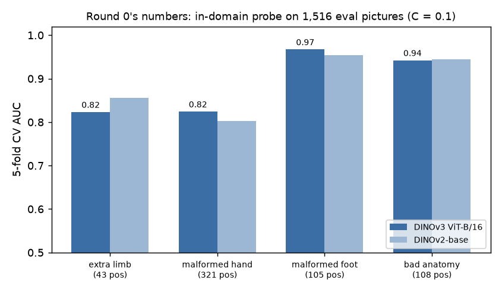
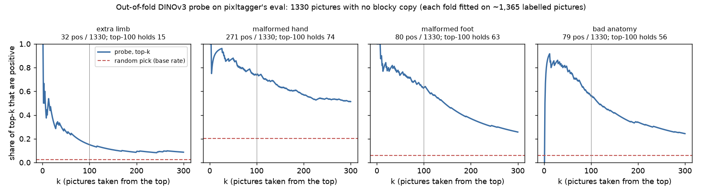
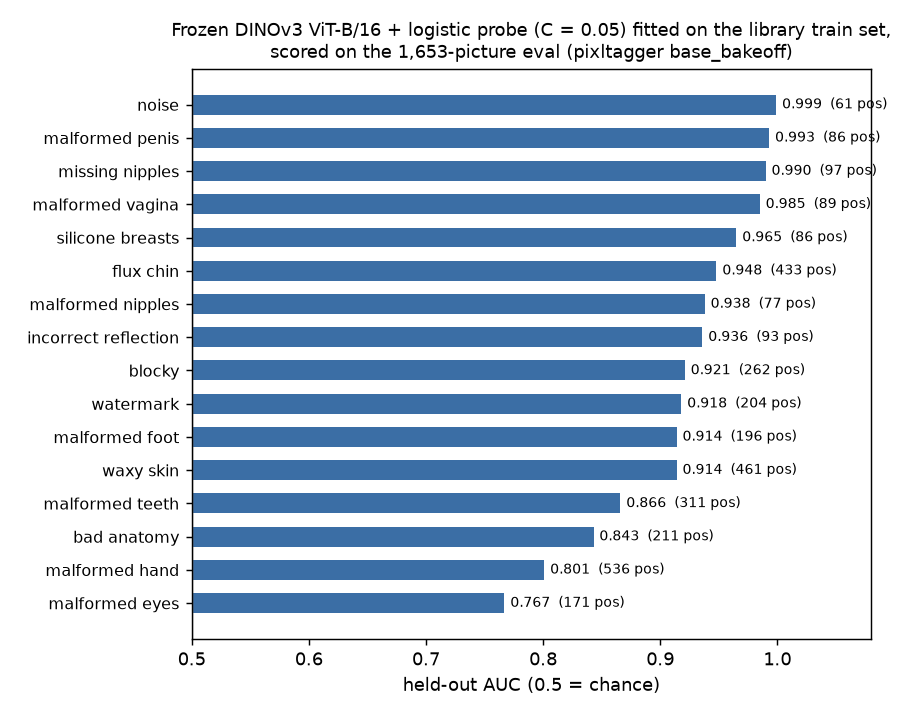

# Idea 1, round 1: backfill of the frozen-DINOv3 logistic probe (pixltagger)

This round backfills evidence from what pixltagger (`~/Projects/pixltagger`) already saved. Nothing was retrained.
`code/backfill.py` reads the saved tables and score files and writes everything in `evidence/`.

**Short answer.** On pixltagger's own labels a linear probe on frozen DINOv3 features ranks anomaly tags well: its
top 100 holds 56–74 positives for hand, foot and bad anatomy, where 6–20 would be expected by chance. It does not
answer #2678. That question uses a different embedding (CLIP ViT-B/32), 50–200 verdicts rather than ~1,365 labelled
pictures, and the near-neighbour vote as the baseline, and the probe was never compared against that vote.

## 1. Where round 0's numbers came from

Round 0 quoted "AUC 0.82 / 0.82 / 0.97 / 0.94". They are the in-domain table in
`tmp/thirdparty/probe_results_dinov3.md` (written by `scripts/dinov3_probe.py probe`, 2026-09-09/10). The probe is
StandardScaler plus class-balanced logistic regression (C = 0.1), with 5-fold cross-validation on pixltagger's eval
labels, after the 191 blocky copies were dropped. `tmp/thirdparty/probe_results.md` holds the same table on
DINOv2-base. Round 0 said "thousands of in-house labels"; in fact each fold was fitted on about 1,213 pictures with
34–257 positives.

| tag | positives / 1,516 | CV AUC, DINOv3 ViT-B/16 | CV AUC, DINOv2-base |
|---|---|---|---|
| extra limb | 43 | 0.823 | 0.856 |
| malformed hand | 321 | 0.824 | 0.803 |
| malformed foot | 105 | 0.967 | 0.954 |
| bad anatomy | 108 | 0.942 | 0.945 |

`evidence/indomain_cv_auc.csv`. The plot below is new in this round:

## 2. What lands in the probe's top 100 (new in this round)

`tmp/loop/scores/probe_eval_oof.json` holds the 5-fold out-of-fold probe scores (C = 0.1, DINOv3 ViT-B/16, from
`dinov3_probe.py score --train-set eval --set eval`, 2026-09-10). Labels come from `tmp/thirdparty/feats_dinov3/eval.json`.
Nobody had turned those scores into top-k numbers or a plot, so this round did.

That run kept the blocky copies in the training data, so a copy and its source could sit in different folds and
inflate each other's scores. The table below therefore scores only the 1,330 pictures that are neither a copy nor a
source (pairs from `tmp/blocky_eval_sources.json`). The table that keeps them is
`evidence/oof_probe_top100_with_copies.csv`; for example, extra limb reads 32 in its top 100 there instead of 15.

| tag | positives / 1,330 | base rate | AUC | P@10 | P@50 | P@100 | positives in top 100 | lift at 100 |
|---|---|---|---|---|---|---|---|---|
| malformed hand | 271 | 0.20 | 0.822 | 0.90 | 0.88 | 0.74 | 74 | 3.6× |
| malformed foot | 80 | 0.06 | 0.971 | 0.90 | 0.74 | 0.63 | 63 of 80 | 10.5× |
| bad anatomy | 79 | 0.06 | 0.943 | 0.90 | 0.78 | 0.56 | 56 of 79 | 9.4× |
| extra limb | 32 | 0.02 | 0.831 | 0.40 | 0.26 | 0.15 | 15 of 32 | 6.2× |

All 17 tags are in `evidence/oof_probe_top100.csv`. Where a tag has fewer than 100 positives, P@100 is capped by that
count, so the "of N" column is the fair reading.

## 3. More labels, other backbones (saved table, plot new)

`tmp/base_bakeoff/results.md` comes from `scripts/base_bakeoff.py` (2026-10-23, C = 0.05). A probe is fitted on the whole
library train set (16,662 pictures, per `docs/plan-vit-base.md`) and scored on the 1,653-picture eval.
`evidence/bakeoff_probe_auc.csv` holds all three backbones.

Even with roughly 12× the labels of section 1, hand (0.80), bad anatomy (0.84) and eyes (0.77) stay the weakest tags.

## 4. Labels from someone else's rubric (saved table)

From `tmp/thirdparty/probe_results_dinov3.md`: the probe was fitted on HAD or AbHuman labels and scored on
pixltagger's eval. In `evidence/transfer_had_abhuman_dinov3.csv` the eval AUCs run 0.68–0.90. The same features reach
0.82–0.97 with pixltagger's own labels (section 1). The doc's conclusion is that "the gap is label semantics": the
probe learns whatever rubric the labels carry.

## 5. Round 0's F1 claim

The source is `tmp/thirdparty/run177.log` and `run176.log`, on the clean held-out eval of 128 pictures with 88 foot positives.

| run | what it is | clean foot F1 [CI] | clean hand F1 | anomaly macro-F1 overall |
|---|---|---|---|---|
| run-176 | fully fine-tuned | 0.679 [0.590, 0.755] | — | — |
| run-177 (epoch 2, interrupted) | frozen DINOv3 + linear head | 0.815 [0.757, 0.867] | 0.439 | 0.425 (vs 0.707 for run-166: **rejected**) |

run-177 is a linear head trained by the trainer, not this sklearn probe. It won on foot and was rejected overall.
Round 0 quoted the foot number and left out the rejection.

## 6. What none of this covers

- **The embedding.** All the evidence is DINOv3 ViT-B/16 (768-d, 512 px). None of it uses the 512-number CLIP
  ViT-B/32 vector PixlStash stores. The one pixltagger note on CLIP (`docs/plan-iqa-tagger-automated.md:154`) says
  CLIP nearest neighbours "does NOT work for watermark (returns content-neighbours, not watermark-neighbours)". That
  is a single tag and a different method.
- **The label count.** The smallest fit here is about 1,213 pictures. Nothing is saved at 50, 100 or 200 verdicts.
  `scripts/crop_learning_curve.py` exists (DINOv2-S hand crops), but no output from it was found.
- **The baseline.** The probe was compared with HADM, pixltagger's own fine-tuned head, and chance. It was never
  compared with PixlStash's near-neighbour vote.
- **The labels.** These are curated eval labels, not confirm/reject verdicts from review, so the negatives here are
  ordinary pictures, not near-misses.

Not asked: no question was sent to the notebook assistant. Nothing in the backfill depended on another idea.
