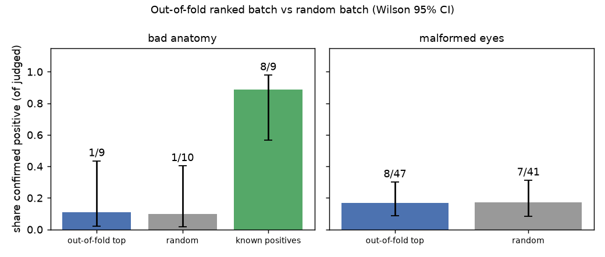
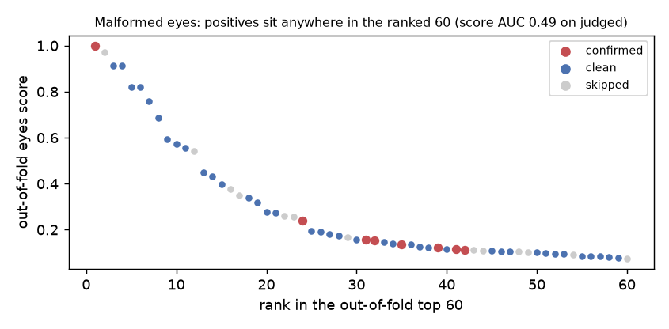

# Out-of-fold ranking to surface pictures worth judging (pixltagger) — round 1, backfill

Backfilled from `~/Projects/pixltagger`, as the reviewer asked. Nothing was re-run. Every table and plot
below was made now by `code/backfill.py` from the verdict files the games left behind; the earlier work had
the numbers only as prose in `docs/plan-everything-over-0.6.md`, plus one bad-anatomy table that a
pixltagger notebook round had already backfilled (commit `b68c2c7`, `research/investigate-the-bad-anatomy-rank/…/surfacing_game.csv`).
My recount of that game matches it exactly.

**What was tested (both games, 2026-09-18).** `scripts/twofold.py` trained two fine-tuned DINOv3 taggers, each on
half the training cache with near-duplicate families kept within one half, and each scored the half it had not
seen. The highest-scoring unlabelled pictures went into a blind game next to a random batch, and a person
judged each picture. This is a much stronger ranker than the question's: a fine-tuned DINOv3 model trained on
**393** bad-anatomy and **516** malformed-eyes positives against roughly 11,300 negatives, nearly all of them
tags that were just absent (`tmp/loop/twofold_suspects.log`). The question's model is a logistic regression
on 512-number CLIP embeddings fitted on 50–200 verdicts.

## 1. Ranked batch against random batch

| tag | arm | served | skipped | judged | confirmed | rate (of judged) | Wilson 95% CI |
|---|---|---:|---:|---:|---:|---:|---|
| bad anatomy | out-of-fold top | 10 | 1 | 9 | 1 | 0.111 | 0.020–0.435 |
| bad anatomy | random | 10 | 0 | 10 | 1 | 0.100 | 0.018–0.404 |
| bad anatomy | known positives (salt) | 10 | 1 | 9 | 8 | 0.889 | 0.565–0.980 |
| malformed eyes | out-of-fold top 60 | 60 | 13 | 47 | 8 | 0.170 | 0.089–0.301 |
| malformed eyes | random 58 | 58 | 17 | 41 | 7 | 0.171 | 0.085–0.313 |

`evidence/surfacing_games.csv`. One-sided Fisher exact test, ranked > random (`evidence/ranked_vs_random.csv`):

| tag | ranked | random | difference | p |
|---|---|---|---:|---:|
| bad anatomy | 1/9 | 1/10 | +0.011 | 0.74 |
| malformed eyes | 8/47 | 7/41 | −0.001 | 0.62 |

Sources:
- bad anatomy: `tmp/loop/ba_paired_meta.json` (which arm each picture was in) and `tmp/loop/ba_paired_game/verdicts.json`.
  The salted known positives meter the judge's attention: 8 of 9 were caught, so the clean calls were trustworthy.
- malformed eyes, ranked: game `mine_eyes_oof` in `tmp/loop/judged_tags.jsonl`, the top 60 of 2,257 unlabelled
  large-face pictures in one half, scored by the model trained on the other half (`tmp/loop/oof_eyes_score.log`,
  `tmp/loop/mine_eyes_oof/`).
- malformed eyes, random: game `mine_eyes_c6` in the same ledger, a random 58 from the largest embedding cluster.
  The plan calls the two "matched (both 60 pictures, 12% vs 13% prevalence)"; those are the rates of *served*
  pictures (7/58 and 8/60), and the rates of judged pictures are equal too. One caveat: the random arm is drawn
  from one cluster, not from the ranked arm's pool. The plan compares that cluster's 17% with 19% in an earlier
  whole-cache game (`mine_eyes3`), but that game was picked by in-sample score, so it is not a clean random reference.

**What the plan predicted before the eyes game:** "Expect 40%+ positives per game rather than 17% … nearer 40%
than 75%" (`docs/plan-everything-over-0.6.md`). The ranked batch's upper 95% bound is 30%.

## 2. Inside the ranked eyes batch, the score did not order the positives

| ranks | score range | judged | confirmed | rate |
|---|---|---:|---:|---:|
| 1–20 | 0.277–0.999 | 16 | 1 | 0.062 |
| 21–40 | 0.117–0.272 | 17 | 5 | 0.294 |
| 41–60 | 0.076–0.117 | 14 | 2 | 0.143 |
| score AUC over the 47 judged | | 47 | 8 | **0.487** |

`evidence/eyes_ranked_thirds.csv`, `evidence/eyes_ranked_by_score.csv`, from `tmp/loop/mine_eyes_oof/top60_scores.json`.
Made now; no earlier plot or table of this existed.

## 3. Context the plan records, not recomputed here

- **Held out, the same kind of score ranked well:** on the clean eyes eval it reached AUC 0.874, with 75% positives
  in its top 60 against a 33% base rate. On unlabelled training pictures it found nothing beyond random. A ranker
  that looks good on held-out verdicts did not find new positives — the gap idea 5 is designed to expose.
- **Other surfacing signals on the random eyes sample** (41 judged): the in-sample model score AUC 0.456;
  max cosine to a known positive, the near-neighbour style signal, 0.555; mean of top-10 cosines 0.500.
- **Judge sensitivity:** a retest put the judge's sensitivity at about 53–56% in low-prevalence games. A constant
  miss rate affects both arms alike, so the comparison stands, but every absolute rate above is a floor.
- A related use, finding *wrong* labels (an out-of-fold DINOv3 probe ranking eval pictures whose tags it doubted),
  removed 13 of 85 model-only tags (15%) in one game (`tmp/loop/SUMMARY.md`, "Eval tightening batch 1"). It had
  no random arm, so it says nothing about enrichment.

## What is missing

- No game with a larger random arm for bad anatomy: 9 vs 10 judged pictures can only detect an enormous gap.
- No out-of-fold scores for the random eyes pictures (they are not in `tmp/loop/scores/oof_eyes_foldB.json`),
  so the ranker's AUC on an unbiased sample cannot be computed.
- No test of the question's own ranker (CLIP logistic regression on 50–200 verdicts) or of the near-neighbour vote.

## Verdict

**Negative.** In both matched games the out-of-fold ranked batch held the same share of confirmed positives as a
random batch (bad anatomy 11% vs 10%, eyes 17% vs 17%), and inside the ranked eyes batch the score did not order
the positives (AUC 0.49). The eyes game rules out the 40% the plan expected. The bad-anatomy game is too small to
rule out a modest gain. This was a stronger model with far more labels than #2678's classifier would have, so it
lowers the odds for that classifier on detail-defect tags; it says nothing about broad tags such as a setting or
a clothing item.
