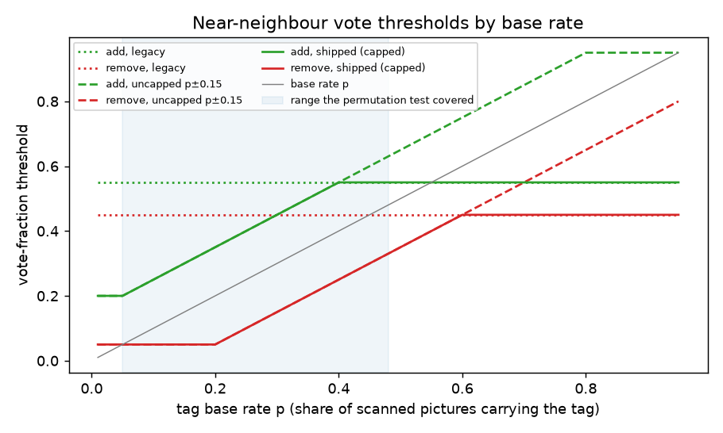
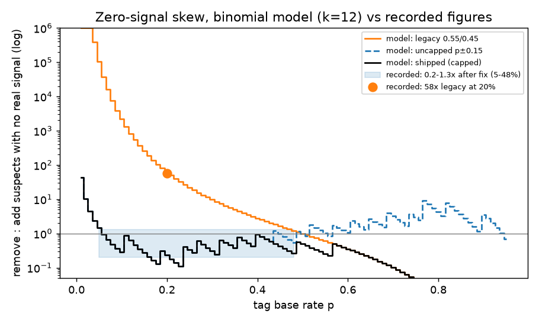

# 3 · Base-rate-relative thresholds for the near-neighbour vote, round 1 (backfill)

Round 0 was sent back with "backfill this from what already exists; look in ~/Projects/pixltagger".

## Where the evidence is (and isn't)

- **pixltagger has no trace of this idea.** Its repository, docs and git history mention neither the base-rate
  thresholds, the permutation test, the 36,318-embedding library nor the 58x skew. That checkout's work is the
  DINOv3 anomaly tagger (ideas 1 and 2), not PixlStash's near-neighbour scan.
- **The record is in PixlStash:** commits `6c79e6de5` (2026-07-16, "cold-start fallback and base-rate-relative
  thresholds") and `02fe21c2f` (same day, "cap base-rate threshold shift at the legacy default"), the long
  comments above `BASE_RATE_THRESHOLD_MARGIN` and `MIN_GROUND_TRUTH_FOR_VOTE` in
  `pixlstash/services/tag_scan_service.py`, and three tests in `tests/test_tag_suggestions_api.py`
  (`…base_rate_default_thresholds_vs_explicit_override`, `…majority_tag_regression`,
  `…confidence_fallback_for_new_tag`).
- **Missing:** the permutation test's script, its per-base-rate table and the numbers for "malformed hand" and
  "waxy skin". The code comment points to "PR/session notes"; the carrying PR (#528) has none, and the July
  session transcript was not found. Only the summary figures below survive.

## Recorded figures (from the commits and code comments)

From `evidence/recorded_claims.csv`, which gives the exact source of each row.

| Claim | Recorded value |
|---|---|
| Library the permutation test ran on | 36,318 real embeddings, labels shuffled |
| Legacy 0.55/0.45, zero real signal | remove:add up to **58x** at a 20% base rate; adds "effectively unreachable" at low base rates |
| p ± 0.15 (uncapped), base rates 5–48% | remove:add **0.2–1.3x** |
| Real tags with genuine separation | "malformed hand", "waxy skin" still off 1.0 (numbers not recorded) |
| Uncapped formula on a majority tag | "man", p = 0.61: legacy finds 1 add suspect, p + 0.15 = 0.76 finds 0, hence the cap |
| Tag with zero positives | vote fraction 0.0 for every picture; separate fallback to tagger confidence added |

## Plots made now

Both come from `code/thresholds.py`, made this round. Nothing was re-run on the library.

**The thresholds**, computed with the same formula as `scan_tag` (`evidence/thresholds_vs_base_rate.csv`):

The cap, added after the permutation test, changes the add threshold for every base rate above 0.40. So 0.40–0.48,
inside the tested range, ships different thresholds from the ones that were measured. Below p = 0.20 the shipped
remove threshold is 0.05: a tagged picture is a remove suspect only if none of its 12 neighbours carries the tag.

**Zero-signal skew, binomial model.** With shuffled labels each of the 12 neighbours carries the tag with probability
p, so the vote is about Binomial(12, p)/12 (the real vote is cosine-weighted, so this is an approximation). The
recorded figures are overlaid. Data: `evidence/zero_signal_skew_model.csv`.

| base rate | legacy remove:add | uncapped | shipped | legacy expected adds (of 36,318) | shipped expected adds |
|---|---|---|---|---|---|
| 0.05 | 106,000 | 1.45 | 1.45 | 0.0 | 675 |
| 0.10 | 2,210 | 0.28 | 0.28 | 1.6 | 3,624 |
| 0.20 | **62.8** | 0.24 | 0.24 | 113 | 2,108 |
| 0.30 | 9.8 | 0.31 | 0.31 | 981 | 2,996 |
| 0.40 | 2.8 | 0.95 | 0.95 | 3,448 | 3,448 |
| 0.48 | 1.22 | 0.55 | 0.26 | 6,313 | 6,313 |
| 0.61 | 0.32 | 2.33 | 0.32 | 9,792 | 9,792 |

(`evidence/zero_signal_skew_summary.csv`.) The model gives 63x at 20% where 58x was recorded, and 0.24–1.45x across
5–48% where 0.2–1.3x was recorded, so the surviving summary is consistent with the mechanism. Below 5% the
shipped skew climbs again (44x at 1%), because the base rate is clamped at 0.05. That range was never tested.

## Against the question

- The thresholds only decide which pictures are **eligible**. Add suspects are still ranked by the same vote
  fraction, so a top-100 list changes only where the legacy 0.55 bar let fewer than 100 through. By the model,
  with no real signal, that is tags below about 20% base rate.
- No surviving number says how many of the vote's suggestions a person **confirmed**, before or after the change.
  The evidence is about direction balance (remove against add), not precision.
- A tag with no confirmed pictures still gets no vote at all. The fallback only works for tags the tagger model
  already predicts; a brand-new user tag has neither. That is the case #2678 asks about.

**Verdict: inconclusive.** The change fixed a real, large bias in the baseline's eligibility: 58x falls to about 1x,
and the model reproduces both figures. Nothing measured shows that it puts more confirmed pictures in the vote's
top 100, which is what the question compares.
