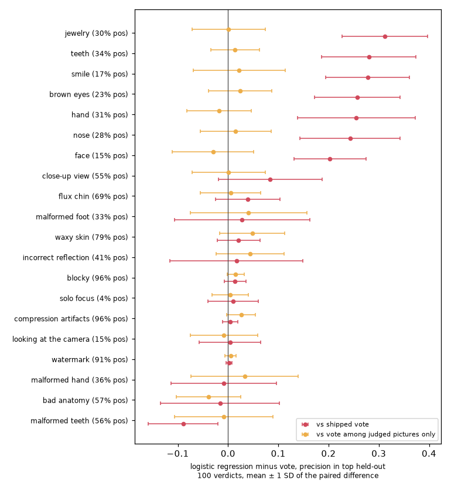
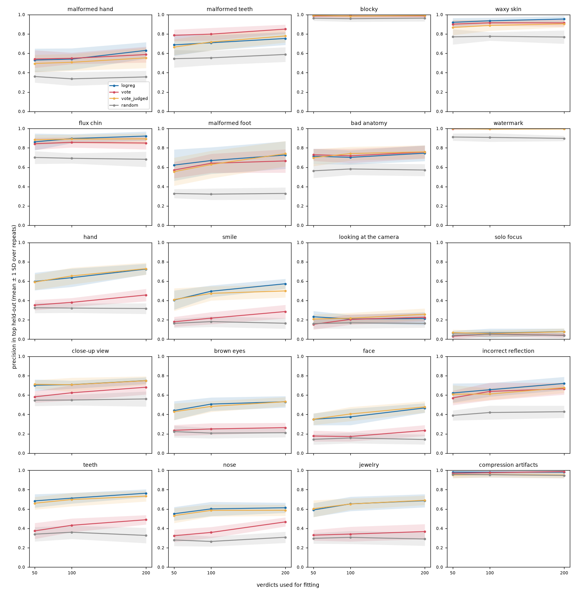
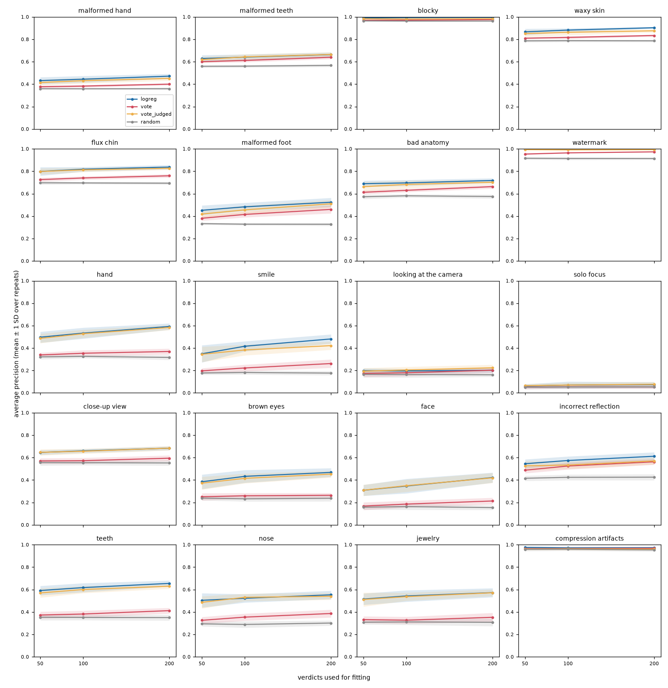

# Idea 4, round 1: CLIP logistic regression vs the near-neighbour vote on held-out verdicts

**Data.** There are 44,426 human verdicts on 528 tags, read through `GET /tag_predictions/labels`. Stored CLIP ViT-B/32 embeddings were exported for 20,984 pictures: the 10,944 that carry a verdict, plus 10,040 unjudged pictures from the library listing (`code/export_data.py`, run by the owner). This round tests the 20 tags with the most verdicts (`evidence/tags.csv`).

**Protocol** (`code/experiment.py`):
- **Repeats and splits.** 20 repeats per tag. Each repeat shuffles the tag's verdicts and keeps everything after the first 200 as the test set, so the test set is the same at 50, 100 and 200. Each method is fitted on the first n verdicts.
- **Methods compared:**
  - **logreg:** logistic regression on unit-norm, standardised embeddings. C is chosen by 3-fold cross-validation inside the n training verdicts only.
  - **vote:** the shipped kernel (`pixlstash/utils/near_neighbor.py`, copied unchanged). It takes the 12 nearest pictures in the whole 21k pool and counts a picture as tagged only if it is a training POS. A self-test confirms the precomputed-neighbour version matches the kernel exactly.
  - **vote, judged only:** the same weighted vote, but neighbours come only from the n training verdicts (POS = 1, NEG = 0), so the vote sees the rejects too.
  - **random.**
- **Metrics:**
  - **P@50:** the share of confirmed pictures among each method's top 50 held-out pictures. Every test set has at least 370 pictures.
  - **AP:** average precision.
  - **Clearly ahead:** logreg's mean minus 1 SD is above the other method's mean plus 1 SD (the ±1 SD bands do not overlap).
- **Compute.** CPU only, about 2 minutes. The run is reproducible: a second run gave a byte-identical `summary.csv`.

## Result at 100 verdicts

| | P@50 clearly ahead | AP clearly ahead |
|---|---|---|
| logreg vs shipped vote, 50 verdicts | 8 / 20 tags | 15 / 20 |
| **logreg vs shipped vote, 100 verdicts** | **7 / 20 tags** | **15 / 20** |
| logreg vs shipped vote, 200 verdicts | 7 / 20 tags | 14 / 20 |
| logreg vs vote over judged pictures only, 100 verdicts | 0 / 20 | 1 / 20 |
| shipped vote vs logreg (the other way), any n | 0 / 20 | 0 / 20 |

The idea's success bar is "clearly ahead on at least three tags at 100 verdicts", and it is met against the shipped vote. The gain is large on visible-content tags: jewelry, teeth, smile, brown eyes, hand, nose and face gain +0.20 to +0.31 in P@50, every repeat won. On the defect tags the gain is small or absent. On malformed teeth the shipped vote is ahead in P@50 (0.80 against 0.71), though not outside the spread.

**The catch:** a near-neighbour vote that looks only at the judged verdicts, so it uses the rejects, matches the logistic regression on every tag. The win comes from voting against judged pictures (rejects included) rather than from the straight-line boundary. The shipped vote counts all 21k pictures without a training POS as untagged. With roughly 30 positives among them, it gives a score of 0 to 95–98% of held-out pictures on the content tags (column "vote > 0"), and its ranking is then mostly a random draw among ties.

| tag | held-out POS rate | vote > 0 | P@50 logreg | P@50 vote | P@50 vote, judged only | AP logreg | AP vote | AP vote, judged only | clear vs vote (P@50 / AP) | clear vs judged-only vote (P@50 / AP) |
|---|---|---|---|---|---|---|---|---|---|---|
| jewelry | 30% | 4% | 0.65 ± 0.07 | 0.34 ± 0.08 | 0.65 ± 0.06 | 0.54 ± 0.05 | 0.33 ± 0.03 | 0.54 ± 0.04 | **yes** / **yes** | no / no |
| teeth | 34% | 5% | 0.71 ± 0.05 | 0.43 ± 0.07 | 0.70 ± 0.07 | 0.62 ± 0.04 | 0.38 ± 0.03 | 0.60 ± 0.03 | **yes** / **yes** | no / no |
| smile | 17% | 2% | 0.50 ± 0.06 | 0.22 ± 0.06 | 0.47 ± 0.07 | 0.42 ± 0.04 | 0.22 ± 0.03 | 0.38 ± 0.05 | **yes** / **yes** | no / no |
| brown eyes | 23% | 2% | 0.51 ± 0.07 | 0.25 ± 0.06 | 0.48 ± 0.06 | 0.43 ± 0.06 | 0.26 ± 0.03 | 0.42 ± 0.04 | **yes** / **yes** | no / no |
| hand | 31% | 3% | 0.64 ± 0.09 | 0.38 ± 0.05 | 0.65 ± 0.09 | 0.53 ± 0.05 | 0.35 ± 0.03 | 0.53 ± 0.04 | **yes** / **yes** | no / no |
| nose | 28% | 3% | 0.60 ± 0.07 | 0.36 ± 0.06 | 0.59 ± 0.06 | 0.52 ± 0.04 | 0.35 ± 0.03 | 0.53 ± 0.03 | **yes** / **yes** | no / no |
| face | 15% | 2% | 0.38 ± 0.08 | 0.17 ± 0.05 | 0.41 ± 0.07 | 0.35 ± 0.06 | 0.19 ± 0.03 | 0.35 ± 0.05 | **yes** / **yes** | no / no |
| close-up view | 55% | 7% | 0.71 ± 0.04 | 0.62 ± 0.08 | 0.71 ± 0.07 | 0.66 ± 0.02 | 0.57 ± 0.03 | 0.66 ± 0.02 | no / **yes** | no / no |
| flux chin | 69% | 14% | 0.90 ± 0.05 | 0.86 ± 0.05 | 0.89 ± 0.04 | 0.82 ± 0.02 | 0.74 ± 0.02 | 0.81 ± 0.02 | no / **yes** | no / no |
| malformed foot | 33% | 10% | 0.67 ± 0.14 | 0.64 ± 0.10 | 0.63 ± 0.14 | 0.48 ± 0.04 | 0.41 ± 0.03 | 0.46 ± 0.04 | no / **yes** | no / no |
| waxy skin | 79% | 12% | 0.94 ± 0.03 | 0.92 ± 0.03 | 0.89 ± 0.06 | 0.88 ± 0.02 | 0.82 ± 0.01 | 0.86 ± 0.03 | no / **yes** | no / no |
| incorrect reflection | 41% | 22% | 0.66 ± 0.07 | 0.64 ± 0.09 | 0.61 ± 0.06 | 0.57 ± 0.04 | 0.53 ± 0.03 | 0.53 ± 0.03 | no / no | no / no |
| blocky | 96% | 16% | 1.00 ± 0.00 | 0.99 ± 0.02 | 0.98 ± 0.02 | 0.99 ± 0.00 | 0.97 ± 0.00 | 0.98 ± 0.01 | no / **yes** | no / **yes** |
| solo focus | 4% | 0% | 0.06 ± 0.05 | 0.05 ± 0.02 | 0.06 ± 0.03 | 0.07 ± 0.03 | 0.05 ± 0.02 | 0.07 ± 0.02 | no / no | no / no |
| compression artifacts | 96% | 23% | 0.98 ± 0.01 | 0.98 ± 0.01 | 0.96 ± 0.03 | 0.97 ± 0.01 | 0.97 ± 0.01 | 0.96 ± 0.01 | no / no | no / no |
| looking at the camera | 15% | 2% | 0.21 ± 0.04 | 0.20 ± 0.05 | 0.22 ± 0.06 | 0.20 ± 0.02 | 0.18 ± 0.03 | 0.20 ± 0.03 | no / no | no / no |
| watermark | 91% | 36% | 1.00 ± 0.00 | 1.00 ± 0.01 | 0.99 ± 0.01 | 1.00 ± 0.00 | 0.96 ± 0.00 | 0.99 ± 0.01 | no / **yes** | no / no |
| malformed hand | 36% | 4% | 0.54 ± 0.11 | 0.55 ± 0.06 | 0.51 ± 0.09 | 0.44 ± 0.03 | 0.38 ± 0.01 | 0.43 ± 0.02 | no / **yes** | no / no |
| bad anatomy | 57% | 16% | 0.70 ± 0.07 | 0.72 ± 0.07 | 0.74 ± 0.07 | 0.70 ± 0.03 | 0.63 ± 0.02 | 0.68 ± 0.03 | no / **yes** | no / no |
| malformed teeth | 56% | 8% | 0.71 ± 0.08 | 0.80 ± 0.06 | 0.72 ± 0.09 | 0.64 ± 0.03 | 0.61 ± 0.01 | 0.64 ± 0.02 | no / no | no / no |

Mean ± 1 SD over 20 repeats. Some tags have fewer valid repeats at n = 50 because draws with fewer than 2 of one class are skipped: blocky, compression artifacts, solo focus and watermark (`repeats` in `evidence/summary.csv`).

## Learning curves

Going from 50 to 200 verdicts helps every method a little, for example teeth logreg AP from 0.59 to 0.66 and hand from 0.50 to 0.59. None of the curves changes rank order.

## Limits

- Held-out verdicts come from pictures someone chose to review, so positives run 15–96%, far above the library's own rate. P@50 here is not "confirms among the top 100 of the library". Idea 5 measures that.
- The shipped vote is fed only the training verdicts, as the idea specifies. In the app it votes against every existing tag, including the tagger's, so this tests the "teach a tag from verdicts" setting of #2678, not the app's vote on a mature tag.
- Three tags are at least 91% positive in their verdicts: blocky, compression artifacts and watermark. They leave no room to separate the methods.
- On the defect tags (malformed hand, bad anatomy, malformed teeth, incorrect reflection), the three methods sit close together and AP is only 0.08 to 0.15 above chance. Idea 9 (a stronger embedding) covers that gap.
- The 10,040 unjudged pictures are whatever `GET /pictures` listed. If that listing returns only part of the library, the shipped vote saw a smaller pool than in the app.
