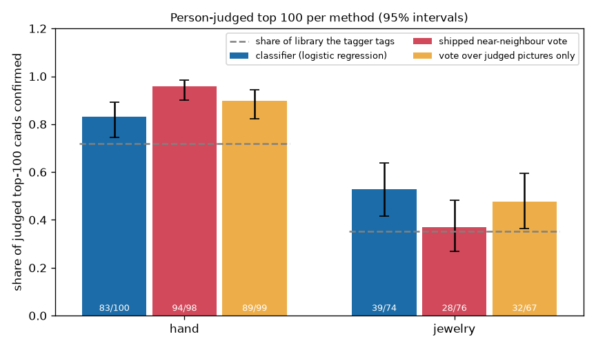

# Idea 5, round 1: a person judges each method's top 100

**Setup** (`code/build_lists.py`, `code/review.py`):
- **Data.** Idea 4's export of the owner's library: human verdicts, plus stored CLIP ViT-B/32 embeddings for all 20,984 pictures. That is the whole library: `count_pictures` gives the same number.
- **Methods.** For each tag, 100 of its human verdicts are drawn at random (seed fixed) as training. Three methods each rank every picture with no verdict on that tag:
  - **classifier:** logistic regression, idea 4's fit;
  - **shipped vote:** the shipped near-neighbour vote, k = 12 over the whole library, where a picture counts as tagged only if it is a training "yes";
  - **vote over judged only:** the same vote, with neighbours drawn only from the 100 training verdicts (follow-up 4.1).
- **Judging.** Each method's top 100 went into one shuffled list review (#2676), with 10% known-answer pictures mixed in. The cards carried no method labels.
- **Tags.** The owner judged **hand** in full. On **jewelry** they stopped part way, about 210 of 290 cards. The list is shuffled, so the cards judged are a fair sample of each method's 100. Rates below are over judged cards. Teeth was built but not judged.

## Result

| tag | classifier | shipped vote | vote over judged only | classifier vs shipped vote (Fisher p) |
|---|---|---|---|---|
| hand | 83 / 100 (83%) | **94 / 98 (96%)** | 89 / 99 (90%) | **0.005: the vote is ahead** |
| jewelry | **39 / 74 (53%)** | 28 / 76 (37%) | 32 / 67 (48%) | 0.07: the classifier is ahead, not clearly |

- **Bar.** The idea's bar is "the classifier's confirm count is clearly higher on at least a few tags". That bar is met on **0 of 2** tags, and the classifier is clearly behind on hand.
- **Vote over judged only.** It sits between the other two on both tags, and is not clearly different from either (p ≥ 0.16; `evidence/pairwise.csv`).
- **Against idea 4.** Idea 4 measured the classifier +26 points ahead of the shipped vote on hand and +31 on jewelry, on held-out verdicts. Here it comes out −13 on hand and +16 on jewelry. Ranking pictures someone already judged did not predict ranking the library.

**Near-twins.** At most 1 confirmed picture per method was a near-twin of a training picture (cosine ≥ 0.95; `evidence/confirms_*.csv`), so no method won by finding copies. The shipped vote's picks still sit much closer to the training "yes" pictures. Median cosine to the nearest training picture (`evidence/lists.csv`):

| | classifier | shipped vote | vote over judged only |
|---|---|---|---|
| hand | 0.56 | 0.80 | 0.54 |
| jewelry | 0.65 | 0.77 | 0.61 |

The two tags fit one reading: on a common tag, staying close to known "yes" pictures pays off; on a small, easily missed feature like jewelry it does not.

**Overlap.** The three top-100 lists barely overlap (`evidence/lists.csv`):
- hand: 2 to 5 pictures in common for any pair;
- jewelry: 6 to 20;
- across 5 tags built: 260 to 294 distinct cards per tag.

## How reliable the judging was

The known-answer pictures show how often the owner repeated an earlier verdict on the same picture (`evidence/controls.csv`):

| tag | earlier "yes" repeated | earlier "no" repeated | skipped | not reached |
|---|---|---|---|---|
| hand | 14 / 16 | 10 / 14 | 2 | 0 |
| jewelry | 6 / 11 | 5 / 7 | 2 | 9 |

- **Jewelry.** Today the owner repeated only about half of their earlier "yes" verdicts. In their words, it was "300 pictures with a tiny piece of jewelry". Whether a small earring counts is a judgement call, so jewelry verdicts are noisy, both the 100 the classifier trained on and the ones judged here.
- **Hand.** 4 of 14 earlier "no" verdicts became "yes". That may reflect the wrist-only and partial-hand question the owner raised during judging.

## Limits

- **Two tags, not "a few".** The person found the games too long: 290 cards per tag, many of them near-repeats to the eye, though CLIP calls only 25 to 45 of hand's 291 cards repeats at similarity ≥ 0.90.
- **Hand is common.** The tagger tags 72% of the library "hand", so all three methods sit near the top of the scale. Tagger counts are not the person's base rate, and no random batch was judged, so how far each method sits above chance is not known.
- **One training draw per tag.** It is not repeated, so the spread across draws is not known. Idea 4 found a 5 to 9 point standard deviation in this kind of score at 100 verdicts.
- **What the shipped vote saw.** It used only the training verdicts as tagged pictures, as in idea 4. In the app it also counts the tagger's tags.
- **Unused short version.** `code/short_list.py` builds a shortened game: 30 per method with repeats collapsed at 0.90, plus 30 random pictures. It was built for jewelry but never judged, because the long review was still open (409). It produced no evidence here.
