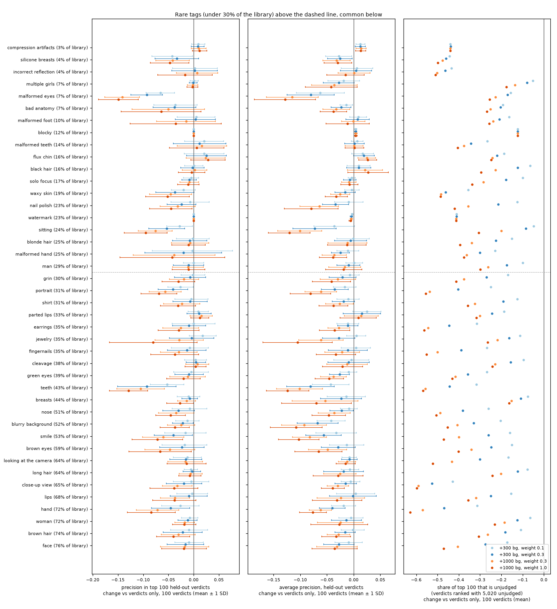

# Idea 6, round 1: random unjudged pictures as background negatives

**Data.** Idea 4's export: 44,426 human verdicts on 528 tags, and the stored CLIP ViT-B/32 embeddings of the whole library (20,984 pictures). 10,040 pictures carry no verdict on any tag; these are the unjudged pictures. The test covers every tag with at least 300 verdicts and at least 20 of each kind: 42 tags. Each tag's library share comes from the MCP `list_tags` count (`evidence/tag_prevalence.csv`).

**Rare and common tags are reported apart**, as the research assistant advised (question q4). The idea assumes that most pictures lack the tag. That holds for the 19 tags on under 30% of the library. It does not hold for the 23 common tags: face is on 76% of pictures and hand on 72%.

**Protocol** (`code/experiment.py`, idea 4's split and logistic regression):
- **Repeats and splits.** 20 repeats per tag. Each repeat shuffles the tag's verdicts and holds out everything after the first 200, then fits on the first 50, 100 or 200.
- **Unjudged pool.** Each repeat splits the unjudged pictures in half. Background is drawn only from the first half. The second half (5,020 pictures) is never trained on.
- **Methods compared:**
  - **verdicts only:** idea 4's logistic regression.
  - **+B, weight w:** the same, plus B random unjudged pictures labelled "no" with sample weight w. Verdicts weigh 1. B is 300 or 1,000 and w is 0.1, 0.3 or 1.0.
- **Choosing C.** C is picked by 3-fold cross-validation. The background joins every training fold, and each fold is scored only on its held-out verdicts.
- **The bar, from the idea.** It counts if precision in the top 100 held-out verdicts (P@100) rises without held-out average precision (AP) falling. "Rises" and "falls" mean the paired difference over the 20 repeats is more than 2 standard errors from 0.
- **Diagnostic (the truth is not known).** The held-out verdicts are ranked together with the 5,020 unjudged test pictures, and we count how much of the top 100 is unjudged. This shows whether the background does push ordinary pictures down. It cannot say whether those pictures were wrong to be there.
- **Compute.** CPU only, 4 minutes. A second run gave a byte-identical `summary.csv`.

## Result at 100 verdicts

| tags | background | P@100 up and AP not down (counts) | P@100 down | AP down | mean change P@100 | mean change AP | unjudged in mixed top 100 (verdicts only: rare 68%, common 87%) |
|---|---|---|---|---|---|---|---|
| rare (19) | +300, weight 0.1 | **3** | 5 | 8 | -0.008 | -0.007 | 47% |
| rare (19) | +300, weight 0.3 | 2 | 7 | 10 | -0.015 | -0.014 | 42% |
| rare (19) | +300, weight 1.0 | 2 | 7 | 11 | -0.021 | -0.021 | 39% |
| rare (19) | +1000, weight 0.1 | 2 | 7 | 9 | -0.015 | -0.016 | 41% |
| rare (19) | +1000, weight 0.3 | 2 | 7 | 11 | -0.022 | -0.022 | 37% |
| rare (19) | +1000, weight 1.0 | 2 | 7 | 11 | -0.028 | -0.027 | 34% |
| common (23) | +300, weight 0.1 | 2 | 6 | 10 | -0.009 | -0.010 | 67% |
| common (23) | +300, weight 0.3 | 1 | 13 | 19 | -0.019 | -0.025 | 58% |
| common (23) | +300, weight 1.0 | 2 | 16 | 20 | -0.030 | -0.038 | 51% |
| common (23) | +1000, weight 0.1 | 2 | 12 | 15 | -0.019 | -0.025 | 55% |
| common (23) | +1000, weight 0.3 | 1 | 18 | 21 | -0.030 | -0.040 | 48% |
| common (23) | +1000, weight 1.0 | 1 | 18 | 22 | -0.040 | -0.052 | 45% |

**The idea does not hold on held-out verdicts.**
- **The mildest version wins on 3 of 19 rare tags.** That is the version the idea describes: a few hundred pictures, down-weighted (+300, weight 0.1). The three are compression artifacts, flux chin and malformed teeth, each by about 1 to 2 points of P@100. On 5 rare tags it lowers P@100 and on 8 it lowers AP. The worst is malformed eyes, down 7 points in P@100 and losing in all 20 repeats.
- **More background is worse.** More pictures or a higher weight costs more, on rare and common tags alike. 50 and 200 verdicts give the same picture (`evidence/by_variant.csv`).

**The mechanism does happen.** Background pulls unjudged pictures out of the top of a mixed ranking: on rare tags, 68% unjudged becomes 47% or 34%. So the classifier fitted on verdicts only does rank many ordinary pictures above confirmed ones, which is the concern in the idea. Pushing them down, though, also pushes down true positives among the held-out verdicts. It is not known whether the pictures that left the top 100 were negatives, because nobody judged them.

### Per tag, 100 verdicts

**Bold** = up by more than 2 standard errors of the paired difference, _italic_ = down by more than 2.

**Caveats.**
- **Small test sets.** Tags with under 400 verdicts have 100 to 199 held-out verdicts, so P@100 sits close to the held-out positive rate there. P@50 (in `summary.csv`) moves in the same direction.
- **Saturated tags.** blocky and watermark are about 95% positive, so P@100 cannot move.

| tag | library share | held-out POS rate | P@100 verdicts only | change, +300 w0.1 | change, +1000 w1.0 | AP verdicts only | change, +300 w0.1 | change, +1000 w1.0 | unjudged in mixed top 100: verdicts only → +300 w0.1 → +1000 w1.0 |
|---|---|---|---|---|---|---|---|---|---|
| compression artifacts (rare) | 3% | 96% | 0.98 | **+0.009** | **+0.012** | 0.97 | **+0.013** | **+0.013** | 46% → 2% → 2% |
| silicone breasts (rare) | 4% | 72% | 0.87 | _-0.043_ | _-0.048_ | 0.86 | _-0.028_ | _-0.029_ | 92% → 48% → 43% |
| incorrect reflection (rare) | 4% | 41% | 0.62 | +0.003 | -0.017 | 0.58 | +0.006 | -0.015 | 77% → 33% → 26% |
| multiple girls (rare) | 7% | 8% | 0.08 | +0.001 | -0.003 | 0.19 | _-0.018_ | _-0.042_ | 96% → 91% → 79% |
| malformed eyes (rare) | 7% | 69% | 0.84 | _-0.066_ | _-0.149_ | 0.87 | _-0.062_ | _-0.129_ | 97% → 81% → 71% |
| bad anatomy (rare) | 7% | 57% | 0.73 | _-0.036_ | _-0.065_ | 0.70 | _-0.014_ | _-0.038_ | 56% → 37% → 29% |
| malformed foot (rare) | 10% | 33% | 0.62 | +0.005 | -0.035 | 0.48 | **+0.009** | -0.011 | 40% → 23% → 14% |
| blocky (rare) | 12% | 96% | 1.00 | +0.000 | +0.000 | 0.99 | **+0.004** | **+0.004** | 13% → 0% → 0% |
| malformed teeth (rare) | 14% | 56% | 0.70 | **+0.021** | +0.006 | 0.65 | **+0.006** | +0.002 | 52% → 25% → 11% |
| flux chin (rare) | 16% | 69% | 0.89 | **+0.021** | **+0.029** | 0.82 | **+0.017** | **+0.027** | 33% → 15% → 9% |
| black hair (rare) | 16% | 12% | 0.17 | +0.001 | -0.004 | 0.19 | +0.009 | **+0.027** | 93% → 87% → 64% |
| solo focus (rare) | 17% | 4% | 0.06 | -0.005 | _-0.011_ | 0.07 | _-0.004_ | _-0.008_ | 85% → 75% → 51% |
| waxy skin (rare) | 19% | 79% | 0.93 | _-0.021_ | _-0.052_ | 0.89 | -0.003 | _-0.032_ | 56% → 20% → 7% |
| nail polish (rare) | 23% | 30% | 0.47 | -0.007 | _-0.045_ | 0.51 | -0.009 | _-0.079_ | 90% → 77% → 48% |
| watermark (rare) | 23% | 91% | 1.00 | +0.000 | +0.000 | 1.00 | _-0.003_ | _-0.006_ | 42% → 1% → 0% |
| sitting (rare) | 24% | 25% | 0.35 | _-0.028_ | _-0.095_ | 0.38 | _-0.036_ | _-0.121_ | 97% → 92% → 66% |
| blonde hair (rare) | 25% | 19% | 0.32 | -0.002 | -0.010 | 0.38 | -0.001 | -0.013 | 85% → 70% → 46% |
| malformed hand (rare) | 25% | 36% | 0.54 | -0.003 | -0.043 | 0.45 | _-0.011_ | _-0.038_ | 50% → 27% → 13% |
| man (rare) | 29% | 16% | 0.19 | -0.000 | -0.010 | 0.22 | +0.001 | _-0.019_ | 94% → 84% → 64% |
| grin (common) | 30% | 33% | 0.48 | -0.002 | _-0.030_ | 0.56 | -0.007 | _-0.042_ | 88% → 71% → 47% |
| portrait (common) | 31% | 44% | 0.65 | _-0.026_ | _-0.069_ | 0.66 | _-0.017_ | _-0.081_ | 87% → 62% → 32% |
| shirt (common) | 31% | 24% | 0.31 | -0.004 | _-0.031_ | 0.34 | _-0.010_ | _-0.038_ | 92% → 79% → 56% |
| parted lips (common) | 33% | 56% | 0.63 | **+0.009** | **+0.013** | 0.71 | **+0.025** | +0.009 | 87% → 68% → 55% |
| earrings (common) | 35% | 40% | 0.52 | -0.000 | _-0.029_ | 0.51 | _-0.011_ | _-0.035_ | 88% → 56% → 32% |
| jewelry (common) | 35% | 30% | 0.55 | **+0.018** | _-0.080_ | 0.55 | +0.005 | _-0.105_ | 74% → 63% → 48% |
| fingernails (common) | 35% | 41% | 0.56 | -0.007 | _-0.037_ | 0.56 | +0.004 | _-0.033_ | 87% → 61% → 32% |
| cleavage (common) | 38% | 32% | 0.39 | +0.004 | +0.004 | 0.53 | -0.004 | _-0.021_ | 84% → 74% → 60% |
| green eyes (common) | 39% | 49% | 0.67 | -0.005 | _-0.021_ | 0.68 | _-0.010_ | _-0.045_ | 86% → 59% → 43% |
| teeth (common) | 43% | 34% | 0.66 | _-0.052_ | _-0.129_ | 0.63 | _-0.043_ | _-0.124_ | 80% → 48% → 23% |
| breasts (common) | 44% | 25% | 0.41 | -0.010 | _-0.027_ | 0.64 | -0.014 | _-0.070_ | 88% → 81% → 72% |
| nose (common) | 51% | 28% | 0.54 | -0.008 | _-0.045_ | 0.52 | _-0.009_ | _-0.047_ | 79% → 53% → 28% |
| blurry background (common) | 52% | 29% | 0.42 | _-0.013_ | _-0.037_ | 0.50 | _-0.042_ | _-0.108_ | 89% → 69% → 44% |
| smile (common) | 53% | 17% | 0.40 | -0.017 | _-0.072_ | 0.42 | _-0.033_ | _-0.103_ | 85% → 69% → 38% |
| brown eyes (common) | 59% | 23% | 0.45 | -0.018 | _-0.067_ | 0.43 | -0.013 | _-0.066_ | 90% → 75% → 50% |
| looking at the camera (common) | 64% | 15% | 0.20 | _-0.013_ | -0.014 | 0.20 | _-0.008_ | _-0.015_ | 88% → 71% → 36% |
| long hair (common) | 64% | 7% | 0.12 | -0.005 | -0.007 | 0.24 | -0.007 | _-0.029_ | 88% → 80% → 63% |
| close-up view (common) | 65% | 55% | 0.69 | -0.005 | _-0.039_ | 0.66 | -0.006 | _-0.039_ | 84% → 41% → 24% |
| lips (common) | 68% | 22% | 0.42 | -0.003 | _-0.038_ | 0.44 | +0.004 | _-0.031_ | 86% → 71% → 51% |
| hand (common) | 72% | 31% | 0.58 | _-0.026_ | _-0.084_ | 0.53 | _-0.019_ | _-0.076_ | 86% → 55% → 23% |
| woman (common) | 72% | 14% | 0.19 | _-0.007_ | _-0.018_ | 0.24 | -0.005 | _-0.027_ | 94% → 88% → 71% |
| brown hair (common) | 74% | 17% | 0.26 | -0.009 | _-0.041_ | 0.28 | -0.002 | _-0.033_ | 94% → 83% → 63% |
| face (common) | 76% | 15% | 0.31 | -0.009 | -0.019 | 0.34 | -0.009 | _-0.036_ | 85% → 68% → 38% |

## What this means for the question

- **The background is not worth adding.** The held-out verdicts are the only known truth, and on them the background buys nothing worth having for a classifier fitted on 50 to 200 verdicts.
- **A side finding for idea 5.** When the classifier fitted on verdicts only ranks the library, most of its top 100 are unjudged pictures, even on rare tags (68%). So a person judging that top 100 will mostly see pictures that no held-out test here can score. The top 100 a person sees may therefore behave quite differently from the held-out numbers in idea 4.

## Files

- `code/experiment.py`: the experiment.
- `code/tables.py`: the roll-up into `evidence/by_variant.csv`.
- `code/idea4_experiment.py` and `code/near_neighbor.py`: idea 4's code, copied unchanged.
- **To run:** `python experiment.py ~/pixlstash-research-data ../evidence/tag_prevalence.csv ../evidence`, then `python tables.py ../evidence`. `python experiment.py --selftest` checks the pipeline on synthetic data.
- `evidence/runs.csv` holds every repeat. `evidence/summary.csv` holds the per tag, n and variant means, with their paired differences against verdicts only.
